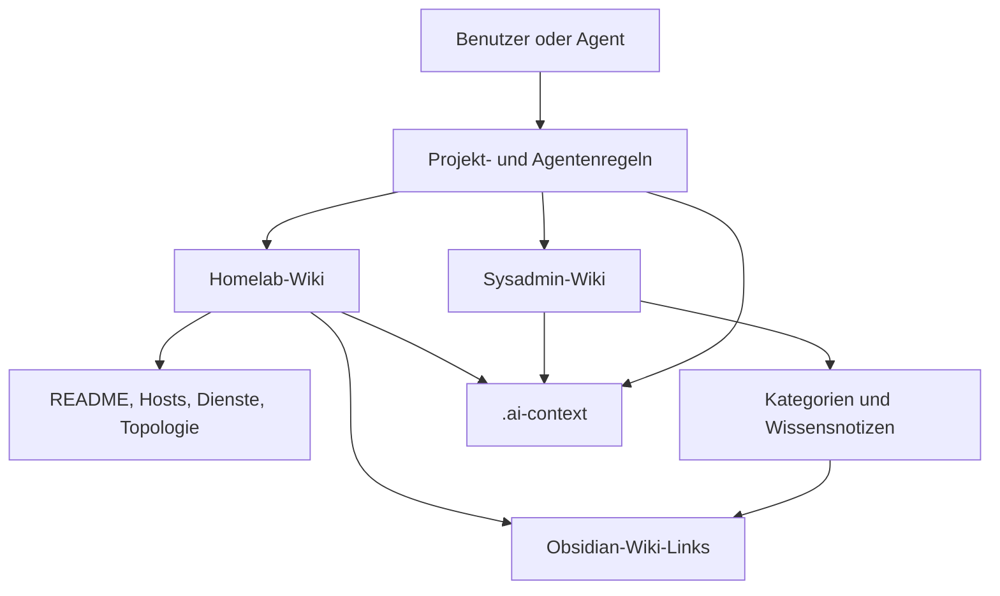

# Architektur und Informationsfluss

> [!ABSTRACT]
> Das Repository ist eine dokumentationsorientierte Obsidian-Struktur ohne Anwendungscode. Die zentrale Architektur besteht aus zwei fachlich getrennten Vaults, projektweiten Markdown-Regeln, spezialisierten Agenten und einem daraus abgeleiteten `.ai-context`.

---

## Komponenten

| Komponente | Rolle | Quelle |
|---|---|---|
| `Homelab-Wiki` | Konkrete Bestandsdokumentation für Hosts, Dienste, Netzwerk und Cloud | `Homelab-Wiki/README.md`, Server-, Service- und Topologie-Dateien |
| `Sysadmin-Wiki` | Allgemeines Wissen zu Administration, Plattformen, Security, AI, Containern, Clustering, Microsoft 365 und Virtualisierung | Kategorien unter `Sysadmin-Wiki/` |
| `.github/agents` | Spezialisierte Arbeitsweisen für Homelab- und Sysadmin-Dokumentation | `homelab-docs.agent.md`, `sysadmin-wiki.agent.md` |
| `.github/instructions` | Gemeinsame Markdown- und Obsidian-Qualitätsregeln | `markdown-docs.instructions.md` |
| `.obsidian` | Editor-, Plugin- und Vault-Konfiguration | Jeweils unter den Vaults |
| `.ai-context` | Kompakte, providerübergreifende Orientierung und Lebenszykluswissen | Diese Dateien |

---

## Daten- und Kontrollfluss

Die fachliche Quelle bleibt jeweils die Markdown-Datei. `.ai-context` enthält Navigation, beobachtete Konventionen, abgeleitete Abhängigkeiten und explizit markierte Unsicherheiten; es ersetzt keine Quellprüfung vor Änderungen.

---

## Homelab-Beziehungen

Die bestehende Homelab-Dokumentation beschreibt unter anderem Proxmox-Hosts und LXC-/VM-Systeme, WireGuard-Verbindungen zwischen Homelab und Cloud, Bind9 als internen DNS, Cloudflare als DNS-Provider, Fritzbox als lokalen Router sowie öffentliche und interne Domains. Diese Beziehungen sind dokumentierte Ist-Fakten; nicht dokumentierte Ports, Rollen oder Zugriffsdaten bleiben offen.

Für Änderungen an einem Host oder Dienst müssen mindestens die Primärdatei, `Homelab-Wiki/README.md`, betroffene Abhängigkeiten und `Homelab-Wiki/network/topology.md` auf Konsistenz geprüft werden.

---

## Deployment- und Betriebsform

Es wurde kein Software-Build, keine CI-Konfiguration, kein Deployment-Manifest, keine Datenbankmigration und keine Queue- oder API-Schicht gefunden. Die operative Veröffentlichung erfolgt daher aus der Sicht dieses Repositories über Obsidian-/Git-Arbeitsabläufe und gegebenenfalls vorhandene, aber nicht im Repository definierte externe Prozesse.

