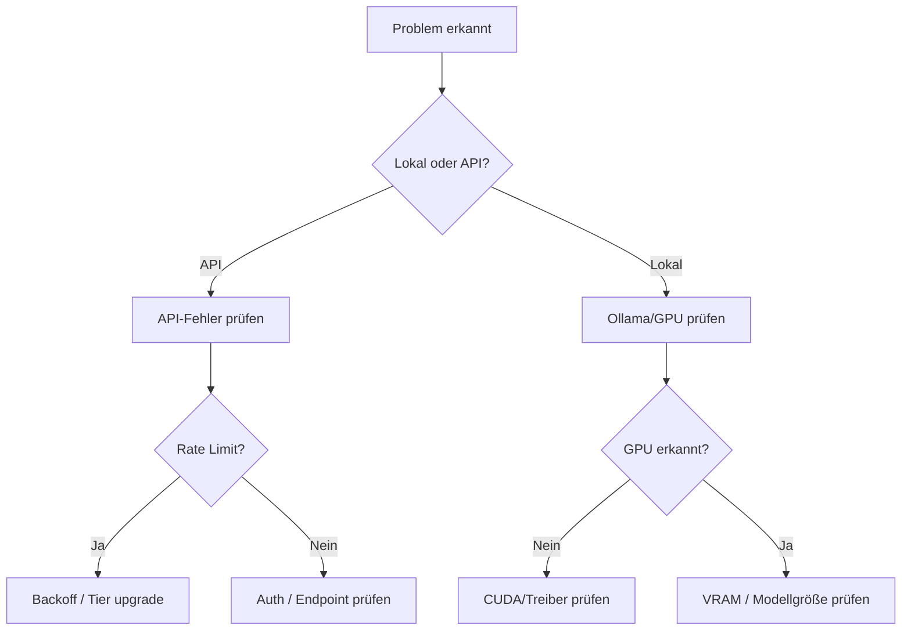

---
tags:
  - ai
  - troubleshooting
  - debugging
  - llm
  - agents
  - mcp
---

# AI Troubleshooting

> [!ABSTRACT] TL;DR
> Systematische Fehlersuche bei KI-Tools, LLMs, Agents und MCP-Servern — von API-Fehlern über Agent-Endlosschleifen bis hin zu lokalen Modell-Problemen mit Ollama. Mit Lösungstabellen, Diagnose-Checklisten und konkreten Fixes.

---

## Debugging-Strategie



---

## LLM-API-Fehler

### Häufige HTTP-Fehlercodes

| Code | Bedeutung | Ursache | Lösung |
|------|-----------|---------|--------|
| `401` | Unauthorized | API-Key ungültig oder abgelaufen | Key erneuern, Umgebungsvariable prüfen |
| `403` | Forbidden | Kein Zugriff auf das Modell | Plan/Tier prüfen, Modell-Verfügbarkeit checken |
| `429` | Too Many Requests | Rate Limit erreicht | Exponential Backoff, Request-Rate reduzieren |
| `500` | Internal Server Error | Provider-Problem | Warten und erneut versuchen |
| `503` | Service Unavailable | Überlastung beim Provider | Fallback-Modell oder Provider wechseln |
| `529` | Overloaded | API ist überlastet (Anthropic) | Warten, Retry mit Backoff |

### Rate Limits debuggen

```bash
# API-Antwort-Header prüfen (OpenAI-Beispiel)
curl -I https://api.openai.com/v1/chat/completions \
    -H "Authorization: Bearer $OPENAI_API_KEY"

# Relevante Header:
# x-ratelimit-limit-requests: 500
# x-ratelimit-remaining-requests: 499
# x-ratelimit-reset-requests: 1s
# x-ratelimit-limit-tokens: 90000
# x-ratelimit-remaining-tokens: 89990
```

| Provider | Free Tier Limits | Lösung bei Überschreitung |
|----------|-----------------|--------------------------|
| OpenAI | 3 RPM (Tier 0) | Tier upgraden, Batching nutzen |
| Anthropic | 5 RPM (Free) | Retry nach `retry-after` Header |
| Google AI | 15 RPM | Quotas in Google Cloud erhöhen |

### Context-Overflow (Token-Limit)

| Symptom | Ursache | Lösung |
|---------|---------|--------|
| Abgeschnittene Antworten | Output-Token-Limit erreicht | `max_tokens` erhöhen |
| `context_length_exceeded` | Input zu lang | Text kürzen, Chunking, RAG verwenden |
| Qualitätsverlust bei langen Chats | Kontext-Fenster nahe am Limit | Conversation-Pruning, Zusammenfassungen |
| Halluzinationen nehmen zu | Zu viel irrelevanter Kontext | Relevante Infos priorisieren |

```python
# Token-Zählung vor API-Call (OpenAI)
import tiktoken
enc = tiktoken.encoding_for_model("gpt-4")
token_count = len(enc.encode(text))
print(f"Tokens: {token_count}")

# Für Anthropic: Token-Count im API-Response
# usage.input_tokens, usage.output_tokens
```

---

## Agent-Probleme

### Agent bleibt in Endlosschleife

| Symptom | Ursache | Lösung |
|---------|---------|--------|
| Agent wiederholt gleiche Aktion | Kein Fortschritt erkannt | Max-Iterations-Limit setzen |
| Agent ruft sich selbst auf | Zirkuläre Tool-Aufrufe | Tool-Ketten-Limit konfigurieren |
| Endloser Planungsloop | Aufgabe zu komplex | Aufgabe in Teilschritte zerlegen |
| Agent "vergisst" vorherige Schritte | Kontext-Overflow | Kontext-Management verbessern |

**Gegenmaßnahmen:**

```yaml
# In Agent-Konfigurationen (z.B. Cline, Cursor)
# Max Iterationen begrenzen
max_iterations: 25
# Timeout pro Aufgabe
task_timeout: 300s
# Auto-Approval für Schleifen-Erkennung deaktivieren
auto_approve_loops: false
```

### Agent halluziniert Dateien/Tools

| Symptom | Ursache | Lösung |
|---------|---------|--------|
| Agent referenziert nicht-existierende Dateien | Halluzination | System-Prompt mit expliziter Tool-Liste |
| Agent nutzt falsches Tool-Format | Falsches Schema | Tool-Definitionen prüfen |
| Agent erfindet API-Endpoints | Kein Zugriff auf aktuelle Docs | Relevante Docs im Kontext mitgeben |

### Agent-Performance-Probleme

| Problem | Diagnose | Lösung |
|---------|----------|--------|
| Langsame Antworten | Modell-Latenz messen | Schnelleres Modell oder lokales LLM |
| Hohe Kosten | Token-Verbrauch tracken | Prompt-Optimierung, Caching |
| Inkonsistente Ergebnisse | Temperature zu hoch | `temperature: 0` für deterministische Tasks |
| Schlechte Code-Qualität | Falsches Modell | Code-spezialisiertes Modell wählen |

---

## MCP-Probleme (Model Context Protocol)

### MCP-Server startet nicht

```bash
# MCP-Server manuell testen
npx @modelcontextprotocol/inspector npx my-mcp-server

# Oder Python-Server
python -m mcp_server --debug

# Typische Fehlermeldungen:
# "Connection refused" → Server-Port belegt oder Pfad falsch
# "Module not found" → npm install / pip install fehlt
# "Permission denied" → Ausführungsrechte prüfen
```

| Fehler | Ursache | Lösung |
|--------|---------|--------|
| `ECONNREFUSED` | Server nicht gestartet | Server-Prozess prüfen, Port frei? |
| `spawn ENOENT` | Executable nicht gefunden | Pfad zur Binary prüfen, `which node` |
| `ETIMEOUT` | Server antwortet zu langsam | Timeout erhöhen, Server-Performance prüfen |
| `Invalid JSON-RPC` | Protokoll-Fehler | MCP-SDK-Version prüfen, Schema validieren |
| `Tool not found` | Tool-Name falsch | Tool-Liste mit `inspector` prüfen |

### MCP-Server in IDE debuggen

```json
// VS Code / Cursor — settings.json
// Logging aktivieren:
{
  "mcpServers": {
    "my-server": {
      "command": "node",
      "args": ["server.js", "--debug"],
      "env": {
        "DEBUG": "*",
        "LOG_LEVEL": "debug"
      }
    }
  }
}
```

```bash
# MCP-Kommunikation loggen (stdout/stderr des Servers)
# Server-Logs finden:
# macOS: ~/Library/Logs/
# Linux: ~/.local/share/
# Windows: %APPDATA%/
```

### MCP-Tool-Ausführungsfehler

| Problem | Diagnose | Lösung |
|---------|----------|--------|
| Tool gibt leere Antwort | Server-Logs prüfen | Return-Value im Tool-Handler prüfen |
| Tool-Timeout | Langsame externe API | Timeout im Tool erhöhen, Async nutzen |
| Tool-Schema-Mismatch | LLM sendet falsche Parameter | JSON-Schema validieren, Beschreibungen verbessern |
| Tool funktioniert manuell aber nicht via MCP | Umgebungsvariablen fehlen | `env` in MCP-Config setzen |

---

## Ollama / Lokale Modelle

### Ollama startet nicht

```bash
# Ollama Status prüfen
systemctl status ollama          # Linux
ollama --version

# API-Erreichbarkeit testen
curl http://localhost:11434/api/tags

# Logs prüfen
journalctl -u ollama -f          # Linux systemd
```

| Problem | Ursache | Lösung |
|---------|---------|--------|
| `connection refused` auf :11434 | Ollama läuft nicht | `ollama serve` oder `systemctl start ollama` |
| `bind: address already in use` | Port 11434 belegt | Anderen Prozess stoppen oder `OLLAMA_HOST` ändern |
| Ollama startet, aber kein Modell | Kein Modell heruntergeladen | `ollama pull llama3.1` |

### GPU / CUDA Probleme

```bash
# NVIDIA GPU erkannt?
nvidia-smi

# CUDA Version prüfen
nvcc --version

# Ollama GPU-Nutzung prüfen
ollama run llama3.1 --verbose
# Ausgabe sollte "using CUDA" enthalten
```

| Problem | Ursache | Lösung |
|---------|---------|--------|
| `no NVIDIA GPU detected` | Treiber fehlt | NVIDIA-Treiber installieren |
| `CUDA out of memory` | Modell zu groß für VRAM | Kleineres Modell oder Quantisierung (Q4_K_M) |
| GPU erkannt aber nicht genutzt | Falscher Treiber | `nvidia-smi` Version muss zu CUDA passen |
| Langsam trotz GPU | Modell läuft auf CPU | `CUDA_VISIBLE_DEVICES=0` setzen |

### VRAM-Anforderungen

| Modell | Parameter | VRAM (Q4) | VRAM (FP16) |
|--------|-----------|-----------|-------------|
| Llama 3.1 8B | 8B | ~5 GB | ~16 GB |
| Llama 3.1 70B | 70B | ~40 GB | ~140 GB |
| Mistral 7B | 7B | ~4.5 GB | ~14 GB |
| Phi-3 Mini | 3.8B | ~2.5 GB | ~8 GB |
| CodeLlama 13B | 13B | ~8 GB | ~26 GB |

```bash
# Modell mit spezifischer Quantisierung laden
ollama pull llama3.1:8b-q4_K_M     # 4-Bit Quantisierung
ollama pull llama3.1:8b-q8_0       # 8-Bit Quantisierung

# Verfügbaren VRAM prüfen
nvidia-smi --query-gpu=memory.free --format=csv
```

### Langsame Inferenz

| Ursache | Diagnose | Lösung |
|---------|----------|--------|
| CPU statt GPU | `ollama run --verbose` | GPU-Treiber und CUDA prüfen |
| Zu großes Modell | VRAM-Nutzung bei 100% | Kleinere Quantisierung oder Modell |
| Disk-Swap aktiv | `free -h`, Swap-Nutzung | Mehr RAM oder Modell verkleinern |
| Langsamer Disk (HDD) | Modell-Ladezeit hoch | Modelle auf SSD speichern |
| Zu viele gleichzeitige Requests | Load Average hoch | `OLLAMA_NUM_PARALLEL=1` begrenzen |

---

## Token und Kosten

### Kosten-Monitoring

| Tool | Funktion | Integration |
|------|----------|-------------|
| **LiteLLM** | Proxy mit Kosten-Tracking | OpenAI-kompatible API |
| **Helicone** | Request-Logging und Analytics | Header-basiert |
| **OpenRouter** | Multi-Provider mit Kosten-Übersicht | API-Key |
| **Portkey** | Gateway mit Budget-Limits | SDK |

### Kosten reduzieren

| Strategie | Ersparnis | Umsetzung |
|-----------|-----------|-----------|
| Prompt-Caching | 50–90% | Anthropic/OpenAI Prompt-Cache nutzen |
| Kürzere Prompts | 20–40% | System-Prompt optimieren |
| Kleinere Modelle | 70–90% | GPT-4o-mini statt GPT-4o für einfache Tasks |
| Batch-API | 50% | OpenAI Batch API für nicht-zeitkritische Anfragen |
| Lokale Modelle | 100% API-Kosten | Ollama für Development und Testing |

---

## Checkliste bei Problemen

```text
□ API-Key gültig und in Umgebungsvariable gesetzt?
□ Rate Limits geprüft? (429-Fehler in Logs?)
□ Modell verfügbar? (Richtige Provider-URL?)
□ Kontext-Fenster überschritten? (Token-Count prüfen)
□ MCP-Server läuft? (Port erreichbar?)
□ GPU erkannt? (nvidia-smi / ollama --verbose)
□ VRAM ausreichend? (Modellgröße vs. GPU-Speicher)
□ Internetverbindung stabil? (API-Timeout?)
□ Neueste Version? (ollama update, npm update)
□ Logs geprüft? (Agent-Logs, MCP-Server-Logs)
```

---

## Verwandte Notizen

- [[AI Index]] — Gesamtübersicht
- [[AI Best Practices]] — Empfehlungen für AI-Einsatz
- [[MCP Grundlagen]] — Model Context Protocol Basics
- [[Ollama]] — Lokale LLM-Inferenz
- [[LLM Grundlagen]] — LLM-Architektur und Konzepte
