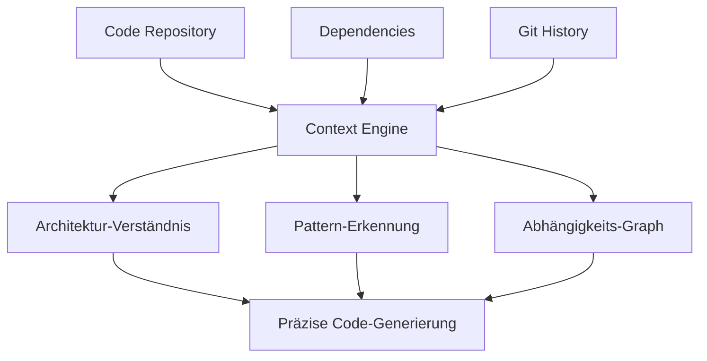

# Augment Code Konfiguration

> [!ABSTRACT]
> Augment Code ist ein AI Coding Agent mit einer **Context Engine**, die das gesamte Repository, Abhängigkeiten und Architektur in Echtzeit versteht. Der Agent bietet Multi-Agent-Koordination für paralleles Arbeiten und ist sowohl als IDE-Plugin als auch als CLI-Tool (Auggie CLI) verfügbar.

---

## Übersicht

| Eigenschaft | Details |
|---|---|
| **Entwickler** | Augment Code |
| **Typ** | CLI Agent + IDE Extension |
| **Lizenz** | Proprietär |
| **Kosten** | Free Trial (30k Credits), Indie ($20/Mo), Standard ($60/Mo), Max ($200/Mo) |
| **Plattformen** | macOS, Windows, Linux |
| **IDEs** | VS Code, JetBrains |
| **Modelle** | Proprietär + konfigurierbar |

---

## Installation

### IDE Plugin

1. **VS Code**: Extension „Augment Code" im Marketplace installieren
2. **JetBrains**: Plugin über den JetBrains Marketplace
3. API-Key eingeben und Projekt indexieren lassen

### CLI (Auggie CLI)

```bash
# Installation
npm install -g @augmentcode/cli

# Authentifizierung
auggie login

# Projekt indexieren
auggie index .
```

---

## Context Engine

Das Alleinstellungsmerkmal von Augment ist die **Context Engine** — ein System, das weit über einfaches File-Reading hinausgeht:



Die Context Engine analysiert:
- **Codebase-Struktur**: Alle Dateien, Module und ihre Beziehungen
- **Abhängigkeiten**: Package-Manager, Import-Graphen
- **Git-Historie**: Änderungsmuster, Blame-Informationen
- **Architektur-Patterns**: Design Patterns, Schichtentrennung

---

## Multi-Agent-Koordination

Augment kann mehrere spezialisierte Agents parallel einsetzen:

| Agent | Aufgabe |
|---|---|
| **Code Generator** | Neue Funktionen und Module erstellen |
| **Code Reviewer** | Bugs, Security und Performance prüfen |
| **Refactoring Agent** | Code-Qualität verbessern |
| **Test Agent** | Tests generieren und ausführen |
| **Documentation Agent** | API-Docs und README aktualisieren |

```bash
# Multi-Agent-Aufgabe
auggie "Implementiere User-Authentication:
        - Code Generator: Auth-Module erstellen
        - Test Agent: Unit Tests schreiben
        - Reviewer: Security-Review durchführen"
```

---

## CLI-Nutzung (Auggie CLI)

### Interaktiver Modus

```bash
# Interaktive Session starten
auggie

# Frage stellen
> Erkläre die Architektur dieses Projekts

# Code generieren
> Erstelle einen Rate Limiter für die API-Endpunkte
```

### Automation-Modus

```bash
# In CI/CD-Pipelines nutzen
auggie --auto "Review alle geänderten Dateien" --output report.md

# Batch-Operationen
auggie --batch "Aktualisiere alle deprecated API-Calls in src/"
```

---

## Preismodell

| Plan | Preis | Credits/Mo | Zielgruppe |
|---|---|---|---|
| **Free Trial** | $0 | 30.000 | Evaluation |
| **Indie** | $20/Mo | 40.000 | Einzelentwickler |
| **Standard** | $60/Mo | 130.000 | Fulltime-Entwickler / kleine Teams |
| **Max** | $200/Mo | 450.000 | Power-User / größere Teams |
| **Enterprise** | Custom | Custom | Organisationen |

> [!WARNING]
> Augment bietet **keinen dauerhaft kostenlosen Plan**. Nach Ablauf der Free Trial müssen Credits gekauft werden. Für Open-Source-Projekte gibt es ggf. Sonderkonditionen.

---

## Vergleich mit anderen Agents

| Feature | Augment Code | Claude Code | Cursor |
|---|---|---|---|
| **Context Engine** | ✅✅✅ (Kernfeature) | ✅ (Projekt-Kontext) | ✅ (Codebase Indexing) |
| **Multi-Agent** | ✅✅ (parallel) | ✅ (Subagents) | ❌ |
| **CLI-Tool** | ✅ (Auggie CLI) | ✅ (Claude Code) | ❌ |
| **IDE-Plugin** | ✅ (VS Code, JetBrains) | ✅ (VS Code) | ✅ (eigene IDE) |
| **Git-Integration** | ✅✅ (Historie-Analyse) | ✅ | ✅ |
| **Free Tier** | ❌ (nur Trial) | ❌ (Subscription) | ✅ (Hobby) |

---

## Pro & Contra

| ✅ Vorteile | ❌ Nachteile |
|---|---|
| Tiefes Architektur-Verständnis durch Context Engine | Kein dauerhaft kostenloser Plan |
| Multi-Agent-Koordination für komplexe Aufgaben | Credit-System erfordert Monitoring |
| CLI + IDE-Integration | Weniger Community als Cursor/Copilot |
| Starke Code-Review-Fähigkeiten | Nicht self-hostbar |
| CI/CD-Integration via Automation-Modus | Noch relativ unbekannt |

---

## Verwandte Notizen

- [[AI Coding Agents Vergleich]] — Vergleich aller AI Coding Agents
- [[Multi-Agent Workflows]] — Parallele Agent-Architekturen
- [[Custom Instructions für AI Coding Agents]] — Instruction-Dateien für verschiedene Agents
