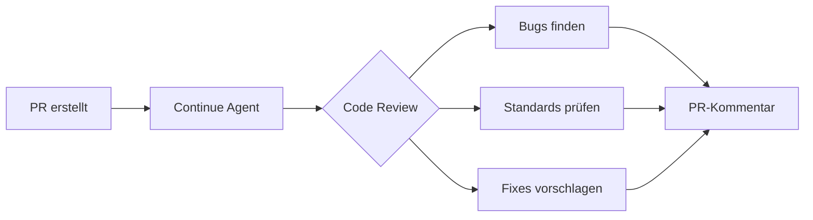

# Continue Konfiguration

> [!ABSTRACT]
> Continue ist ein **Open-Source AI Coding Assistant** (Apache 2.0), der als Plugin für VS Code und JetBrains funktioniert und zusätzlich einen CLI/TUI-Modus bietet. Das Besondere: Continue ist vollständig **model-agnostisch** (BYOK) und bietet seit 2026 autonome **CI/CD-Agents** für automatische Code Reviews auf Pull Requests.

---

## Übersicht

| Eigenschaft | Details |
|---|---|
| **Entwickler** | Continue.dev (Community) |
| **Typ** | IDE Plugin + CLI/TUI |
| **Lizenz** | Apache 2.0 (Open Source) |
| **Kosten** | Free, Team ($10/user/Mo), Models Add-on ($20/user/Mo) |
| **Plattformen** | macOS, Windows, Linux |
| **IDEs** | VS Code, JetBrains |
| **Modelle** | Alle (OpenAI, Anthropic, Gemini, Mistral, Ollama, LM Studio, u.a.) |

---

## Installation

### VS Code Extension

1. VS Code öffnen
2. Extensions → „Continue" suchen und installieren
3. Modell-Provider konfigurieren (BYOK)

### JetBrains Plugin

1. Settings → Plugins → „Continue" suchen und installieren
2. API-Key des gewünschten Providers eingeben

### CLI/TUI

```bash
# Headless Mode (für CI/CD)
continue --headless --review pr-42

# TUI Mode (interaktiv im Terminal)
continue --tui
```

---

## Konfiguration

### config.json

Continue wird über `~/.continue/config.json` konfiguriert:

```json
{
  "models": [
    {
      "title": "Claude Sonnet",
      "provider": "anthropic",
      "model": "claude-sonnet-4-6",
      "apiKey": "${ANTHROPIC_API_KEY}"
    },
    {
      "title": "GPT-5.1",
      "provider": "openai",
      "model": "gpt-5.1",
      "apiKey": "${OPENAI_API_KEY}"
    },
    {
      "title": "Lokales Modell",
      "provider": "ollama",
      "model": "llama3:70b"
    }
  ],
  "tabAutocompleteModel": {
    "title": "Fast Completion",
    "provider": "ollama",
    "model": "codellama:7b"
  },
  "customCommands": [
    {
      "name": "test",
      "description": "Generiere Tests für die selektierte Funktion",
      "prompt": "Schreibe umfassende Unit-Tests für den folgenden Code: {{{ input }}}"
    }
  ]
}
```

### Context Providers

Continue kann verschiedene Kontextquellen einbinden:

```json
{
  "contextProviders": [
    { "name": "code", "params": {} },
    { "name": "docs", "params": {} },
    { "name": "terminal", "params": {} },
    { "name": "diff", "params": {} },
    { "name": "folder", "params": {} },
    { "name": "url", "params": {} }
  ]
}
```

| Provider | Beschreibung |
|---|---|
| `code` | Aktuelle Datei und Projekt-Code |
| `docs` | Dokumentation und README |
| `terminal` | Terminal-Output |
| `diff` | Git-Diff der aktuellen Änderungen |
| `folder` | Verzeichnisstruktur |
| `url` | Web-Inhalte als Kontext |

---

## Autonome CI/CD-Agents

Seit 2026 bietet Continue **asynchrone Agents**, die auf Pull Requests reagieren:



### Review-Regeln definieren

```markdown
<!-- .continue/rules/security.md -->
# Security Review Rules

- Prüfe auf hardcodierte Secrets und API-Keys
- Validiere alle User-Inputs gegen Injection
- Stelle sicher, dass HTTPS für externe Calls genutzt wird
- Keine eval() oder ähnliche dynamische Code-Ausführung
```

---

## Continue Hub — Team-Management

| Feature | Beschreibung |
|---|---|
| **Zentrale Modell-Verwaltung** | Admins definieren erlaubte/gesperrte Modelle |
| **Shared Assistants** | Team-weite AI-Assistenten mit vordefinierten Prompts |
| **Rules** | Versionierte Coding-Standards als Markdown |
| **Secrets Proxy** | API-Keys zentral verwalten, nicht auf Client-Seite |
| **Analytics** | Nutzungsstatistiken pro Entwickler und Modell |

---

## Preismodell

| Plan | Preis | Features |
|---|---|---|
| **Free** | $0/Mo | Vollständig für Einzelpersonen, BYOK, Plugins, Custom Assistants |
| **Team** | $10/user/Mo | Zentrale Verwaltung, Secrets Proxy, Allow/Block Listen |
| **Models Add-on** | $20/user/Mo | Zugang zu Premium-Modellen ohne eigene API-Keys |
| **Enterprise** | Custom | SSO (SAML/OIDC), On-Premise, Priority Support |

> [!TIP]
> Continue ist einer der **wenigen vollständig kostenlosen** AI Coding Assistants mit voller Funktionalität. Der Free Plan hat keine Feature-Einschränkungen — nur BYOK für die LLM-Kosten.

---

## Vergleich mit anderen Tools

| Feature | Continue | GitHub Copilot | Cursor |
|---|---|---|---|
| **Open Source** | ✅ (Apache 2.0) | ❌ | ❌ |
| **BYOK** | ✅✅✅ (alle Provider) | ❌ | ✅ |
| **Lokale Modelle** | ✅ (Ollama, LM Studio) | ❌ | ❌ |
| **CI/CD Agents** | ✅ (async PR Review) | ❌ | ❌ |
| **IDE-Support** | VS Code + JetBrains | VS Code + JetBrains + Vim | Eigene IDE |
| **Free Plan** | ✅ (vollständig) | ❌ | ✅ (begrenzt) |
| **Custom Commands** | ✅ | ❌ | ✅ (Cursor Rules) |
| **Team Hub** | ✅ ($10/user) | ✅ (Business) | ✅ (Business) |

---

## Pro & Contra

| ✅ Vorteile | ❌ Nachteile |
|---|---|
| Vollständig Open Source (Apache 2.0) | Initiale Konfiguration aufwendiger als Copilot |
| Kein Vendor Lock-in, jedes Modell nutzbar | UI weniger poliert als Cursor |
| Lokale Modelle für maximale Privacy | Kein eigenständiger IDE-Fork |
| CI/CD-Integration mit async Agents | Weniger bekannt als Copilot/Cursor |
| Kostenloser Plan ohne Feature-Limits | — |

---

## Verwandte Notizen

- [[AI Coding Agents Vergleich]] — Vergleich aller AI Coding Agents
- [[Cline Konfiguration]] — Ähnlicher Open-Source IDE Agent
- [[Lokale LLMs]] — Lokale Modelle für Privacy-bewussten Einsatz
- [[Custom Instructions für AI Coding Agents]] — Instruction-Dateien für verschiedene Agents
