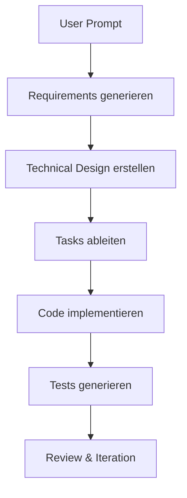

# Kiro Konfiguration

> [!ABSTRACT]
> Kiro ist AWS' agentic IDE, die auf **Spec-driven Development** (SDD) setzt. Statt direkt Code zu generieren, erstellt Kiro zuerst strukturierte Spezifikationen (Requirements, Design, Tasks), aus denen dann systematisch Code abgeleitet wird. Dies erhöht die Nachvollziehbarkeit und Qualität gegenüber reinem Prompt-basiertem Coding.

---

## Übersicht

| Eigenschaft | Details |
|---|---|
| **Entwickler** | Amazon Web Services (AWS) |
| **Typ** | IDE Agent (VS Code OSS Fork) |
| **Lizenz** | Proprietär (Free Tier verfügbar) |
| **Kosten** | Free (50 Credits), Pro ($20/Mo), Pro+ ($40/Mo), Power ($200/Mo) |
| **Plattformen** | macOS, Windows, Linux |
| **Modelle** | Multi-Modell (AWS-Ökosystem) |
| **Custom Instructions** | Steering Files |

---

## Installation

1. **Download** von [kiro.dev](https://kiro.dev)
2. **Installation** wie VS Code (basiert auf VS Code OSS)
3. **Authentifizierung** mit AWS Builder ID (kostenlos) oder AWS IAM

### Erster Start

```bash
# Kiro öffnet sich als IDE
# Login mit AWS Builder ID
# Projekt öffnen und Spec-driven Development starten
```

> [!NOTE]
> Kiro unterstützt alle VS Code OSX Extensions und kann bestehende VS Code-Konfigurationen übernehmen.

---

## Spec-driven Development (SDD)

Das Alleinstellungsmerkmal von Kiro ist der **Spec-driven Workflow**. Statt direkt Code zu generieren, durchläuft Kiro einen strukturierten Prozess:



### Phase 1: Requirements (EARS-Syntax)

Kiro erstellt testbare Requirements im **EARS-Format** (Easy Approach to Requirements Syntax):

```markdown
# requirements.md

## REQ-001: User Registration
WHEN a new user submits the registration form
THE SYSTEM SHALL validate email format and password strength
AND create a new user record in the database
AND send a verification email

## REQ-002: Input Validation
THE SYSTEM SHALL reject passwords shorter than 12 characters
AND reject emails that are already registered
```

### Phase 2: Technical Design

```markdown
# design.md

## Architecture
- REST API mit Express.js
- PostgreSQL für User-Daten
- Redis für Session-Management

## Data Model
| Feld | Typ | Constraints |
|---|---|---|
| id | UUID | Primary Key |
| email | VARCHAR(255) | Unique, NOT NULL |
| password_hash | VARCHAR(255) | NOT NULL |
| verified | BOOLEAN | Default: false |
```

### Phase 3: Tasks

```markdown
# tasks.md

- [x] Datenbankschema erstellen (REQ-001)
- [x] User-Model implementieren (REQ-001)
- [ ] Registration-Endpoint erstellen (REQ-001, REQ-002)
- [ ] Email-Validierung implementieren (REQ-002)
- [ ] Verification-Email senden (REQ-001)
- [ ] Unit Tests schreiben (REQ-001, REQ-002)
```

---

## Agent Hooks

Kiro bietet **Event-driven Automations**, die bei bestimmten Aktionen automatisch ausgelöst werden:

| Hook | Trigger | Beispiel |
|---|---|---|
| **On File Save** | Datei gespeichert | Tests generieren, Linting ausführen |
| **On File Create** | Neue Datei erstellt | Boilerplate einfügen, Imports ergänzen |
| **On Commit** | Git Commit | Dokumentation aktualisieren |
| **On PR** | Pull Request erstellt | Security Scan, Code Review |

---

## Steering Files

Steering Files definieren Projekt- und Teamstandards:

```markdown
# .kiro/steering/coding-standards.md

## Tech Stack
- TypeScript 5.x mit strictem Modus
- Express.js für REST APIs
- Prisma als ORM

## Naming Conventions
- Dateien: kebab-case (user-service.ts)
- Klassen: PascalCase (UserService)
- Variablen/Funktionen: camelCase (getUserById)

## Testing
- Vitest für Unit Tests
- Supertest für Integration Tests
- Minimum 80% Code Coverage
```

---

## Preismodell

| Plan | Preis | Credits/Mo | Features |
|---|---|---|---|
| **Free** | $0/Mo | 50 | Grundfunktionen, Community Support |
| **Pro** | $20/Mo | 1.000 | Alle Features, +$0,04/Credit Overage |
| **Pro+** | $40/Mo | 2.000 | Erweiterte Credits |
| **Power** | $200/Mo | 10.000 | Enterprise-Features |
| **Enterprise** | Custom | Custom | SAML/SCIM SSO, zentrale Abrechnung |

> [!NOTE]
> Neue Accounts erhalten **500 Bonus-Credits** im ersten Monat. Credit-Kosten variieren je nach Aufgabenkomplexität — einfache Prompts verbrauchen weniger als 1 Credit, komplexe Spec-Generierung mehrere.

---

## Vergleich: Kiro vs. Cursor vs. Windsurf

| Feature | Kiro | Cursor | Windsurf |
|---|---|---|---|
| **Spec-driven Development** | ✅✅✅ (Kernfeature) | ❌ | ❌ |
| **Requirements Engineering** | ✅ (EARS) | ❌ | ❌ |
| **Agent Hooks** | ✅ | ❌ | ❌ |
| **Steering Files** | ✅ | `.cursor/rules/` | `.windsurfrules` |
| **AWS-Integration** | ✅✅ | ❌ | ❌ |
| **BYOK** | ❌ | ✅ | ✅ |
| **Basis** | VS Code OSS | VS Code Fork | VS Code Fork |
| **Preis (Pro)** | $20/Mo | $20/Mo | $15/Mo |

---

## Pro & Contra

| ✅ Vorteile | ❌ Nachteile |
|---|---|
| Einzigartig: Spec-driven Development | Längerer Workflow als direktes Coding |
| Nachvollziehbarkeit von Code zu Requirements | Noch junges Produkt, Ökosystem wächst |
| Agent Hooks für Automatisierung | Kein BYOK für Modelle |
| AWS-Service-Integration | Credit-System statt Flatrate |
| VS Code Extensions kompatibel | Weniger Community-Ressourcen als Cursor |

---

## Tipps

> [!TIP]
> - **Spec-driven Development** lohnt sich besonders für Teams und Projekte mit Compliance-Anforderungen
> - **Steering Files** für Team-weite Konsistenz nutzen — ähnlich wie `CLAUDE.md` oder `.cursorrules`
> - **Agent Hooks** für repetitive Tasks (Test-Generierung, Doku-Updates) konfigurieren
> - Für schnelle Prototypen ist der Prompt-Modus effizienter als SDD

---

## Verwandte Notizen

- [[AI Coding Agents Vergleich]] — Vergleich aller AI Coding Agents
- [[Amazon Q Developer CLI Konfiguration]] — AWS' CLI-Agent
- [[Windsurf Konfiguration]] — Alternative IDE mit Cascade-Agent
- [[Cursor Agent Konfiguration]] — Alternative IDE mit Composer
