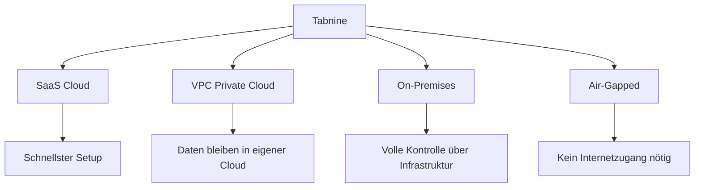

# Tabnine Konfiguration

> [!ABSTRACT]
> Tabnine ist ein **Enterprise-fokussierter AI Coding Assistant** mit Schwerpunkt auf Datenschutz und Compliance. Als einziger großer AI Coding Agent bietet Tabnine vollständige **On-Premises-Deployments** und **Air-Gapped-Installationen** — ideal für regulierte Branchen wie Finanzen, Gesundheitswesen und Behörden.

---

## Übersicht

| Eigenschaft | Details |
|---|---|
| **Entwickler** | Tabnine, Ltd. |
| **Typ** | IDE Plugin (+ CLI-Integration) |
| **Lizenz** | Proprietär |
| **Kosten** | Basic (Free), Dev (~$12/Mo), Enterprise ($39–59/user/Mo) |
| **Plattformen** | macOS, Windows, Linux |
| **IDEs** | VS Code, JetBrains, Vim, Neovim, Eclipse, Visual Studio |
| **Modelle** | Tabnine eigene + BYOM (Anthropic, OpenAI, Google, Meta, Mistral) |
| **Deployment** | SaaS, VPC, On-Premises, Air-Gapped |

---

## Installation

### IDE Plugin

```
VS Code:     Extensions → "Tabnine" suchen → Installieren
JetBrains:   Settings → Plugins → "Tabnine" → Installieren
Vim/Neovim:  Plugin-Manager (z.B. vim-plug, lazy.nvim)
Eclipse:     Eclipse Marketplace → "Tabnine"
```

### Enterprise / On-Premises

```bash
# Docker-basiertes On-Premises Deployment
docker pull tabnine/server:latest

docker run -d \
  --name tabnine-server \
  -p 8080:8080 \
  -v /data/tabnine:/data \
  -e LICENSE_KEY="${TABNINE_LICENSE}" \
  -e AUTH_PROVIDER="saml" \
  tabnine/server:latest
```

> [!IMPORTANT]
> On-Premises und Air-Gapped Deployments sind nur im Enterprise-Plan verfügbar. Sie erfordern separate Lizenzierung und Infrastruktur-Setup durch das Tabnine-Team.

---

## Kernfunktionen

### Code Completion

Tabnine bietet **kontextbewusste Code-Vervollständigung**:

- Whole-Line Completion (ganze Zeilen)
- Multi-Line Completion (mehrere Zeilen/Funktionen)
- Adaptiert sich an Projekt-Coding-Standards
- Unterstützt 30+ Programmiersprachen

### AI Chat

Integrierter Chat im IDE:
- Code erklären
- Refactoring vorschlagen
- Dokumentation generieren
- Bugs debuggen

### Enterprise Context Engine

Tabnine verbindet sich mit Unternehmensquellen für besseren Kontext:

| Quelle | Beschreibung |
|---|---|
| **Code Repositories** | GitHub, GitLab, Bitbucket |
| **Projektmanagement** | Jira |
| **Dokumentation** | Confluence |
| **Code Reviews** | Pull Request History |

---

## Deployment-Optionen

Das Alleinstellungsmerkmal von Tabnine ist die **Flexibilität beim Deployment**:



| Deployment | Datenschutz | Setup-Aufwand | Zielgruppe |
|---|---|---|---|
| **SaaS** | Standard | Minimal | Startups, Freelancer |
| **VPC** | Hoch (eigene Cloud) | Mittel | Mittlere Unternehmen |
| **On-Premises** | Maximal | Hoch | Regulierte Branchen |
| **Air-Gapped** | Maximal (kein Internet) | Sehr hoch | Behörden, Militär, Finanzwesen |

---

## Security und Compliance

| Zertifizierung | Status |
|---|---|
| **SOC 2 Type II** | ✅ |
| **ISO 27001** | ✅ |
| **GDPR** | ✅ |
| **HIPAA** | ✅ (Enterprise) |
| **IP Provenance** | ✅ (Code-Herkunft nachvollziehbar) |

### Zero Data Retention

```
Enterprise-Kunden:
- Kein Code wird für Training verwendet
- Kein Code wird gespeichert oder protokolliert
- Volle Audit-Trails verfügbar
- Verschlüsselung at-rest und in-transit
```

---

## Preismodell

| Plan | Preis | Features |
|---|---|---|
| **Basic** | Free | Begrenzte Completions, Basic AI Chat |
| **Dev** | ~$12/Mo | Unbegrenzte Completions, voller Chat, alle IDEs |
| **Enterprise** | $39–59/user/Mo | On-Premises, BYOM, SSO, Admin-Suite, Compliance, Context Engine |

> [!NOTE]
> Enterprise-Preise variieren je nach Deployment-Art, Modellwahl und Teamgröße. On-Premises-Deployments haben höhere Preise als SaaS.

---

## Vergleich mit anderen Tools

| Feature | Tabnine | GitHub Copilot | Continue |
|---|---|---|---|
| **On-Premises** | ✅✅✅ (Kernfeature) | ❌ | ✅ (self-hosted möglich) |
| **Air-Gapped** | ✅ | ❌ | ❌ |
| **BYOM** | ✅ (Enterprise) | ❌ | ✅ |
| **SOC 2 + ISO 27001** | ✅ | ✅ | ❌ |
| **HIPAA** | ✅ | ❌ | ❌ |
| **IP Provenance** | ✅ | ✅ | ❌ |
| **IDE-Support** | 6+ IDEs | VS Code + JetBrains | VS Code + JetBrains |
| **Free Plan** | ✅ (begrenzt) | ❌ | ✅ (vollständig) |
| **Agentic Coding** | 🟡 (begrenzt) | ✅ | ✅ |

---

## Pro & Contra

| ✅ Vorteile | ❌ Nachteile |
|---|---|
| Einzigartig: On-Premises + Air-Gapped | Weniger agentic als Claude Code/Cursor |
| Breitester IDE-Support (6+ IDEs) | Enterprise-Features teuer |
| HIPAA, SOC 2, ISO 27001 Compliance | Basic Plan sehr begrenzt |
| Zero Data Retention garantiert | Kein CLI-first Agent |
| BYOM für Enterprise-Kunden | Weniger Community und Open-Source-Fokus |
| IP Provenance für lizenzrechtliche Sicherheit | — |

---

## Wann Tabnine wählen?

> [!TIP]
> Tabnine ist die richtige Wahl, wenn:
> - **Compliance-Anforderungen** (HIPAA, SOC 2, ISO) erfüllt werden müssen
> - **Kein Code das Unternehmensnetzwerk verlassen** darf (Air-Gapped)
> - **Regulierte Branchen** (Finanzen, Gesundheit, Behörden) bedient werden
> - **IP Provenance** für lizenzrechtliche Prüfungen benötigt wird
>
> Für allgemeine Coding-Produktivität ohne strenge Compliance sind Claude Code, Cursor oder Continue bessere Optionen.

---

## Verwandte Notizen

- [[AI Coding Agents Vergleich]] — Vergleich aller AI Coding Agents
- [[Continue Konfiguration]] — Open-Source-Alternative mit BYOK
- [[Lokale LLMs]] — Lokale Modelle für Privacy
- [[Custom Instructions für AI Coding Agents]] — Instruction-Dateien für verschiedene Agents
