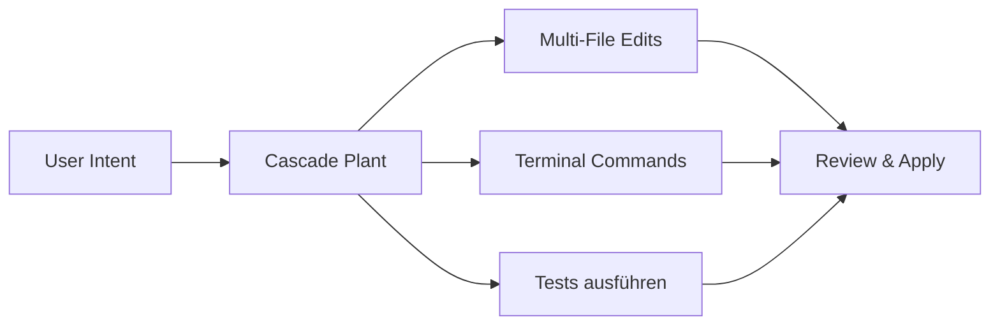

# Windsurf Konfiguration

> [!ABSTRACT]
> Windsurf (ehemals Codeium) ist ein AI-powered IDE-Agent mit dem **Cascade**-System für autonome, mehrstufige Code-Bearbeitung. Die IDE basiert auf VS Code und bietet Deep AI-Integration mit eigenen SWE-Modellen, BYOK-Support und Auto-Run-Features für maximale Entwicklerproduktivität.

---

## Übersicht

| Eigenschaft | Details |
|---|---|
| **Entwickler** | Codeium (jetzt Windsurf) |
| **Typ** | IDE Agent (VS Code Fork) |
| **Lizenz** | Proprietär (Free Tier verfügbar) |
| **Kosten** | Free, Pro ($15/Mo), Teams ($30/user/Mo), Enterprise ($60/user/Mo) |
| **Plattformen** | macOS, Windows 10+, Linux (Ubuntu 20.04+) |
| **Modelle** | SWE-1.5 (eigen), BYOK: OpenAI, Anthropic, Gemini, xAI |
| **Custom Instructions** | `.windsurfrules` |

---

## Installation

### Download und Setup

1. **Download** von [windsurf.com](https://windsurf.com)
2. **Installation** wie VS Code (DMG, EXE, oder .deb/.rpm)
3. **Migration** von VS Code oder Cursor: Themes, Extensions und Shortcuts werden übernommen

### Systemanforderungen

| Anforderung | Minimum | Empfohlen |
|---|---|---|
| RAM | 4 GB | 8 GB |
| Festplatte | 2 GB | 5 GB |
| OS | macOS 11+, Win 10+, Ubuntu 20.04+ | Aktuellste Version |
| Internet | Erforderlich (Cloud-Inferenz) | — |

---

## Cascade — Der AI Agent

Cascade ist das Herzstück von Windsurf. Es handelt sich um einen **autonomen AI Agent**, der mehrstufige Aufgaben eigenständig plant und ausführt:



### Cascade-Features

| Feature | Beschreibung |
|---|---|
| **Multi-File Editing** | Bearbeitet mehrere Dateien gleichzeitig, versteht Zusammenhänge |
| **Terminal Integration** | Führt Befehle in sicherer Sandbox aus |
| **Codebase Awareness** | Versteht Architektur, Patterns und Abhängigkeiten |
| **Auto-Run** | Kann Aufgaben vollständig autonom ausführen |
| **App Deployment** | Integrierte Preview- und Deploy-Flows (z.B. Netlify) |

### Cascade nutzen

```
Cascade: "Erstelle eine REST API für User-Management mit Express.js,
          inklusive CRUD-Operationen, Validierung und Tests."
```

Cascade wird daraufhin:
1. Die Projektstruktur analysieren
2. Einen Plan erstellen und anzeigen
3. Dateien erstellen/bearbeiten
4. Tests generieren und ausführen
5. Ergebnis zur Review vorlegen

---

## Custom Instructions mit `.windsurfrules`

Windsurf liest eine `.windsurfrules`-Datei im Projekt-Root:

```markdown
# .windsurfrules

## Projekt-Kontext
- React 19 Frontend mit TypeScript
- Express.js Backend
- PostgreSQL Datenbank

## Coding-Standards
- Funktionale Komponenten mit Hooks
- Zod für Validierung
- Alle API-Endpunkte mit OpenAPI-Dokumentation
- Error Handling mit Result-Pattern

## Verbote
- Keine `any` Types in TypeScript
- Keine inline-Styles in React
- Kein `console.log` in Production-Code
```

> [!NOTE]
> `.windsurfrules` unterstützt reines Markdown ohne Frontmatter oder Glob-Patterns. Für mehr Granularität können mehrere Dateien in verschiedenen Verzeichnissen angelegt werden.

---

## Modell-Konfiguration

### Eigene Modelle (SWE)

Windsurf nutzt standardmäßig die eigenen **SWE-Modelle**:

| Modell | Beschreibung | Kosten |
|---|---|---|
| **SWE-1 Lite** | Leichtgewichtig, für einfache Aufgaben | Im Free-Plan enthalten |
| **SWE-1** | Standard-Modell für Coding | Promotional: 0 Credits |
| **SWE-1.5** | Neueste Generation, höchste Qualität | Standard-Credit-Verbrauch |

### Bring Your Own Key (BYOK)

Für externe Modelle eigene API-Keys hinterlegen:

1. **Settings → AI Models → BYOK**
2. Provider auswählen (OpenAI, Anthropic, Google, xAI)
3. API-Key eingeben
4. Modell als Standard setzen

---

## Preismodell

| Plan | Preis | Credits/Mo | App Deploys | Features |
|---|---|---|---|---|
| **Free** | $0/Mo | 25 | 1/Tag | Fast Tab, SWE-1 Lite, Basic |
| **Pro** | $15/Mo | 500 | 5/Tag | SWE-1, alle Modelle, Add-on Credits |
| **Teams** | $30/user/Mo | 500/user | 5/Tag | Admin Dashboard, Analytics, Priority Support |
| **Enterprise** | $60/user/Mo | 1.000/user | Unbegrenzt | SSO, RBAC, Hybrid Deployment |

> [!IMPORTANT]
> Windsurf nutzt ein **Prompt-Credit-System**. Ein Credit entspricht nicht einem Prompt — komplexe Cascade-Aktionen verbrauchen mehr Credits als einfache Fragen. Add-on Credits: $10 für 250 Credits (Pro), $40 für 1.000 Credits (Teams/Enterprise).

---

## Plugins und Integrationen

### MCP-Server

Windsurf unterstützt MCP-Server für externe Tool-Integration:

```json
{
  "mcpServers": {
    "github": {
      "command": "npx",
      "args": ["-y", "@modelcontextprotocol/server-github"]
    }
  }
}
```

### Verfügbare Plugins

| Plugin | Beschreibung |
|---|---|
| **Slack** | Nachrichten und Channels durchsuchen |
| **Figma** | Design-Specs in Code umsetzen |
| **GitHub** | PRs, Issues, Repos verwalten |
| **Netlify** | Direct Deployment aus der IDE |

---

## Vergleich: Windsurf vs. Cursor vs. Copilot

| Feature | Windsurf | Cursor | GitHub Copilot |
|---|---|---|---|
| **Agent-System** | Cascade (autonom) | Composer | Chat + Inline |
| **Eigene Modelle** | ✅ SWE-1.5 | ❌ | ❌ |
| **BYOK** | ✅ | ✅ | ❌ |
| **Auto-Run** | ✅ | ✅ | ❌ |
| **App Deployment** | ✅ (integriert) | ❌ | ❌ |
| **Custom Instructions** | `.windsurfrules` | `.cursor/rules/` | `.github/copilot-instructions.md` |
| **Preis (Pro)** | $15/Mo | $20/Mo | $10/Mo |
| **Enterprise** | $60/user/Mo | $200/Mo (Ultra) | $39/Mo (Pro+) |

---

## Pro & Contra

| ✅ Vorteile | ❌ Nachteile |
|---|---|
| Cascade ist sehr leistungsstark für große Projekte | Credit-Limits im Free/Pro Plan |
| Eigene SWE-Modelle optimiert für Coding | Cloud-abhängig (keine lokale Inferenz) |
| Einfache Migration von VS Code | SSO nur als kostenpflichtiges Add-on |
| BYOK für Modell-Flexibilität | Weniger CLI-fokussiert als Claude Code/Amp |
| Integriertes App Deployment | Noch junges Ökosystem |

---

## Tipps

> [!TIP]
> - **Cascade gezielt einsetzen**: Für komplexe, mehrstufige Aufgaben — nicht für einfache Autocomplete-Fragen
> - **`.windsurfrules`** im Git-Repository pflegen, damit das Team konsistente Ergebnisse bekommt
> - **BYOK nutzen**: Für sensible Projekte eigene API-Keys mit datenschutzkonformen Anbietern verwenden
> - **Credit-Verbrauch überwachen**: Im Dashboard den Verbrauch pro Modell und Task-Typ tracken

---

## Verwandte Notizen

- [[AI Coding Agents Vergleich]] — Vergleich aller AI Coding Agents
- [[Cursor Agent Konfiguration]] — Alternative IDE mit ähnlichem Ansatz
- [[Custom Instructions für AI Coding Agents]] — Instruction-Dateien für verschiedene Agents
