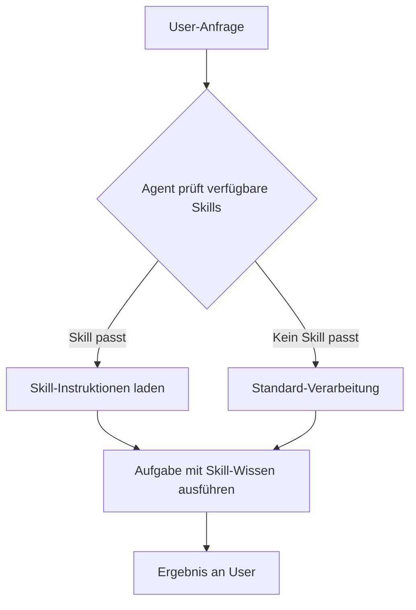
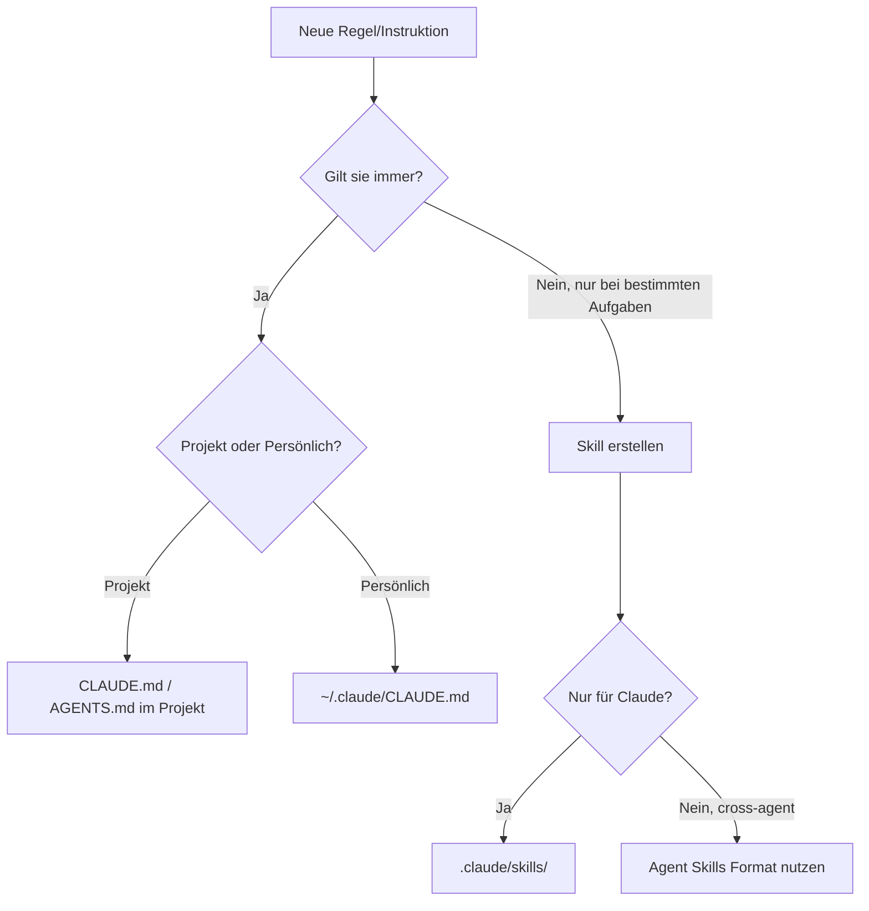
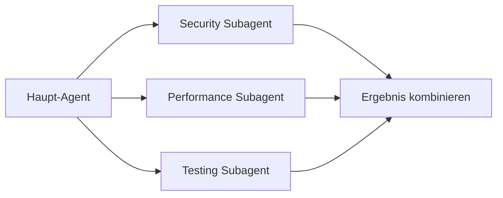

# Skills für AI Coding Agents

> [!ABSTRACT]
> Skills sind modulare, wiederverwendbare Wissenspakete, die AI Coding Agents neue Fähigkeiten beibringen. Anders als [[Custom Instructions für AI Coding Agents|Custom Instructions]] (z.B. `CLAUDE.md`), die immer geladen werden, aktiviert der Agent Skills **on-demand** – nur wenn sie zur aktuellen Aufgabe passen. Dieses Dokument erklärt das Konzept, die Spezifikation, praktische Anwendung und die Neuerungen in Skills 2.0.

---

## Was sind Skills?

Ein Skill ist ein **Ordner mit einer `SKILL.md`-Datei**, der einem AI Agent beibringt, eine bestimmte Aufgabe auszuführen. Der Ordner kann zusätzlich Skripte, Templates und Referenzdateien enthalten. Das Konzept ist vergleichbar mit einem Plugin-System:

- **Custom Instructions** (z.B. `CLAUDE.md`) = Immer geladene Projektregeln
- **Skills** = On-Demand-Expertise, nur bei Bedarf aktiviert
- **MCP-Server** = Externe Tool-Verbindungen (APIs, Datenbanken)



### Warum Skills statt Prompts?

| Eigenschaft | Reguläre Prompts | Skills |
|---|---|---|
| Persistenz | Einmalig | Dauerhaft gespeichert |
| Wiederverwendbarkeit | Manuell kopieren | Automatisch verfügbar |
| Versionierung | Keine | Git-versionierbar |
| Kontextnutzung | Immer im Kontext | Nur bei Bedarf geladen |
| Teilbarkeit | Per Copy-Paste | Als Paket installierbar |
| Struktur | Frei | Standardisiert (YAML + Markdown) |

---

## Die Agent Skills Spezifikation

Die **Agent Skills Specification** ([agentskills.io](https://agentskills.io)) ist ein offener Standard, der von Anthropic initiiert und unter der Apache 2.0 Lizenz veröffentlicht wurde. Ziel ist **Portabilität**: Ein Skill, der für Claude Code geschrieben wird, soll auch in Gemini CLI, Cursor, Codex CLI und anderen kompatiblen Agents funktionieren.

### Unterstützte Agents

| Agent | Skills-Support | Anmerkung |
|---|---|---|
| **Claude Code** | ✅ Vollständig | Initiator des Standards, native Integration |
| **Gemini CLI** | ✅ Vollständig | Eigenes Skills-System, kompatibel mit Agent Skills Spec |
| **Cursor** | ✅ Kompatibel | Lädt Skills aus `.cursor/skills/` |
| **Codex CLI** | ✅ Kompatibel | Unterstützt Agent Skills Format |
| **GitHub Copilot** | 🟡 Teilweise | Skills über Custom Instructions abbildbar |
| **Roo Code** | ✅ Kompatibel | Native Unterstützung |
| **Aider** | ❌ Nein | Nutzt eigenes `CONVENTIONS.md`-System |

### Kern-Prinzipien

1. **Progressive Disclosure**: Beim Start werden nur Metadaten (Name, Beschreibung) geladen. Der vollständige Skill-Inhalt wird erst aktiviert, wenn der Agent ihn tatsächlich braucht – das spart Context Window.
2. **Cross-Agent-Portabilität**: Write once, use everywhere. Skills sind agent-agnostisch spezifiziert.
3. **Deklarativ & Discoverable**: Strukturierte Metadaten ermöglichen automatische Erkennung und Katalogisierung.
4. **Open Source**: Community-getrieben, öffentliches GitHub-Repository unter `anthropics/skills`.

---

## SKILL.md Format

Jeder Skill besteht aus einem Ordner mit einer `SKILL.md`-Datei. Die Datei hat zwei Teile: **YAML-Frontmatter** (Metadaten) und **Markdown-Body** (Instruktionen).

### Ordnerstruktur

```
my-skill/
├── SKILL.md              # Pflicht: Metadaten + Instruktionen
├── scripts/              # Optional: Ausführbare Skripte
│   └── run-analysis.sh
├── references/           # Optional: Referenzdokumente
│   └── api-spec.yaml
└── assets/               # Optional: Templates, Bilder
    └── template.md
```

### Minimales Beispiel

````markdown
---
name: commit-helper
description: Generiert aussagekräftige Commit-Messages aus staged Changes.
---

# Commit Message Generator

1. Führe `git diff --staged` aus
2. Analysiere die Änderungen
3. Erstelle eine Commit-Message nach diesem Format:
   - Summary-Zeile (max 50 Zeichen)
   - Leerzeile
   - Detailbeschreibung (bei Bedarf)
4. Verwende den Conventional Commits Standard (feat:, fix:, refactor:, etc.)
````

### Vollständiges Beispiel

````markdown
---
name: security-review
description: Prüft Code auf Sicherheitslücken basierend auf OWASP Top 10.
license: Apache-2.0
compatibility: Requires git and internet access.
metadata:
  author: security-team
  version: "2.0"
allowed-tools:
  - Bash(grep:*)
  - Bash(git:*)
  - Read(*)
---

# Security Code Review

## Vorgehen

1. Identifiziere alle geänderten Dateien seit dem letzten Commit
2. Prüfe jede Datei auf folgende Schwachstellen:

### OWASP Top 10 Checklist

- [ ] SQL Injection (parameterized queries?)
- [ ] XSS (input sanitization?)
- [ ] Broken Authentication (token handling?)
- [ ] Sensitive Data Exposure (secrets in code?)
- [ ] Security Misconfiguration (default credentials?)

## Ausgabeformat

Für jeden Fund:
- **Severity**: Critical / High / Medium / Low
- **Datei**: Betroffene Datei und Zeile
- **Problem**: Beschreibung der Schwachstelle
- **Fix**: Empfohlene Lösung mit Code-Beispiel
````

### YAML-Felder im Detail

| Feld | Pflicht | Beschreibung | Einschränkungen |
|---|---|---|---|
| `name` | ✅ | Eindeutiger Skill-Identifier | 1–64 Zeichen, lowercase, Bindestriche erlaubt, muss Ordnernamen entsprechen |
| `description` | ✅ | Was der Skill tut und wann er genutzt wird | 1–1024 Zeichen, sollte Schlüsselwörter für Matching enthalten |
| `license` | ❌ | Lizenz des Skills | z.B. `Apache-2.0`, `MIT` |
| `compatibility` | ❌ | Umgebungsanforderungen | Max 500 Zeichen, z.B. benötigte Tools oder Internetzugang |
| `metadata` | ❌ | Beliebige Key-Value-Paare | Autor, Version, Tags, etc. |
| `allowed-tools` | ❌ | Welche Tools der Skill nutzen darf | Experimentell, z.B. `Bash(git:*)`, `Read(*)` |

---

## Speicherorte

Skills können an verschiedenen Orten abgelegt werden, je nach Geltungsbereich:

### Claude Code

| Speicherort | Geltungsbereich | Beschreibung |
|---|---|---|
| `~/.claude/skills/` | Global | Für alle Projekte verfügbar |
| `.claude/skills/` | Projekt | Nur in diesem Projekt, teilbar via Git |

### Gemini CLI

```bash
# Skills anzeigen
gemini skills list

# Skill hinzufügen
npx skills add <skill-name>

# Skill entfernen
npx skills remove <skill-name>
```

### Cursor

Skills werden unter `.cursor/skills/` im Projektverzeichnis abgelegt.

### Allgemeine Empfehlung

```
~/.config/agent-skills/        # Global (persönlich)
./.agent-skills/                # Projekt (versioniert)
```

> [!TIP]
> Projekt-Skills gehören ins Git-Repository! So profitiert das ganze Team. Persönliche Skills (z.B. für Sprachpräferenzen) bleiben im Home-Verzeichnis.

---

## Skills in der Praxis

### Skill erstellen

```bash
# Ordnerstruktur anlegen
mkdir -p .claude/skills/test-generator

# SKILL.md erstellen
cat > .claude/skills/test-generator/SKILL.md << 'EOF'
---
name: test-generator
description: Generiert Unit-Tests für neue oder geänderte Funktionen.
---

# Test Generator

Wenn der User eine neue Funktion schreibt oder ändert:

1. Analysiere die Funktion (Parameter, Rückgabetypen, Seiteneffekte)
2. Erstelle Tests für:
   - Happy Path
   - Edge Cases (leere Inputs, null, Grenzwerte)
   - Error Cases (ungültige Inputs)
3. Verwende das Test-Framework des Projekts
4. Platziere Tests neben der Quelldatei oder im `tests/`-Verzeichnis
EOF
```

### Skill per Slash-Command aufrufen

In Claude Code können Skills auch als Slash-Commands registriert werden:

````markdown
---
name: security-review
description: Review code for security vulnerabilities
command: /security-review
---

# Security Code Review
[Instruktionen...]
````

Danach kann der Skill mit `/security-review` in der Claude Code CLI aufgerufen werden.

### Eingebaute Slash-Commands (Claude Code)

Claude Code bringt bereits mehrere Skills als eingebaute Slash-Commands mit:

| Command | Beschreibung |
|---|---|
| `/simplify` | Prüft kürzlich geänderte Dateien auf Wiederverwendung und Qualität |
| `/batch` | Orchestriert große Codebase-Änderungen parallel |
| `/review` | Reviewed aktuelle Changes |
| `/test` | Führt Tests aus und analysiert Output |
| `/lint` | Lintet die Codebase und wendet Fixes an |
| `/commit` | Erstellt Git-Commit mit auto-generierter Message |
| `/compact` | Komprimiert die Konversation |
| `/help` | Zeigt alle verfügbaren Commands |

> [!NOTE]
> Eingebaute Commands sind keine SKILL.md-Dateien, sondern in Claude Code fest integrierte Workflows. Eigene Skills können aber das gleiche Slash-Command-Pattern nutzen.

---

## SKILL.md vs. CLAUDE.md vs. Custom Instructions

Die verschiedenen Konfigurationsmechanismen haben unterschiedliche Zwecke:

| Eigenschaft | CLAUDE.md | SKILL.md | Custom Instructions |
|---|---|---|---|
| **Geladen** | Immer | On-Demand | Session-/Prompt-spezifisch |
| **Zweck** | Projektweite Standards | Wiederverwendbare Workflows | Einmalige Anweisungen |
| **Kontextverbrauch** | Immer im Context Window | Nur wenn relevant | Temporär |
| **Format** | Reines Markdown | YAML-Frontmatter + Markdown | Frei |
| **Teilbarkeit** | Via Git | Via Git + Registries | Copy-Paste |
| **Agent-übergreifend** | Agent-spezifisch | Agent Skills Spec (portabel) | Variiert |

### Wann was nutzen?



> [!TIP]
> **Faustregel**: Wenn du dieselbe Anweisung immer wieder in Prompts kopierst, sollte sie ein Skill werden. Wenn sie bei *jedem* Prompt relevant ist, gehört sie in die `CLAUDE.md`.

---

## Skills 2.0 – Neuerungen

Anthropic hat 2026 das Skills-System grundlegend erweitert. Die wichtigsten Neuerungen:

### Modulare Skill-Pakete

Skills funktionieren jetzt wie **Software-Pakete**: Sie können Abhängigkeiten haben, versioniert werden und über Registries verteilt werden. Das ermöglicht komplexere, zusammengesetzte Workflows.

```yaml
---
name: full-stack-review
description: Comprehensive full-stack code review.
metadata:
  version: "2.0"
  depends-on:
    - security-review
    - performance-check
    - accessibility-audit
---
```

### Hot-Reloading

Neue oder geänderte Skills werden **sofort** erkannt und geladen – kein Neustart von Claude Code nötig. Das beschleunigt die Entwicklung eigener Skills erheblich.

### Subagent-Integration

Skills können jetzt **Subagents** starten – spezialisierte Agents, die eine Teilaufgabe bearbeiten und das Ergebnis zurückliefern. Jeder Subagent hat seinen eigenen Kontext und eigene Skill-Sets.



### Checkpoint-System

Skills arbeiten mit dem neuen **Checkpoint-System** zusammen: Vor jeder größeren Änderung wird der aktuelle Code- und Session-Stand gespeichert. Per `/rewind` kann jederzeit zu einem früheren Zustand zurückgekehrt werden.

### Verbessertes Skill-Matching

Das Matching-System wurde verbessert:
- **Keyword-basiertes Matching** aus der Description wurde durch semantisches Matching ergänzt
- Skills werden anhand des tatsächlichen Aufgabenkontexts ausgewählt, nicht nur anhand von Schlüsselwörtern
- Mehrere Skills können gleichzeitig aktiviert werden, wenn sie komplementär sind

### Organisation-weite Skills

Für Teams und Unternehmen können Admins Skills zentral bereitstellen:
- Skills können über ein Organisations-Dashboard verwaltet werden
- Mandatory Skills (werden immer geladen) vs. Optional Skills (on-demand)
- Auditing und Zugriffskontrollen für sensible Skills

---

## Eigene Skills entwickeln

### Best Practices

1. **Beschreibung ist King**: Die `description` im Frontmatter bestimmt, wann der Agent den Skill aktiviert. Verwende relevante Schlüsselwörter und beschreibe sowohl *was* der Skill tut als auch *wann* er genutzt werden soll.

2. **Klar und strukturiert schreiben**: Der Markdown-Body sollte Schritt-für-Schritt-Anleitungen enthalten. Nummerierte Listen, Checklisten und Beispiele helfen dem Agent.

3. **Ein Skill = Eine Aufgabe**: Skills sollten fokussiert sein. Ein Skill für "Code Review + Deploy + Dokumentation" ist zu breit. Besser: drei separate Skills.

4. **Testen und iterieren**: Nach dem Erstellen den Skill in verschiedenen Szenarien ausprobieren. Beobachten, ob der Agent ihn korrekt und zum richtigen Zeitpunkt aktiviert.

5. **Versionskontrolle nutzen**: Projekt-Skills ins Git-Repository aufnehmen. So kann das Team gemeinsam daran arbeiten und Änderungen nachvollziehen.

### Debugging

Wenn ein Skill nicht wie erwartet funktioniert:

```bash
# Prüfen, ob der Skill korrekt erkannt wird
ls -la .claude/skills/*/SKILL.md

# Frontmatter validieren (Name = Ordnername?)
head -10 .claude/skills/my-skill/SKILL.md

# Claude Code Logs prüfen
# In der Claude Code CLI:
/debug
```

**Häufige Fehler:**
- Ordnername stimmt nicht mit `name:` im Frontmatter überein
- Description enthält keine relevanten Schlüsselwörter
- YAML-Frontmatter hat Syntaxfehler (fehlende `---`-Begrenzungen)
- Skill-Ordner am falschen Speicherort

---

## Praxis-Beispiele

### Beispiel 1: Dokumentations-Generator

````markdown
---
name: doc-generator
description: Generiert oder aktualisiert Dokumentation für Funktionen, Klassen und Module.
metadata:
  author: dev-team
  version: "1.0"
---

# Dokumentations-Generator

Wenn der User Dokumentation erstellen oder aktualisieren möchte:

## Für Funktionen/Methoden

1. Analysiere Parameter, Rückgabetypen und Seiteneffekte
2. Erstelle Dokumentation im Projekt-üblichen Format:
   - Python: Google-Style Docstrings
   - TypeScript/JavaScript: JSDoc
   - Go: Godoc-Kommentare

## Für Module/Klassen

1. Beschreibe den Zweck und die Verantwortlichkeit
2. Liste öffentliche Methoden mit Kurzbeschreibung
3. Füge Usage-Beispiele hinzu

## Für README

1. Projektbeschreibung
2. Installation
3. Quick Start
4. API-Übersicht
5. Contributing Guide
````

### Beispiel 2: Datenbank-Migration

````markdown
---
name: db-migration
description: Erstellt Datenbank-Migrationsdateien für Schema-Änderungen.
compatibility: Requires database CLI tools (psql, mysql, sqlite3).
---

# Datenbank-Migration

Wenn der User eine Schema-Änderung vornehmen möchte:

1. Analysiere die gewünschte Änderung (neue Tabelle, Spalte, Index, etc.)
2. Erstelle eine Migration mit:
   - Timestamp-basiertem Dateinamen
   - UP-Migration (Änderung anwenden)
   - DOWN-Migration (Änderung rückgängig machen)
3. Berücksichtige:
   - Datentypen passend zum DBMS
   - NOT NULL Constraints mit Default-Werten
   - Indizes für häufig abgefragte Spalten
   - Foreign Keys mit ON DELETE/UPDATE Policies
````

### Beispiel 3: Git Workflow

````markdown
---
name: git-workflow
description: Unterstützt bei Git-Operationen wie Branching, Merging und Release-Vorbereitung.
allowed-tools:
  - Bash(git:*)
---

# Git Workflow Helper

## Branch erstellen

1. Prüfe aktuellen Branch und Status
2. Erstelle Branch nach Konvention: `feature/`, `fix/`, `refactor/`
3. Pushe den Branch

## Pull Request vorbereiten

1. Prüfe alle Commits seit Branch-Abzweigung
2. Erstelle aussagekräftige PR-Beschreibung
3. Liste betroffene Dateien und Änderungskategorien
4. Füge Testing-Hinweise hinzu

## Release vorbereiten

1. Erstelle Changelog aus Commits (Conventional Commits)
2. Aktualisiere Versionsnummer (SemVer)
3. Erstelle Release-Tag
````

---

## Sicherheit

> [!WARNING]
> Skills von Drittanbietern können beliebige Instruktionen enthalten, die den Agent zu unerwünschtem Verhalten veranlassen können. Prüfe den Inhalt jedes Skills vor der Installation – insbesondere:
> - Welche `allowed-tools` werden angefordert?
> - Enthält der Skill Shell-Befehle, die Daten exfiltrieren könnten?
> - Werden Dateien geschrieben oder gelöscht?

### Sicherheits-Checkliste

| Prüfpunkt | Risiko | Maßnahme |
|---|---|---|
| `allowed-tools` prüfen | Hoch | Nur minimal nötige Tools erlauben |
| Shell-Befehle reviewen | Hoch | Keine `curl`, `wget` an externe URLs |
| Dateizugriffe prüfen | Mittel | Write/Edit nur auf notwendige Pfade |
| Quelle verifizieren | Mittel | Nur Skills aus vertrauenswürdigen Repos |
| Skill-Updates prüfen | Niedrig | Changelog bei Updates lesen |

---

## Verwandte Notizen

- [[Custom Instructions für AI Coding Agents]] — Übersicht aller Instruction-Dateien
- [[Custom Instructions für AI Coding Agents]] — Best Practices für Projekt-Instruktionen
- [[Claude Code Konfiguration und Hooks]] — Settings und Hook-System
- [[AI Coding Agents Vergleich]] — Vergleich aller AI Coding Agents
- [[Gemini CLI Konfiguration]] — Gemini CLI inkl. Skills-System
- [[OpenClaw Konfiguration]] — OpenClaw mit eigenem Skill-Marketplace
- [[Multi-Agent Workflows]] — Parallele Agent-Architekturen

### Externe Ressourcen

- [Agent Skills Directory](https://skills.sh) — Durchsuchbares Verzeichnis für Agent Skills
