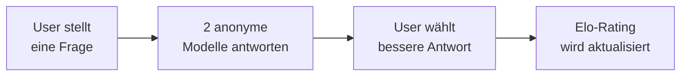

# Evaluation und Benchmarks

> [!ABSTRACT]
> **Benchmarks** sind standardisierte Tests, mit denen die Fähigkeiten von LLMs objektiv gemessen und verglichen werden. Von akademischem Wissen (**MMLU**) über Programmieren (**HumanEval**, **SWE-bench**) bis zu menschlicher Präferenz (**LMSYS Chatbot Arena**) — diese Dokumentation erklärt die wichtigsten Benchmarks, ihre Methodik und ihre Aussagekraft.

---

## Übersicht

| Benchmark | Testet | Top-Score (2025) | Status |
|---|---|---|---|
| **MMLU** | Akademisches Wissen (57 Fächer) | >90% | Zunehmend saturiert |
| **HumanEval** | Python-Code-Generierung | >95% | Nahezu gelöst |
| **SWE-bench** | Real-World Software Engineering | ~70% (Verified) | Aktiv, anspruchsvoll |
| **GPQA** | Graduate-Level Wissenschaft | ~65% | Sehr schwer |
| **LMSYS Arena** | Menschliche Präferenz (Elo) | - | Gold-Standard |
| **MATH** | Mathematische Problemlösung | >90% | Saturiert |
| **ARC-AGI** | Abstraktes Reasoning | ~50% | Sehr schwer |

---

## Wissens-Benchmarks

### MMLU (Massive Multitask Language Understanding)

Der bekannteste akademische Benchmark — 57 Fachgebiete von Astronomie bis Jura:

| Aspekt | Details |
|---|---|
| **Fragen** | ~14.000 Multiple-Choice (4 Optionen) |
| **Fächer** | 57 (STEM, Humanities, Social Sciences, Other) |
| **Format** | Zero-Shot oder Few-Shot |
| **Menschliche Leistung** | ~90% (Experten) |
| **GPT-4o** | ~88% |
| **Claude Sonnet 4** | ~89% |

**Beispiel-Frage (Abstrakte Algebra):**

```
Finde die Ordnung des Elements 5 in der multiplikativen
Gruppe der ganzen Zahlen modulo 7.
(A) 2  (B) 4  (C) 6  (D) 8
→ Antwort: (C) 6
```

> [!WARNING]
> MMLU ist zunehmend **saturiert** — die besten Modelle erreichen >88%, was nahe an der menschlichen Expertenleistung liegt. Deshalb wurde **MMLU-Pro** entwickelt (10 Antwortoptionen statt 4, schwierigere Fragen).

### GPQA (Graduate-Level Google-Proof QA)

Fragen, die so schwer sind, dass selbst **PhD-Experten** nur ~65% erreichen:

| Aspekt | Details |
|---|---|
| **Fragen** | 448 Multiple-Choice |
| **Fächer** | Physik, Chemie, Biologie (Graduate-Level) |
| **PhD-Experten** | ~65% |
| **Nicht-Experten mit Google** | ~34% |
| **Beste LLMs** | ~60% |

---

## Code-Benchmarks

### HumanEval

Von OpenAI entwickelt — testet, ob ein LLM **korrekte Python-Funktionen** schreiben kann:

| Aspekt | Details |
|---|---|
| **Aufgaben** | 164 Python-Programmierprobleme |
| **Metrik** | Pass@k (bestanden bei k Versuchen) |
| **Format** | Docstring → Code generieren → Unit-Tests ausführen |
| **Beste Modelle** | >95% Pass@1 |

**Beispiel:**

```python
def has_close_elements(numbers: List[float], threshold: float) -> bool:
    """Prüfe ob in der Liste zwei Zahlen näher als 'threshold' beieinander liegen.
    
    >>> has_close_elements([1.0, 2.0, 3.0], 0.5)
    False
    >>> has_close_elements([1.0, 2.8, 3.0, 4.0], 0.3)
    True
    """
    # LLM muss diese Funktion implementieren
```

### SWE-bench

Der anspruchsvollste Code-Benchmark — **echte GitHub-Issues lösen**:

| Aspekt | Details |
|---|---|
| **Aufgaben** | 2.294 reale GitHub-Issues (aus 12 Python-Repos) |
| **Format** | Issue-Beschreibung → Code-Patch generieren → Tests bestehen |
| **Repos** | Django, scikit-learn, sympy, matplotlib, u.a. |
| **SWE-bench Verified** | 500 manuell verifizierte, lösbare Issues |
| **SWE-bench Pro** | Härtere Aufgaben, weniger Overfitting-Risiko |

| Variante | Beste Scores (2025) |
|---|---|
| **SWE-bench Lite** | ~50% |
| **SWE-bench Verified** | ~65–72% |
| **SWE-bench Pro** | ~15–23% |

> [!TIP]
> SWE-bench ist der relevanteste Benchmark für **AI Coding Agents** wie [[Claude Code Konfiguration und Hooks|Claude Code]], [[GitHub Copilot CLI Konfiguration|GitHub Copilot]] oder [[OpenAI Codex CLI Konfiguration|Codex]].

---

## Reasoning-Benchmarks

### MATH

Mathematische Problemlösung auf Wettbewerbsniveau:

| Aspekt | Details |
|---|---|
| **Aufgaben** | 12.500 Probleme (7 Schwierigkeitsstufen) |
| **Fächer** | Algebra, Geometrie, Zahlentheorie, Kombinatorik |
| **Format** | Freitext-Antwort (exakter Match) |
| **Beste Modelle** | >90% (mit Chain-of-Thought) |

### ARC-AGI

Testet **abstraktes Reasoning** — Muster erkennen in visuellen Gittern:

| Aspekt | Details |
|---|---|
| **Aufgaben** | Visuelle Input-Output-Gitter |
| **Format** | 3–5 Beispiele → neuen Input transformieren |
| **Menschliche Leistung** | >95% |
| **Beste LLMs** | ~50% |
| **Bedeutung** | Gilt als Test für "echtes" Verständnis vs. Mustererkennung |

---

## Menschliche Präferenz

### LMSYS Chatbot Arena

Der **Gold-Standard** für Modellvergleiche — basiert auf **Blindtests** durch echte Nutzer:



| Aspekt | Details |
|---|---|
| **Methodik** | Blind Pairwise Comparison |
| **Bewertungen** | >2M menschliche Votes |
| **Ranking** | Elo-Rating (wie im Schach) |
| **Website** | chat.lmsys.org |
| **Kategorien** | Overall, Coding, Math, Hard Prompts, Vision |

**Top-Modelle (2025, Overall Elo):**

| Rang | Modell | Elo (ca.) |
|---|---|---|
| 1 | Gemini 2.5 Pro | ~1370 |
| 2 | GPT-4.5 | ~1360 |
| 3 | Claude Sonnet 4 | ~1350 |
| 4 | Grok 3 | ~1340 |
| 5 | DeepSeek R1 | ~1330 |

> [!NOTE]
> Die Arena ist der einzige Benchmark, der **nicht durch Overfitting manipuliert** werden kann, da er auf echten Nutzerfragen basiert.

---

## Benchmark-Kategorien im Überblick

| Kategorie | Benchmarks | Was wird gemessen |
|---|---|---|
| **Wissen** | MMLU, MMLU-Pro, GPQA | Faktenwissen, akademisch |
| **Code** | HumanEval, SWE-bench, MBPP | Programmieren |
| **Mathematik** | MATH, GSM8K | Rechnen und Beweisen |
| **Reasoning** | ARC-AGI, BBH, HellaSwag | Logisches Denken |
| **Sprache** | WMT, FLORES | Übersetzung |
| **Präferenz** | LMSYS Arena, AlpacaEval | Menschliche Bewertung |
| **Safety** | TruthfulQA, ToxiGen | Sicherheit und Ehrlichkeit |

---

## Kritik und Limitierungen

### Benchmark-Saturierung

Viele Benchmarks werden zu schnell "gelöst":
- MMLU: >88% → Unterschiede zwischen Top-Modellen minimal
- HumanEval: >95% → Nicht mehr aussagekräftig
- Lösung: Neue, härtere Benchmarks (MMLU-Pro, SWE-bench Pro)

### Benchmark-Contamination

Gefahr, dass Benchmark-Fragen in den **Trainingsdaten** enthalten sind:
- Modelle "erinnern" sich an Antworten statt sie zu lösen
- Lösung: Private Testsets, regelmäßig neue Fragen

### Nicht alles ist messbar

| Gut messbar | Schwer messbar |
|---|---|
| Faktenwissen | Kreativität |
| Code-Korrektheit | Nuanciertes Verständnis |
| Mathematik | Empathie und Ton |
| Klassifikation | Langfristige Kohärenz |

---

## Benchmarks lesen und interpretieren

### Tipps für Modellvergleiche

1. **Nicht nur einen Benchmark** anschauen — ein Modell kann bei MMLU führen, aber bei Code schwach sein
2. **Chatbot Arena** für allgemeine Qualität bevorzugen (weniger manipulierbar)
3. **SWE-bench** für Coding-Anwendungen (realistischer als HumanEval)
4. **Eigene Evaluierung** für spezifische Use Cases — kein Benchmark ersetzt das Testen mit eigenen Daten
5. **Datum beachten** — Benchmark-Scores ändern sich mit jedem Model-Update

---

## Verwandte Notizen

- [[Wie funktionieren LLMs]] — Wie LLMs funktionieren
- [[RLHF und Alignment]] — Wie Alignment die Benchmark-Scores beeinflusst
- [[Modell Übersicht]] — Modelle im Vergleich
- [[AI Coding Agents Vergleich]] — Coding-Agent Benchmarks
- [[Prompt Engineering Techniken]] — Prompting-Strategien die Benchmark-Scores verbessern
