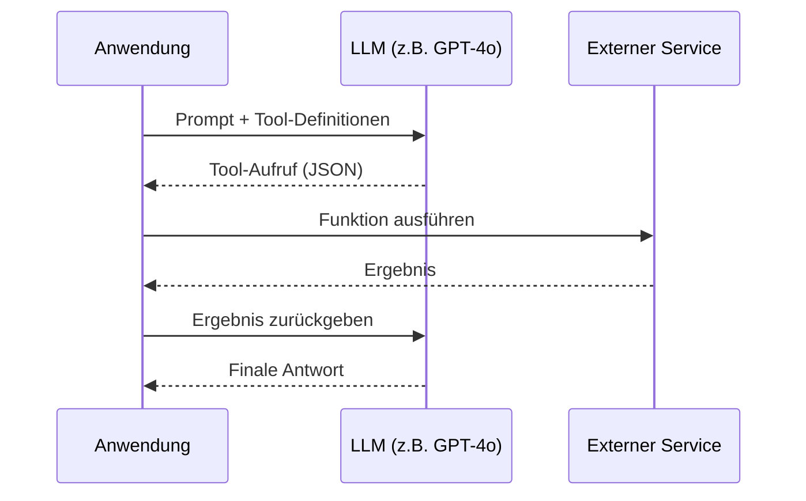
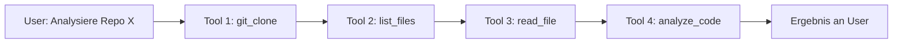
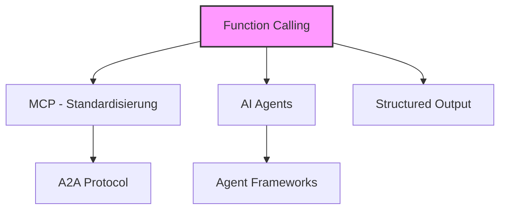

# Function Calling und Tool Use

> [!ABSTRACT]
> **Function Calling** (auch **Tool Use**) ist die Fähigkeit von LLMs, strukturiert externe Funktionen, APIs und Tools aufzurufen. Es ist das Fundament für AI-Agents: Ohne Function Calling kann ein LLM nur Text generieren — mit Function Calling kann es handeln. Function Calling ist die Basis-Technologie hinter [[Was ist MCP|MCP]].

---

## Übersicht

| Aspekt | Details |
|---|---|
| **Konzept** | LLM generiert strukturierten Tool-Aufruf statt Freitext |
| **Format** | JSON Schema für Eingabe/Ausgabe |
| **Unterstützung** | OpenAI, Anthropic, Google, Mistral, Open Source |
| **Parallel Calls** | Mehrere Tools gleichzeitig aufrufen |
| **Chaining** | Tool-Ergebnisse als Input für nächsten Aufruf |
| **Schema-Garantie** | 100% bei OpenAI (Strict Mode), stark bei Anthropic/Google |

---

## Wie Function Calling funktioniert

### Das Grundprinzip



**Ohne Function Calling:**
> User: "Wie ist das Wetter in Berlin?"
> LLM: "Ich kann keine Echtzeit-Daten abrufen." ❌

**Mit Function Calling:**
1. LLM erkennt: "Ich brauche die Wetter-API"
2. LLM gibt zurück: `{"function": "get_weather", "arguments": {"city": "Berlin"}}`
3. App ruft die echte API auf
4. App gibt das Ergebnis an LLM
5. LLM: "In Berlin sind es aktuell 12°C mit leichtem Regen." ✅

---

## Tool-Definitionen (JSON Schema)

### Basis-Struktur

Jedes Tool wird als JSON Schema definiert:

```json
{
  "type": "function",
  "function": {
    "name": "get_weather",
    "description": "Gibt das aktuelle Wetter für eine Stadt zurück",
    "parameters": {
      "type": "object",
      "properties": {
        "city": {
          "type": "string",
          "description": "Name der Stadt"
        },
        "unit": {
          "type": "string",
          "enum": ["celsius", "fahrenheit"],
          "description": "Temperatureinheit"
        }
      },
      "required": ["city"]
    }
  }
}
```

### Was das LLM zurückgibt

```json
{
  "role": "assistant",
  "tool_calls": [
    {
      "id": "call_abc123",
      "type": "function",
      "function": {
        "name": "get_weather",
        "arguments": "{\"city\": \"Berlin\", \"unit\": \"celsius\"}"
      }
    }
  ]
}
```

> [!IMPORTANT] Das LLM führt nie selbst Code aus
> Function Calling bedeutet: Das LLM **entscheidet**, welche Funktion aufgerufen werden soll und mit welchen Parametern. Die **Ausführung** übernimmt deine Anwendung. Das LLM bekommt nur das Ergebnis zurück.

---

## Provider-Vergleich

| Feature | OpenAI | Anthropic | Google Gemini | Mistral | Open Source |
|---|---|---|---|---|---|
| **Function Calling** | ✅ (seit GPT-3.5) | ✅ (Tool Use) | ✅ (seit 1.5 Pro) | ✅ | ✅ (via Frameworks) |
| **JSON Schema** | ✅ | ✅ | ✅ | ✅ | ✅ |
| **Parallel Calls** | ✅ Nativ | ✅ (wachsend) | ✅ | ✅ | Variiert |
| **Strict Mode** | ✅ (100% Schema) | ✅ (ab Sonnet 4.5) | ✅ (`responseSchema`) | Partiell | ❌ |
| **Pydantic-Support** | ✅ Nativ | Indirekt | Indirekt | ❌ | Via Frameworks |
| **Tool Chaining** | ✅ | ✅ | ✅ | ✅ | ✅ |

---

## Implementierung nach Provider

### OpenAI

```python
from openai import OpenAI

client = OpenAI()

tools = [
    {
        "type": "function",
        "function": {
            "name": "search_database",
            "description": "Sucht in der Produktdatenbank",
            "parameters": {
                "type": "object",
                "properties": {
                    "query": {"type": "string"},
                    "max_results": {"type": "integer", "default": 10}
                },
                "required": ["query"]
            }
        }
    }
]

response = client.chat.completions.create(
    model="gpt-4o",
    messages=[{"role": "user", "content": "Finde alle Python-Bücher"}],
    tools=tools,
    tool_choice="auto"  # LLM entscheidet selbst
)

# Tool-Aufruf verarbeiten
tool_call = response.choices[0].message.tool_calls[0]
print(f"Funktion: {tool_call.function.name}")
print(f"Argumente: {tool_call.function.arguments}")
```

### Anthropic (Claude)

```python
import anthropic

client = anthropic.Anthropic()

response = client.messages.create(
    model="claude-sonnet-4-20250514",
    max_tokens=1024,
    tools=[
        {
            "name": "get_stock_price",
            "description": "Aktueller Aktienkurs",
            "input_schema": {
                "type": "object",
                "properties": {
                    "ticker": {
                        "type": "string",
                        "description": "Aktien-Ticker (z.B. AAPL)"
                    }
                },
                "required": ["ticker"]
            }
        }
    ],
    messages=[{"role": "user", "content": "Wie steht Apple?"}]
)

# Tool Use Block verarbeiten
for block in response.content:
    if block.type == "tool_use":
        print(f"Tool: {block.name}, Input: {block.input}")
```

### Google Gemini

```python
import google.generativeai as genai

def get_exchange_rate(base: str, target: str) -> dict:
    """Wechselkurs zwischen zwei Währungen"""
    return {"rate": 1.08, "base": base, "target": target}

model = genai.GenerativeModel(
    "gemini-2.5-pro",
    tools=[get_exchange_rate]
)

chat = model.start_chat()
response = chat.send_message("Wechselkurs EUR zu USD?")
```

---

## Parallel Tool Calls

Moderne LLMs können **mehrere Tools gleichzeitig** aufrufen:

```python
# User: "Wie ist das Wetter in Berlin und München?"
# LLM gibt zurück:
{
    "tool_calls": [
        {
            "id": "call_1",
            "function": {"name": "get_weather", "arguments": '{"city": "Berlin"}'}
        },
        {
            "id": "call_2",
            "function": {"name": "get_weather", "arguments": '{"city": "München"}'}
        }
    ]
}
# → Beide Aufrufe können parallel ausgeführt werden
```

> [!TIP] Performance durch Parallelisierung
> Parallel Tool Calls reduzieren die Latenz erheblich. Statt 2 sequenzielle Roundtrips (Prompt → Tool 1 → Prompt → Tool 2) reicht ein einziger Roundtrip mit paralleler Ausführung.

---

## Tool Chaining (Verkettung)

**Tool Chaining** bedeutet: Das Ergebnis eines Tool-Aufrufs fließt als Input in den nächsten:



Das LLM orchestriert diese Kette automatisch — es entscheidet nach jedem Schritt, welches Tool als nächstes nötig ist. Das ist die Grundlage für **autonome AI-Agents**.

---

## Structured Output vs. Function Calling

| Aspekt | Structured Output | Function Calling |
|---|---|---|
| **Zweck** | LLM gibt strukturierte Daten aus | LLM ruft Funktionen auf |
| **Wer handelt** | Nur das LLM (Daten generieren) | LLM + Anwendung (Aktion ausführen) |
| **Format** | JSON nach Schema | JSON Tool Call + Ergebnis-Loop |
| **Beispiel** | "Extrahiere Name und Alter" | "Rufe Datenbank-API auf" |
| **Verbindung** | Kann Tool-Ergebnisse formatieren | Nutzt Structured Output intern |

> [!NOTE] Beziehung zu MCP
> [[Was ist MCP|MCP]] standardisiert Function Calling über Provider hinweg. Statt für jeden LLM-Provider eigene Tool-Definitionen zu schreiben, definierst du MCP-Server einmal und jeder Agent kann sie nutzen.

---

## Beziehung zu anderen Technologien



| Technologie | Nutzt Function Calling für... |
|---|---|
| **[[Was ist MCP\|MCP]]** | Standardisierte Tool-Schnittstelle |
| **AI Agents** | Autonome Tool-Nutzung und Entscheidungen |
| **[[Structured Output]]** | Schema-garantierte Datenextraktion |
| **[[Agent Frameworks]]** | Tool-Orchestrierung und Chaining |
| **[[A2A Protocol]]** | Agent-Fähigkeiten als aufrufbare Skills |

---

## Best Practices

1. **Präzise Beschreibungen** — Die `description` eines Tools ist entscheidend dafür, ob das LLM es korrekt verwendet
2. **Strict Mode nutzen** — Wo verfügbar (OpenAI), `strict: true` für 100% Schema-Compliance
3. **Validierung** — Tool-Argumente immer serverseitig validieren, bevor die Funktion ausgeführt wird
4. **Fehlerbehandlung** — Tool-Fehler als strukturierte Nachrichten an das LLM zurückgeben
5. **Weniger ist mehr** — Zu viele Tools verwirren das LLM; maximal 10-20 gleichzeitig empfohlen
6. **Enum-Typen nutzen** — Wo möglich `enum` statt freier Strings für bessere Genauigkeit

---

## Verwandte Notizen

- [[Was ist MCP]] — Standardisierung von Function Calling über Provider hinweg
- [[MCP Tools Resources Prompts]] — MCP-Konzepte: Tools, Resources, Prompts
- [[Structured Output]] — Schema-garantierte Ausgabe von LLMs
- [[Was ist ein AI Agent]] — Agents als Systeme, die Function Calling autonom nutzen
- [[Agent Frameworks]] — Frameworks für Tool-Orchestrierung
