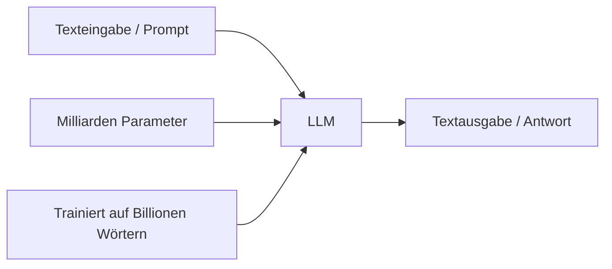
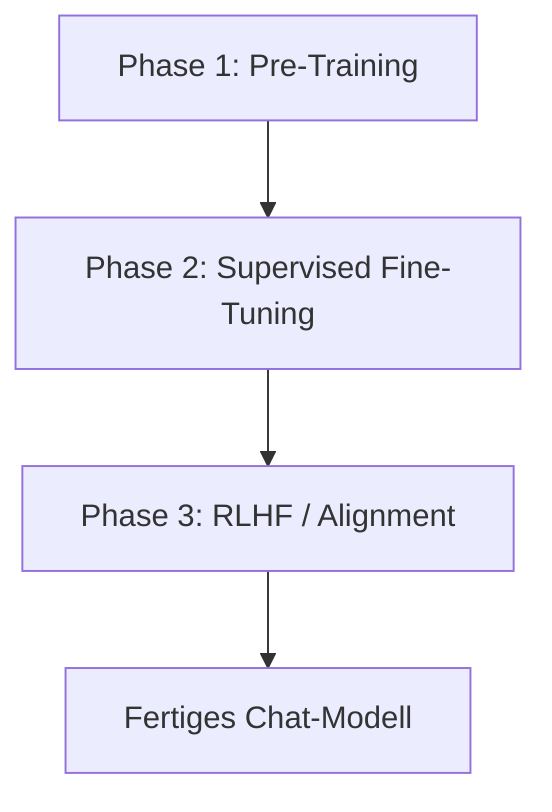
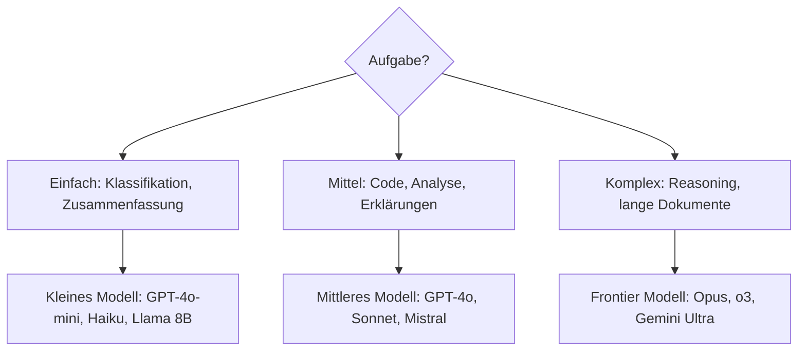

# LLM Grundlagen

> [!ABSTRACT]
> Was sind Large Language Models, warum sind sie so leistungsfähig und wie nutzt man sie? Diese Dokumentation ist der **Einstieg ohne Vorkenntnisse** — von der Frage "Was ist ein LLM?" über Modelltypen und Fähigkeiten bis zu den Grenzen und praktischen Einsatzmöglichkeiten. Die technische Tiefe (Transformer, Attention, Training) findet sich in [[Wie funktionieren LLMs]].

---

## Was ist ein LLM?

Ein **Large Language Model (LLM)** ist ein KI-Modell, das auf enormen Textmengen trainiert wurde und dadurch menschliche Sprache versteht und generieren kann. "Large" bezieht sich auf die Milliarden von **Parametern** (lernbare Gewichte) im Modell.



**Vereinfacht:** Ein LLM ist eine riesige Textvorhersage-Maschine. Es nimmt Text als Eingabe und sagt vorher, welches Wort (Token) am wahrscheinlichsten als nächstes kommt — und das wiederholt es Token für Token, bis eine vollständige Antwort entstanden ist.

> [!NOTE]
> LLMs **verstehen** Sprache nicht im menschlichen Sinne. Sie erkennen statistische Muster aus ihren Trainingsdaten. Trotzdem können sie erstaunlich kohärente, nützliche und kreative Texte generieren.

---

## Schlüsselbegriffe

| Begriff | Bedeutung |
|---------|-----------|
| **Token** | Kleinste Texteinheit (Wort, Silbe oder Zeichen). "Kubernetes" = 3-4 Tokens |
| **Parameter** | Lernbare Gewichte im Modell. Mehr Parameter = potenziell leistungsfähiger |
| **Context Window** | Maximale Textmenge die das Modell gleichzeitig verarbeiten kann |
| **Prompt** | Die Eingabe / Frage an das Modell |
| **Completion** | Die generierte Antwort des Modells |
| **Inference** | Der Prozess der Textgenerierung (Vorhersage Token für Token) |
| **Training** | Der Prozess, bei dem das Modell aus Daten lernt |
| **Fine-Tuning** | Nachtraining auf spezifischen Daten für bestimmte Aufgaben |
| **Halluzination** | Das Modell generiert plausibel klingende, aber falsche Informationen |
| **Temperature** | Steuert wie "kreativ" vs. "deterministisch" das Modell antwortet |

Details zu Tokens: [[Tokenization]] | Details zu Context: [[Context Window und Token Management]]

---

## Wie wird ein LLM trainiert?

Das Training eines LLM erfolgt in mehreren Phasen:



### Phase 1 — Pre-Training

Das Modell liest **Billionen von Wörtern** aus dem Internet (Webseiten, Bücher, Wikipedia, Code, Foren) und lernt dabei:
- Grammatik und Sprachstruktur
- Weltwissen und Fakten
- Logische Zusammenhänge
- Programmiersprachen und Code-Muster

Das Ergebnis ist ein **Base Model**, das Text vervollständigen kann, aber noch nicht als hilfreicher Assistent funktioniert.

### Phase 2 — Supervised Fine-Tuning (SFT)

Menschen erstellen Tausende Beispiel-Konversationen (Frage → ideale Antwort). Das Modell lernt, in einem hilfreichen Dialog-Format zu antworten.

### Phase 3 — RLHF (Reinforcement Learning from Human Feedback)

Menschen bewerten Antworten des Modells und das Modell lernt, welche Antwort-Stile bevorzugt werden (hilfreich, sicher, ehrlich).

Details: [[RLHF und Alignment]]

> [!IMPORTANT]
> Das **Wissen** eines LLM hat einen **Stichtag** (Knowledge Cutoff). Events nach dem Training kennt es nicht, es sei denn es hat Zugriff auf aktuelle Daten (z.B. über [[Function Calling und Tool Use|Tool Use]] oder Web-Suche).

---

## Modelltypen und Kategorien

### Nach Architektur

| Typ | Beschreibung | Beispiele |
|-----|-------------|----------|
| **Decoder-only** | Generiert Text Token für Token | GPT-4, Claude, Llama, Mistral |
| **Encoder-only** | Versteht Text, generiert nicht | BERT, RoBERTa (für Klassifikation) |
| **Encoder-Decoder** | Versteht und generiert | T5, BART (für Übersetzung, Zusammenfassung) |

Für Chat und Textgenerierung sind **Decoder-only** Modelle der Standard.

### Nach Größe

| Kategorie | Parameter | RAM-Bedarf (FP16) | Beispiele |
|-----------|-----------|-------------------|----------|
| **Klein** | 1–3B | 2–6 GB | Phi-3 Mini, Llama 3.2 1B |
| **Mittel** | 7–14B | 14–28 GB | Llama 3.1 8B, Mistral 7B |
| **Groß** | 30–70B | 60–140 GB | Llama 3.1 70B, Qwen 72B |
| **Frontier** | 200B+ | Cluster nötig | GPT-4, Claude Opus, Gemini Ultra |

> [!TIP] Daumenregel für Speicher
> Ein Modell mit **X Milliarden** Parametern braucht mindestens **2 × X GB** RAM bei FP16 Präzision. Mit Quantisierung (Q4) reicht ca. **0.5 × X GB**. Details: [[Lokale LLMs]]

### Nach Zugang

| Typ | Beschreibung | Beispiele |
|-----|-------------|----------|
| **Proprietär (Closed)** | Nur über API nutzbar, Gewichte nicht verfügbar | GPT-4o, Claude, Gemini |
| **Open Weights** | Gewichte herunterladbar, lokal ausführbar | Llama, Mistral, Qwen, Phi |
| **Open Source** | Gewichte + Trainingscode + Daten offen | OLMo, BLOOM |

Modellübersicht und Vergleiche: [[Modell Übersicht]] | [[Modell Vergleiche]]

---

## Was können LLMs?

### Kernfähigkeiten

| Fähigkeit | Beschreibung | Beispiel |
|-----------|-------------|---------|
| **Textgenerierung** | Texte schreiben, fortsetzen, umschreiben | Blog-Artikel, E-Mails, Dokumentation |
| **Zusammenfassung** | Lange Texte auf das Wesentliche reduzieren | Meeting-Notizen, Fachartikel |
| **Übersetzung** | Zwischen Sprachen übersetzen | Deutsch ↔ Englisch, auch Code-Kommentare |
| **Coding** | Code schreiben, erklären, debuggen | Python, JavaScript, Bash, YAML |
| **Analyse** | Texte, Code, Daten analysieren und bewerten | Code-Review, Sentiment-Analyse |
| **Frage-Antwort** | Fragen beantworten basierend auf Wissen | Technische Fragen, Konzept-Erklärungen |
| **Konversation** | Natürliche Dialoge führen | Chatbots, Assistenten |
| **Reasoning** | Logische Schlussfolgerungen ziehen | Mathematik, Problemlösung |

### Multimodale Fähigkeiten

Moderne LLMs können oft mehr als nur Text:

| Modalität | Input | Output | Beispiel-Modelle |
|-----------|-------|--------|-----------------|
| **Text** | ✅ | ✅ | Alle LLMs |
| **Bilder** | ✅ (Vision) | ✅ (Generierung) | GPT-4o, Claude, Gemini |
| **Audio** | ✅ | ✅ | GPT-4o, Gemini |
| **Video** | ✅ | ❌ (meist) | Gemini 2.5 |

Details: [[Multimodalität]]

---

## Was können LLMs nicht?

> [!WARNING] Grenzen von LLMs
> - **Kein Echtzeitwissen** — Wissen endet am Training-Cutoff
> - **Halluzinationen** — Können falsche Fakten überzeugend formulieren
> - **Kein echtes Verständnis** — Statistisches Muster-Matching, kein Bewusstsein
> - **Mathematik-Schwächen** — Können bei komplexer Arithmetik Fehler machen
> - **Kein Gedächtnis** — Jede Konversation startet bei Null (außer bei Kontext/RAG)
> - **Bias** — Spiegeln Vorurteile aus den Trainingsdaten wider
> - **Vertraulichkeit** — Daten an Cloud-APIs werden an den Anbieter gesendet

---

## LLMs in der Praxis nutzen

### Über API (Cloud)

Die einfachste Art, LLMs zu nutzen — ein API-Call genügt:

```bash
# Beispiel: OpenAI API mit curl
curl https://api.openai.com/v1/chat/completions \
  -H "Authorization: Bearer $OPENAI_API_KEY" \
  -H "Content-Type: application/json" \
  -d '{
    "model": "gpt-4o",
    "messages": [
      {"role": "system", "content": "Du bist ein hilfreicher Assistent."},
      {"role": "user", "content": "Was ist Kubernetes in 3 Sätzen?"}
    ]
  }'
```

Anbieter und Routing: [[LLM API Provider und Router]]

### Lokal (Self-Hosted)

LLMs auf eigener Hardware ausführen — kostenlos und ohne Daten an Dritte:

```bash
# Mit Ollama (einfachste Methode)
ollama pull llama3.1:8b
ollama run llama3.1:8b "Erkläre Docker in 3 Sätzen."
```

Details: [[Lokale LLMs]] | [[Ollama]]

### Über AI Agents

LLMs als Kern von autonomen Agenten, die Tools nutzen und mehrstufige Aufgaben lösen:

```text
User: "Erstelle einen Kubernetes-Namespace 'staging' mit Resource-Quotas."

Agent:
1. Liest vorhandene Namespaces (kubectl)
2. Prüft ob 'staging' existiert
3. Erstellt Namespace + ResourceQuota YAML
4. Wendet es an (kubectl apply)
5. Verifiziert das Ergebnis
```

Details: [[Was ist ein AI Agent]] | [[AI Coding Agents Vergleich]]

---

## Kosten und Token-Verbrauch

| Modell | Input (pro 1M Tokens) | Output (pro 1M Tokens) | Ungefähr pro Frage |
|--------|----------------------|------------------------|-------------------|
| GPT-4o | $2.50 | $10.00 | ~$0.01–0.05 |
| Claude Sonnet 4 | $3.00 | $15.00 | ~$0.01–0.08 |
| Claude Opus 4 | $15.00 | $75.00 | ~$0.05–0.40 |
| Llama 3.1 8B (lokal) | $0.00 | $0.00 | Strom + Hardware |

> [!TIP] Kosten sparen
> - Kleine Modelle für einfache Aufgaben (GPT-4o-mini, Haiku)
> - Lokale Modelle für Privatsphäre und Volumen ([[Lokale LLMs]])
> - Kontext minimal halten (weniger Tokens = günstiger)
> - Caching nutzen bei wiederholten Anfragen

---

## Die richtige Modellwahl



| Kriterium | Proprietär (Cloud) | Open Weights (Lokal) |
|-----------|-------------------|---------------------|
| **Qualität** | Meist besser (Frontier) | Gut bis sehr gut (8B–70B) |
| **Datenschutz** | Daten gehen an Anbieter | Daten bleiben lokal |
| **Kosten** | Pay-per-Token | Einmalige Hardware |
| **Verfügbarkeit** | Internet nötig | Offline nutzbar |
| **Geschwindigkeit** | Schnell (Server-GPUs) | Abhängig von Hardware |

Details: [[Modell Vergleiche]] | [[Modell Übersicht]]

---

## Weiterführende Themen

| Thema | Was es abdeckt | Link |
|-------|---------------|------|
| Wie funktionieren LLMs? | Transformer, Attention, Training im Detail | [[Wie funktionieren LLMs]] |
| Tokenization | Wie Text in Tokens zerlegt wird | [[Tokenization]] |
| Prompting | Wie man gute Prompts schreibt | [[Prompting Grundlagen]] |
| Sampling | Temperature, Top-P, Top-K | [[Sampling-Parameter]] |
| Fine-Tuning | Modelle auf eigene Daten trainieren | [[Fine-Tuning Grundlagen]] |
| RAG | LLMs mit eigenen Dokumenten verbinden | [[RAG Grundlagen]] |
| Lokale LLMs | Modelle auf eigener Hardware | [[Lokale LLMs]] |
| AI Agents | LLMs als autonome Assistenten | [[Was ist ein AI Agent]] |
| Evaluation | Wie gut ist ein Modell? | [[Evaluation und Benchmarks]] |
| Sicherheit | Guardrails, Safety, Prompt Injection | [[Guardrails und AI Safety]] |

---

## Verwandte Notizen

- [[Wie funktionieren LLMs]] — Technische Tiefe (Transformer-Architektur)
- [[Modell Übersicht]] — Alle aktuellen Modelle im Überblick
- [[Modell Vergleiche]] — Detaillierte Modellvergleiche
- [[Tokenization]] — Token-Konzept im Detail
- [[Context Window und Token Management]] — Kontextgrenzen
- [[Prompting Grundlagen]] — Wie man richtig promptet
- [[Lokale LLMs]] — Self-Hosted LLMs mit Ollama
- [[AI Index]] — Übersicht aller AI-Themen
