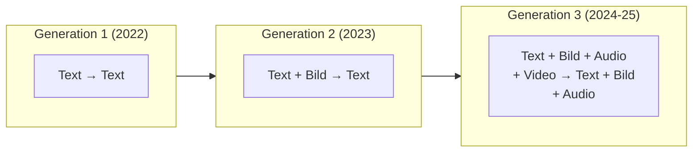
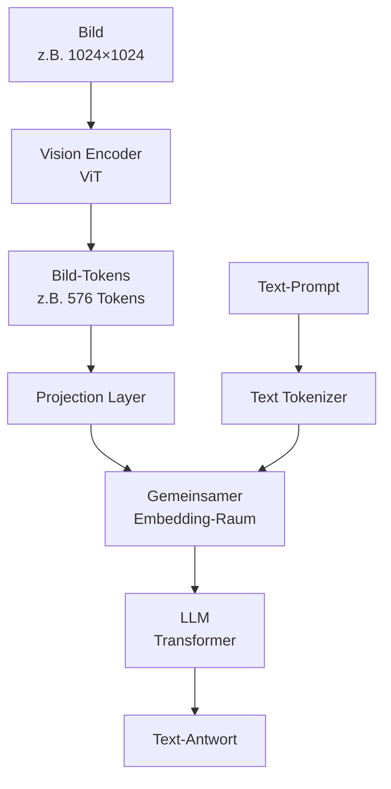
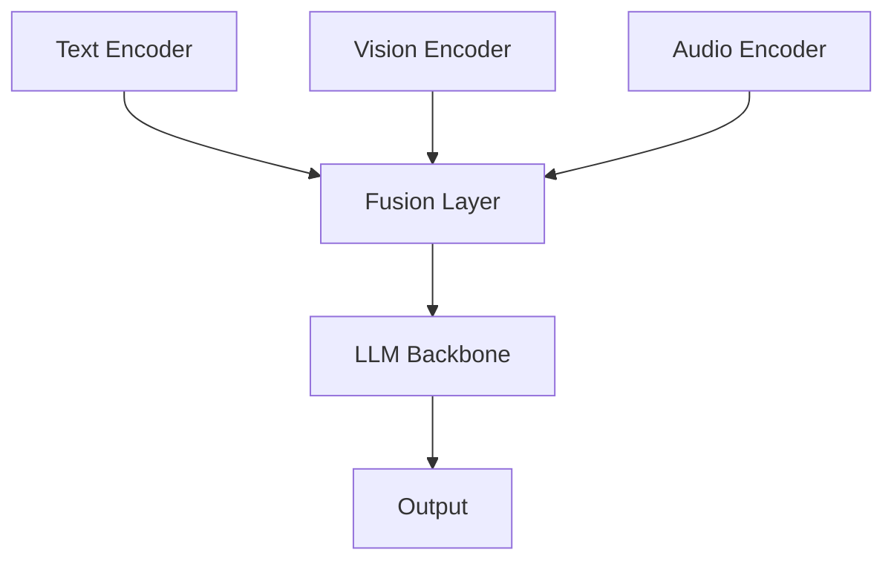
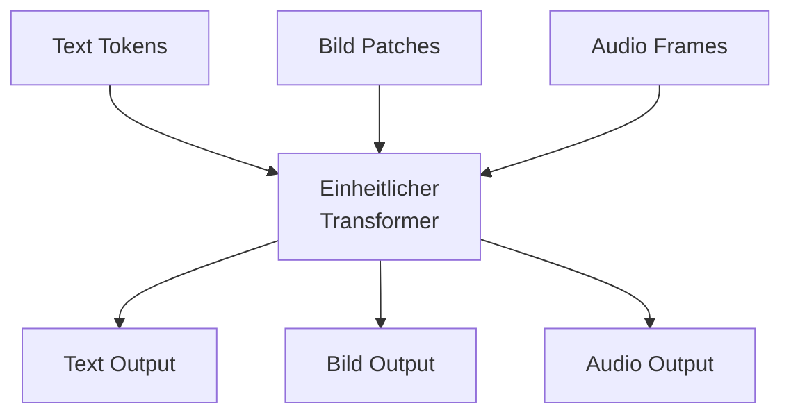

# Multimodalität

> [!ABSTRACT]
> **Multimodale AI** verarbeitet und generiert Inhalte über **mehrere Modalitäten** hinweg — Text, Bilder, Audio, Video und Code in einem einzigen Modell. Von **GPT-4o** (Echtzeit-Audio in 320ms) über **Gemini** (native Multimodalität mit 2M Token-Kontext) bis **Meta ImageBind** (6 Modalitäten) — diese Dokumentation erklärt, wie multimodale Modelle funktionieren und welche Möglichkeiten sie bieten.

---

## Übersicht

| Modell | Modalitäten | Besonderheit |
|---|---|---|
| **GPT-4o** | Text, Bild, Audio | Unified Model, 320ms Audio-Latenz |
| **Gemini 2.5 Pro** | Text, Bild, Audio, Video, Code | Nativ multimodal, 2M Token Context |
| **Claude Sonnet 4** | Text, Bild | Starke Bild-Analyse, kein Audio |
| **Llama 4** | Text, Bild | Open Source, Mixture of Experts |
| **GPT-4o-audio** | Text, Audio (I/O) | Natürliche Sprache mit Emotionen |

---

## Was bedeutet Multimodalität?

### Von Text-Only zu Multi-Modal



| Generation | Modelle | Fähigkeiten |
|---|---|---|
| **Text-Only** | GPT-3, Llama 2, Claude 2 | Nur Text rein, Text raus |
| **Vision-Language** | GPT-4V, Claude 3 | Bilder analysieren, Text ausgeben |
| **Nativ Multimodal** | GPT-4o, Gemini | Alle Modalitäten nativ in einem Modell |

---

## Vision — Bilder verstehen

### Wie VLMs Bilder verarbeiten

**Vision Language Models (VLMs)** verarbeiten Bilder über einen **Vision Encoder** (typischerweise ViT — Vision Transformer):



1. Das Bild wird in **Patches** aufgeteilt (z.B. 16×16 Pixel)
2. Jeder Patch wird wie ein "Token" behandelt
3. Der Vision Encoder erzeugt **Bild-Embeddings**
4. Diese werden mit Text-Embeddings in den gleichen Raum projiziert
5. Das LLM verarbeitet Text und Bild gemeinsam

### Praxis: Bild-Analyse

```python
from openai import OpenAI
import base64

client = OpenAI()

with open("architektur-diagramm.png", "rb") as f:
    image_data = base64.b64encode(f.read()).decode()

response = client.chat.completions.create(
    model="gpt-4o",
    messages=[{
        "role": "user",
        "content": [
            {"type": "text", "text": "Beschreibe diese Systemarchitektur und identifiziere potenzielle Single Points of Failure."},
            {"type": "image_url", "image_url": {"url": f"data:image/png;base64,{image_data}"}}
        ]
    }]
)
```

### Anwendungsfälle Vision

| Anwendung | Beispiel |
|---|---|
| **Dokumenten-Analyse** | PDFs, Rechnungen, Formulare auslesen |
| **Code-Screenshots** | Code von Bildern extrahieren und analysieren |
| **Diagramme verstehen** | Architektur-Diagramme, Flowcharts erklären |
| **UI/UX-Review** | Screenshots analysieren, Verbesserungen vorschlagen |
| **Wissenschaftliche Grafiken** | Graphen, Tabellen, Formeln interpretieren |

---

## Audio — Sprache und Klang

### GPT-4o Audio

GPT-4o verarbeitet Audio **nativ** — nicht als Speech-to-Text → Text-LLM → Text-to-Speech Pipeline, sondern als durchgehende Verarbeitung:

| Eigenschaft | GPT-4o (nativ) | Klassische Pipeline |
|---|---|---|
| **Latenz** | ~320ms | ~2–5 Sekunden |
| **Emotionserkennung** | ✅ Ja | ❌ Nein |
| **Stimmmodulation** | ✅ Natürlich | ❌ Monoton |
| **Code-Switching** | ✅ (Sprache wechseln mid-sentence) | ❌ |
| **Non-Verbal** | ✅ Lachen, Seufzen, Intonation | ❌ |

### Audio API (OpenAI)

```python
# Realtime Audio (WebSocket)
# Für Echtzeit-Konversation mit GPT-4o

# Einfacher: Whisper für Transkription
from openai import OpenAI

client = OpenAI()

with open("meeting.mp3", "rb") as f:
    transcript = client.audio.transcriptions.create(
        model="whisper-1",
        file=f,
        language="de",
    )
print(transcript.text)
```

### Gemini Audio

Gemini kann Audio direkt im Context Window verarbeiten:
- **Gemini 1.5 Flash:** Bis zu **9,5 Stunden Audio** (1M Token Context)
- **Gemini 1.5 Pro:** Bis zu **19 Stunden Audio** (2M Token Context)
- Unterstützt Transkription, Zusammenfassung, Analyse
- Mehrere Audio-Dateien gleichzeitig vergleichen

---

## Video — Bewegtbild verstehen

### Gemini Video-Analyse

Gemini ist führend bei Video-Verarbeitung:

```python
import google.generativeai as genai

model = genai.GenerativeModel("gemini-2.5-pro")

video_file = genai.upload_file("tutorial.mp4")

response = model.generate_content([
    "Erstelle eine detaillierte Zusammenfassung dieses Tutorial-Videos mit Zeitstempeln.",
    video_file,
])
print(response.text)
```

| Feature | Gemini 2.5 Pro | GPT-4o |
|---|---|---|
| **Video-Input** | ✅ Nativ (bis 1h+) | ✅ (Frames) |
| **Zeitstempel** | ✅ Präzise | ⚠️ Begrenzt |
| **Audio im Video** | ✅ Ja | ⚠️ Begrenzt |

### Anwendungsfälle

| Anwendung | Beschreibung |
|---|---|
| **Meeting-Zusammenfassung** | Aufnahme → Protokoll mit Zeitstempeln |
| **Content-Moderation** | Videos auf unangemessenen Inhalt prüfen |
| **Tutorial-Analyse** | Schritte extrahieren, Dokumentation erstellen |
| **Überwachung** | Kamerafeeds analysieren (Anomalieerkennung) |

---

## Multimodale Architekturen

### Ansatz 1: Separate Encoder + Fusion

Früher Standard — jede Modalität hat einen eigenen Encoder:



**Beispiele:** LLaVA, BLIP-2

### Ansatz 2: Nativ Multimodal (Unified)

Modernerer Ansatz — alle Modalitäten in einem einzigen Modell:



**Beispiele:** GPT-4o, Gemini

| Eigenschaft | Separate Encoder | Unified Model |
|---|---|---|
| **Cross-Modal Verständnis** | Begrenzt | Tief |
| **Latenz** | Höher (Pipeline) | Niedriger (ein Durchlauf) |
| **Trainingsaufwand** | Geringer | Sehr hoch |
| **Qualität** | Gut | Besser |

### Meta ImageBind

Metas Forschungsmodell verbindet **6 Modalitäten** in einem gemeinsamen Embedding-Raum:

| Modalität | Beschreibung |
|---|---|
| Text | Natürliche Sprache |
| Bild | Fotos, Illustrationen |
| Audio | Sprache, Musik, Geräusche |
| Tiefe | 3D-Tiefenkarten |
| Thermal | Wärmebilder |
| IMU | Bewegungssensoren |

---

## Token-Kosten pro Modalität

Bilder und Audio verbrauchen **deutlich mehr Tokens** als Text:

| Modalität | Tokens (ca.) | Kosten (GPT-4o) |
|---|---|---|
| 100 Wörter Text | ~130 Tokens | ~$0.0003 |
| 1 Bild (1024×1024) | ~765 Tokens | ~$0.002 |
| 1 Minute Audio | ~1.500 Tokens | ~$0.004 |
| 1 Minute Video (1fps) | ~46.000 Tokens | ~$0.115 |

> [!WARNING]
> Video-Analyse kann **sehr schnell teuer** werden. 10 Minuten Video bei 1 fps ≈ 460K Tokens — das füllt bei vielen Modellen bereits einen Großteil des Context Windows.

---

## Multimodalität in AI Coding Agents

Einige **[[AI Coding Agents Vergleich|AI Coding Agents]]** nutzen multimodale Fähigkeiten:

| Agent | Bild-Input | Anwendung |
|---|---|---|
| **[[Claude Code Konfiguration und Hooks\|Claude Code]]** | ✅ (über API) | Screenshots analysieren, UI beschreiben |
| **[[GitHub Copilot CLI Konfiguration\|Copilot]]** | ✅ (VS Code) | Design-to-Code, UI-Mockups umsetzen |
| **[[Cursor Agent Konfiguration\|Cursor]]** | ✅ | Screenshots → Code |
| **[[Gemini CLI Konfiguration\|Gemini CLI]]** | ✅ | Bild-Analyse im Terminal |

---

## Zukunft: Omni-Models

Die Entwicklung geht in Richtung **Omni-Models**, die alle Modalitäten nahtlos kombinieren:

| Feature | Heute (2025) | Zukunft |
|---|---|---|
| **Text + Bild** | ✅ Standard | ✅ |
| **Audio-Konversation** | ✅ GPT-4o, Gemini | Natürlicher, emotionaler |
| **Video-Generierung** | ⚠️ Sora, Veo | Echtzeit, interaktiv |
| **3D-Generierung** | ❌ Experimentell | Aus Text/Bild |
| **Robotik (Embodied)** | ❌ Forschung | Physische Interaktion |

---

## Verwandte Notizen

- [[Wie funktionieren LLMs]] — Transformer-Grundlagen
- [[AI Bildgenerierung]] — Diffusion Models und Bild-Tools
- [[Modell Übersicht]] — Modelle mit multimodalen Fähigkeiten
- [[Context Window und Token Management]] — Token-Kosten pro Modalität
- [[Embeddings]] — Embedding-Konzepte (Bild- und Text-Embeddings)
- [[Evaluation und Benchmarks]] — Vision-Benchmarks (MMMU, VQA)
