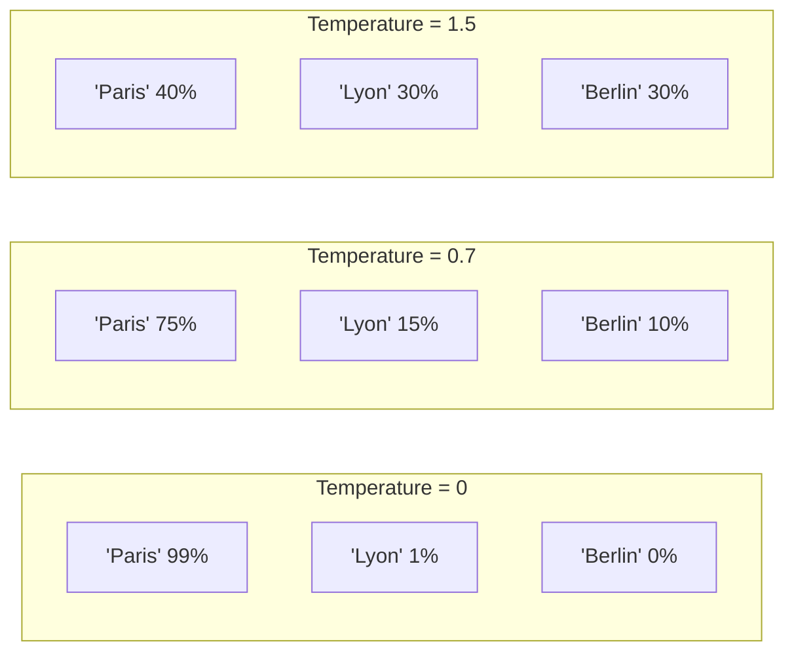

# Sampling-Parameter

> [!ABSTRACT]
> **Sampling-Parameter** steuern, wie ein LLM aus der berechneten Wahrscheinlichkeitsverteilung das nächste Token auswählt. Durch Anpassung von **Temperature**, **Top-P**, **Top-K** und **Penalties** lässt sich das Verhalten zwischen deterministisch (exakt, vorhersagbar) und kreativ (vielfältig, überraschend) fein justieren.

---

## Übersicht

| Parameter | Bereich | Standard | Wirkung |
|---|---|---|---|
| **Temperature** | 0.0–2.0 | 1.0 | Kreativität vs. Determinismus |
| **Top-P (Nucleus)** | 0.0–1.0 | 1.0 | Wahrscheinlichkeitsmasse begrenzen |
| **Top-K** | 1–∞ | Modellabhängig | Anzahl Kandidaten begrenzen |
| **Frequency Penalty** | -2.0–2.0 | 0.0 | Wiederholungen reduzieren |
| **Presence Penalty** | -2.0–2.0 | 0.0 | Neue Themen fördern |
| **Max Tokens** | 1–Modell-Limit | Modellabhängig | Maximale Ausgabelänge |

---

## Temperature

Temperature ist der wichtigste Parameter. Er skaliert die **Logits** (Rohwerte) vor der Softmax-Berechnung:

```
P(token) = softmax(logits / temperature)
```

### Auswirkung



| Temperature | Verhalten | Anwendung |
|---|---|---|
| **0.0** | Deterministisch — immer das wahrscheinlichste Token | Code-Generierung, Fakten, JSON |
| **0.3–0.5** | Leicht kreativ, aber konsistent | Technische Texte, Zusammenfassungen |
| **0.7–0.9** | Ausgewogen kreativ | Dialog, E-Mails, allgemeine Aufgaben |
| **1.0** | Standard — unveränderte Verteilung | Allgemein |
| **1.2–2.0** | Sehr kreativ, potenziell inkohärent | Brainstorming, kreatives Schreiben |

> [!WARNING]
> Temperature = 0 bedeutet **Greedy Decoding** — das Token mit der höchsten Wahrscheinlichkeit wird immer gewählt. Nicht immer optimal, da es zu repetitiven Schleifen führen kann.

---

## Top-P (Nucleus Sampling)

Top-P begrenzt die Auswahl auf die **kleinste Menge an Tokens**, deren kumulative Wahrscheinlichkeit den Schwellenwert P erreicht:

### Beispiel mit Top-P = 0.9

```
Token-Wahrscheinlichkeiten (sortiert):
  "Paris"    → 0.50  (kumulativ: 0.50) ✅
  "Lyon"     → 0.20  (kumulativ: 0.70) ✅
  "Berlin"   → 0.15  (kumulativ: 0.85) ✅
  "Madrid"   → 0.08  (kumulativ: 0.93) ✅ (überschreitet 0.9 → letztes Token)
  "Rom"      → 0.04  ❌ (ausgeschlossen)
  "Tokio"    → 0.03  ❌ (ausgeschlossen)
```

Die Wahrscheinlichkeiten der verbleibenden Tokens werden **renormalisiert**, sodass sie sich wieder zu 1.0 summieren.

| Top-P | Verhalten |
|---|---|
| **0.1** | Nur die wahrscheinlichsten 10% — sehr fokussiert |
| **0.5** | Moderate Auswahl |
| **0.9** | Breite Auswahl, aber extrem Unwahrscheinliches ausgeschlossen |
| **1.0** | Kein Filter — alle Tokens möglich |

> [!TIP]
> **Temperature oder Top-P** — nicht beides gleichzeitig stark verändern. OpenAI empfiehlt: Einen Parameter anpassen und den anderen auf Standard lassen.

---

## Top-K

Top-K begrenzt die Auswahl auf die **K wahrscheinlichsten Tokens**:

```
Top-K = 3:
  "Paris"  → 0.50 ✅
  "Lyon"   → 0.20 ✅
  "Berlin" → 0.15 ✅
  "Madrid" → 0.08 ❌
  ...
```

| Top-K | Verhalten |
|---|---|
| **1** | Greedy — nur das wahrscheinlichste Token |
| **10** | Sehr fokussiert |
| **40** | Standard bei vielen Modellen |
| **100** | Breite Auswahl |

### Top-K vs. Top-P

| Eigenschaft | Top-K | Top-P |
|---|---|---|
| **Methode** | Feste Anzahl Kandidaten | Dynamische Anzahl nach Wahrscheinlichkeit |
| **Problem** | Bei klarer Verteilung zu viele irrelevante Tokens | - |
| **Vorteil** | Einfach und vorhersagbar | Adaptiv — passt sich der Verteilung an |
| **Empfehlung** | Als zusätzlicher Filter verwenden | Bevorzugt gegenüber Top-K |

---

## Frequency Penalty und Presence Penalty

Diese Parameter reduzieren **Wiederholungen**:

### Frequency Penalty

Reduziert die Wahrscheinlichkeit eines Tokens proportional dazu, **wie oft es bereits vorkam**:

```
logit_angepasst = logit - frequency_penalty × anzahl_vorkommen
```

| Wert | Wirkung |
|---|---|
| **0.0** | Kein Effekt |
| **0.5** | Leichte Reduktion von Wiederholungen |
| **1.0** | Starke Reduktion |
| **2.0** | Extreme Vermeidung (kann zu unnatürlichem Text führen) |

### Presence Penalty

Reduziert die Wahrscheinlichkeit eines Tokens basierend darauf, **ob es überhaupt vorkam** (unabhängig von der Häufigkeit):

```
logit_angepasst = logit - presence_penalty × (1 wenn token vorkam, sonst 0)
```

- Fördert **thematische Vielfalt** — das Modell wechselt häufiger das Thema
- Nützlich für Brainstorming und explorative Texte

> [!NOTE]
> Frequency Penalty bestraft **häufige** Wiederholungen stärker. Presence Penalty bestraft jede Wiederholung **gleich stark**, egal ob einmal oder zehnmal verwendet.

---

## Max Tokens

Begrenzt die **maximale Anzahl generierter Tokens** in der Antwort:

| Modell | Max Output Tokens |
|---|---|
| GPT-4o | 16.384 |
| Claude Sonnet 4 | 16.000 (Standard), 64.000 (Extended) |
| Gemini Pro | 8.192 |

> [!IMPORTANT]
> `max_tokens` zählt nur die **Output-Tokens**. Input + Output zusammen dürfen das Context Window nicht überschreiten.

---

## Empfohlene Konfigurationen

### Nach Anwendungsfall

| Anwendung | Temperature | Top-P | Frequency Penalty | Presence Penalty |
|---|---|---|---|---|
| **Code-Generierung** | 0.0–0.2 | 0.95 | 0.0 | 0.0 |
| **JSON/Structured Output** | 0.0 | 1.0 | 0.0 | 0.0 |
| **Technische Dokumentation** | 0.3–0.5 | 0.9 | 0.3 | 0.0 |
| **Allgemeiner Chat** | 0.7 | 0.9 | 0.5 | 0.3 |
| **Kreatives Schreiben** | 0.9–1.2 | 0.95 | 0.5 | 0.5 |
| **Brainstorming** | 1.0–1.5 | 0.95 | 0.8 | 0.8 |

### API-Beispiel (OpenAI Python SDK)

```python
from openai import OpenAI

client = OpenAI()

# Für Code-Generierung (deterministisch)
response = client.chat.completions.create(
    model="gpt-4o",
    messages=[{"role": "user", "content": "Schreibe eine Python-Funktion für Fibonacci"}],
    temperature=0,
    max_tokens=1000,
)

# Für kreatives Schreiben
response = client.chat.completions.create(
    model="gpt-4o",
    messages=[{"role": "user", "content": "Schreibe eine kurze Geschichte über KI"}],
    temperature=1.0,
    top_p=0.95,
    frequency_penalty=0.5,
    presence_penalty=0.5,
    max_tokens=2000,
)
```

### API-Beispiel (Anthropic Python SDK)

```python
import anthropic

client = anthropic.Anthropic()

response = client.messages.create(
    model="claude-sonnet-4-20250514",
    max_tokens=1024,
    temperature=0.3,   # Top-P wird bei Anthropic automatisch gesetzt
    messages=[{"role": "user", "content": "Erkläre Quantencomputing"}],
)
```

---

## Seed-Parameter

Einige APIs bieten einen **Seed-Parameter** für reproduzierbare Ergebnisse:

```python
response = client.chat.completions.create(
    model="gpt-4o",
    messages=[{"role": "user", "content": "Nenne 3 Farben"}],
    temperature=0.5,
    seed=42,  # Gleicher Seed → gleiche Antwort (best effort)
)
```

> [!NOTE]
> Reproduzierbarkeit mit Seed ist **best effort** — nicht garantiert über verschiedene API-Versionen oder Hardware.

---

## Verwandte Notizen

- [[Wie funktionieren LLMs]] — Wie die Wahrscheinlichkeitsverteilung entsteht
- [[Tokenization]] — Was Tokens sind und wie sie gezählt werden
- [[Structured Output]] — Temperature 0 für deterministische JSON-Ausgaben
- [[LLM API Provider und Router]] — API-Parameter pro Provider
- [[Prompt Engineering Techniken]] — Prompt-Strategien inkl. Parameter-Empfehlungen
