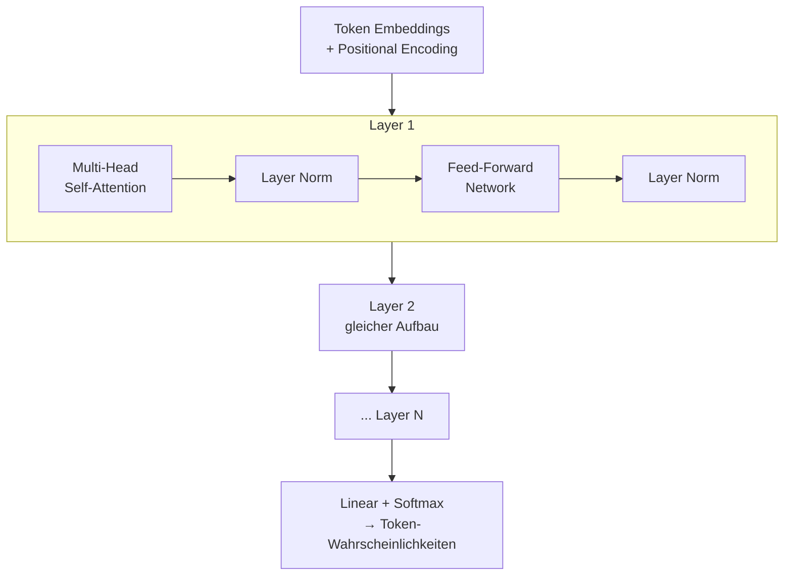
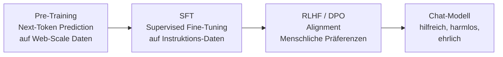
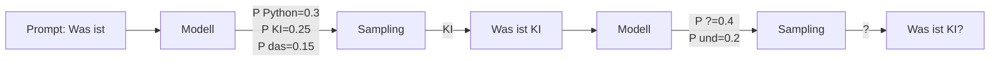

# Wie funktionieren LLMs

> [!ABSTRACT]
> **Large Language Models (LLMs)** basieren auf der **Transformer-Architektur**, die 2017 von Google vorgestellt wurde. Sie lernen durch **Next-Token Prediction** auf riesigen Textmengen, statistische Muster der Sprache zu verstehen. Diese Grundlagen-Dokumentation erklärt, wie ein LLM von Rohtext zu intelligenten Antworten kommt — von der Tokenization über Attention bis zur Textgenerierung.

---

## Übersicht

| Aspekt | Details |
|---|---|
| **Architektur** | Transformer (Decoder-only für GPT, Encoder-Decoder für T5) |
| **Kernmechanismus** | Self-Attention (Multi-Head Attention) |
| **Training** | Pre-Training (Next-Token Prediction) → Fine-Tuning → [[RLHF und Alignment\|Alignment]] |
| **Parameter** | 1B–2T+ trainierbare Gewichte |
| **Eingabe** | Text → [[Tokenization\|Tokens]] → Embeddings |
| **Ausgabe** | Wahrscheinlichkeitsverteilung über nächstes Token |

---

## Von Text zu Zahlen

Bevor ein LLM Text verarbeiten kann, muss er in Zahlen umgewandelt werden:


**Technisches Beispiel:**

```
"Hallo Welt!"
    ↓ Tokenization
[15339, 14957, 0]
    ↓ Embedding (je 4096 Dimensionen)
[[0.23, -0.87, 0.51, ...], [0.12, 0.44, -0.33, ...], [0.91, -0.05, 0.67, ...]]
    ↓ + Positional Encoding
[[0.25, -0.84, 0.53, ...], [0.15, 0.49, -0.28, ...], [0.96, 0.02, 0.73, ...]]
    ↓
Transformer Input (3 × 4096 Matrix)
```

1. **[[Tokenization]]** — Text wird in Sub-Wörter (Tokens) zerlegt
2. **[[Embeddings|Embedding]]** — Jedes Token wird zu einem hochdimensionalen Vektor (z.B. 4096 Dimensionen)
3. **Positional Encoding** — Position im Satz wird hinzugefügt (Transformer hat kein natürliches Sequenzverständnis)

> [!NOTE]
> Ein Token ist **nicht** gleich ein Wort. "Programmierung" könnte z.B. in ["Programm", "ierung"] zerlegt werden. Siehe [[Tokenization]] für Details.

### Embedding — Token zu Vektor

Die **[[Embeddings|Embedding-Schicht]]** wandelt jede Token-ID in einen hochdimensionalen Vektor um (z.B. 4096 Dimensionen). Diese Vektoren repräsentieren **Bedeutung als Geometrie** — semantisch ähnliche Wörter liegen im Vektorraum nah beieinander.

- Die Embedding-Tabelle hat **Vokabulargröße × Embedding-Dimensionen** Einträge (z.B. 100.000 × 4096)
- Die Werte werden **beim Training gelernt** — nicht manuell gesetzt
- Ähnliche Wörter bekommen automatisch ähnliche Vektoren

> [!TIP]
> Für eine ausführliche Erklärung von Vektoren, Ähnlichkeitsmetriken und Embedding-Modellen siehe [[Embeddings]]. Embeddings sind auch die Basis für **[[RAG Grundlagen|RAG]]** und **[[Vektordatenbanken]]**.

### Positional Encoding — Wo steht das Wort?

Ein Transformer verarbeitet alle Tokens **gleichzeitig** (parallel), nicht nacheinander wie ein RNN. Ohne Positions-Information wäre "Hund beißt Mann" identisch zu "Mann beißt Hund". **Positional Encoding** löst das:

| Token | Embedding | Position | Positional Encoding | Finaler Vektor |
|---|---|---|---|---|
| "Hallo" | [0.23, -0.87, ...] | 0 | [0.00, 1.00, ...] | [0.23, 0.13, ...] |
| "Welt" | [0.12, 0.44, ...] | 1 | [0.84, 0.54, ...] | [0.96, 0.98, ...] |
| "!" | [0.91, -0.05, ...] | 2 | [0.91, -0.42, ...] | [1.82, -0.47, ...] |

Der Positional Encoding-Vektor wird zum Embedding **addiert**:

```
Finaler Vektor = Embedding + Positional Encoding
```

**Klassisch (Original-Transformer):** Sinus/Kosinus-Funktionen mit verschiedenen Frequenzen:

```
PE(pos, 2i)   = sin(pos / 10000^(2i/d))
PE(pos, 2i+1) = cos(pos / 10000^(2i/d))
```

**Modern (RoPE — Rotary Position Embeddings):** Dreht die Vektoren im Raum basierend auf der Position. Wird von GPT-4, Llama, Claude verwendet und skaliert besser für lange Kontexte.

> [!IMPORTANT]
> Ohne Positional Encoding könnte ein Transformer nicht zwischen "Katze frisst Maus" und "Maus frisst Katze" unterscheiden — die Wortposition wäre unsichtbar.

---

## Die Transformer-Architektur

### Überblick

Der Transformer besteht aus gestapelten identischen Schichten (Layers). Moderne LLMs wie GPT-4 oder Claude haben 80–120+ Schichten.



Jede Schicht hat zwei Hauptkomponenten:

### Self-Attention — "Worauf achte ich?"

Self-Attention ist die Kerninnovation des Transformers. Für jedes Token berechnet der Mechanismus, wie viel **Aufmerksamkeit** es jedem anderen Token im Kontext schenken soll.

**Beispiel:**

> "Die **Katze** saß auf der Matte, weil **sie** müde war."

Self-Attention erkennt: "sie" bezieht sich auf "Katze" — nicht auf "Matte".

**Wie es funktioniert:**

Für jedes Token werden drei Vektoren berechnet:

| Vektor | Rolle | Analogie |
|---|---|---|
| **Query (Q)** | "Was suche ich?" | Die Frage, die ein Token stellt |
| **Key (K)** | "Was biete ich an?" | Die Information, die ein Token hat |
| **Value (V)** | "Was gebe ich weiter?" | Der tatsächliche Inhalt |

```
Attention(Q, K, V) = softmax(Q × K^T / √d_k) × V
```

- `Q × K^T` berechnet die Ähnlichkeit zwischen allen Token-Paaren
- `√d_k` skaliert die Werte (verhindert zu große Zahlen)
- `softmax` normalisiert zu Wahrscheinlichkeiten (0–1)
- Multiplikation mit `V` gewichtet die tatsächlichen Werte

### Multi-Head Attention — Mehrere Perspektiven

Statt nur eine Attention zu berechnen, nutzt der Transformer **mehrere Attention-Köpfe** parallel (z.B. 32 oder 128):

| Kopf | Könnte lernen |
|---|---|
| Kopf 1 | Grammatische Beziehungen (Subjekt → Verb) |
| Kopf 2 | Semantische Bezüge (Pronomen → Referenz) |
| Kopf 3 | Positionsmuster (nächstes Wort, vorheriges Wort) |
| Kopf 4 | Thematische Zusammenhänge |

Die Ergebnisse aller Köpfe werden am Ende zusammengeführt (concatenated).

### Feed-Forward Network — "Was mache ich damit?"

Nach der Attention verarbeitet ein Feed-Forward Network (FFN) die Informationen:

- Zwei lineare Transformationen mit einer Aktivierungsfunktion (GELU/SwiGLU)
- Hier wird ein Großteil des "Wissens" gespeichert
- Das FFN ist **positionsweise** — jedes Token wird unabhängig verarbeitet

### Residual Connections und Layer Normalization

Jede Sub-Schicht hat:
- **Residual Connection** — Der Original-Input wird zum Output addiert (verhindert Informationsverlust)
- **Layer Norm** — Normalisiert die Werte (stabilisiert das Training)

---

## Pre-Training — Sprache lernen

### Next-Token Prediction

LLMs lernen durch eine einfache Aufgabe: **Das nächste Wort vorhersagen.**

```
Input:  "Die Hauptstadt von Frankreich ist"
Target: "Paris"
```

Das Modell sieht Milliarden solcher Sequenzen und lernt dabei:
- Grammatik und Syntax
- Fakten und Wissen
- Logische Zusammenhänge
- Programmiermuster
- Mehrsprachigkeit

> [!IMPORTANT]
> Pre-Training ist **self-supervised** — es braucht keine manuell gelabelten Daten. Der Text selbst ist das Label (das nächste Wort). Deshalb kann man auf dem gesamten Internet trainieren.

### Trainingsdaten

| Modell | Trainingsdaten | Parameter |
|---|---|---|
| GPT-3 | ~300B Tokens | 175B |
| Llama 3 | ~15T Tokens | 405B |
| GPT-4 | Nicht veröffentlicht | ~1.8T (geschätzt) |
| Claude 4 | Nicht veröffentlicht | Nicht veröffentlicht |

### Kosten

Pre-Training ist **extrem teuer**:
- GPT-4: geschätzt $50–100M+ für einen Trainingslauf
- Tausende GPUs (A100/H100) über Wochen/Monate
- Deshalb trainieren nur wenige Unternehmen Base Models

---

## Vom Base Model zum Chat-Modell

Ein Pre-Trained Base Model kann nur "Text vervollständigen" — es ist kein hilfreicher Assistent. Dafür braucht es weitere Stufen:



| Phase | Was passiert | Ergebnis |
|---|---|---|
| **Pre-Training** | Nächstes Token vorhersagen auf Billionen von Tokens | Base Model (kann Text vervollständigen) |
| **SFT** | Feintuning auf Instruktions-Daten (Frage → Antwort) | Instruktions-Modell (folgt Anweisungen) |
| **[[RLHF und Alignment\|RLHF/DPO]]** | Menschliche Bewertungen optimieren | Aligned Model (hilfreich, sicher, ehrlich) |

> [!TIP]
> Details zum Alignment-Prozess (RLHF, DPO, PPO) findest du in [[RLHF und Alignment]].

---

## Textgenerierung — Wie antwortet ein LLM?

Ein LLM generiert Text **Token für Token** in einer Auto-Regressiven Schleife:



1. Der gesamte bisherige Text (Prompt + bisherige Antwort) geht ins Modell
2. Das Modell berechnet eine Wahrscheinlichkeitsverteilung über alle ~100.000 Tokens im Vokabular
3. Ein Token wird basierend auf den [[Sampling-Parameter|Sampling-Parametern]] (Temperature, Top-P) ausgewählt
4. Das gewählte Token wird angehängt, und der Prozess wiederholt sich
5. Bis ein Stop-Token (`<|endoftext|>`) generiert wird

> [!WARNING]
> LLMs "denken" nicht wie Menschen. Sie berechnen statistische Wahrscheinlichkeiten basierend auf Mustern in den Trainingsdaten. Das erklärt sowohl ihre Stärke (flüssiger Text) als auch ihre Schwäche (Halluzinationen).

---

## Schlüsselkonzepte

### Context Window

Das **[[Context Window und Token Management|Context Window]]** ist die maximale Anzahl an Tokens, die ein LLM gleichzeitig verarbeiten kann:

| Modell | Context Window |
|---|---|
| GPT-3.5 | 4K–16K Tokens |
| GPT-4o | 128K Tokens |
| Claude Sonnet 4 | 200K Tokens |
| Gemini 1.5 Pro | 2M Tokens |

### Emergente Fähigkeiten

Ab einer bestimmten Modellgröße entstehen Fähigkeiten, die **nicht explizit trainiert** wurden:
- **Chain-of-Thought Reasoning** — Schritt-für-Schritt Denken
- **In-Context Learning** — Aus Beispielen im Prompt lernen
- **Code-Generierung** — Programmieren ohne explizites Code-Training
- **Mehrsprachigkeit** — Übersetzen zwischen Sprachen

### Limitierungen

| Limitation | Ursache |
|---|---|
| **Halluzinationen** | Modell generiert plausibel klingenden, aber falschen Text |
| **Kein Weltwissen nach Cutoff** | Training-Daten haben ein Enddatum |
| **Kein echtes Verständnis** | Statistische Muster, keine Kausalität |
| **Bias** | Verzerrungen aus den Trainingsdaten |

---

## Aktuelle Optimierungen

| Technik | Beschreibung |
|---|---|
| **Flash Attention** | Effizientere Attention-Berechnung (weniger GPU-Speicher) |
| **Rotary Embeddings (RoPE)** | Bessere Positions-Kodierung für lange Kontexte |
| **Mixture of Experts (MoE)** | Nur ein Teil des Netzwerks wird pro Token aktiviert |
| **KV-Cache** | Bereits berechnete Key/Value-Paare wiederverwenden |
| **Speculative Decoding** | Kleines Modell generiert Entwürfe, großes Modell prüft |
| **Quantisierung** | Gewichte komprimieren (32-bit → 4-bit) für lokale Ausführung |

---

## Verwandte Notizen

- [[Tokenization]] — Wie Text in Tokens zerlegt wird
- [[Sampling-Parameter]] — Temperature, Top-P, Top-K
- [[RLHF und Alignment]] — Wie Base Models zu Chat-Modellen werden
- [[Context Window und Token Management]] — Token-Limits und Strategien
- [[Modell Übersicht]] — Übersicht aller Modell-Familien
- [[Fine-Tuning Grundlagen]] — Modelle auf eigene Daten anpassen
- [[Lokale LLMs]] — LLMs lokal ausführen
- [[Multimodalität]] — LLMs mit Vision, Audio, Video
