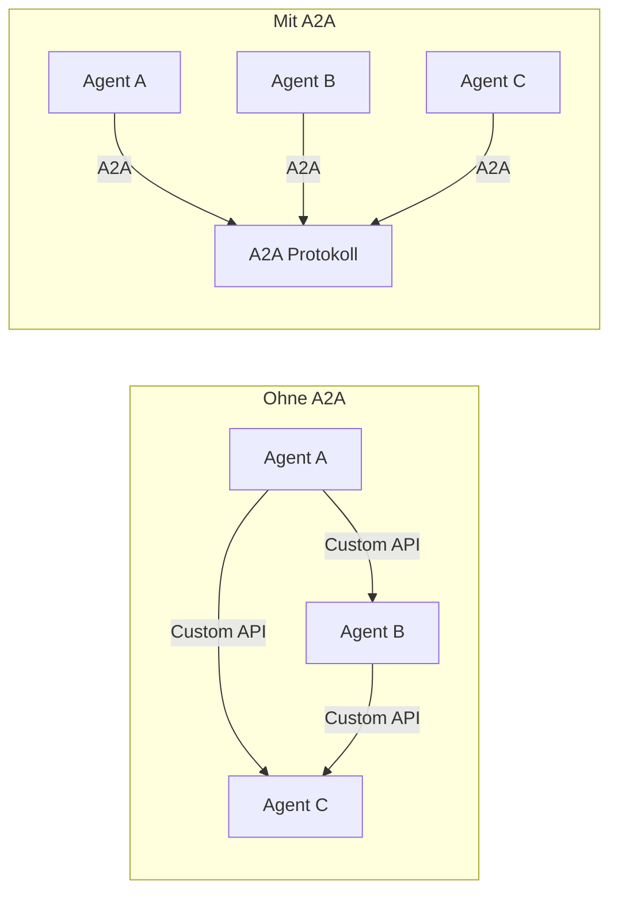
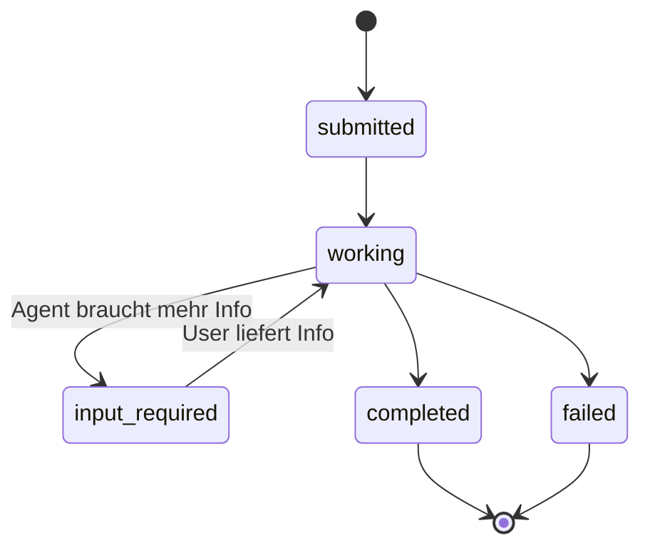
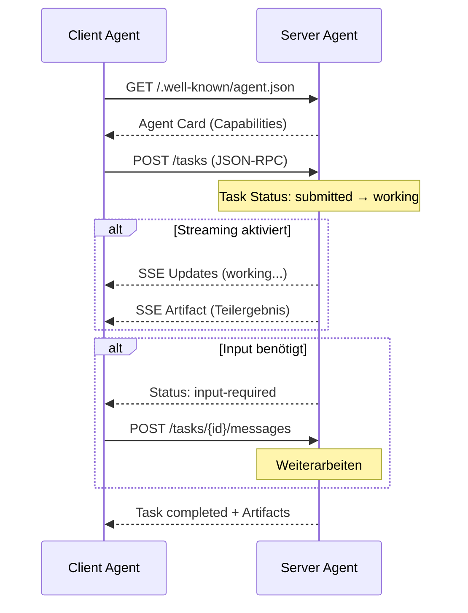

# A2A Protocol (Agent-to-Agent)

> [!ABSTRACT]
> Das **A2A-Protokoll** (Agent-to-Agent) ist ein offener Standard von Google für die sichere Kommunikation und Zusammenarbeit zwischen AI-Agents — auch wenn diese von verschiedenen Herstellern oder auf unterschiedlichen Frameworks basieren. A2A ergänzt [[Was ist MCP|MCP]] (Agent-zu-Tool) um die fehlende Agent-zu-Agent-Schicht.

---

## Übersicht

| Eigenschaft | Details |
|---|---|
| **Name** | Agent-to-Agent Protocol (A2A) |
| **Entwickler** | Google (jetzt Linux Foundation) |
| **Erstveröffentlichung** | April 2025 |
| **Typ** | Offener Standard / Protokoll |
| **Transportschicht** | HTTP + JSON-RPC 2.0 |
| **Streaming** | Server-Sent Events (SSE) |
| **Async** | Webhooks für Benachrichtigungen |
| **SDKs** | Python, JavaScript, Java, C#, Go |
| **Partner** | Google, Microsoft, IBM, Atlassian, Salesforce, SAP, ServiceNow |
| **Spezifikation** | [a2a-protocol.org](https://a2a-protocol.org/latest/) |

---

## Warum A2A?

AI-Agents werden von verschiedenen Teams, mit unterschiedlichen Frameworks und für verschiedene Aufgaben gebaut. Ohne Standard entsteht ein **N²-Integrationsproblem** — jeder Agent muss mit jedem anderen Agent individuell verbunden werden.

A2A löst das durch:

- **Universelle Sprache**: Standardisierte Nachrichten zwischen beliebigen Agents
- **Dynamische Entdeckung**: Agents finden sich gegenseitig über Agent Cards
- **Vendor-neutral**: Framework-agnostisch (LangGraph, CrewAI, ADK, custom)
- **Enterprise-ready**: Authentifizierung, Autorisierung, Audit-Logging



---

## Kernkonzepte

### Agent Cards

Eine **Agent Card** ist die digitale Visitenkarte eines Agents — eine maschinenlesbare JSON-Datei unter `/.well-known/agent.json`:

```json
{
  "name": "Code-Review-Agent",
  "description": "Analysiert Code-Qualität und findet Bugs",
  "url": "https://review-agent.example.com",
  "version": "1.0.0",
  "capabilities": {
    "streaming": true,
    "pushNotifications": true
  },
  "skills": [
    {
      "id": "code-review",
      "name": "Code Review",
      "description": "Führt automatische Code-Reviews durch",
      "inputModes": ["text/plain", "application/json"],
      "outputModes": ["text/plain", "application/json"]
    }
  ],
  "authentication": {
    "schemes": ["Bearer"]
  }
}
```

Andere Agents lesen diese Card und wissen sofort:
- Welche Fähigkeiten der Agent hat
- Wie man mit ihm kommuniziert
- Welche Authentifizierung nötig ist

### Tasks (Aufgaben)

Eine **Task** ist die zentrale Arbeitseinheit im A2A-Protokoll:



Tasks durchlaufen definierte Zustände:
- **submitted** — Aufgabe wurde eingereicht
- **working** — Agent arbeitet daran
- **input-required** — Agent braucht zusätzliche Informationen
- **completed** — Aufgabe erfolgreich abgeschlossen
- **failed** — Aufgabe fehlgeschlagen

### Messages und Parts

Kommunikation erfolgt über **Messages** mit **Parts** (Inhaltsblöcken):

| Part-Typ | Beschreibung | Beispiel |
|---|---|---|
| **TextPart** | Reiner Text | Prompt, Antwort, Beschreibung |
| **FilePart** | Datei (inline oder URI) | Code-Datei, Bild, Dokument |
| **DataPart** | Strukturierte Daten | JSON-Objekt, Schema-Daten |

### Artifacts (Ergebnisse)

**Artifacts** sind die Ergebnisse einer Task — das, was der Agent produziert hat:

```json
{
  "name": "review-result",
  "parts": [
    {
      "type": "text",
      "text": "3 Probleme gefunden: ..."
    },
    {
      "type": "data",
      "data": {
        "issues": 3,
        "severity": "warning"
      }
    }
  ]
}
```

---

## Wie A2A funktioniert

### Ablauf einer Agent-Kollaboration



### Schritt für Schritt

1. **Discovery**: Client liest die Agent Card des Server-Agents
2. **Capability Check**: Client prüft, ob der Agent die gewünschte Fähigkeit hat
3. **Task erstellen**: Client sendet eine Task via JSON-RPC
4. **Verarbeitung**: Server-Agent arbeitet die Task ab
5. **Streaming** (optional): Echtzeit-Updates via SSE
6. **Ergebnis**: Artifacts werden zurückgeliefert

---

## A2A vs. MCP vs. ACP

| Aspekt | A2A | [[Was ist MCP\|MCP]] | [[ACP Agent Communication Protocol\|ACP]] |
|---|---|---|---|
| **Zweck** | Agent ↔ Agent | Agent ↔ Tool | Agent ↔ Agent (Edge/Lokal) |
| **Fokus** | Entdeckung, Koordination, Workflows | Kontext und Tool-Zugriff | Lokale/Edge-Kommunikation |
| **Analogie** | Telefon/E-Mail zwischen Agents | Werkzeugkasten für einen Agent | Lokales Netzwerk für Agents |
| **Transport** | HTTP + JSON-RPC, SSE | JSON-RPC (stdio/HTTP) | HTTP + JSON-RPC, WebSockets |
| **Discovery** | Agent Cards (`.well-known/`) | Manuell / Registry | Manifest-basiert, lokal |
| **Sicherheit** | OAuth2, API Keys, Scopes | Pluggable | Capability Tokens, Zero-Trust |
| **Session Mgmt** | Stateful, async Multi-Turn | Synchron, einfach | Stateful, persistent |
| **Skalierung** | Internet-Scale | Einzelner Agent | Edge/Lokal bis föderiert |
| **Status** | Linux Foundation, aktiv | Anthropic, weit verbreitet | IBM → mit A2A fusioniert |

> [!IMPORTANT] Komplementär, nicht konkurrierend
> A2A und MCP sind **komplementäre Protokolle**:
> - **MCP** = Wie ein Agent seine Tools benutzt (Werkzeugkasten)
> - **A2A** = Wie Agents miteinander sprechen (Kommunikation)
> - **ACP** = Lokale Agent-Kommunikation (jetzt in A2A integriert)

---

## Praktisches Beispiel (Python)

### Server-Agent registrieren

```python
from a2a.server import A2AServer, AgentCard, Skill

card = AgentCard(
    name="Translation Agent",
    description="Übersetzt Text zwischen Sprachen",
    skills=[
        Skill(
            id="translate",
            name="Text-Übersetzung",
            description="Übersetzt Text in die Zielsprache",
            input_modes=["text/plain"],
            output_modes=["text/plain"]
        )
    ]
)

server = A2AServer(card=card, port=8080)

@server.on_task
async def handle_task(task):
    source_text = task.messages[0].parts[0].text
    translated = await translate(source_text, target="de")
    return task.complete(text=translated)

server.start()
```

### Client-Agent sendet Task

```python
from a2a.client import A2AClient

client = A2AClient("https://translate-agent.example.com")

# Agent Card lesen
card = await client.get_agent_card()
print(f"Agent: {card.name}, Skills: {[s.name for s in card.skills]}")

# Task senden
task = await client.create_task(
    skill="translate",
    message="Hello, how are you?"
)

# Ergebnis abrufen
result = await client.get_task(task.id)
print(result.artifacts[0].parts[0].text)
# → "Hallo, wie geht es dir?"
```

---

## Adoption und Ökosystem

### Unterstützte Frameworks

| Framework | A2A-Support | Beschreibung |
|---|---|---|
| **Google ADK** | ✅ Nativ | Agent Development Kit mit A2A-First-Design |
| **LangGraph** | ✅ Plugin | Via A2A-Adapter |
| **CrewAI** | ✅ Plugin | Integration über A2A-Connector |
| **Semantic Kernel** | ✅ Plugin | Microsoft's Framework mit A2A-Support |
| **Agntcy** (Cisco) | ✅ Nativ | Modulares Framework mit A2A und MCP |

### Industrieadoption

A2A wird bereits eingesetzt in:
- **Retail**: Multi-Vendor-Agents für Bestellverarbeitung
- **Finance**: Compliance-Agents, die mit Analyse-Agents zusammenarbeiten
- **Enterprise SaaS**: Atlassian, Salesforce, SAP nutzen A2A für Agent-Interoperabilität

---

## Sicherheit

A2A implementiert mehrschichtige Sicherheit:

| Schicht | Mechanismus |
|---|---|
| **Authentifizierung** | OAuth 2.0, API Keys, JWT |
| **Autorisierung** | Scopes und Berechtigungen pro Skill |
| **Transport** | TLS/HTTPS |
| **Agent Cards** | Signiert und verifizierbar |
| **Audit** | Logging aller Inter-Agent-Kommunikation |

> [!WARNING] Trust Boundary
> Jeder Agent sollte als potenziell nicht vertrauenswürdig behandelt werden. Validiere Inputs, beschränke Berechtigungen und logge alle Interaktionen.

---

## Tipps und Best Practices

1. **Agent Cards sorgfältig definieren** — Je präziser die Skill-Beschreibungen, desto besser finden andere Agents den richtigen Partner
2. **Streaming für lange Aufgaben** — Nutze SSE für Tasks, die länger als ein paar Sekunden dauern
3. **Fehlerbehandlung** — Implementiere immer den `failed`-Status mit aussagekräftigen Fehlermeldungen
4. **Versionierung** — Versioniere deine Agent Cards, um Breaking Changes zu vermeiden
5. **MCP + A2A kombinieren** — Ein Agent nutzt MCP für seine Tools und A2A für die Kommunikation mit anderen Agents

---

## Verwandte Notizen

- [[Was ist MCP]] — Das komplementäre Protokoll für Agent-zu-Tool-Kommunikation
- [[ACP Agent Communication Protocol]] — IBM's Protokoll, jetzt mit A2A fusioniert
- [[Multi-Agent Workflows]] — Wie mehrere Agents zusammenarbeiten
- [[Was ist ein AI Agent]] — Grundlagen zu AI-Agents
- [[Agent Frameworks]] — Frameworks zum Bauen von Agents mit A2A-Support
