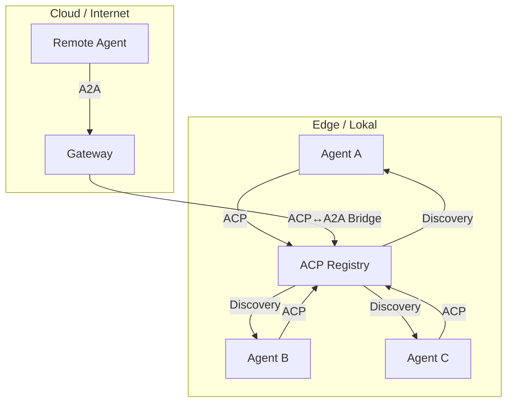
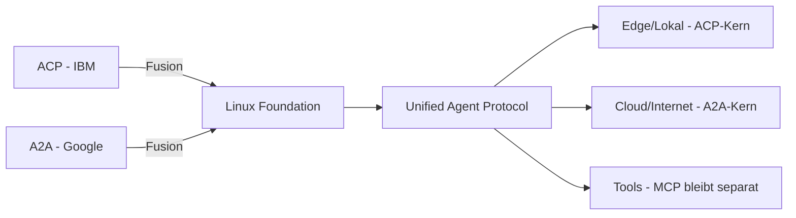

# ACP Agent Communication Protocol

> [!ABSTRACT]
> Das **ACP** (Agent Communication Protocol) ist ein offener Standard von IBM für die lokale, Edge-zentrische Kommunikation zwischen AI-Agents. ACP ergänzt [[Was ist MCP|MCP]] (Agent-zu-Tool) und [[A2A Protocol|A2A]] (Agent-zu-Agent im Internet) um eine **lokale, privacy-bewusste** Kommunikationsschicht. Seit 2025 fusioniert ACP mit A2A unter der Linux Foundation.

---

## Übersicht

| Eigenschaft | Details |
|---|---|
| **Name** | Agent Communication Protocol (ACP) |
| **Entwickler** | IBM |
| **Typ** | Offener Standard / Protokoll |
| **Fokus** | Local-First, Edge-Computing, Privacy |
| **Transportschicht** | HTTP + JSON-RPC, WebSockets |
| **Session Management** | Stateful, persistent |
| **SDKs** | Python, TypeScript |
| **Status** | Mit A2A fusioniert (Linux Foundation) |
| **Observability** | OpenTelemetry-Integration |

---

## Warum ACP?

Während [[A2A Protocol|A2A]] für Internet-Scale-Kommunikation konzipiert ist, adressiert ACP einen anderen Bedarf:

- **Lokale Kommunikation**: Agents auf dem gleichen Server/Cluster ohne Cloud-Abhängigkeit
- **Edge-Computing**: Agents auf Geräten mit eingeschränkter Konnektivität
- **Privacy**: Kein Datentransfer über das Internet nötig
- **Air-Gapped**: Funktioniert komplett ohne Internetverbindung



---

## Kernkonzepte

### Manifeste (Agent-Registrierung)

Jeder Agent veröffentlicht ein **Manifest** — vergleichbar mit Agent Cards bei A2A, aber optimiert für lokale Discovery:

```json
{
  "agent_id": "code-analyzer-v2",
  "name": "Code Analyzer",
  "capabilities": [
    {
      "name": "analyze_code",
      "description": "Analysiert Code auf Qualitätsprobleme",
      "input_schema": {
        "type": "object",
        "properties": {
          "code": { "type": "string" },
          "language": { "type": "string" }
        }
      },
      "output_schema": {
        "type": "object",
        "properties": {
          "issues": { "type": "array" },
          "score": { "type": "number" }
        }
      }
    }
  ],
  "security": {
    "capability_tokens": true,
    "rbac_mapping": "kubernetes"
  }
}
```

### Discovery-Mechanismen

| Methode | Beschreibung | Anwendung |
|---|---|---|
| **Lokale Registry** | Agents registrieren sich bei einem lokalen Index | Einzelner Server / Docker-Compose |
| **Föderierte Indices** | Mehrere Registries synchronisieren sich | Cluster / Multi-Node |
| **Manifest-Scan** | Automatischer Scan nach Agent-Manifesten | Kubernetes / Container |
| **A2A-Bridge** | Export/Import von Agent Cards | Hybrid Cloud/Edge |

### Capability Tokens

ACP verwendet **signierte Capability Tokens** für sichere Autorisierung:

```json
{
  "issuer": "acp-registry",
  "agent_id": "code-analyzer-v2",
  "capabilities": ["analyze_code", "report_issues"],
  "valid_until": "2026-12-31T23:59:59Z",
  "signature": "..."
}
```

> [!TIP] Zero-Trust by Design
> Jeder Agent muss sich mit Capability Tokens authentifizieren. Es gibt keine impliziten Berechtigungen — auch nicht innerhalb des gleichen Netzwerks.

---

## Task-Verarbeitung

### Envelope-basierte Nachrichten

ACP nutzt **Envelopes** (Umschläge) als Nachrichtenformat:

```json
{
  "envelope": {
    "task_id": "task-12345",
    "from": "orchestrator-agent",
    "to": "code-analyzer-v2",
    "type": "task_request",
    "resumable": true,
    "metadata": {
      "priority": "high",
      "trace_id": "otel-abc123"
    }
  },
  "payload": {
    "capability": "analyze_code",
    "input": {
      "code": "def hello():\n    print('world')",
      "language": "python"
    }
  }
}
```

### Session-Management

ACP unterstützt **persistente Sessions** — Agents können Zustand über Interaktionen hinweg beibehalten:

- Sessions überleben Agent-Neustarts
- Kontext wird automatisch wiederhergestellt
- Tasks können pausiert und fortgesetzt werden (resumable)

---

## ACP vs. A2A vs. MCP

| Aspekt | ACP | [[A2A Protocol\|A2A]] | [[Was ist MCP\|MCP]] |
|---|---|---|---|
| **Primärer Fokus** | Lokal, Edge, Privacy | Global, Internet-Scale | Tool-Zugriff |
| **Discovery** | Registry/Manifest, lokal | Agent Cards, Web-URLs | Manuell / Registry |
| **Sicherheit** | Capability Tokens, Zero-Trust, RBAC | OAuth2, API Keys | Pluggable |
| **Session** | Persistent, stateful | Async, multi-turn | Synchron, einfach |
| **Streaming** | Envelopes, resumable Tasks | SSE, async | Token-by-Token |
| **Offline/Edge** | ✅ Kernfeature | ❌ Internet benötigt | ✅ Lokal möglich |
| **Observability** | OpenTelemetry nativ | Hooks für Tracing | Keine |
| **Bester Einsatz** | Edge, Air-Gapped, Hybrid | Cross-Vendor, Cloud | Tool-Integration |

---

## Fusion mit A2A

Seit August 2025 sind ACP und A2A unter der **Linux Foundation (LF AI & Data)** vereint:



**Was sich ändert:**
- ACP's lokale Discovery und Capability Tokens fließen in A2A ein
- A2A's Internet-Scale-Features bleiben erhalten
- Ein einheitlicher Standard für alle Szenarien
- MCP bleibt als separates Protokoll für Tool-Zugriff

**Was gleich bleibt:**
- ACP-Prinzipien für Edge/Lokal-Szenarien
- Bestehende ACP-Implementierungen bleiben kompatibel

---

## Praktischer Einsatz

### Typische Deployment-Szenarien

**Szenario 1: Lokaler Agent-Cluster**

```yaml
# docker-compose.yml
services:
  acp-registry:
    image: acp/registry:latest
    ports: ["8500:8500"]
  
  code-agent:
    image: my-code-agent:latest
    environment:
      ACP_REGISTRY: "http://acp-registry:8500"
      ACP_AGENT_ID: "code-analyzer"
  
  review-agent:
    image: my-review-agent:latest
    environment:
      ACP_REGISTRY: "http://acp-registry:8500"
      ACP_AGENT_ID: "code-reviewer"
```

**Szenario 2: Kubernetes-Deployment**

```yaml
apiVersion: v1
kind: ConfigMap
metadata:
  name: acp-agent-manifest
data:
  manifest.json: |
    {
      "agent_id": "security-scanner",
      "capabilities": ["scan_vulnerabilities"],
      "security": {
        "rbac_mapping": "kubernetes"
      }
    }
```

### Python SDK

```python
from acp import Agent, Registry

# Agent erstellen und registrieren
agent = Agent(
    id="summarizer",
    capabilities=["summarize_text"]
)

registry = Registry("http://localhost:8500")
await registry.register(agent)

# Andere Agents finden
agents = await registry.discover(capability="analyze_code")
for a in agents:
    print(f"Found: {a.name} at {a.endpoint}")

# Task an anderen Agent senden
result = await agents[0].send_task(
    capability="analyze_code",
    input={"code": "...", "language": "python"}
)
```

---

## Wann ACP / wann A2A?

| Szenario | Empfehlung |
|---|---|
| Agents auf dem gleichen Server | ACP |
| Docker-Compose / Kubernetes Cluster | ACP |
| Air-Gapped / Compliance-Umgebung | ACP |
| IoT / Edge-Devices | ACP |
| Cross-Cloud Agent-Kommunikation | A2A |
| Multi-Vendor Agent-Ökosystem | A2A |
| Hybrid (Lokal + Cloud) | ACP lokal + A2A-Bridge nach außen |

---

## Tipps und Best Practices

1. **Registry immer verfügbar halten** — Die ACP-Registry ist ein Single Point of Failure; in Produktion replizieren
2. **Capability Tokens rotieren** — Tokens regelmäßig erneuern für bessere Sicherheit
3. **OpenTelemetry aktivieren** — Tracing über Agent-Grenzen hinweg ist essenziell für Debugging
4. **RBAC-Mappings nutzen** — In Kubernetes die bestehenden RBAC-Regeln für Agents wiederverwenden
5. **Resumable Tasks** — Für lange Aufgaben immer `resumable: true` setzen

---

## Verwandte Notizen

- [[A2A Protocol]] — Das komplementäre Internet-Scale-Protokoll
- [[Was ist MCP]] — Agent-zu-Tool-Kommunikation
- [[MCP Tools Resources Prompts]] — MCP-Konzepte im Detail
- [[Multi-Agent Workflows]] — Strategien für Multi-Agent-Systeme
- [[AI Observability]] — Monitoring und Tracing für Agents
