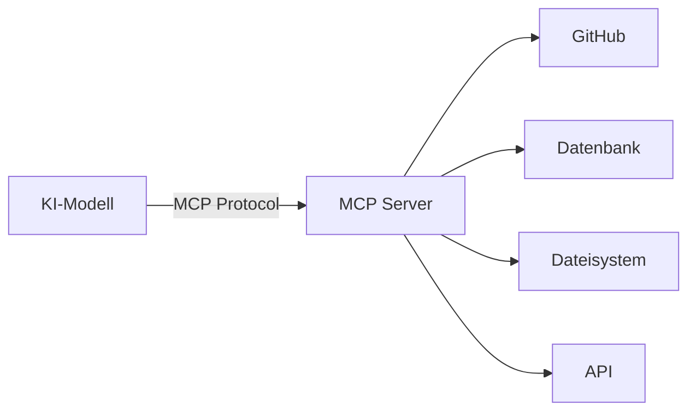
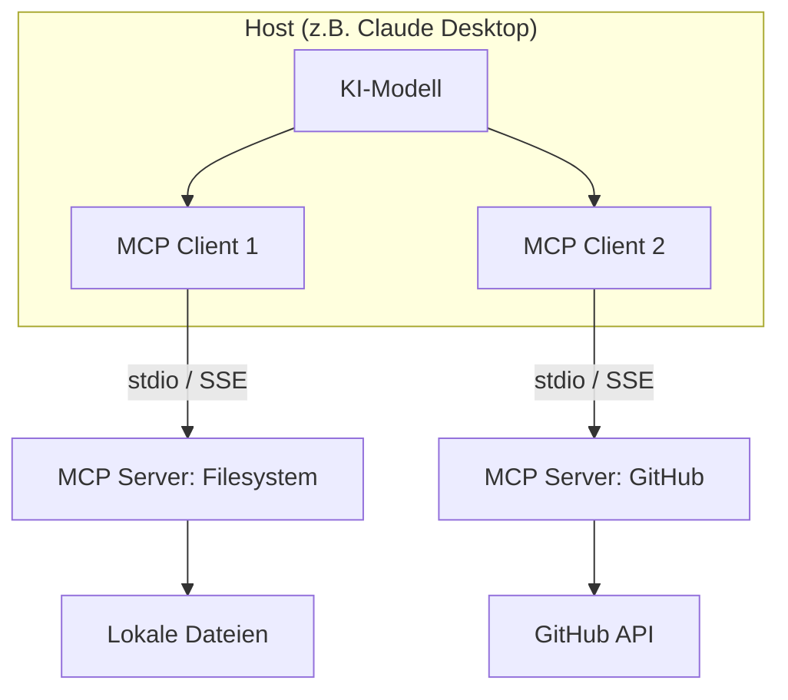

# MCP Grundlagen

> [!ABSTRACT]
> Praktischer Einstieg in das **Model Context Protocol (MCP)** — was ist es, warum braucht man es und wie fängt man an? Diese Dokumentation erklärt die Grundkonzepte (Tools, Resources, Prompts), zeigt die ersten Schritte und gibt eine Übersicht über das MCP-Ökosystem. Für die technische Tiefe des Protokolls siehe [[Was ist MCP]].

---

## Was ist MCP — in einem Satz?

**MCP** ist ein offenes Protokoll, das KI-Modellen (wie Claude, GPT, Gemini) standardisiert Zugriff auf externe Tools und Daten gibt — ein "USB-C für KI".



**Ohne MCP:** Jede KI-App muss für jedes Tool eine eigene Integration bauen.
**Mit MCP:** Jede KI-App verbindet sich über das gleiche Protokoll mit jedem MCP-Server.

Details zur Architektur: [[Was ist MCP]]

---

## Die 3 MCP-Konzepte

MCP Server stellen ihren Clients drei Arten von Fähigkeiten bereit:

### 1. Tools — Aktionen ausführen

**Tools** sind Funktionen, die das Modell aufrufen kann, um etwas zu **tun**:

| Beispiel-Tool | Was es tut |
|--------------|-----------|
| `create_file` | Erstellt eine Datei auf dem Dateisystem |
| `search_code` | Durchsucht Code in einem Repository |
| `run_query` | Führt eine SQL-Abfrage aus |
| `send_message` | Sendet eine Slack-Nachricht |
| `create_issue` | Erstellt ein GitHub Issue |

```text
User: "Erstelle ein Issue in meinem GitHub-Repo für den Login-Bug."

Modell: → Ruft Tool `create_issue` auf mit:
         repo: "mein-org/mein-repo"
         title: "Login-Bug: Session wird nicht gespeichert"
         body: "..."
```

> [!IMPORTANT]
> Tools werden vom **Modell** aufgerufen, nicht vom User direkt. Das Modell entscheidet anhand des Prompts, ob und welches Tool sinnvoll ist. Der Host (z.B. Claude Desktop) fragt in der Regel vor der Ausführung um Erlaubnis.

### 2. Resources — Daten bereitstellen

**Resources** sind Datenquellen, die das Modell **lesen** kann (aber nicht verändern):

| Beispiel-Resource | Was sie liefert |
|------------------|----------------|
| `file:///path/to/config.yaml` | Inhalt einer Datei |
| `postgres://db/users` | Datenbank-Schema oder Abfrageergebnis |
| `git://repo/log` | Git-History eines Repositories |
| `notion://page/123` | Inhalt einer Notion-Seite |

Resources erweitern den **Kontext** des Modells — sie geben ihm Zugriff auf aktuelle Daten, die nicht im Training enthalten waren.

### 3. Prompts — Vorgefertigte Workflows

**Prompts** sind wiederverwendbare Prompt-Templates, die der MCP Server bereitstellt:

| Beispiel-Prompt | Was er tut |
|----------------|-----------|
| `code_review` | Strukturiertes Code-Review mit Checkliste |
| `explain_code` | Code-Erklärung mit Kommentaren |
| `generate_tests` | Testfälle für eine Funktion generieren |

Der Unterschied zu normalen Prompts: MCP-Prompts sind **vom Server definiert** und können Kontext aus Resources und Tool-Ergebnissen einbinden.

Details zu allen drei Konzepten: [[MCP Tools Resources Prompts]]

---

## MCP-Architektur verstehen



| Rolle | Beschreibung |
|-------|-------------|
| **Host** | Die KI-Anwendung (Claude Desktop, Cursor, Claude Code, eigene App) |
| **Client** | Läuft im Host, verwaltet eine Verbindung zu einem MCP Server |
| **Server** | Eigenständiger Prozess, stellt Tools/Resources/Prompts bereit |

### Transport-Protokolle

| Transport | Beschreibung | Verwendung |
|-----------|-------------|-----------|
| **stdio** | Kommunikation über Standard-Input/Output | Lokale Server (Standard) |
| **SSE** | Server-Sent Events über HTTP | Remote-Server, Web-basiert |
| **Streamable HTTP** | HTTP mit Streaming-Unterstützung | Neuerer Standard, ersetzt SSE |

---

## Erste Schritte — MCP ausprobieren

### Voraussetzung

Ein MCP-fähiger Host ist installiert. Die gängigsten:

| Host | MCP-Support | Konfiguration |
|------|------------|---------------|
| **Claude Desktop** | Ja (ab Dez 2024) | `claude_desktop_config.json` |
| **Claude Code** | Ja | `.mcp.json` im Projekt |
| **Cursor** | Ja | Cursor Settings → MCP |
| **GitHub Copilot CLI** | Ja | `.mcp.json` im Projekt |
| **Continue** | Ja | `config.json` |

### Beispiel: Filesystem-Server in Claude Desktop

Der einfachste MCP-Server gibt dem Modell Zugriff auf lokale Dateien:

**1. Konfigurationsdatei öffnen:**

```bash
# macOS / Linux
~/.config/claude/claude_desktop_config.json

# Windows
%APPDATA%\Claude\claude_desktop_config.json
```

**2. Server konfigurieren:**

```json
{
  "mcpServers": {
    "filesystem": {
      "command": "npx",
      "args": [
        "-y",
        "@modelcontextprotocol/server-filesystem",
        "/home/user/projekte"
      ]
    }
  }
}
```

**3. Claude Desktop neustarten** — der Filesystem-Server ist jetzt verfügbar.

**4. Testen:**

```text
User: "Zeig mir den Inhalt meines Projektordners."
Claude: → Nutzt das Filesystem-Tool, um Dateien aufzulisten
```

### Beispiel: GitHub-Server in Claude Code

```json
// .mcp.json im Projektverzeichnis
{
  "mcpServers": {
    "github": {
      "command": "npx",
      "args": ["-y", "@modelcontextprotocol/server-github"],
      "env": {
        "GITHUB_PERSONAL_ACCESS_TOKEN": "ghp_..."
      }
    }
  }
}
```

Details zur Claude-Code-Integration: [[MCP Server in Claude Code einbinden]]

---

## Beliebte MCP Server

| Server | Funktion | Paket |
|--------|---------|-------|
| **Filesystem** | Dateien lesen/schreiben | `@modelcontextprotocol/server-filesystem` |
| **GitHub** | Issues, PRs, Code-Suche | `@modelcontextprotocol/server-github` |
| **PostgreSQL** | Datenbank-Abfragen | `@modelcontextprotocol/server-postgres` |
| **SQLite** | Lokale Datenbanken | `@modelcontextprotocol/server-sqlite` |
| **Brave Search** | Web-Suche | `@modelcontextprotocol/server-brave-search` |
| **Puppeteer** | Browser-Steuerung | `@modelcontextprotocol/server-puppeteer` |
| **Memory** | Persistentes Gedächtnis | `@modelcontextprotocol/server-memory` |
| **Fetch** | HTTP-Requests / Webseiten | `@modelcontextprotocol/server-fetch` |

> [!TIP] MCP Server finden
> Die offizielle Sammlung: [github.com/modelcontextprotocol/servers](https://github.com/modelcontextprotocol/servers)
> Community-Server auf: [mcp.so](https://mcp.so) und [glama.ai/mcp/servers](https://glama.ai/mcp/servers)

---

## Eigenen MCP Server bauen

MCP Server können in verschiedenen Sprachen gebaut werden:

| Sprache | SDK | Reifegrad |
|---------|-----|----------|
| **Python** | `mcp` (offiziell) | Stabil, empfohlen |
| **TypeScript** | `@modelcontextprotocol/sdk` | Stabil, empfohlen |
| **Go** | `mcp-go` | Community |
| **Rust** | `mcp-rs` | Community |
| **Java/Kotlin** | `mcp-kotlin-sdk` | Community |

### Minimaler Python-Server

```python
from mcp.server.fastmcp import FastMCP

mcp = FastMCP("mein-server")

@mcp.tool()
def addiere(a: int, b: int) -> int:
    """Addiert zwei Zahlen."""
    return a + b

@mcp.resource("info://version")
def get_version() -> str:
    """Gibt die Server-Version zurück."""
    return "1.0.0"

if __name__ == "__main__":
    mcp.run()
```

Ausführliches Tutorial: [[MCP Server erstellen (Python)]]

---

## MCP vs. Function Calling

| Aspekt | MCP | Function Calling |
|--------|-----|-----------------|
| **Standard** | Offenes Protokoll (Anthropic) | API-spezifisch (OpenAI, Anthropic, etc.) |
| **Server** | Eigenständiger Prozess | Im eigenen Code definiert |
| **Wiederverwendbar** | Ein Server für viele Hosts | Pro Anwendung neu implementieren |
| **Discovery** | Server beschreibt seine Tools dynamisch | Tools müssen vorab definiert werden |
| **Transport** | stdio, SSE, HTTP | HTTP API |
| **Ökosystem** | Wachsende Server-Bibliothek | Eigene Implementierung |

> [!NOTE]
> MCP und Function Calling schließen sich nicht aus. MCP-Hosts nutzen intern oft Function Calling, um die Tools der MCP-Server aufzurufen. MCP standardisiert den **Zugang**, Function Calling ist der **Mechanismus**.

Details zu Function Calling: [[Function Calling und Tool Use]]

---

## Verwandte Protokolle

| Protokoll | Fokus | Beziehung zu MCP |
|-----------|-------|-----------------|
| **MCP** | LLM ↔ Tools/Daten | Das Kern-Protokoll |
| **A2A** | Agent ↔ Agent | Ergänzt MCP für Multi-Agent-Szenarien |
| **ACP** | Agent-Kommunikation | Alternative/Ergänzung zu A2A |

Details: [[A2A Protocol]] | [[ACP Agent Communication Protocol]]

---

## Sicherheitshinweise

> [!DANGER] MCP Server haben Systemzugriff
> MCP Server laufen als lokale Prozesse mit **deinen Berechtigungen**. Ein Filesystem-Server kann alles lesen/schreiben was du kannst. Achte auf:
> - **Vertrauenswürdige Server** — Nur verifizierte Server installieren
> - **Minimale Berechtigungen** — Nur nötige Verzeichnisse/APIs freigeben
> - **Umgebungsvariablen** — API-Keys sicher verwalten, nicht im Code
> - **Approval-Workflows** — Die meisten Hosts fragen vor Tool-Ausführung

---

## Checkliste für den Einstieg

```text
□ MCP-fähigen Host installiert (Claude Desktop, Cursor, Claude Code)
□ Ersten MCP Server konfiguriert (z.B. Filesystem)
□ Host neu gestartet und Server getestet
□ Zweiten Server hinzugefügt (z.B. GitHub)
□ MCP Tools Resources Prompts verstanden
□ Optional: Eigenen MCP Server gebaut (Python/TypeScript)
```

---

## Verwandte Notizen

- [[Was ist MCP]] — Detaillierte Protokoll-Architektur
- [[MCP Tools Resources Prompts]] — Tools, Resources, Prompts im Detail
- [[MCP Server erstellen (Python)]] — Tutorial: Eigenen Server bauen
- [[MCP Server in Claude Code einbinden]] — Integration in Claude Code
- [[Function Calling und Tool Use]] — Vergleich mit Function Calling
- [[A2A Protocol]] — Agent-to-Agent Kommunikation
- [[AI Index]] — Übersicht aller AI-Themen
