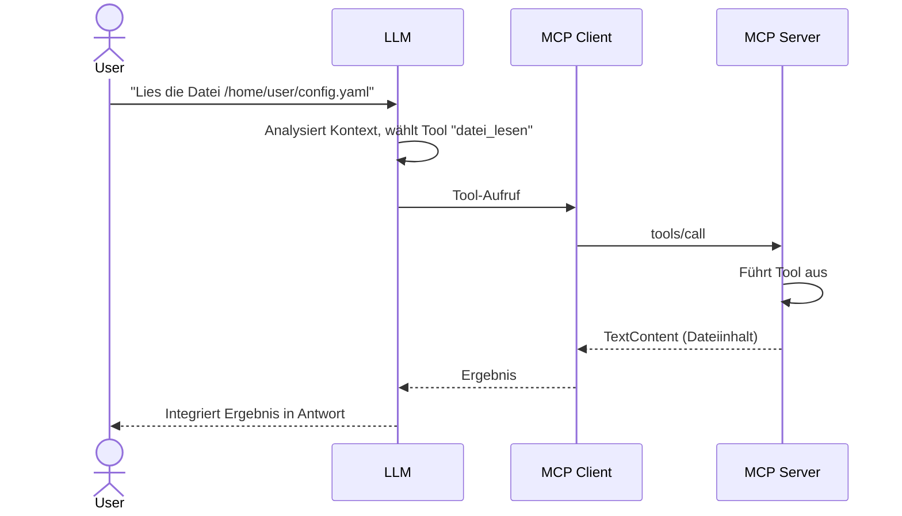

# MCP Tools, Resources und Prompts

> [!IMPORTANT]
> MCP definiert drei grundlegende Primitive, die ein Server bereitstellen kann: **Tools** (ausführbare Funktionen), **Resources** (lesbare Datenquellen) und **Prompts** (wiederverwendbare Prompt-Templates). Jedes Primitiv hat eine klar definierte Rolle und Semantik.

---

## Tools

### Was sind MCP Tools?

Tools sind **ausführbare Funktionen**, die ein LLM aufrufen kann, um eine Aktion durchzuführen oder Informationen abzurufen. Sie sind das mächtigste Primitiv in MCP – sie können Seiteneffekte haben, auf das Internet zugreifen, Dateien verändern und beliebige Berechnungen durchführen.

Das LLM entscheidet **selbst**, wann es ein Tool aufruft, basierend auf dem Kontext des Gesprächs und den Tool-Beschreibungen.



### Tool-Definition (name, description, inputSchema)

Jedes Tool wird durch drei Pflichtfelder definiert:

```python
from mcp.types import Tool

Tool(
    name="datenbankabfrage",          # Eindeutiger Bezeichner, snake_case
    description="""...""",             # Natürlichsprachige Beschreibung (SEHR wichtig!)
    inputSchema={...}                  # JSON Schema für die Parameter
)
```

#### Das inputSchema

Das `inputSchema` folgt dem **JSON Schema**-Standard:

```python
Tool(
    name="suche_dateien",
    description="Sucht nach Dateien in einem Verzeichnis nach Muster",
    inputSchema={
        "type": "object",
        "properties": {
            "verzeichnis": {
                "type": "string",
                "description": "Absoluter Pfad des Verzeichnisses zum Durchsuchen",
            },
            "muster": {
                "type": "string",
                "description": "Glob-Muster, z.B. '*.py' oder '**/*.json'",
                "default": "*",
            },
            "max_ergebnisse": {
                "type": "integer",
                "description": "Maximale Anzahl Treffer",
                "minimum": 1,
                "maximum": 1000,
                "default": 50,
            },
            "rekursiv": {
                "type": "boolean",
                "description": "Unterverzeichnisse einbeziehen",
                "default": True,
            },
        },
        "required": ["verzeichnis"],   # Nur Pflichtfelder hier auflisten
    },
)
```

**Unterstützte JSON-Schema-Typen:**

| Typ | Python-Äquivalent | Beispiel |
|-----|------------------|---------|
| `string` | `str` | `"hello"` |
| `integer` | `int` | `42` |
| `number` | `float` | `3.14` |
| `boolean` | `bool` | `true` |
| `array` | `list` | `["a", "b"]` |
| `object` | `dict` | `{"key": "value"}` |
| `null` | `None` | `null` |

### Tool-Handler implementieren

Der Tool-Handler ist die Funktion, die tatsächlich ausgeführt wird wenn ein Tool aufgerufen wird:

```python
from mcp.server import Server
from mcp.types import TextContent
import glob
import os

app = Server("datei-server")

@app.call_tool()
async def call_tool(name: str, arguments: dict) -> list[TextContent]:
    match name:
        case "suche_dateien":
            return await handle_suche_dateien(arguments)
        case _:
            raise ValueError(f"Unbekanntes Tool: {name}")
            # ValueError für unbekannte Tools ist OK und wird korrekt als Fehler weitergeleitet


async def handle_suche_dateien(args: dict) -> list[TextContent]:
    verzeichnis = args["verzeichnis"]                    # Pflichtfeld, kein .get() nötig
    muster = args.get("muster", "*")                     # Optionales Feld mit Default
    max_ergebnisse = args.get("max_ergebnisse", 50)
    rekursiv = args.get("rekursiv", True)

    # Validierung
    if not os.path.isdir(verzeichnis):
        return [TextContent(type="text", text=f"Fehler: Kein Verzeichnis: {verzeichnis}")]

    # Suche durchführen
    if rekursiv:
        such_pfad = os.path.join(verzeichnis, "**", muster)
        treffer = glob.glob(such_pfad, recursive=True)
    else:
        such_pfad = os.path.join(verzeichnis, muster)
        treffer = glob.glob(such_pfad)

    treffer = treffer[:max_ergebnisse]

    if not treffer:
        return [TextContent(type="text", text=f"Keine Dateien gefunden für Muster '{muster}' in {verzeichnis}")]

    ergebnis = f"Gefunden: {len(treffer)} Datei(en)\n\n" + "\n".join(treffer)
    return [TextContent(type="text", text=ergebnis)]
```

### Best Practices für Tool-Beschreibungen

> [!IMPORTANT]
> Die `description` ist das wichtigste Feld eines Tools. Das LLM entscheidet anhand der Beschreibung, ob und wann es ein Tool aufruft. Eine schlechte Beschreibung führt zu falschen oder ausgelassenen Tool-Aufrufen.

**Schlechte Beschreibung:**
```python
Tool(name="db_query", description="Query the database")
```

**Gute Beschreibung:**
```python
Tool(
    name="datenbank_abfrage",
    description=(
        "Führt eine SQL-SELECT-Abfrage auf der PostgreSQL-Produktionsdatenbank aus. "
        "Gibt die Ergebnisse als formatierte Tabelle zurück. "
        "Nur lesende Abfragen (SELECT) sind erlaubt – keine INSERT, UPDATE oder DELETE. "
        "Maximale Ergebnismenge: 1000 Zeilen. "
        "Verwende dieses Tool wenn der User nach Daten aus der Datenbank fragt, "
        "Statistiken benötigt oder Datenbankstrukturen verstehen möchte."
    ),
    ...
)
```

**Checkliste für gute Tool-Beschreibungen:**

- [ ] Was tut das Tool genau?
- [ ] Was gibt es zurück?
- [ ] Welche Einschränkungen/Limits gibt es?
- [ ] Wann sollte das Tool (nicht) verwendet werden?
- [ ] Was sind typische Anwendungsfälle?

### Beispiel: Tool mit komplexen Parametern

```python
Tool(
    name="github_issue_erstellen",
    description=(
        "Erstellt ein neues Issue im angegebenen GitHub-Repository. "
        "Benötigt ein gültiges GitHub-Token in der Umgebungsvariable GITHUB_TOKEN. "
        "Gibt die URL des erstellten Issues zurück."
    ),
    inputSchema={
        "type": "object",
        "properties": {
            "repo": {
                "type": "string",
                "description": "Repository im Format 'owner/repo', z.B. 'octocat/Hello-World'",
            },
            "titel": {
                "type": "string",
                "description": "Titel des Issues (max. 256 Zeichen)",
                "maxLength": 256,
            },
            "beschreibung": {
                "type": "string",
                "description": "Beschreibung des Issues in Markdown-Format",
            },
            "labels": {
                "type": "array",
                "items": {"type": "string"},
                "description": "Liste der Labels, z.B. ['bug', 'help wanted']",
            },
            "assignees": {
                "type": "array",
                "items": {"type": "string"},
                "description": "Liste der GitHub-Usernamen die zugewiesen werden sollen",
            },
        },
        "required": ["repo", "titel"],
    },
)
```

---

## Resources

### Was sind MCP Resources?

Resources sind **lesbare Datenquellen**, die einem LLM als Kontext zur Verfügung gestellt werden. Im Gegensatz zu Tools führen Resources keine Aktionen aus – sie stellen Daten bereit, die der Host in den Kontext des LLMs laden kann.

Resources sind konzeptuell ähnlich wie Dateien, die man in einem Chat-Fenster anhängt.

```
Typischer Ablauf:
1. Host listet verfügbare Resources (resources/list)
2. User oder Host wählt eine Resource aus
3. Host lädt Resource-Inhalt (resources/read)
4. Inhalt wird dem LLM als Kontext übergeben
```

### Resource-URI Schema

Jede Resource hat eine eindeutige URI:

```
# Allgemeines Format:
scheme://authority/path

# Beispiele:
file:///home/user/projekt/README.md          # Lokale Datei
postgres://localhost/mydb/users/schema        # Datenbankschema
github://octocat/Hello-World/README.md        # GitHub-Datei
mcp://server-name/custom/resource/path        # Custom Resource
config://app/settings                         # Anwendungskonfiguration
log://system/access.log                       # Log-Datei
```

### Statische Resources

Statische Resources haben einen festen Inhalt oder lesen immer dieselbe Quelle:

```python
from mcp.server import Server
from mcp.types import Resource, TextResourceContents
import mcp.types as types

app = Server("resource-server")

@app.list_resources()
async def list_resources() -> list[Resource]:
    """Listet alle verfügbaren statischen Resources."""
    return [
        Resource(
            uri="file:///etc/os-release",
            name="Betriebssystem-Info",
            description="Informationen über das installierte Betriebssystem",
            mimeType="text/plain",
        ),
        Resource(
            uri="config://app/database",
            name="Datenbank-Konfiguration",
            description="Aktuelle Datenbankverbindungsparameter (ohne Passwörter)",
            mimeType="application/json",
        ),
    ]

@app.read_resource()
async def read_resource(uri: str) -> str | bytes:
    """Liest den Inhalt einer Resource."""
    match uri:
        case "file:///etc/os-release":
            with open("/etc/os-release", "r") as f:
                return f.read()

        case "config://app/database":
            import json
            config = {
                "host": "localhost",
                "port": 5432,
                "database": "myapp",
                "pool_size": 10,
                # Passwort wird NICHT zurückgegeben!
            }
            return json.dumps(config, indent=2)

        case _:
            raise ValueError(f"Unbekannte Resource: {uri}")
```

### Dynamische Resources

Dynamische Resources werden basierend auf Parametern oder aktuellem Zustand generiert:

```python
import os
from pathlib import Path

@app.list_resources()
async def list_resources() -> list[Resource]:
    """Listet Dateien im Arbeitsverzeichnis als Resources."""
    ressourcen = []
    arbeitsverz = Path.cwd()

    for datei in arbeitsverz.glob("*.py"):
        ressourcen.append(Resource(
            uri=f"file://{datei.absolute()}",
            name=datei.name,
            description=f"Python-Datei: {datei.name} ({datei.stat().st_size} Bytes)",
            mimeType="text/x-python",
        ))

    return ressourcen

@app.read_resource()
async def read_resource(uri: str) -> str:
    """Liest eine Datei-Resource."""
    if not uri.startswith("file://"):
        raise ValueError(f"Ungültiges URI-Schema: {uri}")

    pfad = Path(uri[7:])  # "file://" entfernen

    if not pfad.exists():
        raise FileNotFoundError(f"Datei nicht gefunden: {pfad}")

    if not pfad.is_file():
        raise ValueError(f"Nicht eine Datei: {pfad}")

    return pfad.read_text(encoding="utf-8")
```

### Resource Templates

Resource-Templates erlauben parametrisierte URIs – ähnlich wie URL-Templates in REST-APIs:

```python
from mcp.types import ResourceTemplate

@app.list_resource_templates()
async def list_resource_templates() -> list[ResourceTemplate]:
    """Definiert URI-Templates für parametrisierte Resources."""
    return [
        ResourceTemplate(
            uriTemplate="file://{pfad}",
            name="Beliebige Datei",
            description="Liest eine beliebige Datei anhand ihres Pfades",
            mimeType="text/plain",
        ),
        ResourceTemplate(
            uriTemplate="github://{owner}/{repo}/{branch}/{datei_pfad}",
            name="GitHub-Datei",
            description="Liest eine Datei aus einem GitHub-Repository",
            mimeType="text/plain",
        ),
        ResourceTemplate(
            uriTemplate="db://table/{tabellenname}/schema",
            name="Tabellen-Schema",
            description="Gibt das Schema einer Datenbanktabelle zurück",
            mimeType="application/json",
        ),
    ]
```

> [!NOTE]
> URI-Templates folgen dem RFC 6570-Standard. `{variable}` ist ein Pflicht-Platzhalter, `{+path}` erlaubt Schrägstriche im Wert.

### Beispiel: Vollständige Resource-Implementierung

```python
#!/usr/bin/env python3
"""
Beispiel: MCP Server mit Datei-Resources und Template-Unterstützung.
"""
import json
import mimetypes
from pathlib import Path

from mcp.server import Server
from mcp.types import Resource, ResourceTemplate

app = Server("datei-resource-server")

# Erlaubte Verzeichnisse (Sicherheit!)
ERLAUBTE_VERZEICHNISSE = [
    Path.home() / "documents",
    Path.home() / "projects",
    Path("/tmp"),
]

def ist_erlaubt(pfad: Path) -> bool:
    """Prüft ob ein Pfad in einem erlaubten Verzeichnis liegt."""
    pfad = pfad.resolve()
    return any(
        pfad.is_relative_to(erlaubt.resolve())
        for erlaubt in ERLAUBTE_VERZEICHNISSE
        if erlaubt.exists()
    )

@app.list_resources()
async def list_resources() -> list[Resource]:
    resources = []
    for verz in ERLAUBTE_VERZEICHNISSE:
        if not verz.exists():
            continue
        for datei in verz.rglob("*.md"):
            mime, _ = mimetypes.guess_type(str(datei))
            resources.append(Resource(
                uri=f"file://{datei.resolve()}",
                name=datei.name,
                description=f"Markdown-Datei in {verz.name}/",
                mimeType=mime or "text/plain",
            ))
    return resources

@app.list_resource_templates()
async def list_resource_templates() -> list[ResourceTemplate]:
    return [
        ResourceTemplate(
            uriTemplate="file://{pfad}",
            name="Datei nach Pfad",
            description="Liest eine Datei. Nur Dateien in erlaubten Verzeichnissen.",
        )
    ]

@app.read_resource()
async def read_resource(uri: str) -> str | bytes:
    if not uri.startswith("file://"):
        raise ValueError(f"Nur file://-URIs werden unterstützt, nicht: {uri}")

    pfad = Path(uri[7:]).resolve()

    if not ist_erlaubt(pfad):
        raise PermissionError(f"Zugriff verweigert: {pfad} liegt nicht in einem erlaubten Verzeichnis")

    if not pfad.exists():
        raise FileNotFoundError(f"Datei nicht gefunden: {pfad}")

    mime, _ = mimetypes.guess_type(str(pfad))
    if mime and mime.startswith("text/"):
        return pfad.read_text(encoding="utf-8")
    else:
        return pfad.read_bytes()
```

---

## Prompts

### Was sind MCP Prompts?

Prompts sind **vordefinierte, wiederverwendbare Prompt-Templates** die Argumente akzeptieren und strukturierte Nachrichten für das LLM generieren. Sie sind vergleichbar mit Funktionen, die einen vollständig formulierten Prompt zurückgeben.

```
Ohne MCP Prompts:
  User: "Mach ein Code Review für Python mit Fokus auf Security"
  → LLM muss selbst wissen wie man ein gutes Code-Review-Prompt formuliert

Mit MCP Prompts:
  User wählt Prompt "code_review" mit Argumenten language="python", focus="security"
  → MCP Server generiert strukturierten, optimierten Prompt
  → LLM bekommt konsistente, hochwertige Prompt-Vorlage
```

### Prompt-Definition mit Argumenten

```python
from mcp.types import Prompt, PromptArgument, PromptMessage, TextContent
from mcp.types import Role

@app.list_prompts()
async def list_prompts() -> list[Prompt]:
    return [
        Prompt(
            name="code_review",
            description=(
                "Führt ein strukturiertes Code-Review durch. "
                "Analysiert Code auf Qualität, Sicherheit, Performance und Best Practices."
            ),
            arguments=[
                PromptArgument(
                    name="sprache",
                    description="Programmiersprache des Codes (z.B. 'python', 'typescript', 'rust')",
                    required=True,
                ),
                PromptArgument(
                    name="fokus",
                    description="Schwerpunkt des Reviews: 'security', 'performance', 'readability', 'all'",
                    required=False,
                ),
                PromptArgument(
                    name="erfahrungslevel",
                    description="Zielgruppe: 'junior', 'senior', 'team'",
                    required=False,
                ),
            ],
        ),
        Prompt(
            name="fehler_analyse",
            description="Analysiert einen Stacktrace oder eine Fehlermeldung und schlägt Lösungen vor.",
            arguments=[
                PromptArgument(
                    name="fehler",
                    description="Der vollständige Stacktrace oder die Fehlermeldung",
                    required=True,
                ),
                PromptArgument(
                    name="kontext",
                    description="Was wurde versucht? Welcher Code hat den Fehler verursacht?",
                    required=False,
                ),
            ],
        ),
    ]
```

### Prompt-Handler implementieren

```python
from mcp.types import GetPromptResult, PromptMessage, TextContent, Role

@app.get_prompt()
async def get_prompt(name: str, arguments: dict | None) -> GetPromptResult:
    args = arguments or {}

    match name:
        case "code_review":
            return await prompt_code_review(args)
        case "fehler_analyse":
            return await prompt_fehler_analyse(args)
        case _:
            raise ValueError(f"Unbekannter Prompt: {name}")


async def prompt_code_review(args: dict) -> GetPromptResult:
    sprache = args.get("sprache", "unbekannt")
    fokus = args.get("fokus", "all")
    level = args.get("erfahrungslevel", "team")

    # Fokus-spezifische Anweisungen
    fokus_anweisung = {
        "security": "Lege besonderen Fokus auf Sicherheitslücken, Injection-Angriffe, unsichere Datenverarbeitung und Authentifizierungsprobleme.",
        "performance": "Analysiere besonders auf Performance-Probleme: unnötige Berechnungen, ineffiziente Algorithmen, Memory-Leaks und I/O-Bottlenecks.",
        "readability": "Fokussiere auf Code-Lesbarkeit, Namensgebung, Kommentare, Struktur und Wartbarkeit.",
        "all": "Führe ein umfassendes Review durch und decke alle Aspekte ab: Korrektheit, Sicherheit, Performance und Lesbarkeit.",
    }.get(fokus, "Führe ein umfassendes Review durch.")

    # Level-spezifische Anpassung
    level_anweisung = {
        "junior": "Erkläre Probleme ausführlich und mit Lerncharakter. Begründe jeden Verbesserungsvorschlag.",
        "senior": "Gehe direkt auf die Kernpunkte ein. Technische Details können knapp gehalten werden.",
        "team": "Balanciere zwischen Ausführlichkeit und Prägnanz. Priorisiere kritische Probleme.",
    }.get(level, "")

    system_prompt = f"""Du bist ein erfahrener {sprache.capitalize()}-Entwickler und Code-Reviewer.
{level_anweisung}

Dein Review soll folgende Struktur haben:
1. **Zusammenfassung** (2-3 Sätze Gesamteindruck)
2. **Kritische Probleme** (Bugs, Sicherheitslücken, die sofort behoben werden müssen)
3. **Verbesserungsvorschläge** (Best Practices, Optimierungen)
4. **Positive Aspekte** (Was wurde gut gemacht?)
5. **Bewertung** (1-10 Skala mit Begründung)

{fokus_anweisung}"""

    user_prompt = f"Bitte führe ein Code-Review für den folgenden {sprache}-Code durch:\n\n```{sprache}\n[Code wird hier eingefügt]\n```"

    return GetPromptResult(
        description=f"Code-Review für {sprache} (Fokus: {fokus})",
        messages=[
            PromptMessage(
                role=Role.user,
                content=TextContent(type="text", text=system_prompt + "\n\n" + user_prompt),
            )
        ],
    )


async def prompt_fehler_analyse(args: dict) -> GetPromptResult:
    fehler = args.get("fehler", "[Fehler nicht angegeben]")
    kontext = args.get("kontext", "")

    kontext_abschnitt = f"\n\n**Kontext:** {kontext}" if kontext else ""

    prompt_text = f"""Analysiere die folgende Fehlermeldung und hilf mir, sie zu verstehen und zu lösen.

**Fehlermeldung / Stacktrace:**
```
{fehler}
```{kontext_abschnitt}

Bitte gib mir:
1. **Was bedeutet dieser Fehler?** (einfache Erklärung)
2. **Warum tritt er auf?** (mögliche Ursachen)
3. **Wie behebe ich ihn?** (konkrete Lösungsschritte)
4. **Wie verhindere ich ihn in Zukunft?** (präventive Maßnahmen)"""

    return GetPromptResult(
        description="Fehleranalyse und Lösungsvorschläge",
        messages=[
            PromptMessage(
                role=Role.user,
                content=TextContent(type="text", text=prompt_text),
            )
        ],
    )
```

### Unterschied zu System Prompts

> [!NOTE]
> MCP Prompts sind **nicht** dasselbe wie System Prompts des LLMs. Sie sind:
> - **Wiederverwendbar**: Einmal definiert, von jedem MCP-Host nutzbar
> - **Parametrisierbar**: Akzeptieren Argumente zur Laufzeit
> - **Auffindbar**: Der Host kann alle verfügbaren Prompts listen
> - **Teil des Servers**: Werden vom MCP-Server definiert, nicht vom LLM-Provider

| Aspekt | System Prompt | MCP Prompt |
|--------|--------------|------------|
| Definiert von | LLM-Provider / App-Entwickler | MCP Server |
| Parametrisierbar | Nein (oder manuell) | Ja, mit Argumenten |
| Auffindbar | Nein | Ja (list_prompts) |
| Wiederverwendbar | Bedingt | Ja, für alle MCP-Hosts |
| Timing | Vor dem Gespräch | Jederzeit aufrufbar |

### Praxisbeispiel: Mehrsprachige Prompt-Templates

```python
REVIEW_TEMPLATES = {
    "de": {
        "intro": "Du bist ein erfahrener {sprache}-Entwickler.",
        "aufgabe": "Führe ein detailliertes Code-Review durch.",
    },
    "en": {
        "intro": "You are an experienced {sprache} developer.",
        "aufgabe": "Conduct a detailed code review.",
    },
}

@app.get_prompt()
async def get_prompt(name: str, arguments: dict | None) -> GetPromptResult:
    args = arguments or {}

    if name == "review_mehrsprachig":
        lang = args.get("ui_sprache", "de")
        template = REVIEW_TEMPLATES.get(lang, REVIEW_TEMPLATES["de"])
        prog_sprache = args.get("sprache", "Python")

        text = template["intro"].format(sprache=prog_sprache)
        text += "\n" + template["aufgabe"]

        return GetPromptResult(
            description=f"Code Review ({lang})",
            messages=[
                PromptMessage(
                    role=Role.user,
                    content=TextContent(type="text", text=text),
                )
            ],
        )

    raise ValueError(f"Unbekannter Prompt: {name}")
```

---

## Vollständiger Server mit allen drei Primitiven

```python
#!/usr/bin/env python3
"""
Vollständiger MCP Server mit Tools, Resources und Prompts.
"""
import asyncio
import json
import os
from pathlib import Path

from mcp.server import Server
from mcp.server.stdio import stdio_server
from mcp.types import (
    GetPromptResult,
    Prompt,
    PromptArgument,
    PromptMessage,
    Resource,
    Role,
    TextContent,
    Tool,
)

app = Server("vollstaendiger-server")


# ── TOOLS ─────────────────────────────────────────────────────────

@app.list_tools()
async def list_tools() -> list[Tool]:
    return [
        Tool(
            name="verzeichnis_liste",
            description="Listet Dateien und Unterverzeichnisse in einem Verzeichnis auf.",
            inputSchema={
                "type": "object",
                "properties": {
                    "pfad": {"type": "string", "description": "Pfad zum Verzeichnis"},
                    "versteckt": {"type": "boolean", "description": "Versteckte Dateien anzeigen", "default": False},
                },
                "required": ["pfad"],
            },
        ),
    ]

@app.call_tool()
async def call_tool(name: str, arguments: dict) -> list[TextContent]:
    if name == "verzeichnis_liste":
        pfad = Path(arguments["pfad"])
        versteckt = arguments.get("versteckt", False)
        if not pfad.is_dir():
            return [TextContent(type="text", text=f"Fehler: Kein Verzeichnis: {pfad}")]
        eintraege = sorted(pfad.iterdir(), key=lambda p: (p.is_file(), p.name))
        if not versteckt:
            eintraege = [e for e in eintraege if not e.name.startswith(".")]
        zeilen = []
        for eintrag in eintraege:
            symbol = "📁" if eintrag.is_dir() else "📄"
            groesse = f" ({eintrag.stat().st_size} B)" if eintrag.is_file() else ""
            zeilen.append(f"{symbol} {eintrag.name}{groesse}")
        return [TextContent(type="text", text="\n".join(zeilen) or "Verzeichnis ist leer.")]
    raise ValueError(f"Unbekanntes Tool: {name}")


# ── RESOURCES ──────────────────────────────────────────────────────

@app.list_resources()
async def list_resources() -> list[Resource]:
    home = Path.home()
    ressourcen = []
    for datei in home.glob("*.json"):
        ressourcen.append(Resource(
            uri=f"file://{datei}",
            name=datei.name,
            description=f"JSON-Konfigurationsdatei: {datei.name}",
            mimeType="application/json",
        ))
    return ressourcen

@app.read_resource()
async def read_resource(uri: str) -> str:
    pfad = Path(uri.removeprefix("file://"))
    if not pfad.exists():
        raise FileNotFoundError(f"Nicht gefunden: {pfad}")
    return pfad.read_text(encoding="utf-8")


# ── PROMPTS ────────────────────────────────────────────────────────

@app.list_prompts()
async def list_prompts() -> list[Prompt]:
    return [
        Prompt(
            name="commit_message",
            description="Generiert eine strukturierte Git-Commit-Nachricht nach Conventional Commits.",
            arguments=[
                PromptArgument(name="aenderungen", description="Beschreibung der Änderungen", required=True),
                PromptArgument(name="typ", description="commit type: feat, fix, docs, refactor, test, chore", required=False),
            ],
        ),
    ]

@app.get_prompt()
async def get_prompt(name: str, arguments: dict | None) -> GetPromptResult:
    args = arguments or {}
    if name == "commit_message":
        aenderungen = args.get("aenderungen", "")
        typ = args.get("typ", "")
        typ_hinweis = f"Der Typ sollte '{typ}' sein.\n" if typ else ""
        text = (
            f"Erstelle eine Git-Commit-Nachricht nach dem Conventional Commits-Standard.\n\n"
            f"{typ_hinweis}"
            f"Änderungen:\n{aenderungen}\n\n"
            f"Format:\n"
            f"<type>(<scope>): <kurze Beschreibung>\n\n"
            f"[optionaler Body]\n\n"
            f"[optionale Footer]"
        )
        return GetPromptResult(
            description="Git Commit Message Generator",
            messages=[PromptMessage(role=Role.user, content=TextContent(type="text", text=text))],
        )
    raise ValueError(f"Unbekannter Prompt: {name}")


# ── MAIN ───────────────────────────────────────────────────────────

async def main():
    async with stdio_server() as (read_stream, write_stream):
        await app.run(read_stream, write_stream, app.create_initialization_options())

if __name__ == "__main__":
    asyncio.run(main())
```

---

## Zusammenfassung: Wann welches Primitiv?

| Situation | Primitiv | Begründung |
|-----------|---------|-----------|
| Datei lesen/schreiben | Tool | Hat Seiteneffekte (schreiben) oder braucht dynamische Pfadeingabe |
| Bekannte Konfig-Datei als Kontext | Resource | Unveränderlicher Inhalt, kein Seiteneffekt |
| API aufrufen | Tool | Seiteneffekte, dynamische Parameter |
| Datenbankschema anzeigen | Resource | Lesend, stabil |
| Datenbank abfragen | Tool | Dynamische SQL-Abfrage nötig |
| Code Review starten | Prompt | Wiederverwendbares, parametrisierbares Template |
| Fehlermeldung analysieren | Prompt | Strukturierter Analyse-Workflow |
| E-Mail senden | Tool | Klarer Seiteneffekt |

---

## Verwandte Notizen

- [[Was ist MCP]]
- [[MCP Server erstellen (Python)]]
- [[MCP Server in Claude Code einbinden]]
