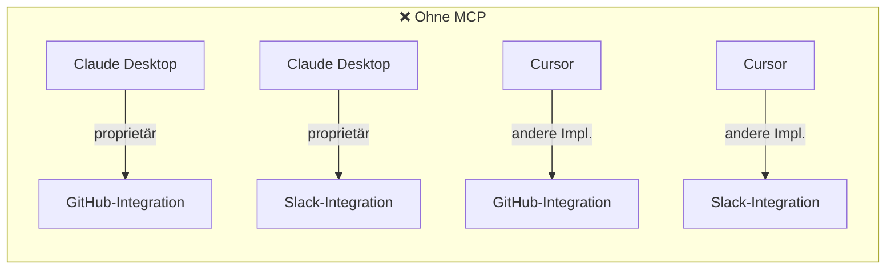
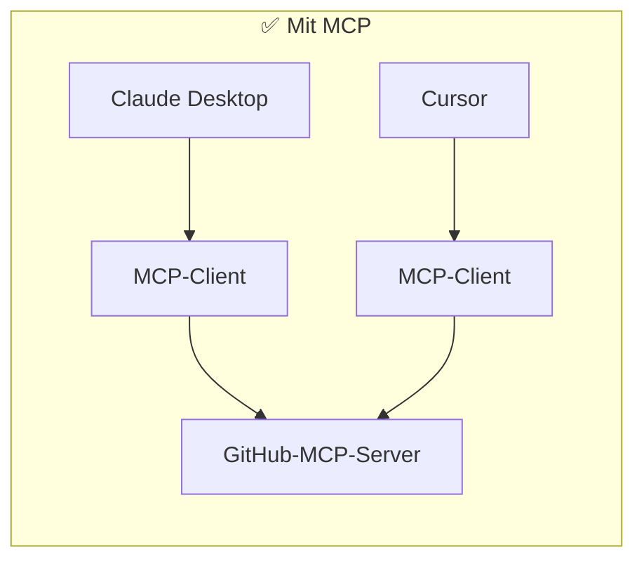
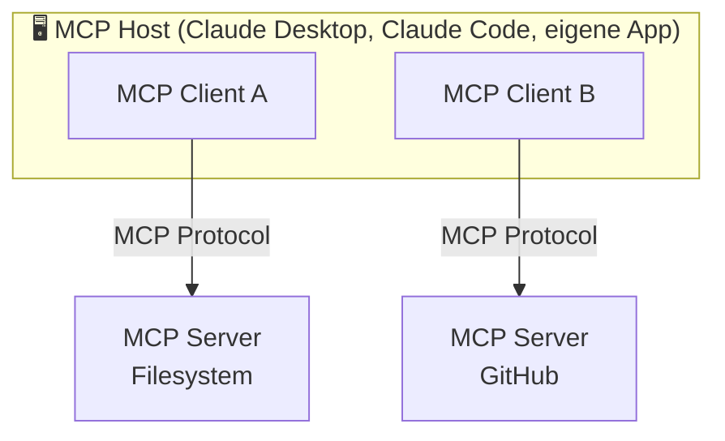
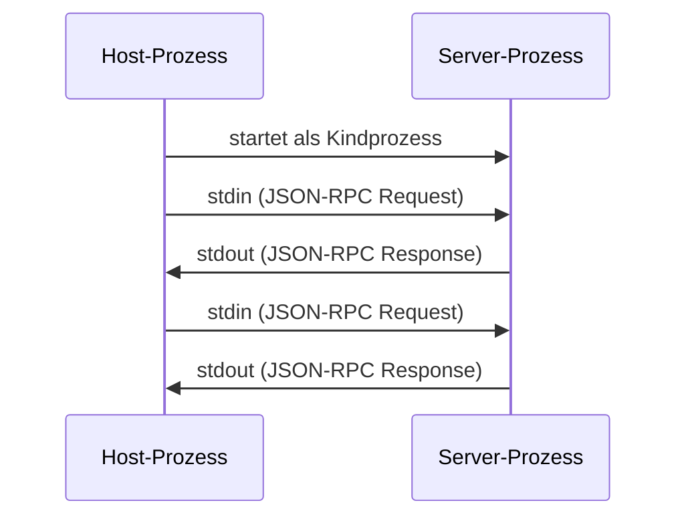
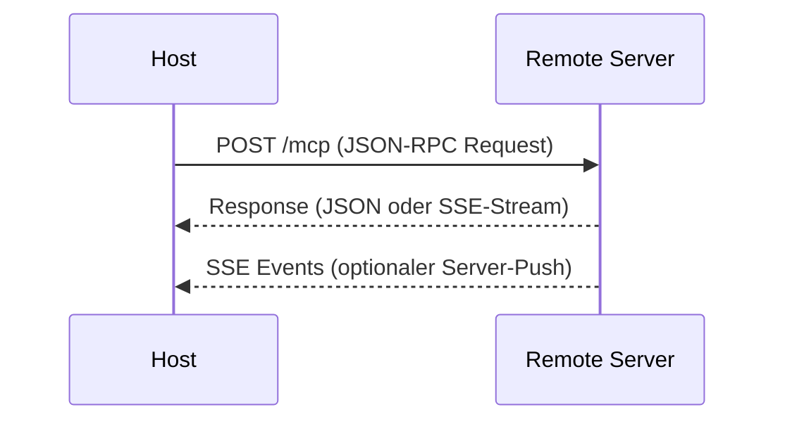

# Was ist das Model Context Protocol (MCP)?

> [!IMPORTANT]
> MCP (Model Context Protocol) ist ein offenes Protokoll von Anthropic, das standardisiert, wie Large Language Models mit externen Tools, Daten und Diensten kommunizieren. Es wurde im November 2024 veröffentlicht und löst das Problem inkompatibler, proprietärer Tool-Integrationen.

## Das Problem: Proprietäre Tool-Integrationen

Vor MCP musste jede KI-Anwendung für jedes externe Tool eine eigene, maßgeschneiderte Integration schreiben. Das führte zu einem "N×M-Problem":

- **N** KI-Anwendungen (Claude Desktop, Cursor, eigene Apps, ...)
- **M** externe Tools/Dienste (GitHub, Datenbanken, Dateisystem, APIs, ...)
- Ergebnis: **N×M** individuelle Integrationen nötig





MCP reduziert das Problem auf **N+M**: Jede KI-Anwendung implementiert einmal den MCP-Client, jedes Tool implementiert einmal den MCP-Server.

---

## Architektur: Host, Client, Server

MCP definiert drei klar getrennte Rollen:



| Rolle | Beschreibung | Beispiele |
|-------|-------------|----------|
| **Host** | Die KI-Anwendung, die MCP nutzt. Verwaltet mehrere Client-Instanzen. | Claude Desktop, Claude Code, Cursor, eigene Apps |
| **Client** | Läuft im Host. Hält genau eine Verbindung zu einem MCP-Server. Übersetzt zwischen Host und Server. | Eingebaut in den jeweiligen Host |
| **Server** | Eigenständiger Prozess, der Tools, Resources und Prompts bereitstellt. | Filesystem-Server, GitHub-Server, Postgres-Server |

> [!NOTE]
> Ein Host kann gleichzeitig Verbindungen zu mehreren MCP-Servern halten. Jede Verbindung wird von einem eigenen Client-Objekt verwaltet.

---

## Transport-Typen

MCP unterstützt zwei Transport-Mechanismen:

### stdio (Standard Input/Output)

Verwendet für **lokale Prozesse**. Der Host startet den Server-Prozess direkt und kommuniziert über stdin/stdout.



- Vorteile: Einfach, sicher (kein Netzwerk), geringe Latenz
- Nachteile: Nur lokal, ein Prozess pro Verbindung
- Typische Verwendung: Filesystem-Server, lokale Tools, Entwicklung

### Streamable HTTP (aktueller Standard)

Seit der MCP-Spezifikation vom 2025-03-26 ist **Streamable HTTP** der empfohlene Transport für **remote Server** oder **mehrere gleichzeitige Verbindungen**. Es ersetzt den älteren SSE-Transport durch einen einzigen Endpunkt (`/mcp`).



- **Ein Endpunkt** (`/mcp`) statt zwei separate Endpunkte (`/sse` + `/messages`)
- Unterstützt **bidirektionale Kommunikation** über einen einzigen Kanal
- **Skalierbar**: Kein langlebiger SSE-Stream nötig – Antworten können als einfaches JSON oder als SSE-Stream zurückgegeben werden
- Typische Verwendung: Cloud-Dienste, geteilte Server, produktive Deployments

### HTTP mit Server-Sent Events (SSE) – Legacy

> [!WARNING]
> SSE wurde in der MCP-Spezifikation vom 2025-03-26 als **deprecated** markiert und durch Streamable HTTP ersetzt. Bestehende SSE-Server funktionieren weiterhin, neue Implementierungen sollten jedoch Streamable HTTP verwenden.

Der ältere SSE-Transport verwendete zwei Endpunkte (`GET /sse` für den Event-Stream und `POST /messages` für Client-Nachrichten).

> [!TIP]
> Für die lokale Entwicklung und die meisten privaten Use Cases ist stdio die einfachere Wahl. Streamable HTTP ist sinnvoll, wenn der Server von mehreren Personen oder Hosts genutzt werden soll.

---

## Die drei Primitiven: Tools, Resources, Prompts

MCP definiert drei grundlegende Typen von Fähigkeiten, die ein Server bereitstellen kann:

### Tools (Werkzeuge)

Tools sind **ausführbare Funktionen**, die das LLM aufrufen kann. Sie können Seiteneffekte haben (Dateien schreiben, APIs aufrufen, Datenbanken verändern).

```json
{
  "name": "read_file",
  "description": "Liest den Inhalt einer Datei vom Dateisystem",
  "inputSchema": {
    "type": "object",
    "properties": {
      "path": {
        "type": "string",
        "description": "Absoluter oder relativer Pfad zur Datei"
      }
    },
    "required": ["path"]
  }
}
```

**Beispiele:** Datei lesen/schreiben, HTTP-Request senden, Datenbank abfragen, Code ausführen, E-Mail senden

### Resources (Ressourcen)

Resources sind **lesbare Datenquellen**, die dem LLM als Kontext bereitgestellt werden. Sie sind vergleichbar mit Dateien, die in den Kontext geladen werden.

```
mcp://server-name/resource-path
file:///home/user/dokument.txt
postgres://localhost/mydb/users/schema
```

**Beispiele:** Dateien, Datenbankschemas, API-Antworten, Konfigurationsdaten, Log-Einträge

### Prompts (Prompt-Templates)

Prompts sind **vordefinierte Prompt-Templates**, die Argumente akzeptieren und strukturierte Nachrichten generieren. Sie helfen dabei, konsistente, wiederverwendbare Interaktionsmuster zu definieren.

```json
{
  "name": "code_review",
  "description": "Führt ein strukturiertes Code-Review durch",
  "arguments": [
    {
      "name": "language",
      "description": "Programmiersprache des Codes",
      "required": true
    },
    {
      "name": "focus",
      "description": "Worauf soll sich das Review konzentrieren?",
      "required": false
    }
  ]
}
```

| Primitiv | Zweck | Seiteneffekte | Initiiert von |
|---------|-------|--------------|--------------|
| **Tool** | Aktion ausführen | Ja (möglich) | LLM (auf Anfrage des Users) |
| **Resource** | Daten bereitstellen | Nein | Host oder User |
| **Prompt** | Template für Interaktion | Nein | User |

---

## Unterschied zu klassischen Function Calls / Tool Use

MCP und klassische "Tool Use" / "Function Calling" (wie bei der OpenAI API) lösen ähnliche Probleme, aber auf unterschiedlichen Ebenen:

| Aspekt | Klassisches Tool Use | MCP |
|--------|---------------------|-----|
| **Ebene** | API-Protokoll (LLM ↔ API) | Anwendungsprotokoll (Host ↔ Server) |
| **Standardisierung** | Proprietär (OpenAI, Anthropic, Google haben je eigene Formate) | Offen, einheitlich |
| **Server-Prozess** | Nein, Funktionen werden im eigenen Code definiert | Ja, eigener Prozess mit eigener Laufzeit |
| **Wiederverwendbarkeit** | Gering (Code ist an eine API gebunden) | Hoch (Server funktioniert mit jedem MCP-Host) |
| **Resources** | Nicht Teil des Standards | Nativ unterstützt |
| **Prompts** | Nicht Teil des Standards | Nativ unterstützt |
| **Deployment** | Im eigenen Code | Eigenständiger Dienst |

> [!NOTE]
> Intern nutzt Claude Anthropics eigenes Tool-Use-Format. MCP ist eine Abstraktionsschicht darüber, die es erlaubt, Tools aus externen Servern zu beziehen, ohne sie direkt im Host-Code zu implementieren.

---

## MCP Ökosystem: Verfügbare Server

Anthropic und die Community stellen eine wachsende Zahl von MCP-Servern bereit:

### Offizielle Anthropic-Server

| Server | Beschreibung | Repository |
|--------|-------------|-----------|
| `filesystem` | Dateisystem-Operationen (lesen, schreiben, suchen) | `@modelcontextprotocol/server-filesystem` |
| `github` | GitHub-API (Issues, PRs, Repositories) | `@modelcontextprotocol/server-github` |
| `gitlab` | GitLab-API | `@modelcontextprotocol/server-gitlab` |
| `postgres` | PostgreSQL-Datenbank (Abfragen, Schema) | `@modelcontextprotocol/server-postgres` |
| `sqlite` | SQLite-Datenbank | `@modelcontextprotocol/server-sqlite` |
| `brave-search` | Brave Search Web-Suche | `@modelcontextprotocol/server-brave-search` |
| `fetch` | HTTP-Anfragen an beliebige URLs | `@modelcontextprotocol/server-fetch` |
| `memory` | Persistentes Gedächtnis (Key-Value) | `@modelcontextprotocol/server-memory` |
| `puppeteer` | Browser-Automatisierung | `@modelcontextprotocol/server-puppeteer` |
| `slack` | Slack-API (Nachrichten, Channels) | `@modelcontextprotocol/server-slack` |
| `google-maps` | Google Maps API | `@modelcontextprotocol/server-google-maps` |

### Community-Server (Auswahl)

- **Obsidian**: Obsidian Vault lesen/schreiben
- **Jira**: Jira-Tickets verwalten
- **Linear**: Linear-Issues verwalten
- **Docker**: Docker-Container steuern
- **AWS**: AWS-Dienste ansprechen
- **Stripe**: Zahlungen verwalten

> [!TIP]
> Eine vollständige Liste aller verfügbaren MCP-Server findet sich unter: https://github.com/modelcontextprotocol/servers
> Weitere Verzeichnisse: [Awesome MCP Servers](https://mcpservers.org) | [Smithery](https://smithery.ai)

---

## Anwendungsbeispiele

### Szenario 1: Entwickler-Workflow

Ein Entwickler nutzt Claude Code mit folgenden MCP-Servern:
- `filesystem` - um Projektdateien zu lesen/schreiben
- `github` - um Issues zu erstellen und PRs zu reviewen
- `postgres` - um das Datenbankschema zu verstehen

**Ablauf:** "Erstelle ein GitHub-Issue für den Bug in der `auth.py` Datei und schreibe einen Fix" → Claude liest die Datei, versteht das Schema, erstellt das Issue, schreibt den Fix.

### Szenario 2: Recherche und Dokumentation

Mit `brave-search`, `fetch` und `filesystem`:

**Ablauf:** "Recherchiere die neuesten Änderungen an der Rust-Standardbibliothek und schreibe eine Zusammenfassung in meine Notes-Datei" → Claude sucht, liest Webseiten, schreibt ins Dateisystem.

### Szenario 3: Datenanalyse

Mit `sqlite` und `filesystem`:

**Ablauf:** "Analysiere die Verkaufsdaten aus der Datenbank und erstelle einen CSV-Export der Top-10-Produkte" → Claude fragt die DB ab, verarbeitet Daten, schreibt CSV.

---

## Das JSON-RPC Protokoll

MCP basiert auf **JSON-RPC 2.0**. Alle Nachrichten folgen diesem Format:

```json
// Request (Host → Server)
{
  "jsonrpc": "2.0",
  "id": 1,
  "method": "tools/call",
  "params": {
    "name": "read_file",
    "arguments": {
      "path": "/home/user/dokument.txt"
    }
  }
}

// Response (Server → Host)
{
  "jsonrpc": "2.0",
  "id": 1,
  "result": {
    "content": [
      {
        "type": "text",
        "text": "Inhalt der Datei..."
      }
    ]
  }
}
```

### Lifecycle einer MCP-Verbindung

```
1. Initialize     Host → Server: Capabilities aushandeln
2. Initialized    Server → Host: Bestätigung
3. [Betrieb]      Beliebige Tool/Resource/Prompt-Aufrufe
4. Shutdown       Verbindung beenden
```

---

## Offizielle Links und Ressourcen

| Ressource | URL |
|-----------|-----|
| Offizielle Dokumentation | https://modelcontextprotocol.io |
| GitHub Organisation | https://github.com/modelcontextprotocol |
| Server-Sammlung | https://github.com/modelcontextprotocol/servers |
| Python SDK | https://github.com/modelcontextprotocol/python-sdk |
| TypeScript SDK | https://github.com/modelcontextprotocol/typescript-sdk |
| Spezifikation | https://spec.modelcontextprotocol.io |

> [!NOTE]
> MCP ist ein offenes Protokoll – jeder kann eigene Server und Clients implementieren. Die Spezifikation ist unter einer offenen Lizenz verfügbar.

---

## Verwandte Notizen

- [[MCP Server erstellen (Python)]]
- [[MCP Tools Resources Prompts]]
- [[MCP Server in Claude Code einbinden]]
