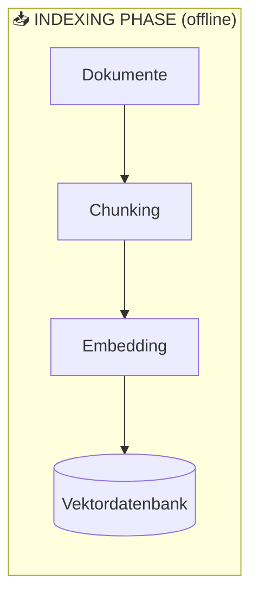
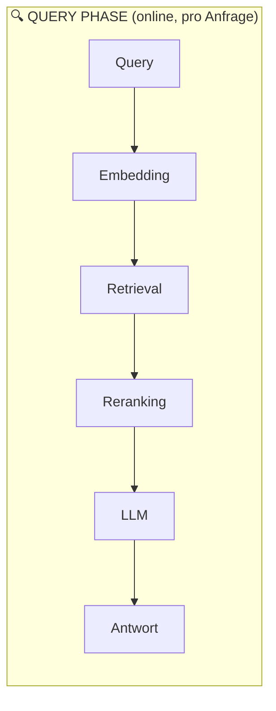

# RAG Grundlagen

## Was ist RAG?

**Retrieval-Augmented Generation (RAG)** ist eine Architektur, die Large Language Models (LLMs) mit externem Wissen anreichert, um deren inhärente Limitierungen zu überwinden.

### Das Problem mit reinen LLMs

LLMs wie GPT-4 oder Claude haben ein fundamentales Problem: ihr Wissen ist statisch. Das Modell wurde auf einem bestimmten Datensatz bis zu einem **Stichtag (Training Cutoff)** trainiert und kennt danach nichts mehr. Außerdem hat das Modell keine Kenntnis von:

- internen Unternehmensdokumenten
- privaten Datenbanken
- aktuellen Ereignissen nach dem Training
- spezifischem Fachwissen, das nicht im Training enthalten war

> [!IMPORTANT]
> RAG löst dieses Problem nicht durch erneutes Training, sondern durch **dynamisches Nachschlagen** relevanter Informationen zur Laufzeit. Das ist deutlich effizienter und aktueller als Fine-Tuning.

### Was RAG ermöglicht

| Problem                        | RAG-Lösung                                      |
| ------------------------------ | ----------------------------------------------- |
| Veraltetes Wissen              | Zugriff auf aktuelle Dokumente                  |
| Keine privaten Daten           | Eigene Dokumentenbasis einbindbar               |
| Halluzinationen                | Antworten auf Quellen gestützt                  |
| Keine Quellenangaben           | Retrieval liefert konkrete Fundstellen          |
| Kontextfenster-Limitierung     | Nur relevante Chunks werden übergeben           |

---

## RAG-Architektur: Die drei Phasen

RAG besteht aus **drei** Hauptphasen: **Indexing** (einmalig/periodisch), **Retrieval** und **Generation** (zur Laufzeit bei jeder Anfrage).





### Phase 1: Indexing

1. **Dokumente laden** – PDFs, Word-Dateien, Webseiten, Datenbanken
2. **Chunking** – Aufteilen in kleinere Abschnitte
3. **Embedding** – Jeder Chunk wird in einen Vektor umgewandelt
4. **Speichern** – Vektoren + Originaltext in Vektordatenbank

### Phase 2: Retrieval

1. **Query embedden** – Die Nutzerfrage wird in einen Vektor umgewandelt
2. **Similarity Search** – Suche nach den ähnlichsten Chunks in der Datenbank
3. **Reranking** (optional) – Ergebnisse neu bewerten und sortieren

### Phase 3: Generation

1. **Prompt aufbauen** – Kontext (gefundene Chunks) + Frage werden kombiniert
2. **LLM aufrufen** – Das Modell generiert eine Antwort basierend auf dem Kontext
3. **Antwort zurückgeben** – Optional mit Quellenangaben

---

## Schritt-für-Schritt: Ablauf einer RAG-Anfrage

```
Nutzer: "Was sind die Urlaubsregelungen laut unserem Firmenhandbuch?"

1. Query-Embedding:
   "Was sind die Urlaubsregelungen..." → [0.23, -0.87, 0.12, ...]

2. Vektorsuche in der Datenbank:
   Top-3 ähnlichste Chunks:
   - Chunk 47: "§5 Urlaubsanspruch: Jeder Mitarbeiter hat Anspruch auf..."
   - Chunk 48: "§6 Urlaubsplanung: Urlaub ist mindestens 4 Wochen im Voraus..."
   - Chunk 12: "Sonderurlaub: Bei Heirat stehen dem Mitarbeiter..."

3. Prompt-Konstruktion:
   System: "Beantworte die Frage basierend auf dem folgenden Kontext."
   Context: [Chunk 47] + [Chunk 48] + [Chunk 12]
   Question: "Was sind die Urlaubsregelungen laut unserem Firmenhandbuch?"

4. LLM-Antwort:
   "Laut Ihrem Firmenhandbuch haben Mitarbeiter folgende Urlaubsregelungen:
   - Grundanspruch: X Tage (§5)
   - Planung: 4 Wochen im Voraus (§6)
   - Sonderurlaub bei Heirat: ..."
```

---

## Chunking

Chunking ist der Prozess, Dokumente in kleinere, handhabbare Textabschnitte zu zerlegen. Es ist einer der kritischsten Faktoren für RAG-Qualität.

> [!NOTE]
> Das Embedding-Modell hat ein maximales Input-Limit (meist 512–8192 Tokens). Auch das Kontextfenster des LLMs ist begrenzt. Chunking löst beide Probleme.

### Chunk-Größe: Der Trade-off

| Eigenschaft        | Kleine Chunks (128–256 Tokens) | Große Chunks (512–1024 Tokens) |
| ------------------ | ------------------------------ | ------------------------------ |
| Präzision          | Hoch – sehr spezifisch         | Niedrig – viel Rauschen        |
| Kontext            | Gering – Kontext fehlt oft     | Hoch – mehr Zusammenhang       |
| Retrieval-Qualität | Gut für spezifische Fragen     | Gut für komplexe Fragen        |
| Speicherbedarf     | Mehr Chunks, mehr Vektoren     | Weniger Chunks, weniger Vektoren |
| Embedding-Kosten   | Höher (mehr Chunks)            | Niedriger                      |

> [!TIP]
> Als Startpunkt empfiehlt sich eine Chunk-Größe von **512 Tokens** mit einem Overlap von **50–100 Tokens**. Für technische Dokumentation eher größer (1024), für FAQ-artige Dokumente eher kleiner (256).

### Chunk-Overlap

Overlap bedeutet, dass aufeinanderfolgende Chunks sich **überschneiden** – die letzten N Tokens eines Chunks sind gleichzeitig die ersten N Tokens des nächsten.

```
Ohne Overlap:
[...Satz A. Satz B. Satz C.] [Satz D. Satz E. Satz F...]

Mit Overlap (Overlap = Satz C + D):
[...Satz A. Satz B. Satz C.]
              [Satz C. Satz D. Satz E. Satz F...]
```

**Warum Overlap?** Wichtige Informationen stehen oft an Chunk-Grenzen. Ohne Overlap würde ein Satz, der über die Grenze läuft, in keinem Chunk vollständig erfasst sein.

### Chunking-Strategien

#### 1. Fixed-Size Chunking

Der einfachste Ansatz: teile nach fixer Token- oder Zeichenanzahl auf.

```python
from langchain.text_splitter import CharacterTextSplitter

splitter = CharacterTextSplitter(
    chunk_size=512,
    chunk_overlap=50,
    separator="\n"
)
chunks = splitter.split_text(text)
```

**Vorteil:** Einfach, schnell, vorhersehbar.
**Nachteil:** Ignoriert Satzgrenzen und Dokumentstruktur – Sätze können mitten im Chunk abgeschnitten werden.

#### 2. Sentence-Based Chunking

Teilt an Satzgrenzen auf und gruppiert dann Sätze zu Chunks.

```python
from langchain.text_splitter import NLTKTextSplitter

splitter = NLTKTextSplitter(chunk_size=512)
chunks = splitter.split_text(text)
```

**Vorteil:** Respektiert natürliche Sprachgrenzen.
**Nachteil:** Chunk-Größen variieren stark; erfordert NLP-Bibliothek.

#### 3. Recursive Character Text Splitting

LangChains bevorzugte Methode: versucht nacheinander verschiedene Trennzeichen (`\n\n`, `\n`, ` `, `""`) und teilt erst auf, wenn nötig.

```python
from langchain.text_splitter import RecursiveCharacterTextSplitter

splitter = RecursiveCharacterTextSplitter(
    chunk_size=512,
    chunk_overlap=50,
    separators=["\n\n", "\n", ". ", " ", ""]
)
chunks = splitter.split_text(text)
```

**Vorteil:** Behält Absätze und Sätze wo möglich zusammen.
**Nachteil:** Etwas langsamer als Fixed-Size.

#### 4. Semantic Chunking

Analysiert den Inhalt und erstellt Chunks basierend auf semantischer Ähnlichkeit – neue Chunks beginnen, wo das Thema wechselt.

```python
from langchain_experimental.text_splitter import SemanticChunker
from langchain_openai import OpenAIEmbeddings

splitter = SemanticChunker(
    OpenAIEmbeddings(),
    breakpoint_threshold_type="percentile",
    breakpoint_threshold_amount=95
)
chunks = splitter.split_text(text)
```

**Vorteil:** Semantisch kohärente Chunks, beste Qualität.
**Nachteil:** Teuer (braucht Embedding-Calls), langsam, nicht deterministisch.

> [!TIP]
> **Empfehlung:** Starte mit **Recursive Character Text Splitting**. Wechsle zu Semantic Chunking nur, wenn du merkst, dass Themen in deinen Dokumenten häufig innerhalb von Absätzen wechseln.

---

## Retrieval-Methoden

### Dense Retrieval (Vektorsuche)

Verwendet neuronale Embeddings für semantische Ähnlichkeitssuche. Findet Dokumente, die *bedeutungsmäßig* ähnlich sind, auch wenn keine Worte übereinstimmen.

```
Query: "Wie hoch ist mein Gehalt?"
Findet auch: "Vergütung", "Lohn", "monatliche Bezüge", "Entlohnung"
```

**Algorithmisch:** Cosine Similarity oder Dot Product zwischen Query-Vektor und Chunk-Vektoren. Meist über **HNSW** (Hierarchical Navigable Small World) approximiert für Effizienz.

**Stärke:** Semantisches Verständnis, Synonyme, mehrsprachig.
**Schwäche:** Funktioniert schlecht bei seltenen Begriffen, IDs, Codes (z.B. "Fehler ERR-4821").

### Sparse Retrieval (BM25 / TF-IDF)

Klassische Keyword-Suche, die auf Wortübereinstimmungen basiert. **BM25** (Best Match 25) ist der Standard.

```
Query: "ERR-4821 PostgreSQL connection timeout"
Findet exakt: Dokumente mit diesen spezifischen Begriffen
```

**Stärke:** Exakte Begriffe, Produktcodes, Namen, technische Strings.
**Schwäche:** Kein semantisches Verständnis – "Auto" und "Fahrzeug" sind verschieden.

### Hybrid Retrieval

Kombiniert Dense + Sparse Retrieval und fusioniert die Ergebnisse.

```python
# Konzept: Reciprocal Rank Fusion (RRF)
def reciprocal_rank_fusion(dense_results, sparse_results, k=60):
    scores = {}
    for rank, doc in enumerate(dense_results):
        scores[doc.id] = scores.get(doc.id, 0) + 1 / (k + rank + 1)
    for rank, doc in enumerate(sparse_results):
        scores[doc.id] = scores.get(doc.id, 0) + 1 / (k + rank + 1)
    return sorted(scores.keys(), key=lambda x: scores[x], reverse=True)
```

> [!NOTE]
> Hybrid Retrieval ist in der Praxis oft besser als beide Einzelmethoden. Qdrant, Weaviate und OpenSearch unterstützen es nativ. Der Aufwand lohnt sich fast immer.

---

## Reranking

Reranking ist ein **zweistufiger Prozess**: Erst werden mit schneller Vektorsuche 50–100 Kandidaten geholt, dann bewertet ein präziseres (aber langsameres) Modell, welche Chunks wirklich relevant sind.

```
Vektorsuche: 100 Kandidaten (schnell, ~10ms)
     ↓
Reranker: 100 → Top 5 (langsamer, ~100ms, aber viel präziser)
     ↓
LLM: 5 hochwertige Chunks als Kontext
```

**Warum Reranking?** Embedding-Modelle optimieren für schnelle Ähnlichkeitssuche, nicht für präzise Relevanz. Cross-Encoder-Modelle (Reranker) sehen Query und Dokument **gleichzeitig** und können komplexe Zusammenhänge besser beurteilen.

```python
from sentence_transformers import CrossEncoder

reranker = CrossEncoder("cross-encoder/ms-marco-MiniLM-L-6-v2")

# candidates: Liste von (query, chunk) Paaren
scores = reranker.predict([(query, chunk) for chunk in candidates])
ranked = sorted(zip(scores, candidates), reverse=True)
top_5 = [chunk for _, chunk in ranked[:5]]
```

> [!TIP]
> **Cohere Rerank** und **Jina Reranker** sind gute API-Optionen. Für lokalen Einsatz: `cross-encoder/ms-marco-MiniLM-L-6-v2` (schnell) oder `BAAI/bge-reranker-large` (präzise).

---

## RAG Evaluation mit RAGAS

[RAGAS](https://docs.ragas.io) ist das Standard-Framework für die Bewertung von RAG-Systemen.

### Die vier Kernmetriken

| Metrik                | Misst                                               | Wertebereich |
| --------------------- | --------------------------------------------------- | ------------ |
| **Faithfulness**      | Ist die Antwort durch den Kontext gestützt?         | 0.0 – 1.0    |
| **Answer Relevancy**  | Beantwortet die Antwort die Frage?                  | 0.0 – 1.0    |
| **Context Precision** | Wie relevant sind die abgerufenen Chunks?           | 0.0 – 1.0    |
| **Context Recall**    | Wurden alle relevanten Infos abgerufen?             | 0.0 – 1.0    |

```python
from ragas import evaluate
from ragas.metrics import faithfulness, answer_relevancy, context_precision, context_recall
from datasets import Dataset

# Testdaten vorbereiten
data = {
    "question": ["Was ist der Urlaubsanspruch?"],
    "answer": ["Laut Handbuch haben Mitarbeiter 30 Tage Urlaub."],
    "contexts": [["§5: Mitarbeiter erhalten 30 Tage Jahresurlaub..."]],
    "ground_truth": ["Der Urlaubsanspruch beträgt 30 Tage."]
}
dataset = Dataset.from_dict(data)

# Evaluation durchführen
result = evaluate(
    dataset,
    metrics=[faithfulness, answer_relevancy, context_precision, context_recall]
)
print(result)
# {'faithfulness': 0.95, 'answer_relevancy': 0.88, ...}
```

> [!NOTE]
> Ab RAGAS v0.2 heißt das Feld `ground_truths` (Plural).

> [!WARNING]
> RAGAS braucht für die meisten Metriken selbst ein LLM. Kalkuliere die API-Kosten ein, besonders bei großen Test-Sets.

---

## Advanced RAG

### HyDE (Hypothetical Document Embeddings)

Statt die Query direkt zu embedden, lässt man das LLM zuerst ein **hypothetisches Dokument** generieren, das die Antwort enthalten würde. Dieses wird dann geembeddet und für die Suche verwendet.

```python
from langchain_openai import ChatOpenAI, OpenAIEmbeddings
from langchain.chains import HypotheticalDocumentEmbedder

llm = ChatOpenAI(model="gpt-4o-mini")
embeddings = OpenAIEmbeddings()

# HyDE erzeugt zuerst eine hypothetische Antwort, dann embedded sie diese
hyde_embeddings = HypotheticalDocumentEmbedder.from_llm(
    llm=llm,
    base_embeddings=embeddings,
    custom_prompt=None  # Nutzt Standard-Prompt
)

# Diese Embeddings dann für die Vektorsuche verwenden
query_embedding = hyde_embeddings.embed_query("Was ist der Urlaubsanspruch?")
```

**Wann sinnvoll?** Bei kurzen, schlagwortartigen Queries, die semantisch arm sind. Nachteil: ein zusätzlicher LLM-Call pro Anfrage.

### Self-RAG

Das Modell entscheidet selbst, ob es Retrieval braucht, und bewertet die abgerufenen Chunks. Es generiert spezielle Tokens wie `[Retrieve]`, `[IsRel]`, `[IsSup]`, `[IsUse]`.

**Konzept:**
1. Ist Retrieval für diese Frage nötig? (`[Retrieve]` / `[No Retrieve]`)
2. Ist der gefundene Chunk relevant? (`[Relevant]` / `[Irrelevant]`)
3. Stützt der Chunk die Aussage? (`[Fully Supported]` / `[Partially]` / `[No Support]`)
4. Ist die finale Antwort nützlich?

### Corrective RAG (CRAG)

Wenn der Retrieval schlecht ist (niedrige Confidence), wird automatisch eine Websuche als Fallback ausgelöst.

```
Retrieval Score < Threshold → Web Search als Ergänzung
Retrieval Score > Threshold → Nur lokale Dokumente
```

> [!NOTE]
> Self-RAG und CRAG erfordern spezielle Modelle oder komplexe Pipelines (z.B. mit LangGraph). Sie sind fortgeschrittene Techniken für Produktionssysteme.

---

## Häufige Probleme und Lösungen

| Problem                            | Ursache                               | Lösung                                               |
| ---------------------------------- | ------------------------------------- | ---------------------------------------------------- |
| Irrelevante Chunks werden gefunden | Chunk-Größe zu groß / Embedding schwach | Chunk-Größe reduzieren, besseres Embedding-Modell    |
| Relevante Chunks fehlen            | Query zu spezifisch / Overlap zu klein | Hybrid Retrieval, größeres Top-K, Overlap erhöhen    |
| LLM ignoriert den Kontext          | Kontext zu lang, schlechter Prompt    | Reranking auf Top-3 reduzieren, Prompt verbessern    |
| Halluzinationen trotz Kontext      | LLM "erfindet" trotzdem               | Faithfulness-Prompt, Temperatur auf 0 setzen         |
| Langsame Antwortzeiten             | Zu viele Chunks, großes Embedding     | Caching, kleineres Embedding-Modell, async Retrieval |
| Hohe Kosten                        | Embedding bei jedem Aufruf            | Embeddings cachen, lokales Embedding-Modell nutzen   |

> [!WARNING]
> **Das häufigste RAG-Problem ist schlechtes Chunking** – nicht das Embedding oder das LLM. Investiere Zeit in die Analyse deiner Dokumente und teste verschiedene Chunking-Strategien, bevor du andere Komponenten optimierst.

---

## Weiterführende Links

- [[Embeddings]] – Embedding-Modelle im Detail
- [[Vektordatenbanken]] – ChromaDB, Qdrant, pgvector
- [[LangChain und LlamaIndex]] – RAG-Frameworks
