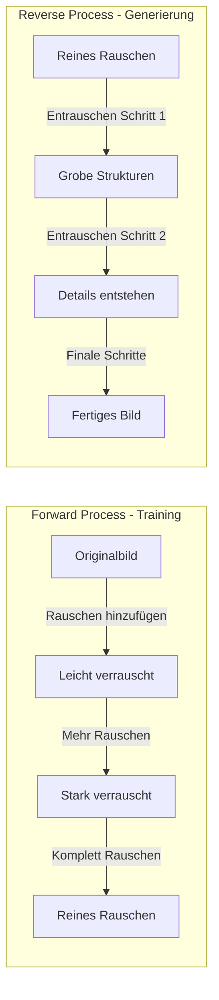
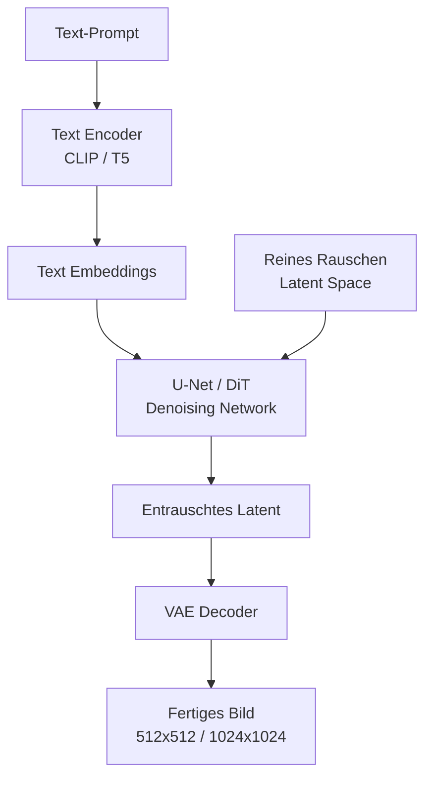

# AI Bildgenerierung

> [!ABSTRACT]
> **AI Bildgenerierung** nutzt **Diffusion Models**, um aus Text-Beschreibungen fotorealistische Bilder, Illustrationen und Kunst zu erstellen. Von **Stable Diffusion** (Open Source) über **DALL-E 3** (OpenAI) bis **Midjourney** (Ästhetik-Fokus) — diese Dokumentation erklärt die Technik, die wichtigsten Tools und den praktischen Einsatz.

---

## Übersicht

| Tool | Entwickler | Open Source | Stärke | Kosten |
|---|---|---|---|---|
| **Stable Diffusion** | Stability AI | ✅ Ja | Lokal, anpassbar, Community | Kostenlos (lokal) |
| **DALL-E 3** | OpenAI | ❌ Nein | ChatGPT-Integration, Prompt-Treue | API / ChatGPT Plus |
| **Midjourney** | Midjourney Inc. | ❌ Nein | Ästhetik, künstlerische Qualität | Ab $10/Mo |
| **Flux** | Black Forest Labs | ✅ Ja | Moderne Architektur (DiT), Qualität | Kostenlos (lokal) |
| **Imagen 3** | Google | ❌ Nein | Fotorealismus, Text in Bildern | Google AI / Gemini |

---

## Wie Diffusion Models funktionieren

### Das Grundprinzip

Diffusion Models lernen, **Rauschen rückgängig zu machen**:



1. **Forward Process** — Ein echtes Bild wird schrittweise mit Gaußschem Rauschen zerstört (T Schritte)
2. **Training** — Ein neuronales Netzwerk (U-Net oder DiT) lernt, bei jedem Schritt das hinzugefügte Rauschen vorherzusagen
3. **Reverse Process** — Zum Generieren startet man mit reinem Rauschen und entrauscht schrittweise

> [!NOTE]
> Das Modell lernt **nicht**, Bilder zu malen — es lernt, **Rauschen zu entfernen**. Die Generierung entsteht als Nebeneffekt dieses Entrauschungsprozesses.

### Architektur-Komponenten



| Komponente | Aufgabe |
|---|---|
| **Text Encoder (CLIP/T5)** | Wandelt Text in Vektoren um, die das Bild steuern |
| **U-Net / DiT** | Das Kernmodell — sagt das Rauschen vorher, gesteuert vom Text |
| **VAE (Variational Autoencoder)** | Komprimiert/dekomprimiert zwischen Pixelraum und Latent Space |
| **Scheduler/Sampler** | Steuert den Entrauschungsprozess (DDPM, Euler, DPM++) |

### Latent Diffusion

Statt direkt im Pixelraum zu arbeiten (z.B. 512×512×3 = 786.432 Werte), komprimiert ein **VAE** das Bild in einen **Latent Space** (z.B. 64×64×4 = 16.384 Werte):

| Raum | Größe (512×512 Bild) | Vorteil |
|---|---|---|
| Pixel Space | 786.432 Werte | Maximale Qualität |
| **Latent Space** | 16.384 Werte | **48x weniger** — viel schneller! |

> [!IMPORTANT]
> Latent Diffusion ist die Kerninnovation von **Stable Diffusion** — es macht hochqualitative Bildgenerierung auf Consumer-GPUs möglich.

---

## Stable Diffusion

### Versionen

| Version | Release | Architektur | Auflösung | Besonderheit |
|---|---|---|---|---|
| **SD 1.5** | 2022 | U-Net, CLIP | 512×512 | Riesige Community, tausende LoRAs |
| **SDXL** | 2023 | U-Net (größer), CLIP+OpenCLIP | 1024×1024 | Bessere Qualität, 2-Stage |
| **SD 3** | 2024 | DiT (Transformer), T5+CLIP | 1024×1024 | Besserer Text in Bildern |

### Lokale Installation

```bash
# ComfyUI (empfohlen — Node-basierter Workflow)
git clone https://github.com/comfyanonymous/ComfyUI
cd ComfyUI
pip install -r requirements.txt
python main.py

# Automatic1111 WebUI (klassisch, einfacher)
git clone https://github.com/AUTOMATIC1111/stable-diffusion-webui
cd stable-diffusion-webui
./webui.sh   # Linux/Mac
```

### Hardware-Anforderungen

| Modell | VRAM (Minimum) | VRAM (Empfohlen) | Generierungszeit |
|---|---|---|---|
| SD 1.5 | 4 GB | 8 GB | ~5s (RTX 3060) |
| SDXL | 6 GB | 12 GB | ~15s (RTX 3060) |
| Flux Dev | 12 GB | 24 GB | ~30s (RTX 4090) |

---

## Wichtige Konzepte

### Prompt Engineering für Bilder

| Element | Beispiel | Wirkung |
|---|---|---|
| **Hauptmotiv** | "a cyberpunk samurai" | Was wird gezeigt |
| **Stil** | "digital painting, oil painting, photograph" | Künstlerischer Stil |
| **Qualität** | "8k, ultra detailed, masterpiece" | Qualitäts-Keywords |
| **Beleuchtung** | "cinematic lighting, golden hour" | Lichtstimmung |
| **Negative Prompt** | "blurry, low quality, deformed hands" | Was vermieden werden soll |

### CFG Scale (Classifier-Free Guidance)

Steuert, wie stark der Text-Prompt das Bild beeinflusst:

| CFG | Wirkung |
|---|---|
| 1–3 | Sehr kreativ, wenig Prompt-Treue |
| **7–9** | **Bester Kompromiss (Standard)** |
| 12–15 | Sehr prompt-treu, kann überzeichnet wirken |
| >20 | Artefakte, unnatürlich |

### Sampler / Scheduler

Bestimmt, wie der Entrauschungsprozess abläuft:

| Sampler | Schritte | Geschwindigkeit | Qualität |
|---|---|---|---|
| **Euler a** | 20–30 | Schnell | Gut |
| **DPM++ 2M Karras** | 20–30 | Schnell | Sehr gut |
| **DDIM** | 50+ | Langsam | Gut, deterministisch |

### LoRA und Fine-Tuning

**[[LoRA und QLoRA]]** wird intensiv für Bild-Modelle genutzt:
- Spezifische Stile lernen (z.B. Anime, Pixel-Art)
- Personen oder Objekte einprägen
- Nur ~10–50 MB pro LoRA (statt 2–7 GB für das Modell)

---

## API-Nutzung

### DALL-E 3 (OpenAI)

```python
from openai import OpenAI

client = OpenAI()

response = client.images.generate(
    model="dall-e-3",
    prompt="Ein futuristisches Homelab mit RGB-Beleuchtung, fotorealistisch",
    size="1024x1024",
    quality="hd",
    n=1,
)

image_url = response.data[0].url
print(image_url)
```

### Stable Diffusion (lokal via API)

```python
import requests

# ComfyUI oder Automatic1111 API
response = requests.post("http://localhost:7860/sdapi/v1/txt2img", json={
    "prompt": "cyberpunk city at night, neon lights, rain",
    "negative_prompt": "blurry, low quality",
    "steps": 25,
    "cfg_scale": 7.5,
    "width": 1024,
    "height": 1024,
    "sampler_name": "DPM++ 2M Karras",
})
```

---

## Flux — Die neue Generation

**Flux** von Black Forest Labs (gegründet von Stable Diffusion Erfindern) nutzt **DiT (Diffusion Transformer)** statt U-Net:

| Variante | Lizenz | Qualität | VRAM |
|---|---|---|---|
| **Flux Schnell** | Apache 2.0 | Gut | 8 GB+ |
| **Flux Dev** | Non-Commercial | Sehr gut | 12 GB+ |
| **Flux Pro** | API only | Beste | - |

Flux bietet:
- Besseres Text-Rendering in Bildern
- Höhere Prompt-Treue
- Bessere Anatomie (weniger deformierte Hände)

---

## Vergleich der Generatoren

| Feature | Stable Diffusion | DALL-E 3 | Midjourney | Flux |
|---|---|---|---|---|
| **Open Source** | ✅ | ❌ | ❌ | ✅ (Schnell/Dev) |
| **Lokal ausführbar** | ✅ | ❌ | ❌ | ✅ |
| **Prompt-Treue** | Mittel | Sehr hoch | Mittel | Hoch |
| **Ästhetik** | Gut (SDXL) | Gut | Sehr hoch | Hoch |
| **Text in Bildern** | Schlecht | Gut | Schlecht | Gut |
| **Anpassbar (LoRA)** | ✅ | ❌ | ❌ | ✅ |
| **Community** | Riesig | - | Groß | Wachsend |

---

## Ethik und Rechtliches

| Thema | Status |
|---|---|
| **Copyright der Outputs** | Rechtlich ungeklärt (USA: kein Copyright für rein AI-generierte Bilder) |
| **Trainingsdaten** | Kontroverse: Stable Diffusion auf LAION trainiert (enthält Copyright-Material) |
| **Deepfakes** | Missbrauchspotential — viele Plattformen verbieten realistische Gesichter |
| **Wasserzeichen** | DALL-E 3 und Imagen fügen unsichtbare Wasserzeichen hinzu |

---

## Verwandte Notizen

- [[LoRA und QLoRA]] — Modelle auf eigene Stile anpassen
- [[Wie funktionieren LLMs]] — Transformer-Architektur (DiT baut darauf auf)
- [[Lokale LLMs]] — Hardware-Anforderungen und lokale Ausführung
- [[Multimodalität]] — Bilder als Input für multimodale Modelle

### Externe Ressourcen

- [Hugging Face](https://huggingface.co) — Modelle, Datasets und Spaces für Bildgenerierung
