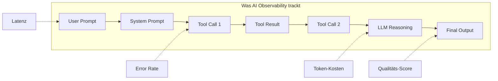

# AI Observability

> [!ABSTRACT]
> **AI Observability** umfasst Tracing, Monitoring und Debugging von LLM-Anwendungen und AI-Agents. Während klassisches APM (Application Performance Monitoring) Latenz und Fehlerquoten misst, geht AI Observability tiefer: Es trackt Prompt-Chains, Token-Kosten, Modell-Qualität und Agent-Entscheidungen. Die führenden Tools sind **Langfuse**, **LangSmith**, **Arize Phoenix** und **OpenLIT**.

---

## Übersicht

| Aspekt | Details |
|---|---|
| **Zweck** | Tracing, Debugging, Monitoring von LLM/Agent-Systemen |
| **Standard** | OpenTelemetry (OTel) als Basis-Protokoll |
| **Metriken** | Latenz, Token-Kosten, Qualität, Halluzinationen, Drift |
| **Granularität** | Prompt → Chain → Tool-Call → Antwort |
| **Integration** | LangChain, LlamaIndex, eigene SDKs, OpenTelemetry |

---

## Warum AI Observability?

Klassische Anwendungen sind deterministisch — gleicher Input, gleicher Output. LLM-basierte Systeme sind **stochastisch**: Gleiches Prompt kann verschiedene Antworten liefern. Das macht Debugging fundamental anders:

| Klassisches Debugging | AI Observability |
|---|---|
| Stack Traces lesen | Prompt-Chains nachverfolgen |
| Breakpoints setzen | Token-Verbrauch analysieren |
| Unit Tests schreiben | Output-Qualität messen |
| Logs durchsuchen | Reasoning-Traces inspizieren |
| Performance messen | Kosten pro Anfrage tracken |



---

## Die wichtigsten Tools

### Langfuse

| Eigenschaft | Details |
|---|---|
| **Typ** | Open Source (MIT) + Managed SaaS |
| **Self-Hosting** | ✅ Docker, Kubernetes |
| **Stärke** | Tiefes Tracing, Prompt-Versionierung, Kosten-Tracking |
| **Integration** | LangChain, OpenAI SDK, LlamaIndex, Vektordatenbanken |
| **OTel-Support** | ✅ |
| **Pricing** | Free (Self-Hosted), Cloud ab $59/Mo |

**Kernfeatures:**
- **Session Replays** — Komplette Konversationen Schritt für Schritt nachspielen
- **Prompt Management** — Prompts versionieren, A/B-testen, deployen
- **Cost Analytics** — Token-Kosten pro User, Feature oder Zeitraum
- **Evaluator Templates** — Halluzination, Toxizität, Relevanz messen

```python
from langfuse import Langfuse

langfuse = Langfuse()

# Trace erstellen
trace = langfuse.trace(name="code-review", user_id="dev-123")

# Span für LLM-Aufruf
span = trace.span(name="llm-call", input={"prompt": "Review this code"})
# ... LLM aufrufen ...
span.end(output={"response": "..."}, metadata={"tokens": 450, "cost": 0.012})

# Score vergeben
trace.score(name="quality", value=0.85, comment="Gute Review, aber Formatierung fehlt")
```

---

### LangSmith

| Eigenschaft | Details |
|---|---|
| **Typ** | Commercial (LangChain) |
| **Self-Hosting** | Enterprise-Option |
| **Stärke** | Zero-Config für LangChain-Apps, Annotation-Workflows |
| **Integration** | LangChain, LangGraph (nativ) |
| **Pricing** | Free Tier, Plus $39/Mo, Enterprise custom |

**Kernfeatures:**
- **Automatisches Tracing** — LangChain-Calls werden ohne Code-Änderung getrackt
- **Annotation Queues** — Experten bewerten Agent-Outputs
- **Datasets & Testing** — Evaluations-Pipelines definieren
- **Hub** — Prompts teilen und versionieren

```bash
# LangSmith aktivieren (Umgebungsvariable reicht)
export LANGCHAIN_TRACING_V2=true
export LANGCHAIN_API_KEY=ls-...
```

```python
from langchain_openai import ChatOpenAI
from langchain_core.messages import HumanMessage

# Automatisches Tracing — kein zusätzlicher Code nötig
llm = ChatOpenAI(model="gpt-4o")
response = llm.invoke([HumanMessage(content="Erkläre Observability")])
# → Trace erscheint automatisch in LangSmith Dashboard
```

---

### Arize Phoenix

| Eigenschaft | Details |
|---|---|
| **Typ** | Open Source (Elastic License) |
| **Self-Hosting** | ✅ |
| **Stärke** | RAG-Pipeline-Monitoring, Drift-Detection, Clustering |
| **Integration** | LlamaIndex, LangChain, OpenAI |
| **Pricing** | Free (Self-Hosted) |

**Kernfeatures:**
- **RAG-Analyse** — Retrieval-Qualität messen (Relevanz, Recall, MRR)
- **Embedding-Drift** — Erkennt, wenn sich Datenverteilungen ändern
- **Clustering** — Gruppiert ähnliche Anfragen für Muster-Erkennung
- **Evaluations** — Built-in Evals für Halluzination und Toxizität

```python
import phoenix as px

session = px.launch_app()

# Traces automatisch sammeln
from openinference.instrumentation.openai import OpenAIInstrumentor
OpenAIInstrumentor().instrument()

# Jetzt werden alle OpenAI-Calls getrackt
```

---

### OpenLIT

| Eigenschaft | Details |
|---|---|
| **Typ** | Open Source |
| **Stärke** | Leichtgewichtig, OpenTelemetry-native |
| **Integration** | OTel-kompatibel (Jaeger, Zipkin, Grafana) |
| **Pricing** | Free |

**Kernfeatures:**
- Native OpenTelemetry-Spans für LLM-Calls
- Kosten-Analytics
- Prompt/Response-Visualisierung

---

## Vergleichsmatrix

| Feature | Langfuse | LangSmith | Arize Phoenix | OpenLIT |
|---|---|---|---|---|
| **Open Source** | ✅ (MIT) | ❌ | ✅ (Elastic) | ✅ |
| **Self-Hosting** | ✅ | Enterprise | ✅ | ✅ |
| **Tracing** | ✅✅ | ✅✅ | ✅ | ✅ |
| **Kosten-Tracking** | ✅✅ | ✅ | ❌ | ✅ |
| **Prompt-Mgmt** | ✅✅ | ✅ Hub | ❌ | ❌ |
| **RAG-Monitoring** | ✅ | ✅ | ✅✅ (Kern) | ❌ |
| **Drift-Detection** | ❌ | ❌ | ✅✅ | ❌ |
| **Evaluations** | ✅ Templates | ✅ Datasets | ✅ Built-in | ❌ |
| **OTel-Support** | ✅ | Limitiert | ✅ | ✅✅ (Kern) |
| **LangChain-native** | ✅ | ✅✅ | ✅ | ❌ |
| **Setup-Aufwand** | Niedrig | Sehr niedrig | Mittel | Niedrig |

---

## Was tracken?

### Kern-Metriken

| Metrik | Beschreibung | Warum wichtig |
|---|---|---|
| **Latenz** | Zeit pro LLM-Call und Gesamt-Chain | User Experience |
| **Token-Verbrauch** | Input/Output-Tokens pro Anfrage | Kostencontrol |
| **Kosten** | $ pro Anfrage, User, Feature | Budget-Management |
| **Error Rate** | Fehlgeschlagene Calls, Timeouts | Reliability |
| **Qualitäts-Score** | Manuelle oder automatische Bewertung | Output-Qualität |
| **Halluzinations-Rate** | Anteil faktisch falscher Antworten | Vertrauenswürdigkeit |

### Agent-spezifische Metriken

| Metrik | Beschreibung |
|---|---|
| **Tool-Call-Verteilung** | Welche Tools wie oft genutzt werden |
| **Chain-Tiefe** | Wie viele Schritte ein Agent braucht |
| **Reasoning-Qualität** | Ob die Zwischenschritte logisch sind |
| **Context-Utilization** | Wie viel vom Kontext tatsächlich genutzt wird |

---

## OpenTelemetry für AI

**OpenTelemetry (OTel)** wird zum Standard für AI-Observability:

```python
from opentelemetry import trace
from opentelemetry.sdk.trace import TracerProvider

provider = TracerProvider()
trace.set_tracer_provider(provider)

tracer = trace.get_tracer("ai-agent")

with tracer.start_as_current_span("agent-task") as span:
    span.set_attribute("llm.model", "gpt-4o")
    span.set_attribute("llm.tokens.input", 150)
    span.set_attribute("llm.tokens.output", 450)
    span.set_attribute("llm.cost", 0.015)
    
    # ... LLM aufrufen ...
```

> [!TIP] OTel-First-Strategie
> Wenn du schon Datadog, Grafana oder Jaeger nutzt, wähle ein AI-Observability-Tool mit OTel-Support (Langfuse, OpenLIT, Phoenix). So fließen AI-Traces in dein bestehendes Monitoring.

---

## Wann welches Tool?

| Szenario | Empfehlung |
|---|---|
| LangChain-Projekt, schneller Start | **LangSmith** (Zero-Config) |
| Self-Hosted, volle Kontrolle | **Langfuse** (Open Source) |
| RAG-Pipeline überwachen | **Arize Phoenix** (Drift + Retrieval) |
| Bestehendes OTel-Setup erweitern | **OpenLIT** oder **Traceloop** |
| Enterprise mit Budget | **LangSmith** oder **Langfuse Cloud** |

---

## Best Practices

1. **Alles tracken** — Lieber zu viel als zu wenig; Traces sind billig, Debugging-Zeit nicht
2. **Kosten-Alerts** — Automatische Warnung bei unerwartetem Token-Verbrauch
3. **Evaluation-Pipelines** — Automatische Qualitätsbewertung für jede Antwort
4. **Prompt-Versionierung** — Jede Prompt-Änderung als Version tracken (A/B-Testing)
5. **Sampling in Produktion** — Nicht jede Anfrage voll tracken; 10-20% reichen für Statistik
6. **Retention Policy** — Traces mit PII automatisch nach X Tagen löschen

---

## Verwandte Notizen

- [[Guardrails und AI Safety]] — Guardrails-Events monitoren
- [[Agent Frameworks]] — Frameworks integrieren Observability-Hooks
- [[Function Calling und Tool Use]] — Tool-Calls als Trace-Spans
- [[Memory Systems]] — Memory-Zugriffe tracken
- [[RAG Grundlagen]] — RAG-Pipeline-Monitoring mit Phoenix

### Externe Ressourcen

- [Langfuse](https://langfuse.com) — Open-Source LLM Observability Platform
