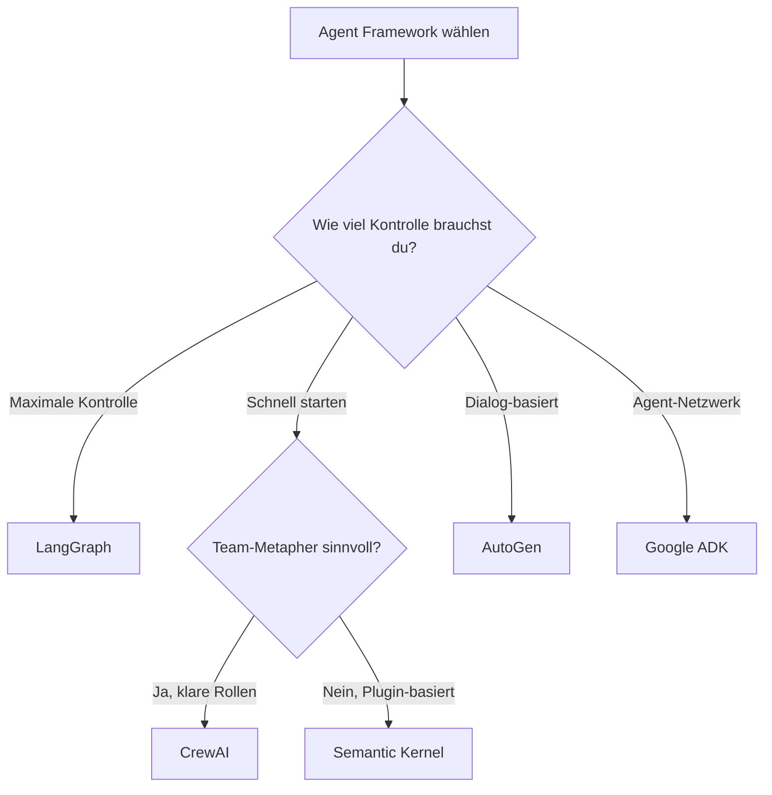

# Agent Frameworks

> [!ABSTRACT]
> **Agent Frameworks** sind Bibliotheken und Plattformen zum Bauen von AI-Agents und Multi-Agent-Systemen. Sie abstrahieren die Komplexität von [[Function Calling und Tool Use|Tool-Orchestrierung]], Zustandsmanagement und Agent-Koordination. Die wichtigsten Frameworks 2026 sind LangGraph, CrewAI, AutoGen, Semantic Kernel und Google ADK.

---

## Übersicht: Die großen Fünf

| Framework | Hersteller | Philosophie | Sprache | Lizenz |
|---|---|---|---|---|
| **LangGraph** | LangChain | Graph-basierte Zustandsmaschine | Python | MIT |
| **CrewAI** | Community | Rollen-basierte Team-Orchestrierung | Python | MIT |
| **AutoGen** | Microsoft | Konversations-basierte Multi-Agent-Dialoge | Python, .NET | MIT |
| **Semantic Kernel** | Microsoft | Skill/Plugin-Orchestrierung | .NET, Python | MIT |
| **Google ADK** | Google | [[A2A Protocol\|A2A]]-natives Agent Development Kit | Python, JS, Go | Apache 2.0 |

---

## LangGraph

**Philosophie**: Jeder Schritt ist ein Knoten in einem Graph, jede Transition eine Kante. Maximale Kontrolle.

### Stärken und Schwächen

| ✅ Pro | ❌ Contra |
|---|---|
| Maximale Kontrolle über Workflows | Steile Lernkurve |
| Checkpointing (Pause/Resume/Audit) | Viel Boilerplate für einfache Tasks |
| Enterprise-grade Reliability | Verbose Syntax |
| Visuelles Debugging möglich | |

### Installation und Beispiel

```bash
pip install langgraph
```

```python
from langgraph.graph import StateGraph, END
from typing import TypedDict

class AgentState(TypedDict):
    messages: list
    current_step: str

graph = StateGraph(AgentState)

def analyze(state):
    return {"current_step": "analyzing", "messages": state["messages"]}

def decide(state):
    if "error" in state["messages"][-1]:
        return "fix"
    return "done"

graph.add_node("analyze", analyze)
graph.add_node("fix", lambda s: {"current_step": "fixing"})

graph.set_entry_point("analyze")
graph.add_conditional_edges("analyze", decide, {"fix": "fix", "done": END})
graph.add_edge("fix", "analyze")

app = graph.compile()
result = app.invoke({"messages": ["Review this code"], "current_step": ""})
```

**Best für**: Mission-Critical-Logik, Compliance, komplexe Zustandsmaschinen.

---

## CrewAI

**Philosophie**: Stelle ein "Team" zusammen — jeder Agent hat eine Rolle, ein Ziel und Tools.

### Stärken und Schwächen

| ✅ Pro | ❌ Contra |
|---|---|
| Schnellstes Prototyping | Weniger Kontrolle über Ablauf |
| Intuitive Rollen-Metapher | Agents an Crew-Lifecycle gebunden |
| Minimaler Boilerplate | Nicht ideal für dynamische Logik |
| Hierarchischer Prozess-Modus | |

### Installation und Beispiel

```bash
pip install crewai
```

```python
from crewai import Agent, Task, Crew

researcher = Agent(
    role="Researcher",
    goal="Finde relevante Informationen zum Thema",
    backstory="Du bist ein erfahrener Researcher.",
    tools=[search_tool]
)

writer = Agent(
    role="Writer",
    goal="Schreibe einen zusammenfassenden Artikel",
    backstory="Du bist ein technischer Autor."
)

research_task = Task(
    description="Recherchiere die neuesten AI-Agent-Frameworks",
    agent=researcher,
    expected_output="Strukturierte Zusammenfassung"
)

write_task = Task(
    description="Schreibe einen Blog-Artikel basierend auf der Recherche",
    agent=writer,
    expected_output="Blog-Artikel in Markdown"
)

crew = Crew(
    agents=[researcher, writer],
    tasks=[research_task, write_task],
    verbose=True
)

result = crew.kickoff()
```

**Best für**: Schnelle Prototypen, klar definierte Teamstrukturen, Content-Pipelines.

---

## AutoGen (Microsoft Agent Framework)

**Philosophie**: Agents kommunizieren in **Dialogen** — wie ein Gruppenchat zwischen spezialisierten Agents.

> [!NOTE] Status
> AutoGen ist jetzt Teil des **Microsoft Agent Framework** und wird aktiv weiterentwickelt. Die klassische AutoGen-API bleibt als Kompatibilitätsschicht erhalten.

### Stärken und Schwächen

| ✅ Pro | ❌ Contra |
|---|---|
| Nativer Human-in-the-Loop | Token-intensiv bei langen Dialogen |
| AutoGen Studio (visuelles Debugging) | Weniger deterministische Abläufe |
| .NET und Azure-Integration | Komplexer als CrewAI |
| Code-Ausführung integriert | |

### Installation und Beispiel

```bash
pip install autogen
```

```python
from autogen import AssistantAgent, UserProxyAgent

assistant = AssistantAgent(
    name="coding_agent",
    llm_config={"model": "gpt-4o"}
)

user_proxy = UserProxyAgent(
    name="user",
    human_input_mode="TERMINATE",
    code_execution_config={"work_dir": "workspace"}
)

# Dialog starten
user_proxy.initiate_chat(
    assistant,
    message="Schreibe ein Python-Script, das CSV-Dateien analysiert"
)
```

**Best für**: Dialogbasierte Workflows, Human-in-the-Loop, Azure/Microsoft-Ökosystem.

---

## Semantic Kernel

**Philosophie**: LLM als **Planungs-Engine** — orchestriert Skills und Plugins.

### Stärken und Schwächen

| ✅ Pro | ❌ Contra |
|---|---|
| Starke Plugin-Architektur | Weniger Multi-Agent-Fokus |
| .NET und Python | Mehr Skill- als Agent-orientiert |
| Memory-Management integriert | Microsoft-Ökosystem-Bindung |
| Enterprise-ready | |

### Installation

```bash
# Python
pip install semantic-kernel

# .NET
dotnet add package Microsoft.SemanticKernel
```

```python
import semantic_kernel as sk

kernel = sk.Kernel()
kernel.add_service(sk.connectors.OpenAIChatCompletion("gpt-4o", api_key="..."))

@kernel.function(name="summarize", description="Fasst Text zusammen")
def summarize(text: str) -> str:
    return f"Zusammenfassung von: {text[:100]}..."

result = await kernel.invoke("summarize", text="Langer Artikel...")
```

**Best für**: Plugin-basierte Workflows, .NET-Teams, Microsoft-Stack.

---

## Google ADK (Agent Development Kit)

**Philosophie**: [[A2A Protocol|A2A]]-First — Agents, die sich gegenseitig finden und kollaborieren.

### Stärken und Schwächen

| ✅ Pro | ❌ Contra |
|---|---|
| A2A-nativer Support | Noch relativ jung |
| Multi-Agent-Netzwerke | Google-Ökosystem-Fokus |
| Persistente Agent-Communities | Dokumentation entwickelt sich noch |
| Multi-Sprach-SDKs (Python, JS, Go) | |

### Installation

```bash
pip install google-adk
```

**Best für**: A2A-basierte Agent-Netzwerke, Cross-Vendor-Interoperabilität.

---

## Vergleichsmatrix

| Feature | LangGraph | CrewAI | AutoGen | Semantic Kernel | Google ADK |
|---|---|---|---|---|---|
| **Architektur** | Graph/Zustandsmaschine | Rollen/Teams | Dialoge/Chat | Skills/Plugins | Protokoll/Netzwerk |
| **Kontrolle** | Sehr hoch | Mittel | Niedrig | Mittel | Hoch (Protokoll) |
| **Setup-Aufwand** | Hoch | Niedrig | Mittel | Hoch | Mittel |
| **Determinismus** | ✅✅ | ✅ | ❌ | ✅ | ✅ |
| **Human-in-the-Loop** | Manuell | Limitiert | ✅✅ (Kern) | Limitiert | ✅ |
| **MCP-Support** | Limitiert | ✅ (wachsend) | Limitiert | ❌ | ✅ Nativ |
| **A2A-Support** | Via Adapter | Via Adapter | Limitiert | ❌ | ✅✅ Nativ |
| **Production-Ready** | ✅✅ Enterprise | ✅ MVP → Prod | ✅ Azure | ✅ Enterprise | Im Aufbau |
| **Debugging** | Graph-Visualisierung | Logs | AutoGen Studio | Console | Protokoll-Tracing |

---

## Wann welches Framework?



| Szenario | Framework |
|---|---|
| Compliance-kritische Workflows | LangGraph |
| Schneller Prototyp mit Team-Rollen | CrewAI |
| Dialog-basierte Agent-Interaktion | AutoGen |
| .NET / Microsoft-Stack | Semantic Kernel |
| A2A-basierte Agent-Netzwerke | Google ADK |
| Einfachster Einstieg | CrewAI |

---

## Kombination mit dem AI-Agent-Ökosystem

| Technologie | Rolle im Framework |
|---|---|
| **[[Function Calling und Tool Use\|Function Calling]]** | Basis für alle Tool-Aufrufe |
| **[[Was ist MCP\|MCP]]** | Standardisierte Tool-Schnittstelle |
| **[[A2A Protocol]]** | Agent-zu-Agent-Kommunikation |
| **[[Memory Systems]]** | Persistenter Kontext (Mem0, Zep) |
| **[[AI Observability]]** | Tracing und Monitoring |
| **[[Guardrails und AI Safety]]** | Sicherheitsschicht |
| **[[Sandboxing und Code Execution]]** | Isolierte Code-Ausführung |

---

## Verwandte Notizen

- [[Was ist ein AI Agent]] — Grundlagen zu AI-Agents
- [[Multi-Agent Workflows]] — Strategien für Multi-Agent-Systeme
- [[Function Calling und Tool Use]] — Die Basis-Technologie hinter Agents
- [[Was ist MCP]] — Standardisierung von Tool-Zugriff
- [[A2A Protocol]] — Agent-zu-Agent-Kommunikation
- [[AI Observability]] — Monitoring von Agent-Workflows
