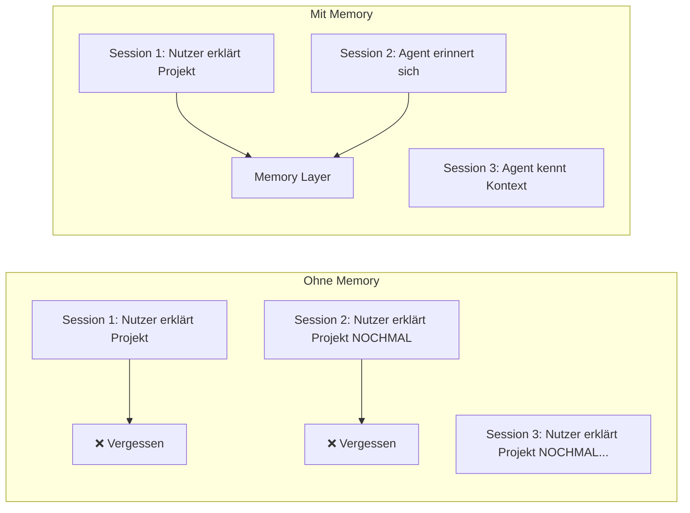
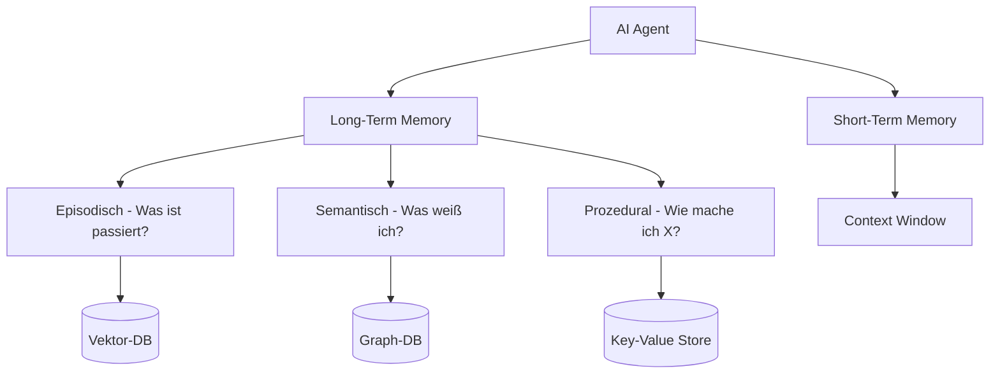
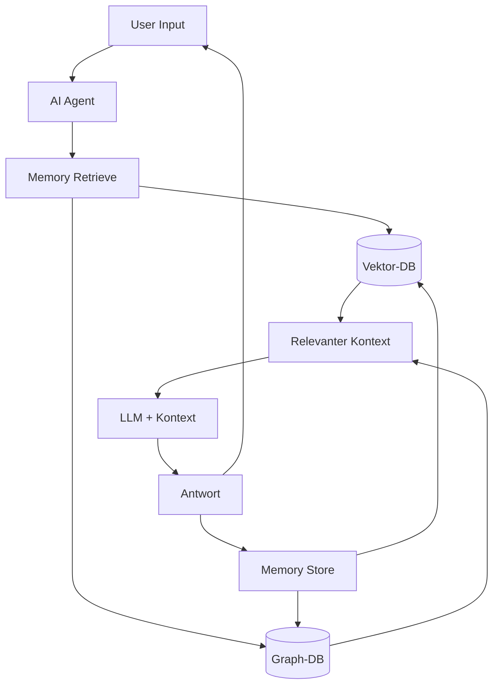

# Memory Systems

> [!ABSTRACT]
> **Memory Systems** geben AI-Agents die Fähigkeit, Informationen über Konversationen und Sessions hinweg zu speichern und abzurufen. Ohne Memory vergisst ein Agent alles nach dem [[Context Window und Token Management|Context Window]]. Die führenden Lösungen sind **Mem0** und **Zep**, die verschiedene Gedächtnistypen implementieren: kurzfristig, langfristig, episodisch, semantisch und prozedural.

---

## Übersicht

| Aspekt | Details |
|---|---|
| **Problem** | LLMs haben ein begrenztes Context Window und kein persistentes Gedächtnis |
| **Lösung** | Externe Memory-Schicht zwischen Agent und LLM |
| **Typen** | Short-Term, Long-Term, Episodisch, Semantisch, Prozedural |
| **Führende Tools** | Mem0, Zep, Letta |
| **Integration** | Als Middleware in Agent-Pipelines |
| **Nutzen** | ~26% bessere Genauigkeit, ~90% weniger Token-Verbrauch |

---

## Warum Memory?

Ein LLM ohne Memory ist wie ein Mensch mit Amnesie — jede Konversation beginnt bei Null:



**Ohne Memory:**
- Agent kennt keine Nutzerpräferenzen
- Kontext geht nach jeder Session verloren
- Wiederholte Erklärungen nötig
- Teuer: Voller Kontext muss jedes Mal mitgesendet werden

**Mit Memory:**
- Agent erinnert sich an Projekte, Präferenzen, Entscheidungen
- Kontext wird automatisch geladen
- Personalisierte Antworten
- Kosteneffizient: Nur relevante Erinnerungen werden geladen

---

## Gedächtnistypen

Inspiriert von der menschlichen Kognition unterscheidet man fünf Typen:

| Typ | Beschreibung | Beispiel | Speicher |
|---|---|---|---|
| **Short-Term** | Aktuelles Context Window | Laufende Konversation | In-Memory (LLM Context) |
| **Long-Term** | Persistente Informationen über Sessions | "Nutzer bevorzugt TypeScript" | Vektor-DB / Graph-DB |
| **Episodisch** | Spezifische vergangene Ereignisse | "Letzte Woche haben wir Bug X gefixt" | Vektor-DB |
| **Semantisch** | Fakten und generalisiertes Wissen | "Das Projekt nutzt PostgreSQL" | Graph-DB / Vektor-DB |
| **Prozedural** | Gelernte Workflows und Routinen | "Bei Deployment: Tests → Build → Deploy" | Structured Storage |



---

## Mem0

### Was ist Mem0?

Universelle Memory-Schicht für AI-Agents — extrahiert, konsolidiert und ruft relevante Erinnerungen automatisch ab.

| Eigenschaft | Details |
|---|---|
| **Typ** | Open Source + Managed SaaS |
| **Lizenz** | Apache 2.0 |
| **GitHub Stars** | ~25K+ |
| **Speicher** | Hybrid (Vektor + Graph) |
| **Genauigkeit** | ~26% besser als OpenAI Memory |
| **Token-Effizienz** | ~90% weniger als Full-Context |
| **Integration** | Python SDK, REST API |

### Installation

```bash
pip install mem0ai
```

### Grundlegende Nutzung

```python
from mem0 import Memory

# Memory initialisieren
memory = Memory()

# Erinnerung hinzufügen
memory.add(
    messages=[
        {"role": "user", "content": "Ich arbeite an einem Python-Projekt mit FastAPI"},
        {"role": "assistant", "content": "Verstanden! Ich merke mir das."}
    ],
    user_id="dev-123"
)

# Relevante Erinnerungen abrufen
memories = memory.search("Welches Framework nutzt der User?", user_id="dev-123")
# → [{"memory": "User arbeitet mit Python und FastAPI", "score": 0.95}]

# Alle Erinnerungen eines Users
all_memories = memory.get_all(user_id="dev-123")
```

### In einen Agent integrieren

```python
from mem0 import Memory
from openai import OpenAI

memory = Memory()
client = OpenAI()

def chat_with_memory(user_id: str, message: str):
    # Relevante Erinnerungen laden
    memories = memory.search(message, user_id=user_id)
    context = "\n".join([m["memory"] for m in memories])
    
    # LLM mit Kontext aufrufen
    response = client.chat.completions.create(
        model="gpt-4o",
        messages=[
            {"role": "system", "content": f"Bekannter Kontext:\n{context}"},
            {"role": "user", "content": message}
        ]
    )
    
    answer = response.choices[0].message.content
    
    # Neue Erinnerungen speichern
    memory.add(
        messages=[
            {"role": "user", "content": message},
            {"role": "assistant", "content": answer}
        ],
        user_id=user_id
    )
    
    return answer
```

---

## Zep

### Was ist Zep?

Memory-System basierend auf **temporalen Knowledge Graphs** — versteht nicht nur *was* gespeichert ist, sondern *wann* und *in welcher Reihenfolge*.

| Eigenschaft | Details |
|---|---|
| **Typ** | Open Source + Cloud |
| **Ansatz** | Temporal Knowledge Graph |
| **Stärke** | Historischer Recall, zeitliche Zusammenhänge |
| **Performance** | +18.5% Genauigkeit auf LongMemEval |
| **Latenz** | 90% Reduktion vs. Full-Context |
| **Integration** | Python SDK, LangChain, LlamaIndex |

### Installation

```bash
pip install zep-python
```

### Grundlegende Nutzung

```python
from zep_python import ZepClient
from zep_python.memory import Session, Memory, Message

client = ZepClient(api_key="...")

# Session erstellen
session = Session(session_id="project-review", user_id="dev-123")
await client.memory.add_session(session)

# Nachrichten speichern
messages = [
    Message(role="user", content="Wir haben den Login-Bug gefixt"),
    Message(role="assistant", content="Gut, welcher Fix war das?"),
    Message(role="user", content="Der Session-Token lief zu früh ab")
]
await client.memory.add_memory(session_id="project-review", memory=Memory(messages=messages))

# Erinnerungen abrufen — mit temporalem Kontext
memory = await client.memory.get_memory(session_id="project-review")
# → Weiß: "Am [Datum] wurde ein Session-Token-Bug gefixt"
```

### Temporal Knowledge Graph

Zeps Alleinstellungsmerkmal: Es versteht **zeitliche Zusammenhänge**:

```
Timeline: ──────────────────────────────────►
    
    Tag 1: "Projekt gestartet mit FastAPI"
    Tag 3: "Login-System implementiert"
    Tag 5: "Bug im Session-Token gefunden"
    Tag 6: "Bug gefixt — Token-Ablauf verlängert"
    Tag 8: "Performance-Tests gestartet"

→ Agent versteht: "Der Login-Bug wurde nach 1 Tag gefixt"
→ Agent versteht: "Performance-Tests kamen NACH dem Bug-Fix"
```

---

## Mem0 vs. Zep vs. Letta

| Aspekt | Mem0 | Zep | Letta |
|---|---|---|---|
| **Ansatz** | Hybrid (Vektor + Graph) | Temporal Knowledge Graph | Architektur-fokussiert |
| **Stärke** | Skalierung, Token-Effizienz | Historischer Recall, Zeitbezug | Developer-Kontrolle, Archiving |
| **Genauigkeit** | ✅✅ (~26% besser) | ✅✅✅ (LongMemEval SOTA) | ✅ |
| **Setup** | Einfach | Mittel | Komplex |
| **Self-Hosting** | ✅ | ✅ | ✅ |
| **Multi-User** | ✅ (user_id-Scoping) | ✅ (session-basiert) | ✅ |
| **Open Source** | ✅ (Apache 2.0) | ✅ | ✅ |

---

## Architektur: Memory in der Agent-Pipeline



---

## Memory-Scoping

Erinnerungen können auf verschiedenen Ebenen gespeichert werden:

| Scope | Beschreibung | Beispiel |
|---|---|---|
| **User** | Pro Nutzer | "User bevorzugt TypeScript" |
| **Agent** | Pro Agent-Instanz | "Dieser Agent ist für Backend zuständig" |
| **Thread/Session** | Pro Konversation | "In dieser Session geht es um Bug #123" |
| **Application** | Global für die App | "Unser Tech-Stack: FastAPI + PostgreSQL" |

```python
# Mem0 Scoping-Beispiel
memory.add(messages=msgs, user_id="dev-123")       # User-Level
memory.add(messages=msgs, agent_id="backend-agent") # Agent-Level
memory.add(messages=msgs, run_id="session-456")     # Session-Level
```

---

## Best Practices

1. **Selektiv speichern** — Nicht jede Nachricht ist eine Erinnerung; nur relevante Fakten extrahieren
2. **Konsolidierung** — Alte Erinnerungen zusammenfassen statt endlos akkumulieren
3. **Relevanz-Scoring** — Nur die Top-K relevantesten Erinnerungen in den Kontext laden
4. **Privacy by Design** — PII in Erinnerungen maskieren oder verschlüsseln
5. **Garbage Collection** — Veraltete Erinnerungen automatisch bereinigen
6. **Testen** — Memory-Retrieval mit Evaluations testen (Recall, Precision)
7. **Scoping nutzen** — User-Level für Präferenzen, Session-Level für Aufgabenkontext

---

## Verwandte Notizen

- [[Was ist ein AI Agent]] — Agents mit Gedächtnis
- [[RAG Grundlagen]] — RAG als verwandte Technik für Kontextanreicherung
- [[Vektordatenbanken]] — Speicher-Backend für Memory
- [[Embeddings]] — Basis-Technologie für semantische Suche
- [[Context Window und Token Management]] — Das Problem, das Memory löst
- [[Agent Frameworks]] — Frameworks mit Memory-Integration

### Externe Ressourcen

- [Mem0](https://mem0.ai) — Universelle Memory-Schicht für AI Agents
