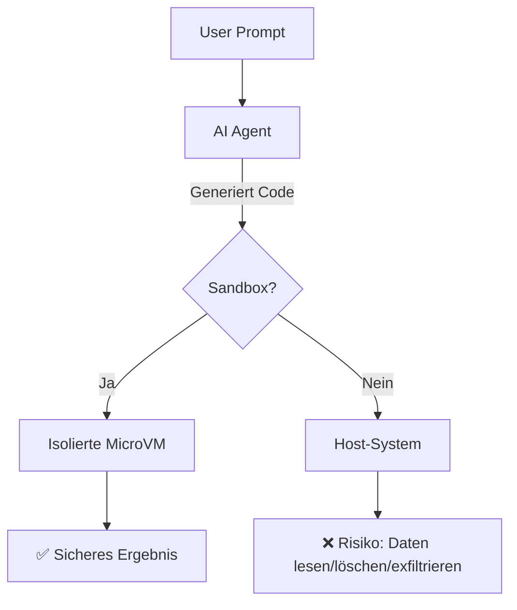
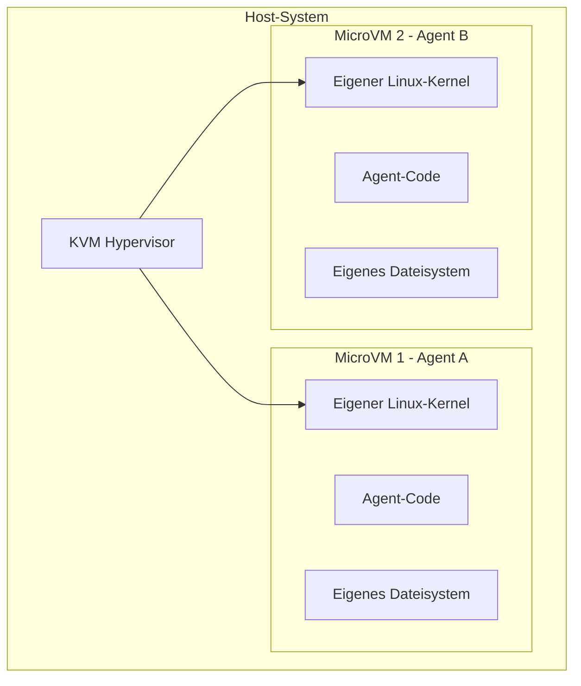

# Sandboxing und Code Execution

> [!ABSTRACT]
> **Sandboxing** ist die isolierte Ausführung von Code, den AI-Agents generieren. Da Agents dynamisch Code erzeugen und ausführen, ist Isolation die wichtigste Sicherheitsmaßnahme gegen Prompt Injection, Datenexfiltration und unkontrollierte Systemzugriffe. Die führenden Plattformen sind **E2B** (Firecracker MicroVMs), **Daytona** und **Modal**.

---

## Übersicht

| Aspekt | Details |
|---|---|
| **Zweck** | Sichere, isolierte Ausführung von Agent-generiertem Code |
| **Bedrohungen** | Prompt Injection → Code Execution, Lateral Movement, Datenexfiltration |
| **Isolation** | MicroVM > gVisor > Container > Prozess |
| **Latenz** | 90ms–3s Cold Start (je nach Technologie) |
| **Provider** | E2B, Daytona, Modal, Vercel Sandbox, Cloudflare |

---

## Warum Sandboxing?

AI-Agents führen Code aus, den sie **selbst geschrieben** haben. Das ist grundlegend anders als bei klassischen Anwendungen:



> [!DANGER] Ohne Sandbox
> Ein manipulierter Prompt kann den Agent dazu bringen, Code auszuführen, der:
> - `.env`-Dateien mit API-Keys liest
> - Dateien löscht oder verschlüsselt
> - Netzwerk-Requests an externe Server sendet
> - Malware herunterlädt und installiert

---

## Isolations-Technologien

### Vergleich der Technologien

| Technologie | Isolation | Sicherheit | Startup | Beispiel |
|---|---|---|---|---|
| **MicroVM** (Firecracker) | Eigener Kernel, Hardware-Isolation | ✅✅✅ | ~150ms | E2B |
| **Kata Containers** | VM-Level in Container-Format | ✅✅✅ | ~200ms | Daytona (optional) |
| **gVisor** | User-Space Kernel-Emulation | ✅✅ | ~1s | Modal |
| **Container** (Docker) | Namespace/cgroup-Isolation | ✅ | <1s | Standard-Docker |
| **Prozess-Isolation** | Nur OS-Level-Trennung | ❌ | Sofort | Kein Provider |

### Wie MicroVMs funktionieren (Firecracker)



Jede MicroVM hat:
- **Eigenen Linux-Kernel** — Kernel-Exploits betreffen nur die VM
- **Isoliertes Dateisystem** — Kein Zugriff auf Host-Dateien
- **Begrenzte Netzwerk-Zugriffe** — Konfigurierbare Firewall-Regeln
- **Ressourcen-Limits** — CPU, RAM, Disk strikt begrenzt

---

## Die wichtigsten Plattformen

### E2B

| Eigenschaft | Details |
|---|---|
| **Isolation** | Firecracker MicroVMs |
| **Cold Start** | ~150ms |
| **Max Runtime** | 24h (Pro) |
| **SDKs** | Python, JavaScript/TypeScript |
| **Open Source** | ✅ Runtime (Apache 2.0) |
| **Self-Hosting** | ✅ BYOC (Bring Your Own Cloud) |
| **Pricing** | ~$0.08/h, 100 Free Credits |

```python
from e2b_code_interpreter import Sandbox

# Sandbox in ~150ms starten
sandbox = Sandbox()

# Code sicher ausführen
execution = sandbox.run_code("""
import os
print(os.listdir('/'))  # Sieht nur Sandbox-Dateisystem
""")
print(execution.logs.stdout)

# Dateien hochladen/herunterladen
sandbox.files.write("/home/user/data.csv", csv_content)
result = sandbox.files.read("/home/user/output.json")

sandbox.close()
```

**Best für**: AI-Agent-Workloads, Forschung, RL-Pipelines. Genutzt von Perplexity, HuggingFace.

---

### Daytona

| Eigenschaft | Details |
|---|---|
| **Isolation** | Docker (Standard), Kata Containers (optional) |
| **Cold Start** | ~90ms |
| **Max Runtime** | Unbegrenzt |
| **SDKs** | Python, TypeScript |
| **Pricing** | ~$0.08/h, $200 Free Credits |

```python
from daytona_sdk import Daytona

daytona = Daytona()

# Sandbox erstellen
sandbox = daytona.create()

# Code ausführen
result = sandbox.process.code_run("""
print("Hallo aus der Sandbox!")
""")

# Shell-Commands
sandbox.process.exec("pip install pandas && python analyze.py")

daytona.remove(sandbox)
```

**Best für**: Dev-Environments, PR-Review-Automation, unbegrenzte Laufzeit.

---

### Modal

| Eigenschaft | Details |
|---|---|
| **Isolation** | gVisor (User-Space Kernel) |
| **Cold Start** | ~1–3s |
| **Max Runtime** | 24h |
| **SDKs** | Python (primär) |
| **GPU-Support** | ✅ |
| **Self-Hosting** | ❌ (nur SaaS) |
| **Pricing** | ~$0.12/h |

```python
import modal

app = modal.App("agent-sandbox")

@app.function(gpu="T4", timeout=3600)
def run_agent_code(code: str):
    exec(code)
    return "Ausführung erfolgreich"

# Remote ausführen
with app.run():
    result = run_agent_code.remote("print('Sicher in gVisor!')")
```

**Best für**: ML/AI-Workloads mit GPU, Python-First, Auto-Scaling.

---

## Vergleichsmatrix

| Feature | E2B | Daytona | Modal |
|---|---|---|---|
| **Isolation** | MicroVM (Firecracker) | Docker / Kata | gVisor |
| **Sicherheit** | ✅✅✅ | ✅–✅✅✅ | ✅✅ |
| **Cold Start** | ~150ms | ~90ms | ~1–3s |
| **Max Runtime** | 24h | Unbegrenzt | 24h |
| **GPU** | ❌ | ✅ (Enterprise) | ✅ |
| **BYOC** | ✅ | Enterprise | ❌ |
| **Open Source** | ✅ Runtime | Teile | ❌ |
| **Preis/Stunde** | ~$0.08 | ~$0.08 | ~$0.12 |
| **Best für** | Agent-Code, Forschung | Dev-Env, PR-Reviews | ML/GPU-Workloads |

---

## Sandboxing in AI Coding Agents

Viele der AI Coding Agents in diesem Vault nutzen bereits Sandboxing:

| Agent | Sandbox-Methode |
|---|---|
| [[Claude Code Konfiguration und Hooks\|Claude Code]] | Integrierte Sandbox (Permission-System) |
| [[GitHub Copilot CLI Konfiguration\|Copilot CLI]] | Sandbox-Modus |
| [[Gemini CLI Konfiguration\|Gemini CLI]] | Docker/Podman-Container |
| [[OpenAI Codex CLI Konfiguration\|Codex CLI]] | Integrierte Sandbox |
| [[Windsurf Konfiguration\|Windsurf]] | Eigene Sandbox |
| [[Amazon Q Developer CLI Konfiguration\|Amazon Q]] | AWS-basierte Sandbox |
| [[Open Interpreter Konfiguration\|Open Interpreter]] | ❌ Keine (führt direkt auf Host aus!) |

> [!WARNING] Open Interpreter
> [[Open Interpreter Konfiguration|Open Interpreter]] führt Code **ohne Sandbox direkt auf dem Host** aus. Für Produktionsumgebungen unbedingt in E2B oder Docker einwickeln.

---

## Best Practices

1. **MicroVMs für Untrusted Code** — Wenn der Code von einem LLM generiert wurde, ist Firecracker/Kata die sicherste Wahl
2. **Netzwerk einschränken** — Sandbox-Code sollte keinen Internetzugang haben, es sei denn explizit nötig
3. **Timeouts setzen** — Maximale Laufzeit begrenzen (Endlosschleifen verhindern)
4. **Dateisystem isolieren** — Sandbox-Code darf keine Host-Dateien sehen
5. **Least Privilege** — Nur die minimal nötigen Berechtigungen gewähren
6. **Ergebnisse validieren** — Output der Sandbox prüfen, bevor er weiterverwendet wird
7. **Logging** — Alle Sandbox-Ausführungen für Audit loggen

---

## Verwandte Notizen

- [[Guardrails und AI Safety]] — Guardrails + Sandboxing = Defense in Depth
- [[Was ist ein AI Agent]] — Warum Agents Sandboxing brauchen
- [[AI Observability]] — Sandbox-Ausführungen tracken
- [[Agent Frameworks]] — Frameworks integrieren Sandbox-Provider
- [[Open Interpreter Konfiguration]] — Agent ohne Sandbox (Sicherheitsrisiko)

### Externe Ressourcen

- [E2B](https://e2b.dev) — Open-Source Sandboxing mit Firecracker MicroVMs
