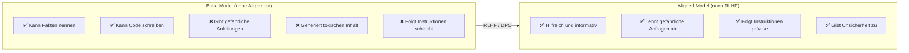
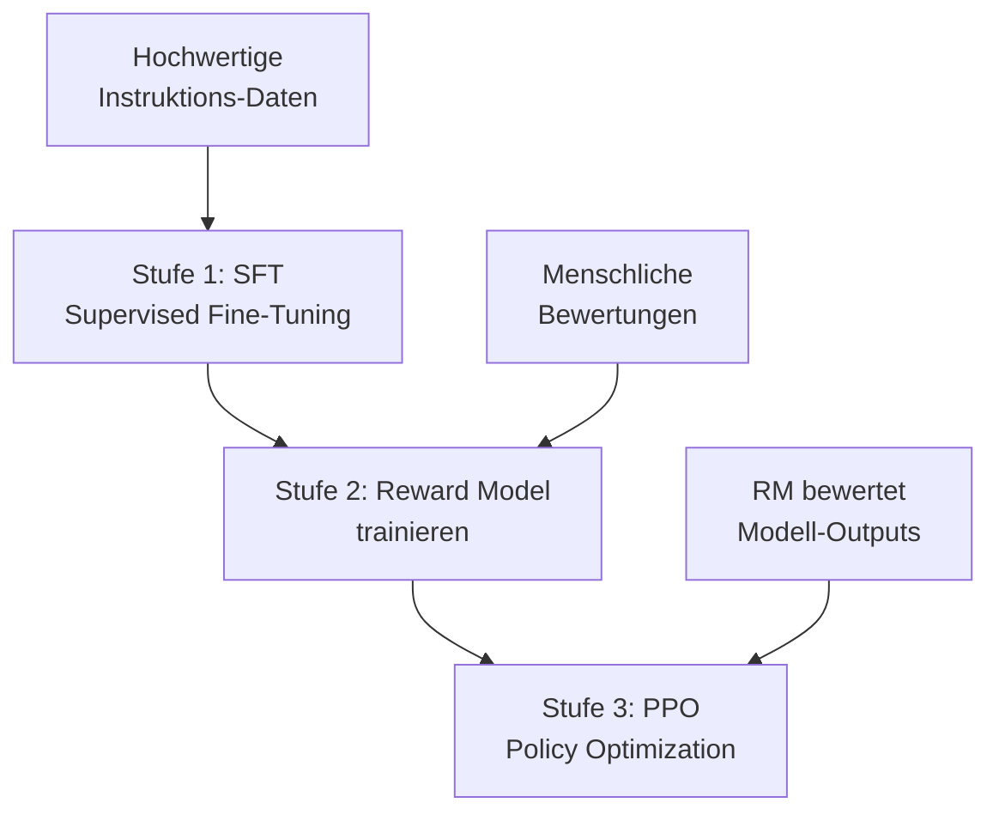
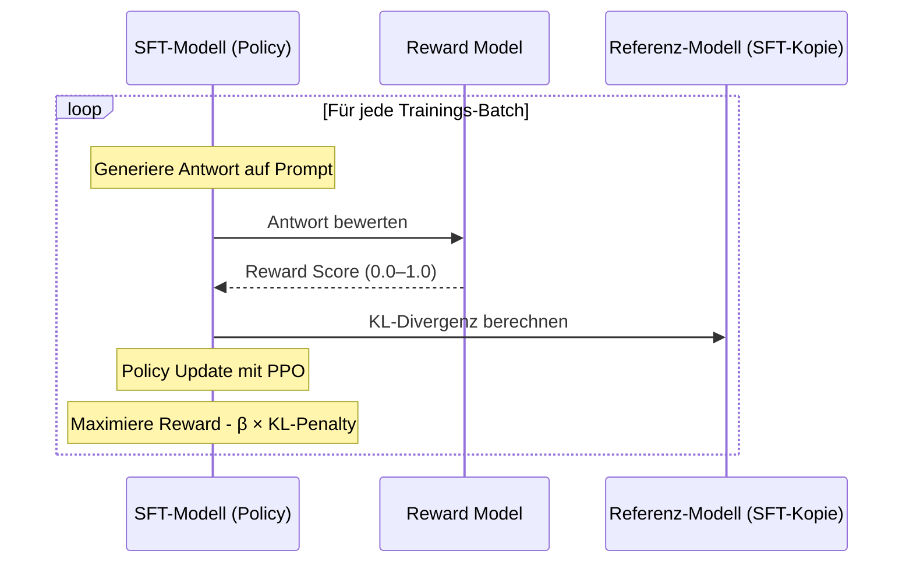
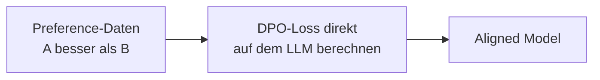

# RLHF und Alignment

> [!ABSTRACT]
> **Reinforcement Learning from Human Feedback (RLHF)** ist das Verfahren, mit dem ein vortrainiertes LLM von einem Text-Vervollständigungs-Tool zu einem **hilfreichen, harmlosen und ehrlichen** Assistenten wird. Diese Dokumentation erklärt den vollständigen Alignment-Pipeline — von Supervised Fine-Tuning über Reward Models bis zu modernen Alternativen wie **DPO** und **Constitutional AI**.

---

## Übersicht

| Aspekt | Details |
|---|---|
| **Ziel** | LLM an menschliche Werte und Präferenzen anpassen |
| **Klassischer Ansatz** | SFT → Reward Model → PPO (3 Stufen) |
| **Moderne Alternative** | DPO (Direct Preference Optimization) |
| **Adoption** | >70% der Enterprise-LLMs nutzen RLHF oder DPO |
| **Kernproblem** | Base Models sind hilfreich UND schädlich — Alignment filtert |
| **Entwickelt von** | OpenAI (InstructGPT, 2022), DeepMind, Anthropic |

---

## Warum Alignment nötig ist

Ein Pre-Trained Base Model hat **kein Wertesystem**. Es hat gelernt, Text statistisch fortzusetzen — egal ob der Text hilfreich, toxisch, oder gefährlich ist:



> [!IMPORTANT]
> Alignment ist **keine Zensur** — es bringt das Modell dazu, menschliche Werte zu internalisieren. Ein aligned Model "will" hilfreich sein, statt einfach nur Text fortzusetzen.

---

## Die klassische RLHF-Pipeline

### 3-Stufen-Prozess



---

### Stufe 1: Supervised Fine-Tuning (SFT)

Das Base Model wird auf **kuratierte Instruktions-Daten** feingetunt:

| Aspekt | Details |
|---|---|
| **Input** | Instruktion/Frage |
| **Output** | Gewünschte Antwort (von Menschen geschrieben) |
| **Datenmenge** | 10K–100K Beispiele |
| **Kosten** | Menschliche Annotatoren schreiben ideale Antworten |

**Beispiel:**

```
Instruktion: "Erkläre Photosynthese für ein 10-jähriges Kind."

Ideale Antwort: "Stell dir vor, Pflanzen haben winzige Küchen in
ihren Blättern. Sie nehmen Sonnenlicht, Wasser und Luft (CO2) und
kochen daraus ihr Essen (Zucker). Als Nebenprodukt geben sie
Sauerstoff ab — die Luft, die wir atmen!"
```

Nach SFT kann das Modell Instruktionen folgen, aber die **Qualität variiert** stark.

---

### Stufe 2: Reward Model (RM)

Ein separates Modell lernt, **menschliche Präferenzen vorherzusagen**:

1. Das SFT-Modell generiert **mehrere Antworten** auf die gleiche Frage
2. Menschliche Annotatoren **ranken** die Antworten (A > B > C)
3. Das Reward Model lernt diese Rankings vorherzusagen

```
Frage: "Was ist Quantencomputing?"

Antwort A: (klar, korrekt, gut strukturiert)     → Score: 0.92
Antwort B: (korrekt, aber verwirrend)             → Score: 0.65
Antwort C: (teilweise falsch, aber flüssig)       → Score: 0.31
```

| Aspekt | Details |
|---|---|
| **Architektur** | Oft ein modifiziertes LLM (gleiche Größe oder kleiner) |
| **Training** | Bradley-Terry Model (Paarvergleiche) |
| **Output** | Skalarer Reward-Score für jeden Text |
| **Datenmenge** | 100K–1M+ Vergleichspaare |

> [!NOTE]
> Das Reward Model ist der **Flaschenhals** — wenn es schlechte Präferenzen lernt, wird das finale Modell auch schlecht. Deshalb investieren Unternehmen stark in Annotator-Qualität.

---

### Stufe 3: PPO (Proximal Policy Optimization)

Das SFT-Modell wird mit **Reinforcement Learning** optimiert, um den Reward-Score zu maximieren:



**Schlüsselkonzepte:**
- **Policy** — Das LLM, das optimiert wird
- **Reward** — Score vom Reward Model (höher = besser)
- **KL-Divergenz** — Bestraft zu starke Abweichung vom SFT-Modell
- **β (Beta)** — Gewichtungsfaktor für KL-Penalty

> [!WARNING]
> Ohne KL-Penalty würde das Modell **Reward Hacking** betreiben — unnatürliche Outputs generieren, die das Reward Model "austricksen", aber für Menschen schlecht lesbar sind.

---

## Direct Preference Optimization (DPO)

DPO (2023, Stanford) ist eine **vereinfachte Alternative** zu RLHF, die kein separates Reward Model braucht:

### Wie DPO funktioniert



DPO optimiert das LLM **direkt** mit den Preference-Daten, indem es die Wahrscheinlichkeit der bevorzugten Antwort erhöht und die der abgelehnten senkt:

```
DPO-Loss = -log σ(β × (log π(y_w|x) - log π_ref(y_w|x))
                    - β × (log π(y_l|x) - log π_ref(y_l|x)))

y_w = bevorzugte Antwort (winner)
y_l = abgelehnte Antwort (loser)
π = trainiertes Modell
π_ref = Referenzmodell
```

### RLHF vs. DPO

| Eigenschaft | RLHF (PPO) | DPO |
|---|---|---|
| **Reward Model** | Separat trainiert | Nicht nötig |
| **Training** | 3 Stufen (SFT → RM → PPO) | 2 Stufen (SFT → DPO) |
| **Komplexität** | Hoch (RL-Instabilität) | Niedrig (Standard-Supervised-Training) |
| **GPU-Bedarf** | 4+ Modelle gleichzeitig | 2 Modelle (Policy + Referenz) |
| **Ergebnisse** | Benchmark-führend | Vergleichbar, manchmal besser |
| **Adoption** | OpenAI, DeepMind | Anthropic (teilweise), Meta (Llama 3), Community |

> [!TIP]
> DPO wird zunehmend bevorzugt, besonders in der Open-Source-Community, weil es einfacher zu implementieren und stabiler zu trainieren ist.

---

## Weitere Alignment-Methoden

### GRPO (Group Relative Policy Optimization)

- Entwickelt von DeepSeek
- Gruppiert Antworten und vergleicht relativ (ohne externes Reward Model)
- Besonders effizient für **mathematische Reasoning-Tasks**

### Constitutional AI (CAI)

Anthropics Ansatz — das Modell bewertet sich **selbst** anhand von Prinzipien:

1. Modell generiert eine Antwort
2. Modell kritisiert seine eigene Antwort anhand einer "Verfassung" (Regeln)
3. Modell revidiert die Antwort
4. Revidierte Antworten werden für DPO/RLHF verwendet

**Vorteile:**
- Weniger menschliche Annotationen nötig
- Transparentere Regeln (die "Verfassung" ist einsehbar)
- Skaliert besser als rein menschliches Feedback

### RLAIF (RL from AI Feedback)

- Statt menschlicher Annotatoren bewertet ein **stärkeres AI-Modell** die Antworten
- Google nutzt dies intensiv (z.B. GPT-4 als Evaluator für schwächere Modelle)
- Kostengünstiger, aber Risiko von AI-Bias

---

## Alignment in der Praxis

### Wer nutzt was?

| Unternehmen | Methode | Details |
|---|---|---|
| **OpenAI** | RLHF (PPO) | InstructGPT, GPT-4, o1 |
| **Anthropic** | Constitutional AI + DPO | Claude-Modelle, "HHH"-Prinzip |
| **Meta** | DPO | Llama 3, 3.1 |
| **Google** | RLHF + RLAIF | Gemini |
| **DeepSeek** | GRPO | DeepSeek R1, V3 |

### Kosten für Alignment

| Phase | Kosten |
|---|---|
| SFT-Daten erstellen | $50K–500K (Annotatoren) |
| Preference-Daten sammeln | $100K–1M+ |
| RM-Training | GPU-Kosten (Tage bis Wochen) |
| PPO-Training | GPU-Kosten (Wochen) |
| **DPO (Alternative)** | **Deutlich günstiger** (kein RM, kürzer) |

---

## Herausforderungen

### Alignment Tax

Aligned Models können bei manchen Benchmarks **schlechter** abschneiden als Base Models — die "Alignment Tax":
- Zu starke Sicherheitsfilter blockieren legitime Anfragen
- Übermäßige Höflichkeit und Vorsicht
- Weigerung, bei kontroversen Themen Position zu beziehen

### Reward Hacking

Das Modell findet Wege, den Reward-Score zu maximieren, ohne tatsächlich besser zu werden:
- Übermäßig lange Antworten (mehr Text = höherer Score)
- Schmeichelhafte Sprache statt korrekter Antworten
- Formelhaft wirkende Strukturen, die Annotatoren bevorzugten

### Skalierung

- Menschliches Feedback skaliert nicht unendlich
- Annotatoren-Qualität variiert stark
- Kulturelle und sprachliche Bias in den Bewertungen

---

## Verwandte Notizen

- [[Wie funktionieren LLMs]] — Pre-Training als Grundlage für Alignment
- [[Fine-Tuning Grundlagen]] — SFT als erste Alignment-Stufe
- [[LoRA und QLoRA]] — Effizientes Fine-Tuning-Verfahren
- [[Guardrails und AI Safety]] — Sicherheit auf Anwendungsebene
- [[Evaluation und Benchmarks]] — Wie Alignment gemessen wird
