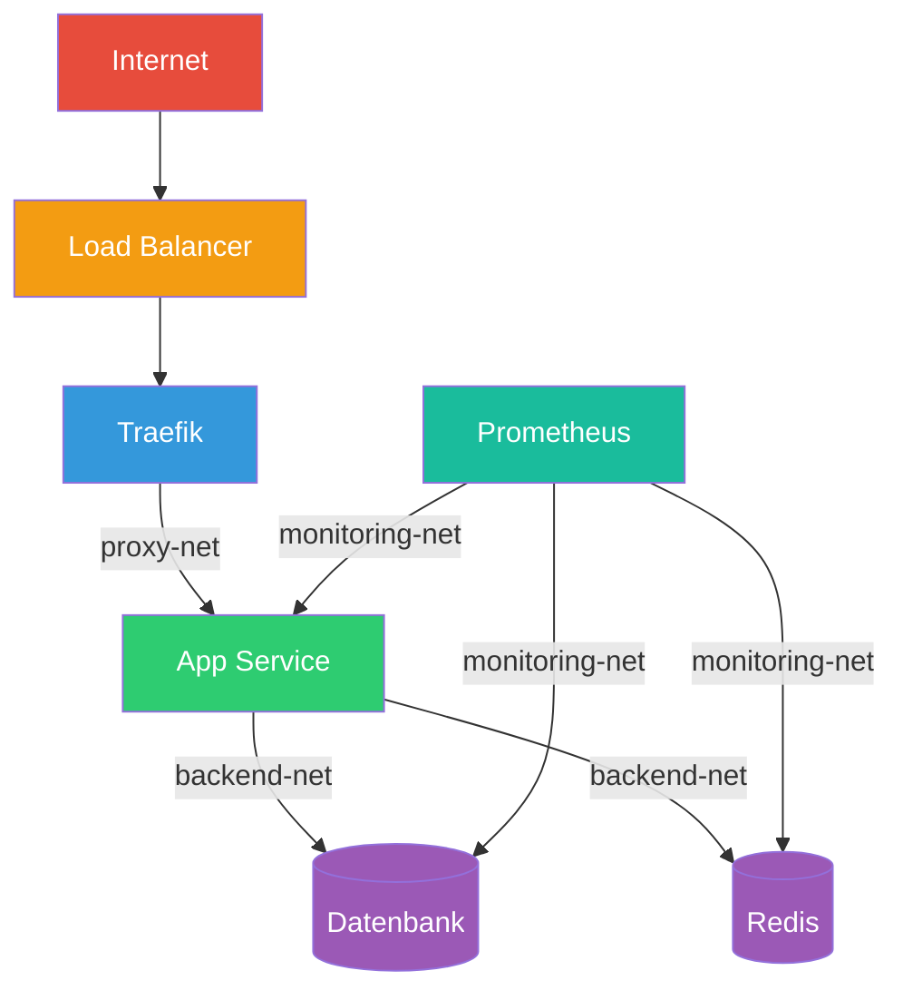

---
tags:
  - docker-swarm
  - best-practices
  - produktion
  - hardening
  - betrieb
---

# Swarm Best Practices

> [!ABSTRACT] TL;DR
> Produktions-Checkliste und bewährte Vorgehensweisen für Docker Swarm — von Cluster-Sizing über Service-Design bis hin zu Monitoring und Disaster Recovery. Diese Dokumentation sammelt alle wichtigen Empfehlungen an einem Ort.

---

## Cluster-Design

### Node-Planung

| Cluster-Größe | Manager | Worker | Fehlertoleranz | Empfehlung |
|---------------|---------|--------|----------------|------------|
| Entwicklung | 1 | 0–2 | Keine | Single-Node Swarm |
| Klein | 3 | 2–5 | 1 Manager-Ausfall | Minimum für Produktion |
| Mittel | 3 | 5–20 | 1 Manager-Ausfall | Standard-Produktion |
| Groß | 5 | 20–50 | 2 Manager-Ausfälle | Hohe Verfügbarkeit |
| Sehr groß | 7 | 50+ | 3 Manager-Ausfälle | Maximal empfohlen |

> [!IMPORTANT] Immer ungerade Manager-Anzahl
> Verwende **immer** eine ungerade Anzahl an Managern (3, 5 oder 7). Bei gerader Anzahl (z.B. 4) gibt es keinen Vorteil gegenüber einem Manager weniger (3), da das Quorum identisch bleibt: ⌊N/2⌋ + 1.

### Manager-Node-Sizing

```bash
# Empfohlene Mindest-Ressourcen pro Manager-Node
# (Swarm Overhead + Docker Daemon + ggf. Workloads)

# Kleines Cluster (bis 10 Nodes, bis 50 Services):
# - 2 CPU Cores
# - 4 GB RAM
# - 20 GB SSD für /var/lib/docker/swarm

# Mittleres Cluster (10-50 Nodes, 50-200 Services):
# - 4 CPU Cores
# - 8 GB RAM
# - 50 GB SSD für /var/lib/docker/swarm

# Großes Cluster (50+ Nodes, 200+ Services):
# - 8 CPU Cores
# - 16 GB RAM
# - 100 GB SSD für /var/lib/docker/swarm
```

> [!TIP] SSDs für Manager
> Manager-Nodes sollten **immer** SSDs verwenden. Die Raft-Konsens-Performance hängt direkt von der Disk-I/O ab — langsame Festplatten führen zu Quorum-Instabilitäten und Leader-Wechseln.

### Manager als Dedicated Nodes

In Produktion sollten Manager-Nodes **keine** Workloads ausführen:

```bash
# Manager-Nodes für Workloads sperren
docker node update --availability drain manager-01
docker node update --availability drain manager-02
docker node update --availability drain manager-03
```

Alternativ: Placement Constraints in allen Services setzen:

```yaml
deploy:
  placement:
    constraints:
      - node.role == worker
```

---

## Labeling-Strategie

### Node-Labels definieren

Labels ermöglichen gezielte Workload-Platzierung:

```bash
# Funktionale Labels
docker node update --label-add role=app worker-01
docker node update --label-add role=app worker-02
docker node update --label-add role=database worker-03
docker node update --label-add role=monitoring worker-04

# Hardware-Labels
docker node update --label-add storage=ssd worker-03
docker node update --label-add storage=hdd worker-05
docker node update --label-add gpu=nvidia worker-06

# Standort-Labels (Multi-Datacenter)
docker node update --label-add zone=eu-west-1a worker-01
docker node update --label-add zone=eu-west-1b worker-02
docker node update --label-add rack=rack-a worker-01
docker node update --label-add rack=rack-b worker-02

# Umgebungs-Labels
docker node update --label-add env=production worker-01
docker node update --label-add env=staging worker-05
```

### Labels in Services nutzen

```yaml
services:
  database:
    deploy:
      placement:
        constraints:
          - node.labels.storage == ssd
          - node.labels.role == database
        preferences:
          - spread: node.labels.zone  # Über Zonen verteilen

  app:
    deploy:
      placement:
        constraints:
          - node.role == worker
          - node.labels.env == production
        preferences:
          - spread: node.labels.rack  # Über Racks verteilen
```

### Label-Konventionen

| Kategorie | Prefix | Beispiele |
|-----------|--------|-----------|
| Rolle | `role=` | `app`, `database`, `monitoring`, `ingress` |
| Storage | `storage=` | `ssd`, `hdd`, `nvme` |
| Standort | `zone=`, `rack=`, `dc=` | `eu-west-1a`, `rack-a`, `dc-ffm` |
| Umgebung | `env=` | `production`, `staging`, `dev` |
| Hardware | `gpu=`, `cpu=` | `nvidia`, `amd`, `high-perf` |

---

## Service-Design

### Health Checks in jedem Service

```yaml
services:
  app:
    healthcheck:
      test: ["CMD", "curl", "-f", "http://localhost:8080/health"]
      interval: 30s
      timeout: 10s
      retries: 3
      start_period: 60s  # Grace Period beim Start
```

> [!WARNING] Ohne Health Check kein zuverlässiges Rolling Update
> Docker Swarm erkennt ohne Health Check nicht, ob ein neuer Task tatsächlich funktioniert. Das Update wird als erfolgreich gewertet, sobald der Container startet — unabhängig davon, ob die Anwendung bereit ist.

**Health Check-Empfehlungen nach Service-Typ:**

| Service-Typ | Health Check |
|-------------|-------------|
| Web-App | `curl -f http://localhost:PORT/health` |
| API | `curl -f http://localhost:PORT/api/status` |
| Datenbank | `pg_isready -U user` / `mysqladmin ping` |
| Redis | `redis-cli ping` |
| Worker/Queue | Custom-Script prüft Queue-Verbindung |
| Static Files | `curl -f http://localhost:PORT/` |

### Ressourcen-Limits setzen

```yaml
deploy:
  resources:
    limits:
      cpus: '1.0'       # Maximum 1 CPU Core
      memory: 512M       # Maximum 512 MB RAM
    reservations:
      cpus: '0.25'       # Garantierte 0.25 Cores
      memory: 128M       # Garantierte 128 MB RAM
```

> [!IMPORTANT] Limits UND Reservations setzen
> **Limits** verhindern, dass ein Container zu viele Ressourcen verbraucht. **Reservations** stellen sicher, dass der Scheduler den Task nur auf Nodes platziert, die genug freie Ressourcen haben. Ohne Reservations kann es zu Overcommitment kommen.

### Update-Strategie konfigurieren

```yaml
deploy:
  update_config:
    parallelism: 1            # Sequentiell updaten
    delay: 10s                # Pause zwischen Tasks
    failure_action: rollback  # Bei Fehler zurückrollen
    monitor: 30s              # Beobachtungszeitraum
    max_failure_ratio: 0.1    # Max. 10% Fehlerrate
    order: start-first        # Neuer Task zuerst starten

  rollback_config:
    parallelism: 1
    delay: 5s
    failure_action: pause
    monitor: 15s
    order: start-first
```

| Parameter | Empfehlung | Begründung |
|-----------|-----------|------------|
| `parallelism` | `1` oder `2` | Minimales Risiko bei Problemen |
| `delay` | `10s–30s` | Zeit für Health Check-Stabilisierung |
| `failure_action` | `rollback` | Automatische Fehlerbehandlung |
| `monitor` | `30s–60s` | Ausreichend Zeit für Health Checks |
| `order` | `start-first` | Zero-Downtime (neuer Task startet vor altem Stopp) |

### Restart-Policy

```yaml
deploy:
  restart_policy:
    condition: on-failure    # Nur bei Fehler neustarten
    delay: 5s                # Wartezeit vor Restart
    max_attempts: 3          # Maximal 3 Versuche
    window: 120s             # Zeitfenster für die Versuche
```

---

## Netzwerk-Best-Practices

### Netzwerk-Segmentierung

```yaml
networks:
  # Öffentlich — nur für Services mit externem Zugriff
  proxy-net:
    driver: overlay

  # Intern — Backend-Kommunikation ohne Internet
  backend-net:
    driver: overlay
    internal: true

  # Monitoring — separates Netzwerk für Observability
  monitoring-net:
    driver: overlay
    internal: true
```

### Empfohlene Netzwerk-Architektur



### Overlay-Netzwerk-Konfiguration

```bash
# Overlay mit Verschlüsselung (für sensible Daten)
docker network create \
    --driver overlay \
    --opt encrypted \
    --subnet 10.0.10.0/24 \
    secure-backend

# Overlay mit benutzerdefiniertem Subnet
docker network create \
    --driver overlay \
    --subnet 10.0.20.0/24 \
    --gateway 10.0.20.1 \
    app-network
```

---

## Logging-Strategie

### Strukturiertes Logging

```yaml
services:
  app:
    logging:
      driver: json-file
      options:
        max-size: "10m"    # Max. 10 MB pro Log-Datei
        max-file: "5"      # Max. 5 rotierte Dateien
        tag: "{{.Name}}"   # Container-Name als Tag
```

> [!TIP] Log-Rotation ist Pflicht
> Ohne `max-size` und `max-file` wachsen Container-Logs unbegrenzt und füllen die Festplatte. Standardmäßig gibt es **keine** Rotation!

### Zentrales Logging

```yaml
# Docker Daemon Konfiguration (/etc/docker/daemon.json)
{
  "log-driver": "json-file",
  "log-opts": {
    "max-size": "10m",
    "max-file": "3"
  }
}
```

Für zentrales Log-Management empfiehlt sich ein Logging-Stack:

- **Promtail + Loki + Grafana** → Leichtgewichtig, ideal für Swarm
- **Fluentd/Fluent Bit** → Flexibler Log-Router
- **ELK Stack** → Elasticsearch, Logstash, Kibana (ressourcenintensiver)

Siehe [[Swarm Stack Beispiele]] für einen fertigen Loki-Stack.

---

## Secrets und Configs

### Secrets-Management

```bash
# Secrets aus Dateien erstellen (nicht aus der CLI-History)
docker secret create db_password /run/keys/db_password.txt

# Niemals Secrets in Environment-Variablen!
# FALSCH:
environment:
  - DB_PASSWORD=mein-passwort

# RICHTIG:
secrets:
  - db_password
environment:
  - DB_PASSWORD_FILE=/run/secrets/db_password
```

### Config-Versionierung

```bash
# Configs sind immutabel — Versionierung über Namen
docker config create nginx-v1 nginx.conf
docker config create nginx-v2 nginx-updated.conf

# Service mit neuer Config updaten
docker service update \
    --config-rm nginx-v1 \
    --config-add source=nginx-v2,target=/etc/nginx/nginx.conf \
    web-server
```

---

## Monitoring-Empfehlungen

### Kritische Metriken

| Metrik | Schwellwert | Aktion |
|--------|------------|--------|
| Node-Status | `!= Ready` | Alarm — Node offline |
| Service Replicas | `Running < Desired` | Warnung — Tasks failing |
| Manager Quorum | `< ⌊N/2⌋+1` | Kritisch — Cluster gefährdet |
| Raft Leader wechselt | `> 2x/Stunde` | Warnung — Instabilität |
| Disk Usage Manager | `> 80%` | Warnung — Raft-Log wächst |
| Docker Engine | `!= Running` | Kritisch — Node tot |

### Automatische Checks

```bash
#!/bin/bash
# swarm-health-check.sh — Cluster-Gesundheitscheck
set -euo pipefail

ERRORS=0

# 1. Alle Nodes Ready?
NOT_READY=$(docker node ls --format '{{.Status}}' | grep -cv "Ready" || true)
if [ "$NOT_READY" -gt 0 ]; then
    echo "WARNUNG: ${NOT_READY} Node(s) nicht Ready!"
    docker node ls --filter "status!=ready"
    ERRORS=$((ERRORS + 1))
fi

# 2. Leader vorhanden?
LEADER=$(docker node ls --format '{{.ManagerStatus}}' | grep -c "Leader" || true)
if [ "$LEADER" -ne 1 ]; then
    echo "KRITISCH: Kein eindeutiger Leader gefunden!"
    ERRORS=$((ERRORS + 1))
fi

# 3. Services mit fehlenden Replicas?
for service in $(docker service ls --format '{{.Name}}'); do
    REPLICAS=$(docker service inspect $service \
        --format '{{.Spec.Mode.Replicated.Replicas}}' 2>/dev/null || echo "0")
    RUNNING=$(docker service ps $service \
        --filter "desired-state=running" \
        --format '{{.CurrentState}}' 2>/dev/null | grep -c "Running" || true)

    if [ "$RUNNING" -lt "$REPLICAS" ] 2>/dev/null; then
        echo "WARNUNG: ${service}: ${RUNNING}/${REPLICAS} Replicas running"
        ERRORS=$((ERRORS + 1))
    fi
done

# 4. Disk-Usage auf Manager
DISK_USAGE=$(df /var/lib/docker --output=pcent | tail -1 | tr -d ' %')
if [ "$DISK_USAGE" -gt 80 ]; then
    echo "WARNUNG: Disk-Usage bei ${DISK_USAGE}%!"
    ERRORS=$((ERRORS + 1))
fi

if [ "$ERRORS" -eq 0 ]; then
    echo "OK: Cluster ist gesund"
    exit 0
else
    echo "FEHLER: ${ERRORS} Problem(e) gefunden!"
    exit 1
fi
```

---

## Disaster Recovery

### Recovery-Plan

| Szenario | Sofortmaßnahme | Recovery-Ziel |
|----------|----------------|---------------|
| 1 Worker down | Automatisch — Tasks werden umverteilt | < 1 min |
| 1 Manager down | Automatisch — Quorum bleibt erhalten | < 30 sec |
| Quorum verloren | `docker swarm init --force-new-cluster` | < 10 min |
| Cluster komplett verloren | Restore aus Backup | < 30 min |
| Daten-Corruption | Backup einspielen, Services redeployen | < 1 Stunde |

### Recovery-Runbook

```bash
# Schritt 1: Situation einschätzen
docker node ls 2>/dev/null || echo "Kein Cluster-Zugriff!"

# Schritt 2a: Quorum verloren — Force-Recovery
docker swarm init --force-new-cluster --advertise-addr <eigene-IP>

# Schritt 2b: Cluster komplett verloren — Backup-Restore
systemctl stop docker
tar -xzf /opt/swarm-backups/swarm-backup-latest.tar.gz -C /var/lib/docker/
systemctl start docker
docker swarm init --force-new-cluster

# Schritt 3: Neue Nodes hinzufügen
docker swarm join-token manager  # Für Manager
docker swarm join-token worker   # Für Worker

# Schritt 4: Services verifizieren
docker service ls
docker stack ls
```

Detaillierte Restore-Anweisungen: [[Swarm Upgrades und Backups]]

---

## Produktions-Checkliste

### Vor dem Go-Live

- [ ] **Cluster-Design**: Mindestens 3 Manager, ungerade Anzahl
- [ ] **Manager drainiert**: Keine Workloads auf Manager-Nodes
- [ ] **Node-Labels**: Alle Nodes korrekt gelabelt
- [ ] **Firewall**: Ports 2377, 7946, 4789 und ggf. IP-Protokoll 50 (ESP) offen
- [ ] **NTP synchronisiert**: Alle Nodes haben gleiche Uhrzeit
- [ ] **TLS aktiv**: Automatisches mTLS ist Standard, Rotation geprüft
- [ ] **Autolock aktiviert**: `docker swarm update --autolock=true`
- [ ] **Unlock-Key gesichert**: Passwort-Manager oder sicherer Speicherort

### Services

- [ ] **Health Checks**: Jeder Service hat einen Health Check
- [ ] **Ressourcen-Limits**: CPU und Memory für alle Services gesetzt
- [ ] **Update-Config**: `failure_action: rollback` konfiguriert
- [ ] **Secrets**: Keine Passwörter in Environment-Variablen
- [ ] **Feste Image-Tags**: Kein `:latest` in Produktion
- [ ] **Logging konfiguriert**: `max-size` und `max-file` gesetzt
- [ ] **Interne Netzwerke**: Backend-Netzwerke als `internal: true`
- [ ] **Placement Constraints**: Datenbanken auf SSD-Nodes

### Betrieb

- [ ] **Backup-Strategie**: Tägliche Raft-Backups automatisiert
- [ ] **Monitoring**: Cluster-Metriken werden überwacht
- [ ] **Alerting**: Benachrichtigung bei Node-Ausfall oder Service-Problemen
- [ ] **Upgrade-Plan**: Rolling-Upgrade-Prozedur dokumentiert
- [ ] **Recovery-Runbook**: Disaster Recovery getestet
- [ ] **CI/CD-Pipeline**: Automatisiertes Deployment eingerichtet
- [ ] **Dokumentation**: Stack-Dateien und Configs im Git-Repository

---

## Anti-Patterns (häufige Fehler)

| Anti-Pattern | Problem | Lösung |
|-------------|---------|--------|
| `:latest` Tag in Produktion | Nicht reproduzierbar, undefiniertes Verhalten | Feste Tags wie `:1.2.3` verwenden |
| Gerade Manager-Anzahl | Kein Vorteil gegenüber N-1 Managern | Ungerade Anzahl: 3, 5 oder 7 |
| Workloads auf Managern | Ressourcen-Konkurrenz mit Raft | Manager auf `drain` setzen |
| Secrets in Env-Variablen | Sichtbar in `docker inspect` und Prozessliste | Docker Secrets nutzen |
| Kein Health Check | Swarm erkennt fehlerhafte Container nicht | Health Checks in jedem Service |
| Keine Log-Rotation | Disk füllt sich, Node fällt aus | `max-size` und `max-file` setzen |
| Kein Backup | Cluster-Verlust = Totalverlust | Tägliche Raft-Backups |
| Manuelle Deployments | Fehleranfällig, nicht reproduzierbar | CI/CD-Pipeline nutzen |
| Zu viele Manager (>7) | Raft-Konsens wird langsamer | Maximum 7 Manager |
| Keine Ressourcen-Limits | Ein Container kann den ganzen Node lahmlegen | Limits für CPU und Memory |

---

## Verwandte Notizen

- [[Swarm Security]] — Sicherheits-Hardening im Detail
- [[Swarm Upgrades und Backups]] — Upgrade- und Backup-Strategien
- [[Swarm CI-CD Integration]] — Automatisiertes Deployment
- [[Swarm Stack Beispiele]] — Produktionsreife Stack-Beispiele
- [[Swarm Monitoring und Maintenance]] — Monitoring-Setup
- [[Docker Swarm HA Installation]] — Hochverfügbares Cluster aufsetzen
- [[Docker Swarm Architektur]] — Cluster-Architektur und Raft-Konsens
- [[Docker Security und Hardening]] — Docker-spezifische Security
