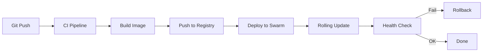

---
tags:
  - docker-swarm
  - ci-cd
  - deployment
  - automation
  - github-actions
  - gitlab-ci
---

# Swarm CI/CD Integration

> [!ABSTRACT] TL;DR
> Docker Swarm lässt sich nahtlos in CI/CD-Pipelines integrieren — über SSH-basierte Remote-Deployments, Registry-gestützte Image-Workflows und automatisierte Rolling Updates. Diese Dokumentation zeigt vollständige Pipeline-Beispiele für GitHub Actions und GitLab CI, sowie Strategien für Blue-Green und Canary Deployments.

---

## Deployment-Konzept

### Typischer CI/CD-Workflow mit Swarm



### Deployment-Methoden

| Methode | Beschreibung | Sicherheit | Komplexität |
|---------|-------------|------------|-------------|
| **SSH + docker stack** | Remote-Zugriff auf Manager per SSH | Hoch | Niedrig |
| **Docker API (TLS)** | Direkte API-Kommunikation | Hoch | Mittel |
| **Portainer API** | Deployment über Portainer Webhooks | Mittel | Niedrig |
| **Watchtower** | Automatisches Image-Update | Niedrig | Sehr niedrig |

---

## SSH-basiertes Deployment

Die gängigste und sicherste Methode — die CI/CD-Pipeline verbindet sich per SSH mit einem Manager-Node und führt `docker stack deploy` aus.

### Voraussetzungen

```bash
# 1. Deploy-User auf dem Manager erstellen
useradd -m -G docker deploy-user
mkdir -p /home/deploy-user/.ssh
chmod 700 /home/deploy-user/.ssh

# 2. SSH-Key generieren (in der CI/CD-Umgebung)
ssh-keygen -t ed25519 -f deploy-key -N ""

# 3. Public Key auf dem Manager hinterlegen
cat deploy-key.pub >> /home/deploy-user/.ssh/authorized_keys
chmod 600 /home/deploy-user/.ssh/authorized_keys

# 4. Private Key als CI/CD-Secret hinterlegen
# → GitHub: Settings → Secrets → SWARM_SSH_KEY
# → GitLab: Settings → CI/CD → Variables → SWARM_SSH_KEY
```

> [!WARNING] Minimale Berechtigungen
> Der Deploy-User sollte **nur** Docker-Befehle ausführen können. Erstelle eine eingeschränkte Shell oder nutze `authorized_keys` mit `command=`-Restriction für maximale Sicherheit.

---

## GitHub Actions Pipeline

### Vollständige Workflow-Datei

```yaml
# .github/workflows/deploy-swarm.yml
name: Build & Deploy to Swarm

on:
  push:
    branches: [main]
  workflow_dispatch:

env:
  REGISTRY: ghcr.io
  IMAGE_NAME: ${{ github.repository }}

jobs:
  build:
    runs-on: ubuntu-latest
    permissions:
      contents: read
      packages: write

    outputs:
      image-tag: ${{ steps.meta.outputs.tags }}

    steps:
      - name: Checkout
        uses: actions/checkout@v4

      - name: Login to Container Registry
        uses: docker/login-action@v3
        with:
          registry: ${{ env.REGISTRY }}
          username: ${{ github.actor }}
          password: ${{ secrets.GITHUB_TOKEN }}

      - name: Extract Metadata
        id: meta
        uses: docker/metadata-action@v5
        with:
          images: ${{ env.REGISTRY }}/${{ env.IMAGE_NAME }}
          tags: |
            type=sha,prefix=
            type=ref,event=branch
            type=semver,pattern={{version}}

      - name: Build and Push
        uses: docker/build-push-action@v5
        with:
          context: .
          push: true
          tags: ${{ steps.meta.outputs.tags }}
          labels: ${{ steps.meta.outputs.labels }}

  deploy:
    needs: build
    runs-on: ubuntu-latest
    environment: production

    steps:
      - name: Checkout (für Stack-Dateien)
        uses: actions/checkout@v4

      - name: Setup SSH
        run: |
          mkdir -p ~/.ssh
          echo "${{ secrets.SWARM_SSH_KEY }}" > ~/.ssh/deploy-key
          chmod 600 ~/.ssh/deploy-key
          ssh-keyscan -H ${{ secrets.SWARM_HOST }} >> ~/.ssh/known_hosts

      - name: Deploy Stack
        env:
          DOCKER_HOST: ssh://deploy-user@${{ secrets.SWARM_HOST }}
          IMAGE_TAG: ${{ needs.build.outputs.image-tag }}
        run: |
          # SSH-Agent starten
          eval $(ssh-agent -s)
          ssh-add ~/.ssh/deploy-key

          # Image-Tag in Stack-Datei ersetzen
          export APP_IMAGE="${IMAGE_TAG}"
          envsubst < docker-stack.yml > docker-stack-deploy.yml

          # Stack deployen
          docker stack deploy \
            -c docker-stack-deploy.yml \
            --with-registry-auth \
            myapp

      - name: Verify Deployment
        env:
          DOCKER_HOST: ssh://deploy-user@${{ secrets.SWARM_HOST }}
        run: |
          eval $(ssh-agent -s)
          ssh-add ~/.ssh/deploy-key

          # Warten und prüfen
          sleep 30
          docker service ls --filter "label=com.docker.stack.namespace=myapp"

          # Health Check
          for service in $(docker service ls --filter "label=com.docker.stack.namespace=myapp" -q); do
            REPLICAS=$(docker service inspect $service --format '{{.Spec.Mode.Replicated.Replicas}}')
            RUNNING=$(docker service ps $service --filter "desired-state=running" -q | wc -l)
            if [ "$RUNNING" -lt "$REPLICAS" ]; then
              echo "FEHLER: Service $service hat nur $RUNNING/$REPLICAS Replicas!"
              docker service ps $service
              exit 1
            fi
          done
          echo "Alle Services healthy!"

      - name: Rollback on Failure
        if: failure()
        env:
          DOCKER_HOST: ssh://deploy-user@${{ secrets.SWARM_HOST }}
        run: |
          eval $(ssh-agent -s)
          ssh-add ~/.ssh/deploy-key

          echo "Deployment fehlgeschlagen — Rollback!"
          for service in $(docker service ls --filter "label=com.docker.stack.namespace=myapp" -q); do
            docker service rollback $service
          done
```

### Stack-Datei mit Variablen

```yaml
# docker-stack.yml
services:
  app:
    image: ${APP_IMAGE}
    deploy:
      replicas: 3
      update_config:
        parallelism: 1
        delay: 10s
        failure_action: rollback
        monitor: 30s
        order: start-first
      rollback_config:
        parallelism: 1
      labels:
        - "deployed.by=github-actions"
        - "deployed.commit=${GITHUB_SHA}"
        - "deployed.at=${DEPLOY_TIMESTAMP}"
    networks:
      - app-net

networks:
  app-net:
    driver: overlay
```

---

## GitLab CI Pipeline

### Vollständige `.gitlab-ci.yml`

```yaml
# .gitlab-ci.yml
stages:
  - build
  - test
  - deploy

variables:
  REGISTRY: registry.example.com
  IMAGE_NAME: ${REGISTRY}/${CI_PROJECT_PATH}

build:
  stage: build
  image: docker:27
  services:
    - docker:27-dind
  variables:
    DOCKER_TLS_CERTDIR: "/certs"
  script:
    - docker login -u ${CI_REGISTRY_USER} -p ${CI_REGISTRY_PASSWORD} ${CI_REGISTRY}
    - docker build -t ${IMAGE_NAME}:${CI_COMMIT_SHORT_SHA} .
    - docker push ${IMAGE_NAME}:${CI_COMMIT_SHORT_SHA}
    # Latest-Tag nur für main
    - |
      if [ "$CI_COMMIT_BRANCH" = "main" ]; then
        docker tag ${IMAGE_NAME}:${CI_COMMIT_SHORT_SHA} ${IMAGE_NAME}:latest
        docker push ${IMAGE_NAME}:latest
      fi

test:
  stage: test
  image: ${IMAGE_NAME}:${CI_COMMIT_SHORT_SHA}
  script:
    - npm test  # oder pytest, go test, etc.

deploy-staging:
  stage: deploy
  image: alpine:latest
  environment:
    name: staging
    url: https://staging.example.com
  only:
    - develop
  before_script:
    - apk add --no-cache openssh-client
    - mkdir -p ~/.ssh
    - echo "${SWARM_SSH_KEY}" > ~/.ssh/id_ed25519
    - chmod 600 ~/.ssh/id_ed25519
    - ssh-keyscan -H ${SWARM_STAGING_HOST} >> ~/.ssh/known_hosts
  script:
    - |
      ssh deploy-user@${SWARM_STAGING_HOST} << 'EOF'
        docker service update \
          --image ${IMAGE_NAME}:${CI_COMMIT_SHORT_SHA} \
          --update-parallelism 1 \
          --update-delay 10s \
          --update-failure-action rollback \
          staging_app
      EOF

deploy-production:
  stage: deploy
  image: alpine:latest
  environment:
    name: production
    url: https://app.example.com
  only:
    - main
  when: manual
  before_script:
    - apk add --no-cache openssh-client gettext
    - mkdir -p ~/.ssh
    - echo "${SWARM_SSH_KEY}" > ~/.ssh/id_ed25519
    - chmod 600 ~/.ssh/id_ed25519
    - ssh-keyscan -H ${SWARM_PROD_HOST} >> ~/.ssh/known_hosts
  script:
    - export APP_IMAGE="${IMAGE_NAME}:${CI_COMMIT_SHORT_SHA}"
    - envsubst < docker-stack.yml > docker-stack-deploy.yml
    - scp docker-stack-deploy.yml deploy-user@${SWARM_PROD_HOST}:/tmp/
    - |
      ssh deploy-user@${SWARM_PROD_HOST} << 'EOF'
        docker stack deploy \
          -c /tmp/docker-stack-deploy.yml \
          --with-registry-auth \
          production
        rm /tmp/docker-stack-deploy.yml
      EOF
    # Verify
    - |
      ssh deploy-user@${SWARM_PROD_HOST} << 'EOF'
        sleep 30
        docker stack services production
      EOF
```

---

## Deployment-Strategien

### Rolling Update (Standard)

Das Standard-Verhalten von Docker Swarm — Tasks werden nacheinander aktualisiert.

```yaml
deploy:
  update_config:
    parallelism: 1        # Ein Task gleichzeitig
    delay: 10s            # Pause zwischen Updates
    failure_action: rollback  # Bei Fehler: Rollback
    monitor: 30s          # Überwachungszeitraum nach Update
    order: start-first    # Neuer Task startet vor dem alten
```

```bash
# Manuelles Rolling Update
docker service update \
    --image myapp:2.0.0 \
    --update-parallelism 1 \
    --update-delay 10s \
    myapp
```

### Blue-Green Deployment

Zwei identische Stacks — Traffic wird zwischen ihnen umgeschaltet:

```bash
#!/bin/bash
# blue-green-deploy.sh
set -euo pipefail

STACK_NAME="myapp"
NEW_IMAGE="$1"
CURRENT_COLOR=$(docker service inspect ${STACK_NAME}_app \
    --format '{{index .Spec.Labels "deployment.color"}}' 2>/dev/null || echo "blue")

if [ "$CURRENT_COLOR" = "blue" ]; then
    NEW_COLOR="green"
else
    NEW_COLOR="blue"
fi

echo "Aktuell: ${CURRENT_COLOR} → Deploye: ${NEW_COLOR}"

# 1. Neuen Stack deployen
export APP_IMAGE="${NEW_IMAGE}"
export DEPLOY_COLOR="${NEW_COLOR}"
envsubst < docker-stack-${NEW_COLOR}.yml > /tmp/deploy.yml
docker stack deploy -c /tmp/deploy.yml ${STACK_NAME}-${NEW_COLOR}

# 2. Warten bis alle Tasks healthy sind
echo "Warte auf Health Checks..."
sleep 60

HEALTHY=true
for service in $(docker stack services ${STACK_NAME}-${NEW_COLOR} -q); do
    REPLICAS=$(docker service inspect $service --format '{{.Spec.Mode.Replicated.Replicas}}')
    RUNNING=$(docker service ps $service --filter "desired-state=running" -q | wc -l)
    if [ "$RUNNING" -lt "$REPLICAS" ]; then
        HEALTHY=false
        break
    fi
done

if [ "$HEALTHY" = true ]; then
    # 3. Traffic umschalten (Traefik-Label oder DNS)
    echo "Switching traffic to ${NEW_COLOR}..."
    docker service update \
        --label-add "traefik.enable=true" \
        ${STACK_NAME}-${NEW_COLOR}_app
    docker service update \
        --label-rm "traefik.enable" \
        ${STACK_NAME}-${CURRENT_COLOR}_app

    # 4. Alten Stack nach Bestätigung entfernen
    echo "Alter Stack (${CURRENT_COLOR}) kann entfernt werden mit:"
    echo "  docker stack rm ${STACK_NAME}-${CURRENT_COLOR}"
else
    echo "FEHLER: Neuer Stack nicht healthy — Abbruch!"
    docker stack rm ${STACK_NAME}-${NEW_COLOR}
    exit 1
fi
```

### Canary Deployment

Schrittweises Rollout mit zunehmendem Traffic-Anteil:

```bash
#!/bin/bash
# canary-deploy.sh — Schrittweises Rollout
set -euo pipefail

SERVICE="myapp_app"
NEW_IMAGE="$1"
TOTAL_REPLICAS=$(docker service inspect $SERVICE \
    --format '{{.Spec.Mode.Replicated.Replicas}}')

echo "Service: ${SERVICE} (${TOTAL_REPLICAS} Replicas)"
echo "Neues Image: ${NEW_IMAGE}"

# Phase 1: 1 Canary-Replica (z.B. 1 von 5 = 20% Traffic)
echo "=== Phase 1: Canary (1/${TOTAL_REPLICAS}) ==="
docker service update \
    --image "${NEW_IMAGE}" \
    --update-parallelism 1 \
    --update-delay 0s \
    --rollback-monitor 0s \
    ${SERVICE}

# Nur 1 Task updaten, dann pausieren
sleep 5
docker service update --update-parallelism 0 ${SERVICE}

echo "Canary läuft. Bitte Metriken prüfen."
echo "Weiter mit: docker service update --update-parallelism 1 ${SERVICE}"
echo "Rollback mit: docker service rollback ${SERVICE}"
```

---

## Registry-Integration

### Private Registry mit Authentifizierung

```bash
# Registry-Login auf dem Manager (wird für --with-registry-auth benötigt)
docker login registry.example.com

# Stack mit Registry-Auth deployen
docker stack deploy \
    -c docker-stack.yml \
    --with-registry-auth \
    myapp
```

> [!IMPORTANT] `--with-registry-auth` nicht vergessen
> Ohne dieses Flag können Worker-Nodes keine Images aus privaten Registries pullen. Das Flag verteilt die Registry-Credentials verschlüsselt über den Raft-Konsens an alle Nodes.

### GitHub Container Registry (GHCR)

```bash
# Personal Access Token erstellen (read:packages Scope)
echo "${GITHUB_TOKEN}" | docker login ghcr.io -u USERNAME --password-stdin

# Image pullen
docker pull ghcr.io/organisation/app:1.0.0
```

---

## Deployment-Hooks und Notifications

### Slack-Notification bei Deployment

```bash
#!/bin/bash
# notify-deploy.sh — Slack-Benachrichtigung nach Deployment
WEBHOOK_URL="${SLACK_WEBHOOK_URL}"
SERVICE="$1"
IMAGE="$2"
STATUS="$3"

if [ "$STATUS" = "success" ]; then
    COLOR="#36a64f"
    TEXT="Deployment erfolgreich"
else
    COLOR="#ff0000"
    TEXT="Deployment fehlgeschlagen"
fi

curl -s -X POST "${WEBHOOK_URL}" \
    -H 'Content-type: application/json' \
    -d "{
        \"attachments\": [{
            \"color\": \"${COLOR}\",
            \"title\": \"${TEXT}\",
            \"fields\": [
                {\"title\": \"Service\", \"value\": \"${SERVICE}\", \"short\": true},
                {\"title\": \"Image\", \"value\": \"${IMAGE}\", \"short\": true}
            ]
        }]
    }"
```

### Deployment-Verify-Script

```bash
#!/bin/bash
# verify-deploy.sh — Deployment verifizieren
set -euo pipefail

STACK_NAME="$1"
TIMEOUT=120
INTERVAL=10
ELAPSED=0

echo "Verifiziere Deployment: ${STACK_NAME}"

while [ $ELAPSED -lt $TIMEOUT ]; do
    ALL_RUNNING=true

    for service in $(docker stack services ${STACK_NAME} --format '{{.Name}}'); do
        REPLICAS=$(docker service inspect $service \
            --format '{{.Spec.Mode.Replicated.Replicas}}' 2>/dev/null || echo "0")
        RUNNING=$(docker service ps $service \
            --filter "desired-state=running" \
            --format '{{.CurrentState}}' | grep -c "Running" || true)

        if [ "$RUNNING" -lt "$REPLICAS" ]; then
            ALL_RUNNING=false
            echo "  ⏳ ${service}: ${RUNNING}/${REPLICAS} running"
        else
            echo "  ✅ ${service}: ${RUNNING}/${REPLICAS} running"
        fi
    done

    if [ "$ALL_RUNNING" = true ]; then
        echo "Deployment erfolgreich!"
        exit 0
    fi

    sleep $INTERVAL
    ELAPSED=$((ELAPSED + INTERVAL))
done

echo "TIMEOUT: Deployment nicht innerhalb von ${TIMEOUT}s abgeschlossen!"
exit 1
```

---

## Sicherheitsempfehlungen

| Empfehlung | Umsetzung |
|-----------|-----------|
| SSH-Keys statt Passwörter | Ed25519-Keys als CI/CD-Secrets |
| Minimaler Deploy-User | Eigener User in der `docker`-Gruppe |
| Registry-Auth verschlüsselt | `--with-registry-auth` nutzt Raft-Encryption |
| Secrets nie im Code | `docker secret` oder CI/CD-Variablen verwenden |
| Deployment-Audit | Labels mit Commit-SHA, Timestamp, Pipeline-ID |
| Environment-Protection | GitHub Environments mit Approval-Gates |
| Image-Signing | Docker Content Trust (`DOCKER_CONTENT_TRUST=1`) |

---

## Verwandte Notizen

- [[Swarm Stacks]] — Stack-Deployment-Grundlagen
- [[Swarm Stack Beispiele]] — Praktische Stack-Beispiele
- [[Swarm Services und Tasks]] — Update- und Rollback-Strategien
- [[Swarm Security]] — Sicherheit im Swarm-Cluster
- [[Docker Registries]] — Registry-Konzepte und private Registries
- [[Swarm Best Practices]] — Produktions-Checkliste
- [[Swarm Upgrades und Backups]] — Upgrade-Strategien
