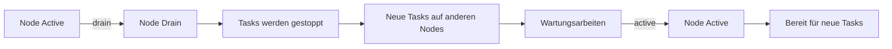

---
tags:
  - docker-swarm
  - monitoring
  - maintenance
  - betrieb
---

# Swarm Monitoring und Maintenance

> [!ABSTRACT] TL;DR
> Monitoring, Wartung und Node-Management in Docker Swarm — von Cluster-Health über Prometheus/Grafana bis hin zu Node Drain und Wartungsfenstern. Diese Notiz deckt den kompletten operativen Betrieb eines Swarm-Clusters ab.

---

## Cluster Health prüfen

Die Gesundheit eines Docker-Swarm-Clusters lässt sich über mehrere Ebenen verifizieren: Nodes, Services, Tasks und den Raft-Konsensus. Eine regelmäßige Überprüfung verhindert, dass sich Probleme unbemerkt aufstauen.

### Node-Status

Der erste Blick sollte immer auf die Nodes gehen — sind alle erreichbar und im Status `Ready`?

```bash
# Übersicht aller Nodes mit Status und Rolle
docker node ls

# Detaillierte Informationen zu einem bestimmten Node
docker node inspect --pretty <node>

# Nur Manager-Nodes anzeigen
docker node ls --filter role=manager

# Nur aktive Worker-Nodes anzeigen
docker node ls --filter role=worker --filter availability=active
```

> [!NOTE] Node-Status verstehen
> | Status | Bedeutung |
> |--------|-----------|
> | `Ready` | Node ist erreichbar und einsatzbereit |
> | `Down` | Node ist nicht erreichbar |
> | `Drain` | Node nimmt keine neuen Tasks an, bestehende werden verschoben |
> | `Pause` | Node nimmt keine neuen Tasks an, bestehende laufen weiter |

### Service-Status

Services sind die logische Einheit — hier prüft man, ob alle gewünschten Replicas laufen:

```bash
# Alle Services mit Replica-Zählung
docker service ls

# Tasks eines Services mit vollständiger Fehlerausgabe
docker service ps <service> --no-trunc

# Nur laufende Tasks anzeigen
docker service ps <service> --filter desired-state=running

# Detaillierte Service-Konfiguration
docker service inspect --pretty <service>
```

> [!TIP] Schneller Gesundheitscheck
> Ein Service ist gesund, wenn die Spalten `REPLICAS` den Wert `n/n` zeigen (z. B. `3/3`). Steht dort `2/3`, läuft mindestens ein Task nicht.

```bash
# Alle Services mit fehlenden Replicas finden
docker service ls --format "{{.Name}}: {{.Replicas}}" | grep -v -E '([0-9]+)/\1'
```

### Raft-Status

Docker Swarm nutzt den Raft-Konsensus-Algorithmus für Manager-Koordination. Ein funktionierender Raft-Cluster benötigt ein **Quorum** (Mehrheit der Manager-Nodes).

```bash
# Raft-Status und Leader identifizieren
docker node ls --format "{{.Hostname}} {{.ManagerStatus}}"

# Detaillierte Raft-Info über inspect
docker node inspect --pretty $(docker node ls --filter role=manager -q)
```

> [!IMPORTANT] Quorum-Tabelle
> | Manager-Nodes | Quorum (Mehrheit) | Tolerierte Ausfälle |
> |:-------------:|:-----------------:|:-------------------:|
> | 1 | 1 | 0 |
> | 3 | 2 | 1 |
> | 5 | 3 | 2 |
> | 7 | 4 | 3 |
>
> **Empfehlung:** Immer eine ungerade Anzahl an Managern (3 oder 5) verwenden.

> [!DANGER] Quorum-Verlust
> Wenn das Quorum verloren geht, kann der Cluster keine Änderungen mehr akzeptieren — keine neuen Services, keine Skalierung, keine Updates. Bestehende Tasks laufen weiter, aber der Cluster ist quasi eingefroren.
>
> Wiederherstellung im Notfall:
> ```bash
> docker swarm init --force-new-cluster --advertise-addr <IP>
> ```

---

## Monitoring mit Prometheus & Grafana

Ein produktiver Swarm-Cluster sollte immer mit einem Monitoring-Stack betrieben werden. Die Kombination aus **Prometheus** (Metriken sammeln), **Grafana** (Visualisierung) und **Alertmanager** (Benachrichtigungen) ist der De-facto-Standard.

### Docker Metrics aktivieren

Der Docker Daemon kann nativ Prometheus-Metriken über einen HTTP-Endpoint bereitstellen. Dies muss auf **jedem Node** konfiguriert werden.

```json
{
  "metrics-addr": "0.0.0.0:9323",
  "experimental": true
}
```

```bash
# Docker Daemon neu starten, damit die Änderungen greifen
sudo systemctl restart docker

# Prüfen, ob der Metrics-Endpoint erreichbar ist
curl -s http://localhost:9323/metrics | head -20
```

> [!WARNING] Sicherheitshinweis
> Der Metrics-Endpoint `0.0.0.0:9323` ist ohne Authentifizierung erreichbar. In Produktionsumgebungen sollte der Zugriff per Firewall auf das interne Netzwerk beschränkt werden:
> ```bash
> # Nur Zugriff aus dem Swarm-Netzwerk erlauben
> sudo ufw allow from 10.0.0.0/24 to any port 9323
> sudo ufw deny 9323
> ```

### Prometheus als Swarm Service

Der gesamte Monitoring-Stack lässt sich als Docker Stack deployen:

```yaml
# monitoring-stack.yml
version: "3.8"

services:
  prometheus:
    image: prom/prometheus:v2.53.0
    ports:
      - "9090:9090"
    volumes:
      - prometheus-data:/prometheus
      - /etc/prometheus:/etc/prometheus:ro
    configs:
      - source: prometheus-config
        target: /etc/prometheus/prometheus.yml
    deploy:
      replicas: 1
      placement:
        constraints:
          - node.role == manager
      resources:
        limits:
          memory: 2G
        reservations:
          memory: 512M
    networks:
      - monitoring

  cadvisor:
    image: gcr.io/cadvisor/cadvisor:v0.49.1
    volumes:
      - /:/rootfs:ro
      - /var/run:/var/run:ro
      - /sys:/sys:ro
      - /var/lib/docker/:/var/lib/docker:ro
    deploy:
      mode: global
      resources:
        limits:
          memory: 256M
    networks:
      - monitoring

  node-exporter:
    image: prom/node-exporter:v1.8.2
    volumes:
      - /proc:/host/proc:ro
      - /sys:/host/sys:ro
      - /:/rootfs:ro
    command:
      - "--path.procfs=/host/proc"
      - "--path.sysfs=/host/sys"
      - "--path.rootfs=/rootfs"
      - "--collector.filesystem.mount-points-exclude=^/(sys|proc|dev|host|etc)($$|/)"
    deploy:
      mode: global
      resources:
        limits:
          memory: 128M
    networks:
      - monitoring

  alertmanager:
    image: prom/alertmanager:v0.27.0
    ports:
      - "9093:9093"
    volumes:
      - alertmanager-data:/alertmanager
    deploy:
      replicas: 1
      placement:
        constraints:
          - node.role == manager
    networks:
      - monitoring

volumes:
  prometheus-data:
  alertmanager-data:

configs:
  prometheus-config:
    file: ./prometheus.yml

networks:
  monitoring:
    driver: overlay
    attachable: true
```

```bash
# Monitoring-Stack deployen
docker stack deploy -c monitoring-stack.yml monitoring
```

### Prometheus-Konfiguration

```yaml
# prometheus.yml
global:
  scrape_interval: 15s
  evaluation_interval: 15s

scrape_configs:
  # Docker Daemon Metriken
  - job_name: "docker"
    static_configs:
      - targets:
          - "node1:9323"
          - "node2:9323"
          - "node3:9323"

  # cAdvisor Container-Metriken
  - job_name: "cadvisor"
    dns_sd_configs:
      - names:
          - "tasks.cadvisor"
        type: A
        port: 8080

  # Node Exporter System-Metriken
  - job_name: "node-exporter"
    dns_sd_configs:
      - names:
          - "tasks.node-exporter"
        type: A
        port: 9100

alerting:
  alertmanagers:
    - static_configs:
        - targets:
            - "alertmanager:9093"
```

> [!TIP] DNS Service Discovery
> Innerhalb eines Swarm-Overlay-Netzwerks lassen sich Services über `tasks.<service-name>` auflösen. Prometheus findet so automatisch alle Instanzen eines Global Service wie cAdvisor oder Node Exporter — ohne dass man IPs pflegen muss.

### Grafana Dashboards

```yaml
# Im monitoring-stack.yml ergänzen
  grafana:
    image: grafana/grafana:11.1.0
    ports:
      - "3000:3000"
    volumes:
      - grafana-data:/var/lib/grafana
    environment:
      - GF_SECURITY_ADMIN_PASSWORD=changeme
      - GF_INSTALL_PLUGINS=grafana-piechart-panel
    deploy:
      replicas: 1
      placement:
        constraints:
          - node.role == manager
      resources:
        limits:
          memory: 512M
    networks:
      - monitoring
```

> [!EXAMPLE] Empfohlene Grafana Dashboards
> Diese Dashboards können direkt über die Dashboard-ID in Grafana importiert werden:
>
> | Dashboard | ID | Beschreibung |
> |-----------|---:|-------------|
> | Docker Swarm & Container | `609` | Übersicht aller Swarm-Services und Container |
> | Node Exporter Full | `1860` | Detaillierte Host-Metriken (CPU, RAM, Disk, Network) |
> | cAdvisor Exporter | `14282` | Container-Ressourcenverbrauch |
> | Docker Swarm Nodes | `2603` | Node-spezifische Swarm-Metriken |
> | Alertmanager | `9578` | Übersicht aktiver Alerts |
>
> Import: **Grafana → Dashboards → Import → Dashboard-ID eingeben → Prometheus als Datasource wählen**

---

## Swarm Visualizer

Der Docker Swarm Visualizer bietet eine einfache Web-Oberfläche, die in Echtzeit zeigt, welche Tasks auf welchen Nodes laufen. Nützlich für schnelle visuelle Checks.

```bash
docker service create \
  --name viz \
  --publish 8080:8080 \
  --constraint 'node.role==manager' \
  --mount type=bind,src=/var/run/docker.sock,dst=/var/run/docker.sock \
  dockersamples/visualizer
```

> [!WARNING] Nur für Entwicklung und Debugging
> Der Visualizer bindet den Docker-Socket ein und hat damit vollen Zugriff auf den Docker Daemon. Er sollte **nicht** in Produktionsumgebungen öffentlich exponiert werden. Für Produktion stattdessen Grafana Dashboards verwenden.

```bash
# Visualizer nach Gebrauch wieder entfernen
docker service rm viz
```

---

## Node Maintenance

Wartungsarbeiten an einzelnen Nodes (Kernel-Updates, Hardware-Tausch, Docker-Upgrade) erfordern eine kontrollierte Herausnahme aus dem Cluster, damit laufende Tasks sauber umverteilt werden.

### Node Drain

Der Drain-Modus ist das Standardverfahren für geplante Wartungsarbeiten:

```bash
# Node in den Drain-Modus versetzen
docker node update --availability drain <node>

# Prüfen, ob alle Tasks verschoben wurden
docker node ps <node>

# --- Wartungsarbeiten durchführen ---

# Node wieder aktivieren
docker node update --availability active <node>
```

> [!NOTE] Was passiert beim Drain?
> 1. Der Node akzeptiert **keine neuen Tasks** mehr
> 2. Alle laufenden Tasks werden **gestoppt**
> 3. Der Scheduler erstellt **Ersatz-Tasks** auf anderen verfügbaren Nodes
> 4. Global Services werden auf dem Node ebenfalls gestoppt
>
> Nach dem Zurücksetzen auf `active` werden **nicht** automatisch Tasks zurück verschoben — der Node nimmt erst bei neuen Scheduling-Entscheidungen wieder teil.



> [!TIP] Tasks nach Wartung zurückholen
> Um Tasks nach der Wartung explizit zurück auf den Node zu bringen, kann ein Force-Update auf den Service ausgelöst werden:
> ```bash
> docker service update --force <service>
> ```
> Der Scheduler verteilt daraufhin die Tasks neu und berücksichtigt den frisch aktivierten Node.

### Node Pause

Im Gegensatz zu Drain stoppt der Pause-Modus **keine** laufenden Tasks — es werden lediglich keine neuen zugewiesen:

```bash
# Node pausieren — bestehende Tasks laufen weiter
docker node update --availability pause <node>

# Status prüfen
docker node ls --filter name=<node>

# Node wieder aktivieren
docker node update --availability active <node>
```

> [!INFO] Drain vs. Pause — Wann was verwenden?
> | Szenario | Modus | Begründung |
> |----------|-------|------------|
> | Kernel-Update (Reboot nötig) | `drain` | Tasks müssen sowieso stoppen |
> | Docker-Daemon-Neustart | `drain` | Alle Container werden gestoppt |
> | Monitoring-Check / Debugging | `pause` | Bestehende Tasks sollen weiterlaufen |
> | Temporäre Lastreduzierung | `pause` | Keine neuen Tasks, aber kein Ausfall |
> | Hardware-Austausch | `drain` | Node wird physisch getrennt |

### Node Labels für Maintenance

Labels ermöglichen granulare Steuerung über Placement Constraints — auch für Wartungsszenarien:

```bash
# Maintenance-Label setzen
docker node update --label-add maintenance=true <node>

# Label prüfen
docker node inspect --pretty <node> | grep -A 5 Labels

# Label wieder entfernen
docker node update --label-rm maintenance <node>
```

> [!EXAMPLE] Constraint-basierte Wartung
> Services können so konfiguriert werden, dass sie Nodes mit dem Maintenance-Label automatisch meiden:
> ```yaml
> deploy:
>   placement:
>     constraints:
>       - node.labels.maintenance != true
> ```
> Vorteil: Der Node bleibt `active`, aber Services mit diesem Constraint werden nicht dort platziert. Nützlich für Rolling Maintenance ohne harten Drain.

### Wartungsfenster-Checkliste

> [!IMPORTANT] Ablauf einer geplanten Node-Wartung
> 1. **Kommunikation** — Team über Wartungsfenster informieren
> 2. **Monitoring prüfen** — Cluster ist gesund, alle Replicas laufen
> 3. **Drain aktivieren** — `docker node update --availability drain <node>`
> 4. **Task-Migration abwarten** — `docker node ps <node>` zeigt keine laufenden Tasks
> 5. **Wartung durchführen** — Updates, Reboot, Hardware, etc.
> 6. **Node reaktivieren** — `docker node update --availability active <node>`
> 7. **Health-Check** — `docker node ls` und Service-Replicas prüfen
> 8. **Optional: Force-Rebalance** — `docker service update --force <service>`

---

## Log-Management

Zentralisiertes Logging ist essenziell, da Tasks auf beliebigen Nodes laufen und bei Reschedules auf andere Nodes wandern können.

### Service Logs

Docker Swarm aggregiert Logs aller Tasks eines Services automatisch:

```bash
# Live-Logs eines Services verfolgen
docker service logs --follow --tail 200 <service>

# Logs mit Timestamps anzeigen
docker service logs --timestamps <service>

# Logs eines bestimmten Tasks
docker service logs <service>.1

# Logs seit einem Zeitpunkt
docker service logs --since 2025-06-01T10:00:00 <service>

# Nur Fehlermeldungen filtern
docker service logs <service> 2>&1 | grep -i error
```

> [!NOTE] Log-Aggregation
> `docker service logs` sammelt die Logs aller Replicas. Jede Zeile wird mit dem Task-Namen und der Node-ID prefixed, sodass man nachvollziehen kann, woher eine Meldung stammt.

### Log-Treiber konfigurieren

Der Standard-Log-Treiber `json-file` speichert Logs lokal auf jedem Node. Für Produktion empfiehlt sich ein zentraler Log-Treiber:

```yaml
# In der Stack-Datei pro Service konfigurieren
services:
  web:
    image: nginx:1.27
    logging:
      driver: "fluentd"
      options:
        fluentd-address: "fluentd:24224"
        tag: "swarm.{{.Name}}"
        fluentd-async: "true"
```

> [!TIP] Log-Treiber im Vergleich
> | Treiber | Zentral | Performance | Anwendungsfall |
> |---------|:-------:|:-----------:|----------------|
> | `json-file` | ❌ | ⭐⭐⭐ | Entwicklung, kleine Setups |
> | `syslog` | ✅ | ⭐⭐⭐ | Vorhandene Syslog-Infrastruktur |
> | `fluentd` | ✅ | ⭐⭐ | Flexible Log-Pipeline (EFK-Stack) |
> | `gelf` | ✅ | ⭐⭐ | Graylog-Integration |
> | `loki` | ✅ | ⭐⭐⭐ | Grafana-Ökosystem (leichtgewichtig) |

```json
{
  "log-driver": "json-file",
  "log-opts": {
    "max-size": "50m",
    "max-file": "3",
    "labels": "service,environment",
    "compress": "true"
  }
}
```

> [!WARNING] Log-Rotation nicht vergessen
> Ohne `max-size` und `max-file` wachsen JSON-Logs unbegrenzt und können die Festplatte füllen. Dies ist eine der häufigsten Ursachen für Node-Ausfälle in Docker-Umgebungen.

---

## Automatisierte Health Checks

Health Checks ermöglichen es Docker, den Zustand einzelner Container zu überwachen und ungesunde Instanzen automatisch zu ersetzen.

### HEALTHCHECK im Dockerfile

```dockerfile
HEALTHCHECK --interval=30s --timeout=10s --start-period=60s --retries=3 \
  CMD curl -f http://localhost:8080/health || exit 1
```

> [!INFO] HEALTHCHECK-Parameter
> | Parameter | Beschreibung | Empfohlener Wert |
> |-----------|-------------|:----------------:|
> | `--interval` | Prüfintervall | `30s` |
> | `--timeout` | Maximale Wartezeit pro Check | `10s` |
> | `--start-period` | Startphase ohne Checks (Container-Boot) | `30s` – `120s` |
> | `--retries` | Fehlversuche bis `unhealthy` | `3` – `5` |

### Health Checks im Swarm-Kontext

Im Swarm-Modus reagiert der Orchestrator automatisch auf `unhealthy` Container:

```bash
# Health-Status aller Tasks eines Services prüfen
docker service ps <service> --format "{{.Name}} {{.CurrentState}} {{.Error}}"

# Container-Health direkt abfragen
docker inspect --format='{{.State.Health.Status}}' <container-id>

# Letzte Health-Check-Ergebnisse
docker inspect --format='{{json .State.Health}}' <container-id> | jq .
```

> [!NOTE] Ablauf bei Unhealthy
> 1. Container wird als `unhealthy` markiert
> 2. Swarm stoppt den Task
> 3. Ein neuer Task wird auf einem verfügbaren Node gestartet
> 4. Der alte Container wird nach dem `shutdown-grace-period` entfernt

### Health Check in der Stack-Datei

```yaml
services:
  api:
    image: myapp:latest
    healthcheck:
      test: ["CMD", "wget", "--spider", "-q", "http://localhost:3000/health"]
      interval: 30s
      timeout: 10s
      retries: 3
      start_period: 60s
    deploy:
      replicas: 3
      update_config:
        parallelism: 1
        delay: 30s
        failure_action: rollback
        monitor: 60s
```

---

## Wartungsaufgaben

Regelmäßige Wartungsaufgaben halten den Swarm-Cluster stabil und sicher.

### Image-Updates (Rolling Updates)

```bash
# Service auf ein neues Image aktualisieren
docker service update --image nginx:1.27 web

# Update mit kontrolliertem Rollout
docker service update \
  --image nginx:1.27 \
  --update-parallelism 1 \
  --update-delay 30s \
  --update-failure-action rollback \
  --update-monitor 60s \
  web

# Update-Status überwachen
docker service ps web

# Manuelles Rollback bei Problemen
docker service rollback web
```

> [!TIP] Update-Strategie
> ```yaml
> deploy:
>   update_config:
>     parallelism: 1            # Ein Task gleichzeitig
>     delay: 30s                # 30s Pause zwischen Tasks
>     failure_action: rollback  # Bei Fehler: automatisches Rollback
>     monitor: 60s              # 60s Beobachtungsfenster pro Task
>     max_failure_ratio: 0.1    # Maximal 10% dürfen fehlschlagen
>     order: start-first        # Neuer Task zuerst starten (Zero-Downtime)
>   rollback_config:
>     parallelism: 0            # Alle gleichzeitig zurückrollen
>     delay: 0s
> ```

### Swarm-Certificate Rotation

Docker Swarm nutzt TLS-Zertifikate für die verschlüsselte Kommunikation zwischen Nodes. Diese sollten regelmäßig rotiert werden.

```bash
# Aktuelle Zertifikats-Informationen anzeigen
docker swarm ca

# Zertifikate sofort rotieren
docker swarm ca --rotate

# Zertifikats-Gültigkeit anpassen (Standard: 90 Tage)
docker swarm update --cert-expiry 720h

# Prüfen, ob die Rotation abgeschlossen ist
docker info --format '{{.Swarm.Cluster.Spec.CAConfig.NodeCertExpiry}}'
```

> [!WARNING] Zertifikats-Rotation
> Die Rotation erzeugt ein neues Root-CA-Zertifikat. Alle Nodes müssen erreichbar sein, damit sie das neue Zertifikat erhalten. Nodes im Status `Down` erhalten das Zertifikat erst, wenn sie wieder online sind.

### System Prune

Ungenutzte Ressourcen belegen Speicherplatz und sollten regelmäßig bereinigt werden:

```bash
# Alles Ungenutzte entfernen (Images, Container, Netzwerke, Volumes)
docker system prune -af --volumes

# Nur dangling Images entfernen (sicherer)
docker image prune -f

# Speicherverbrauch vor dem Prune anzeigen
docker system df

# Detaillierte Speicherübersicht
docker system df -v
```

> [!DANGER] Vorsicht mit `--volumes`
> Das Flag `--volumes` entfernt auch **unbenutzte Volumes** inklusive deren Daten. In Produktionsumgebungen besser **ohne** `--volumes` arbeiten und Volumes manuell prüfen:
> ```bash
> # Ungenutzte Volumes auflisten (ohne zu löschen)
> docker volume ls --filter dangling=true
>
> # Gezielt ein Volume entfernen
> docker volume rm <volume-name>
> ```

### Automatisierter Prune via Swarm Service

```yaml
# prune-stack.yml
version: "3.8"

services:
  prune:
    image: docker:cli
    command: >
      sh -c "while true; do
        echo '[Prune] Starte Bereinigung...';
        docker image prune -af --filter 'until=168h';
        docker container prune -f;
        docker network prune -f;
        echo '[Prune] Fertig.';
        sleep 86400;
      done"
    volumes:
      - /var/run/docker.sock:/var/run/docker.sock
    deploy:
      mode: global
      resources:
        limits:
          memory: 64M
```

---

## Alerting

Ein Monitoring ohne Alerting ist nur die halbe Miete. Prometheus Alertmanager kann bei kritischen Zuständen benachrichtigen.

### Alert-Regeln für Swarm

```yaml
# alert-rules.yml
groups:
  - name: swarm-alerts
    rules:
      - alert: NodeDown
        expr: up{job="node-exporter"} == 0
        for: 2m
        labels:
          severity: critical
        annotations:
          summary: "Node {{ $labels.instance }} ist nicht erreichbar"

      - alert: ServiceReplicasMismatch
        expr: docker_swarm_tasks_running != docker_swarm_tasks_desired
        for: 5m
        labels:
          severity: warning
        annotations:
          summary: "Service {{ $labels.service_name }} hat nicht genug Replicas"

      - alert: HighMemoryUsage
        expr: (1 - (node_memory_MemAvailable_bytes / node_memory_MemTotal_bytes)) > 0.9
        for: 5m
        labels:
          severity: warning
        annotations:
          summary: "Node {{ $labels.instance }} — RAM-Auslastung über 90%"

      - alert: DiskSpaceLow
        expr: (1 - (node_filesystem_avail_bytes / node_filesystem_size_bytes)) > 0.85
        for: 10m
        labels:
          severity: critical
        annotations:
          summary: "Node {{ $labels.instance }} — Festplatte über 85% belegt"
```

> [!TIP] Alertmanager-Kanäle
> Alertmanager unterstützt diverse Benachrichtigungskanäle:
> - **E-Mail** — SMTP-Integration
> - **Slack / Discord** — Webhook-Integration
> - **PagerDuty** — Incident Management
> - **Gotify / ntfy** — Self-Hosted Push Notifications

---

## Verwandte Notizen

- [[Docker Swarm Index]]
- [[Swarm CLI Cheatsheet]] %%TODO: Noch zu erstellen%%
- [[Swarm Troubleshooting]] %%TODO: Noch zu erstellen%%
- [[Docker Monitoring und Logging]] — Docker Standalone Monitoring
- [[Monitoring und Logging]] — Kubernetes Monitoring