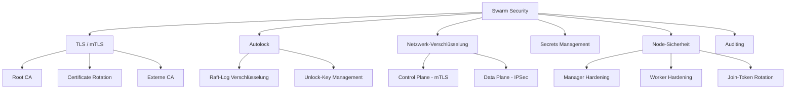
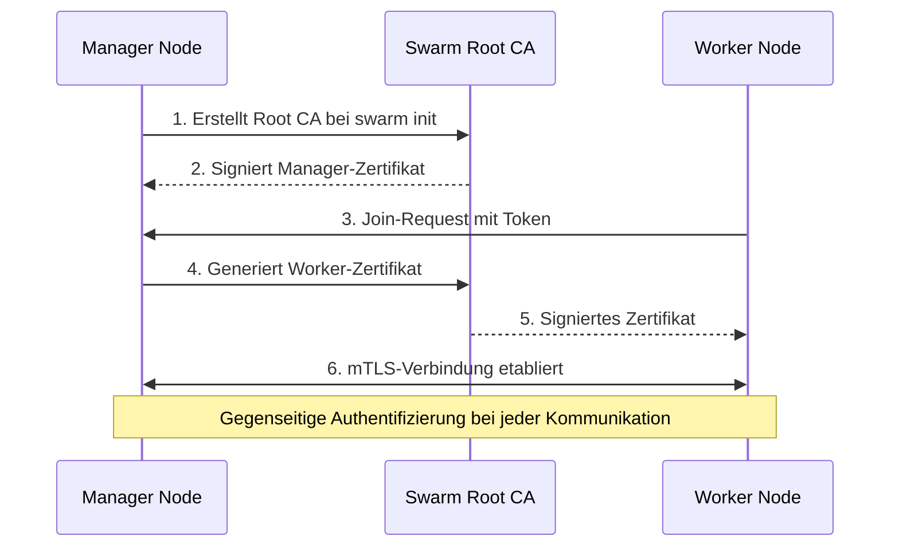
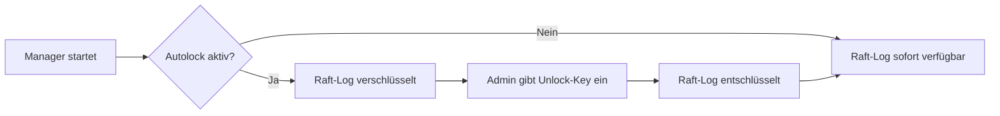

---
tags:
  - docker-swarm
  - security
  - tls
  - hardening
---

# Swarm Security

> [!ABSTRACT] TL;DR
> Sicherheitskonzepte in Docker Swarm — von automatischer TLS-Verschlüsselung über Autolock bis hin zu Node-Sicherheit und Netzwerk-Verschlüsselung. Docker Swarm bringt viele Security-Features out-of-the-box mit, die in anderen Orchestrierungslösungen erst manuell konfiguriert werden müssen.

---

## Überblick

Docker Swarm verfolgt einen **Security-by-Default**-Ansatz. Bereits beim Initialisieren eines Swarm-Clusters werden automatisch kryptographische Identitäten, TLS-Zertifikate und verschlüsselte Kommunikationskanäle eingerichtet. Dieses Dokument behandelt alle sicherheitsrelevanten Aspekte eines Swarm-Clusters:

- **TLS & mTLS** — Verschlüsselung und gegenseitige Authentifizierung
- **Autolock** — Schutz des Raft-Logs auf der Festplatte
- **Netzwerk-Verschlüsselung** — Control Plane und Data Plane
- **Secrets Management** — Sichere Verwaltung sensibler Daten
- **Node-Sicherheit** — Härtung von Manager- und Worker-Nodes
- **Auditing & Compliance** — Docker Bench for Security



---

## TLS in Docker Swarm

Transport Layer Security (TLS) ist das Fundament der Swarm-Sicherheit. Docker Swarm nutzt **Mutual TLS (mTLS)**, bei dem sich beide Kommunikationspartner gegenseitig authentifizieren — nicht nur der Server gegenüber dem Client.

### Automatische TLS-Verschlüsselung

Bei der Initialisierung eines Swarm-Clusters passiert Folgendes automatisch:

1. **Root CA wird generiert** — Eine selbstsignierte Zertifizierungsstelle wird erstellt
2. **Manager erhält Zertifikat** — Der erste Manager-Node bekommt ein TLS-Zertifikat
3. **Jeder neue Node erhält ein Zertifikat** — Beim Beitritt via `docker swarm join`
4. **mTLS wird aktiviert** — Alle Node-zu-Node-Kommunikation ist verschlüsselt und authentifiziert

```bash
# Swarm initialisieren — TLS wird automatisch eingerichtet
docker swarm init --advertise-addr 192.168.1.10

# Swarm-Status und Zertifikatsinfo anzeigen
docker info --format '{{.Swarm.Cluster.RootRotationInProgress}}'

# Aktuelle CA-Konfiguration anzeigen
docker swarm ca
```

> [!NOTE] Automatisch, nicht optional
> Die TLS-Verschlüsselung des Control Plane ist **immer aktiv** und kann nicht deaktiviert werden. Das ist ein bewusstes Design-Prinzip von Docker Swarm — Security by Default.

### Wie mTLS in Swarm funktioniert



Jedes Zertifikat enthält:

| Feld | Inhalt | Zweck |
|------|--------|-------|
| **CN (Common Name)** | Kryptographische Node-ID | Eindeutige Identifizierung |
| **OU (Organizational Unit)** | `swarm-manager` oder `swarm-worker` | Rollenbestimmung |
| **O (Organization)** | Swarm-Cluster-ID | Cluster-Zugehörigkeit |

> [!IMPORTANT] Zertifikats-basierte Autorisierung
> Die Rolle eines Nodes (Manager oder Worker) wird über das Zertifikat bestimmt. Ein Worker-Zertifikat kann niemals Manager-Operationen ausführen — selbst wenn der Node kompromittiert wird.

### Certificate Rotation

Zertifikate haben eine begrenzte Gültigkeitsdauer und werden automatisch vor Ablauf erneuert. Die Standard-Ablaufzeit beträgt **90 Tage**.

```bash
# Aktuelle Zertifikats-Ablaufzeit anzeigen
docker system info | grep "Expiry Duration"

# Ablaufzeit auf 30 Tage verkürzen (härtere Sicherheit)
docker swarm update --cert-expiry 720h

# Ablaufzeit auf 48 Stunden setzen (maximale Sicherheit)
docker swarm update --cert-expiry 48h

# Minimale Ablaufzeit: 1 Stunde
docker swarm update --cert-expiry 1h
```

> [!WARNING] Zu kurze Ablaufzeiten
> Eine Ablaufzeit unter 24 Stunden kann problematisch werden, wenn ein Node längere Zeit offline ist. Nach Ablauf des Zertifikats kann der Node nicht mehr automatisch dem Cluster beitreten und muss manuell neu aufgenommen werden.

#### Root CA rotieren

Die Root CA selbst kann ebenfalls rotiert werden — ein Vorgang, der bei Verdacht auf Kompromittierung durchgeführt werden sollte:

```bash
# Root CA rotieren — alle Node-Zertifikate werden erneuert
docker swarm ca --rotate

# Root CA mit externem Zertifikat rotieren
docker swarm ca --rotate \
  --ca-cert /pfad/zur/neuen/ca.pem \
  --ca-key /pfad/zum/neuen/ca-key.pem

# Status der Rotation prüfen
docker info --format '{{.Swarm.Cluster.RootRotationInProgress}}'
```

> [!TIP] Wann die Root CA rotieren?
> - Verdacht auf Kompromittierung eines Manager-Nodes
> - Regelmäßig im Rahmen von Compliance-Anforderungen (z.B. jährlich)
> - Nach dem Entfernen eines Manager-Nodes aus dem Cluster
> - Bei Wechsel zu einer externen CA

### Externe CA verwenden

Für Enterprise-Umgebungen kann eine externe Certificate Authority eingebunden werden:

```bash
# Swarm mit externer CA initialisieren (CFSSL)
docker swarm init \
  --external-ca protocol=cfssl,url=https://ca.example.com

# Mehrere externe CAs für Redundanz
docker swarm init \
  --external-ca protocol=cfssl,url=https://ca1.example.com \
  --external-ca protocol=cfssl,url=https://ca2.example.com

# Externe CA nachträglich hinzufügen
docker swarm update \
  --external-ca protocol=cfssl,url=https://ca.example.com
```

> [!NOTE] Unterstützte Protokolle
> Aktuell unterstützt Docker Swarm nur das **CFSSL**-Protokoll für externe CAs. Andere CA-Lösungen wie Vault PKI müssen über einen CFSSL-kompatiblen Proxy angebunden werden.

---

## Autolock

### Konzept

Der **Raft-Log** ist das verteilte Konsens-Protokoll, das Docker Swarm für die Zustandsverwaltung nutzt. Er enthält hochsensible Daten:

- **TLS-Schlüssel** aller Nodes
- **Secrets** (Passwörter, API-Keys, Zertifikate)
- **Konfigurationsdaten** des Clusters
- **Encryption Keys** für die Datenverschlüsselung

Standardmäßig werden diese Daten **unverschlüsselt auf der Festplatte** der Manager-Nodes gespeichert. **Autolock** ändert das:



### Autolock aktivieren

```bash
# Bei der Swarm-Initialisierung aktivieren
docker swarm init --autolock

# Nachträglich aktivieren
docker swarm update --autolock=true
# Ausgabe: Unlock-Key wird angezeigt — SOFORT SICHERN!

# Nachträglich deaktivieren
docker swarm update --autolock=false
```

### Unlock-Key verwalten

```bash
# Aktuellen Unlock-Key anzeigen (nur auf aktivem Manager)
docker swarm unlock-key

# Unlock-Key rotieren
docker swarm unlock-key --rotate
# Ausgabe: Neuer Key wird angezeigt, alter Key bleibt kurzzeitig gültig

# Manager nach Neustart entsperren
docker swarm unlock
# Interaktive Eingabe des Unlock-Keys
```

> [!DANGER] Unlock-Key sichern!
> Ohne den Unlock-Key kann ein neugestarteter Manager **nicht** am Cluster teilnehmen. Wenn **alle** Manager gleichzeitig neustarten und der Key verloren ist, ist der gesamte Cluster-Zustand unwiederbringlich verloren. Den Key an einem sicheren, externen Ort aufbewahren (Passwort-Manager, Hardware Security Module, versiegelter Umschlag im Tresor).

> [!TIP] Unlock-Key Rotation
> Nach jedem personellen Wechsel im Ops-Team sollte der Unlock-Key rotiert werden. Die Rotation erzeugt einen neuen Key, der alte bleibt für eine kurze Übergangszeit gültig, damit laufende Nodes nicht sofort betroffen sind.

### Verhalten nach Neustart

Wenn ein Manager-Node mit aktiviertem Autolock neu startet:

1. Der Docker-Daemon startet normal
2. Der Node kann **nicht** am Raft-Konsens teilnehmen
3. Der Node kann **keine** Managementbefehle ausführen
4. Bestehende Container auf dem Node laufen weiter
5. Erst nach `docker swarm unlock` ist der Node wieder voll funktionsfähig

```bash
# Prüfen ob ein Unlock nötig ist
docker node ls
# Fehler: "Swarm is encrypted and needs to be unlocked"

# Node entsperren
docker swarm unlock
# Eingabe: SWMKEY-1-...
```

---

## Netzwerk-Verschlüsselung

Docker Swarm unterscheidet zwischen zwei Kommunikationsebenen:

### Control Plane Verschlüsselung

Das Control Plane umfasst die gesamte Cluster-Management-Kommunikation:

- **Raft-Konsens** zwischen Manager-Nodes
- **Gossip-Protokoll** für Service Discovery
- **Task-Zuweisung** von Managern zu Workern

```bash
# Control Plane ist IMMER verschlüsselt — keine Konfiguration nötig
# Verifizierung über die TLS-Zertifikate:
docker info | grep -A5 "Security Options"
```

> [!NOTE] Ports für das Control Plane
> - **TCP 2377** — Cluster-Management und Raft
> - **TCP/UDP 7946** — Node Discovery und Gossip
> - **UDP 4789** — VXLAN Overlay Traffic (Data Plane)
>
> Diese Ports müssen in der Firewall zwischen allen Swarm-Nodes offen sein.

### Data Plane Verschlüsselung

Das Data Plane betrifft den eigentlichen Anwendungstraffic über Overlay-Netzwerke. Diese Verschlüsselung ist **optional** und muss explizit aktiviert werden:

```bash
# Verschlüsseltes Overlay-Netzwerk erstellen
docker network create \
  --driver overlay \
  --opt encrypted \
  secure-network

# Verschlüsseltes Netzwerk mit spezifischen Optionen
docker network create \
  --driver overlay \
  --opt encrypted \
  --subnet 10.10.0.0/24 \
  --gateway 10.10.0.1 \
  secure-app-network

# Prüfen ob ein Netzwerk verschlüsselt ist
docker network inspect secure-network \
  --format '{{.Options}}'
```

> [!WARNING] Performance-Impact
> Die Data Plane Verschlüsselung nutzt **IPSec (ESP)** im Tunnel-Modus. Das verursacht:
> - **CPU-Overhead** durch Ver-/Entschlüsselung jedes Pakets
> - **Latenz-Erhöhung** von ca. 10–20 %
> - **Durchsatz-Reduktion** je nach Hardware um 20–40 %
>
> Für latenz-kritische Anwendungen (z.B. Datenbanken) sollte abgewogen werden, ob die Verschlüsselung auf Netzwerkebene oder auf Applikationsebene (TLS) sinnvoller ist.

### Wann welche Verschlüsselung?

| Szenario | Data Plane Encryption | Begründung |
|----------|:---------------------:|------------|
| Multi-Datacenter | ✅ Ja | Traffic läuft über unsichere Netze |
| Sensible Daten (PII, Finanzdaten) | ✅ Ja | Compliance-Anforderungen |
| Internes Trusted Network | ⚠️ Abwägen | Performance vs. Sicherheit |
| High-Performance Datenbanken | ❌ Nein | App-Level TLS bevorzugen |
| Entwicklungsumgebung | ❌ Nein | Unnötiger Overhead |

---

## Secrets Management

Docker Swarm hat ein integriertes Secrets-Management-System, das eng mit der Sicherheitsarchitektur verzahnt ist. Eine ausführliche Dokumentation findet sich unter [[Swarm Secrets und Configs]].

### Grundprinzipien

- Secrets werden **verschlüsselt im Raft-Log** gespeichert
- Transport zu den Containern erfolgt über **mTLS**
- Secrets sind nur als **tmpfs-Mount** im Container verfügbar — nie auf der Festplatte
- Nur Services, denen ein Secret explizit zugewiesen wurde, haben Zugriff

```bash
# Secret erstellen
echo "mein-sicheres-passwort" | docker secret create db_password -

# Secret aus Datei erstellen
docker secret create tls_cert /pfad/zum/cert.pem

# Secret einem Service zuweisen
docker service create \
  --name webapp \
  --secret db_password \
  nginx:latest

# Secrets auflisten
docker secret ls

# Secret-Details anzeigen (Inhalt wird NIE angezeigt)
docker secret inspect db_password
```

> [!DANGER] Niemals Passwörter in Umgebungsvariablen!
> Umgebungsvariablen sind über `docker inspect`, `/proc/<PID>/environ` und in Logs sichtbar. **Immer** Docker Secrets verwenden:
>
> ```bash
> # FALSCH
> docker service create --env DB_PASS=geheim myapp
>
> # RICHTIG
> docker service create --secret db_password myapp
> ```

---

## Node-Sicherheit

### Join-Tokens schützen

Docker Swarm verwendet zwei verschiedene Join-Tokens — einen für Worker und einen für Manager. Diese Tokens sind der Schlüssel zum Cluster:

```bash
# Aktuelle Tokens anzeigen
docker swarm join-token worker
docker swarm join-token manager

# Worker-Token rotieren
docker swarm join-token --rotate worker

# Manager-Token rotieren
docker swarm join-token --rotate manager

# Beide Tokens gleichzeitig rotieren
docker swarm join-token --rotate worker && \
docker swarm join-token --rotate manager
```

> [!WARNING] Token-Rotation ist Pflicht
> Join-Tokens sollten regelmäßig rotiert werden — mindestens:
> - Nach jedem personellen Wechsel im Team
> - Wenn ein Token versehentlich in Logs oder Chats aufgetaucht ist
> - Quartalsweise als Routine-Maßnahme
> - Nach dem Entfernen eines kompromittierten Nodes

### Manager-Nodes absichern

Manager-Nodes sind die kritischsten Komponenten im Swarm-Cluster. Sie speichern den Cluster-Zustand und haben volle Kontrolle:

```bash
# SSH-Zugang auf Manager-Nodes beschränken
# /etc/ssh/sshd_config
AllowUsers swarm-admin
PermitRootLogin no
PasswordAuthentication no

# Docker Socket schützen — nur berechtigte User
sudo chmod 660 /var/run/docker.sock
sudo chown root:docker /var/run/docker.sock

# Manager-Node als reinen Manager betreiben (kein Workload)
docker node update --availability drain manager-node-1
docker node update --availability drain manager-node-2
docker node update --availability drain manager-node-3
```

> [!TIP] Dedizierte Manager-Nodes
> In Produktionsumgebungen sollten Manager-Nodes **ausschließlich** für Cluster-Management verwendet werden. Mit `--availability drain` werden keine Anwendungs-Container auf ihnen geplant. Das reduziert die Angriffsfläche erheblich und schützt den Raft-Log vor Ressourcenengpässen durch Workloads.

### Worker-Nodes absichern

```bash
# Container mit Read-only Filesystem starten
docker service create \
  --name secure-app \
  --read-only \
  --tmpfs /tmp:rw,noexec,nosuid \
  myapp:latest

# No-new-privileges Flag setzen
docker service create \
  --name secure-app \
  --no-new-privileges \
  myapp:latest

# Kombinierte Härtung
docker service create \
  --name hardened-app \
  --read-only \
  --no-new-privileges \
  --cap-drop ALL \
  --cap-add NET_BIND_SERVICE \
  --user 1000:1000 \
  --tmpfs /tmp:rw,noexec,nosuid,size=64m \
  myapp:latest
```

> [!NOTE] Defense in Depth
> Die Härtung auf Worker-Ebene ist eine zusätzliche Verteidigungsschicht. Auch wenn ein Container kompromittiert wird, begrenzen `--read-only`, `--no-new-privileges` und `--cap-drop ALL` den möglichen Schaden erheblich.

### Sicherheitsoptionen im Überblick

| Option | Wirkung | Empfehlung |
|--------|---------|------------|
| `--read-only` | Root-Filesystem ist read-only | ✅ Immer verwenden |
| `--no-new-privileges` | Verhindert Privilege Escalation | ✅ Immer verwenden |
| `--cap-drop ALL` | Entfernt alle Linux Capabilities | ✅ Standard, einzeln zurückgeben |
| `--user 1000:1000` | Nicht als Root laufen | ✅ Immer verwenden |
| `--pids-limit 100` | Begrenzt Anzahl der Prozesse | ✅ Fork-Bomb-Schutz |
| `--memory 512m` | RAM-Limit | ✅ Ressourcen-Schutz |
| `--cpus 1.0` | CPU-Limit | ✅ Ressourcen-Schutz |
| `--security-opt apparmor=profile` | AppArmor-Profil | ✅ Wenn verfügbar |
| `--security-opt seccomp=profile.json` | Seccomp-Profil | ✅ Für maximale Isolation |

---

## Docker Bench for Security

Docker Bench for Security ist ein offizielles Audit-Tool, das den Host und die Docker-Konfiguration gegen die **CIS Docker Benchmark** prüft:

```bash
# Docker Bench for Security ausführen
docker run --rm --net host --pid host \
  --userns host --cap-add audit_control \
  -e DOCKER_CONTENT_TRUST=$DOCKER_CONTENT_TRUST \
  -v /var/run/docker.sock:/var/run/docker.sock \
  -v /usr/lib/systemd:/usr/lib/systemd \
  -v /etc:/etc \
  docker/docker-bench-security

# Nur bestimmte Checks ausführen
docker run --rm --net host --pid host \
  -v /var/run/docker.sock:/var/run/docker.sock \
  docker/docker-bench-security -c check_2

# Ergebnis in Datei speichern
docker run --rm --net host --pid host \
  -v /var/run/docker.sock:/var/run/docker.sock \
  -v $(pwd):/output \
  docker/docker-bench-security -l /output/bench-report.txt
```

### Wichtige Check-Kategorien

| Nr. | Kategorie | Prüft |
|-----|-----------|-------|
| 1 | Host Configuration | OS-Hardening, Audit-Logs |
| 2 | Docker Daemon | Daemon-Konfiguration, TLS |
| 3 | Docker Files | Dateiberechtigungen |
| 4 | Container Images | Image-Sicherheit |
| 5 | Container Runtime | Laufzeit-Konfiguration |
| 6 | Docker Security Operations | Betriebsprozesse |
| 7 | Docker Swarm | Swarm-spezifische Checks |

> [!TIP] Regelmäßig ausführen
> Docker Bench sollte in einem regelmäßigen Intervall (z.B. wöchentlich) auf allen Swarm-Nodes ausgeführt werden. Die Ergebnisse können in ein Monitoring-System eingespeist werden, um Compliance-Abweichungen frühzeitig zu erkennen.

---

## Firewall-Konfiguration

Für einen sicheren Swarm-Cluster müssen die richtigen Ports geöffnet und alle anderen geschlossen sein:

```bash
# Manager-Nodes — eingehende Regeln (UFW)
sudo ufw allow from 192.168.1.0/24 to any port 2377 proto tcp  # Cluster Management
sudo ufw allow from 192.168.1.0/24 to any port 7946 proto tcp  # Node Communication
sudo ufw allow from 192.168.1.0/24 to any port 7946 proto udp  # Node Communication
sudo ufw allow from 192.168.1.0/24 to any port 4789 proto udp  # Overlay Network

# Worker-Nodes — eingehende Regeln (UFW)
sudo ufw allow from 192.168.1.0/24 to any port 7946 proto tcp  # Node Communication
sudo ufw allow from 192.168.1.0/24 to any port 7946 proto udp  # Node Communication
sudo ufw allow from 192.168.1.0/24 to any port 4789 proto udp  # Overlay Network

# Alles andere blockieren
sudo ufw default deny incoming
sudo ufw enable
```

> [!IMPORTANT] Netzwerk-Segmentierung
> In Produktionsumgebungen sollten Manager-Nodes in einem eigenen Netzwerk-Segment stehen. Der Port **2377** (Cluster Management API) darf **nur** von anderen Managern und autorisierten Admin-Workstations erreichbar sein — niemals aus dem Internet.

---

## Best Practices Checkliste

> [!SUCCESS] Security Hardening Checklist
> Verwende diese Checkliste für jeden neuen Swarm-Cluster:

- [ ] Autolock aktiviert (`docker swarm update --autolock=true`)
- [ ] Unlock-Key extern und sicher gespeichert
- [ ] Certificate Rotation auf max. 30 Tage konfiguriert
- [ ] Join-Tokens regelmäßig rotiert (mindestens quartalsweise)
- [ ] Manager-Nodes als **dedicated** konfiguriert (`--availability drain`)
- [ ] Overlay-Netzwerk-Verschlüsselung für sensible Netze aktiviert
- [ ] Docker Secrets statt Umgebungsvariablen für alle Passwörter
- [ ] Docker Bench for Security regelmäßig auf allen Nodes ausgeführt
- [ ] Firewall korrekt konfiguriert (nur nötige Ports offen)
- [ ] SSH-Zugang gehärtet (Key-only, kein Root-Login)
- [ ] Docker Socket mit restriktiven Berechtigungen
- [ ] Container mit `--read-only`, `--no-new-privileges`, `--cap-drop ALL`
- [ ] Container laufen nicht als Root (`--user`)
- [ ] Ressourcen-Limits gesetzt (`--memory`, `--cpus`, `--pids-limit`)
- [ ] Logging und Monitoring für Security-Events eingerichtet

---

## Troubleshooting

### Häufige Sicherheitsprobleme

> [!BUG] Node kann nach Neustart nicht beitreten
> **Symptom:** `Error: Swarm is encrypted and needs to be unlocked`
> **Ursache:** Autolock ist aktiv, Unlock wurde nach Neustart vergessen.
> **Lösung:**
> ```bash
> docker swarm unlock
> # Unlock-Key eingeben
> ```

> [!BUG] Zertifikat abgelaufen
> **Symptom:** `certificate has expired or is not yet valid`
> **Ursache:** Node war zu lange offline und das Zertifikat konnte nicht erneuert werden.
> **Lösung:**
> ```bash
> # Node aus dem Cluster entfernen und neu hinzufügen
> docker node rm --force <node-id>
> # Auf dem betroffenen Node:
> docker swarm leave --force
> docker swarm join --token <aktueller-token> <manager-ip>:2377
> ```

> [!BUG] Join-Token kompromittiert
> **Symptom:** Unbekannte Nodes erscheinen im Cluster.
> **Ursache:** Join-Token wurde geleaked.
> **Lösung:**
> ```bash
> # Sofort beide Tokens rotieren
> docker swarm join-token --rotate worker
> docker swarm join-token --rotate manager
> # Unbekannte Nodes entfernen
> docker node rm --force <verdaechtiger-node>
> ```

---

## Verwandte Notizen

- [[Docker Swarm Index]] — Übersicht aller Swarm-Dokumentationen
- [[Swarm Secrets und Configs]] — Detaillierte Secrets-Verwaltung
- [[Docker Swarm HA Installation]] — Hochverfügbare Cluster-Installation
- [[Docker Security und Hardening]] — Docker Standalone Security
- [[Pod Security Standards]] — Kubernetes Security-Konzepte zum Vergleich