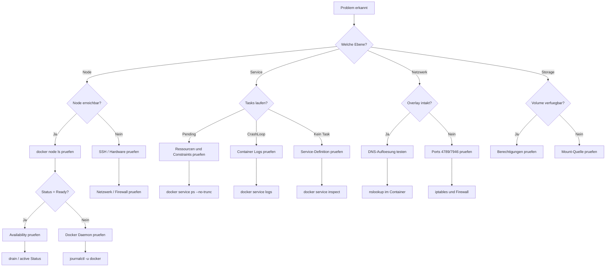

---
tags:
  - docker-swarm
  - troubleshooting
  - debugging
  - betrieb
---

# Swarm Troubleshooting

> [!ABSTRACT] TL;DR
> Systematische Fehlerbehebung in Docker Swarm — von Node-Problemen über Service-Fehler bis hin zu Netzwerk-Debugging und Disaster Recovery. Dieses Dokument bietet einen strukturierten Diagnose-Workflow, konkrete Lösungen für die häufigsten Fehlerbilder und eine Sammlung essentieller Debug-Befehle.

---

## Diagnose-Workflow

Der folgende Flowchart zeigt den systematischen Debugging-Pfad, um Swarm-Probleme effizient einzugrenzen und zu lösen.



> [!TIP] Systematisch vorgehen
> Beginne immer auf der Node-Ebene und arbeite dich nach oben. Ein Node-Problem kann Service-, Netzwerk- und Storage-Probleme gleichzeitig verursachen.

---

## Node-Probleme

### Node erscheint als "Down"

Ein Node mit dem Status `Down` in `docker node ls` kommuniziert nicht mehr mit dem Swarm-Cluster. Die Ursachen sind vielfältig.

**Häufige Ursachen:**

- **Netzwerk-Ausfall** — Node ist nicht erreichbar, Switch-Problem, VLAN-Konfiguration
- **Docker-Daemon gestoppt oder abgestürzt** — Prozess läuft nicht mehr
- **Hardware-Defekt** — Festplatte, RAM, Mainboard
- **Kernel Panic** — System hat sich aufgehängt
- **Ressourcen-Erschöpfung** — Disk full, OOM-Killer hat Docker beendet

**Diagnose-Befehle auf einem Manager-Node:**

```bash
# Node-Status im Cluster prüfen
docker node ls

# Detaillierte Informationen zum betroffenen Node
docker node inspect <node-id> --pretty

# Tasks auf dem betroffenen Node anzeigen
docker node ps <node-id>
```

**Diagnose-Befehle auf dem betroffenen Node (per SSH):**

```bash
# Docker-Daemon Status prüfen
sudo systemctl status docker

# Docker-Daemon Logs prüfen
sudo journalctl -u docker --since "1 hour ago" --no-pager

# Disk-Space prüfen
df -h /var/lib/docker

# Speicher prüfen
free -h

# Netzwerk-Konnektivität zum Manager testen
ping <manager-ip>
nc -zv <manager-ip> 2377
```

**Lösung:**

```bash
# Docker-Daemon neu starten
sudo systemctl restart docker

# Falls der Node automatisch reconnected, Status prüfen
docker node ls

# Falls der Node nicht zurückkommt: draining, entfernen, neu joinen
docker node update --availability drain <node-id>
docker node rm --force <node-id>
docker swarm join --token <worker-token> <manager-ip>:2377
```

> [!WARNING] Node entfernen
> Bevor ein Node entfernt wird, sollten alle laufenden Tasks auf andere Nodes migriert werden. Nutze `docker node update --availability drain <node-id>` und warte, bis alle Tasks verschoben sind.

---

### Node kann nicht joinen

Ein neuer oder wieder-joinender Node kann dem Swarm nicht beitreten. Die häufigsten Ursachen sind Firewall-Regeln, abgelaufene Tokens oder Zeitdrift.

**Erforderliche Ports prüfen:**

| Port | Protokoll | Zweck |
|------|-----------|-------|
| 2377 | TCP | Cluster-Management und Raft-Konsensus |
| 7946 | TCP/UDP | Node-zu-Node Kommunikation (Gossip) |
| 4789 | UDP | Overlay Network Traffic (VXLAN) |

```bash
# Firewall-Ports mit firewalld öffnen
sudo firewall-cmd --permanent --add-port=2377/tcp
sudo firewall-cmd --permanent --add-port=7946/tcp
sudo firewall-cmd --permanent --add-port=7946/udp
sudo firewall-cmd --permanent --add-port=4789/udp
sudo firewall-cmd --reload

# Firewall-Ports mit ufw öffnen
sudo ufw allow 2377/tcp
sudo ufw allow 7946/tcp
sudo ufw allow 7946/udp
sudo ufw allow 4789/udp
```

**Token abgelaufen oder unbekannt:**

```bash
# Aktuelle Tokens anzeigen
docker swarm join-token worker
docker swarm join-token manager

# Token rotieren (invalidiert alle alten Tokens)
docker swarm join-token --rotate worker
docker swarm join-token --rotate manager
```

**Zeitdrift prüfen (NTP):**

```bash
# Aktuelle Zeit und NTP-Status prüfen
timedatectl status

# NTP-Synchronisation erzwingen
sudo timedatectl set-ntp true
sudo systemctl restart systemd-timesyncd

# Alternativ mit chrony
sudo chronyc makestep
sudo chronyc tracking
```

> [!NOTE] Zeitdrift-Toleranz
> Docker Swarm nutzt den Raft-Konsensus-Algorithmus. Eine Zeitdrift von mehr als wenigen Sekunden zwischen Nodes kann zu unerwarteten Leader-Wechseln und Join-Fehlern führen.

**Netzwerk-Konnektivität testen:**

```bash
# Vom Worker aus alle relevanten Ports zum Manager testen
nc -zv <manager-ip> 2377
nc -zv <manager-ip> 7946
nc -zuv <manager-ip> 4789

# DNS-Auflösung des Managers prüfen
nslookup <manager-hostname>
```

---

### Manager-Quorum verloren

Das Quorum ist verloren, wenn die Mehrheit der Manager-Nodes ausgefallen ist. Bei 3 Managern dürfen maximal 1, bei 5 Managern maximal 2 ausfallen.

**Symptome:**

- `docker node ls` antwortet nicht oder extrem langsam
- Fehlermeldung: `Error response from daemon: rpc error: ... leader is not reachable`
- API-Aufrufe hängen oder schlagen fehl
- Keine neuen Services können deployed werden

**Quorum-Tabelle:**

| Manager-Nodes | Quorum | Tolerierte Ausfälle |
|---------------|--------|---------------------|
| 1 | 1 | 0 |
| 2 | 2 | 0 |
| 3 | 2 | 1 |
| 5 | 3 | 2 |
| 7 | 4 | 3 |

> [!IMPORTANT] Ungerade Anzahl
> Verwende immer eine ungerade Anzahl an Manager-Nodes (3 oder 5). Bei einer geraden Anzahl (z.B. 2 oder 4) erhöht sich das Risiko eines Split-Brain-Szenarios, ohne die Ausfalltoleranz zu verbessern.

**Wiederherstellung mit force-new-cluster:**

```bash
# Auf dem verbliebenen (oder am besten erhaltenen) Manager ausführen
docker swarm init --force-new-cluster --advertise-addr <eigene-ip>

# Prüfen ob der Swarm wieder funktioniert
docker node ls

# Neue Manager-Nodes hinzufügen
docker swarm join-token manager
# Token auf neuen Manager-Nodes verwenden
```

> [!DANGER] Force-New-Cluster
> Nur als letztes Mittel verwenden! Dieser Befehl erstellt einen neuen Single-Node-Cluster aus dem Raft-State des aktuellen Nodes. Alle anderen Manager verlieren ihre Raft-Logs und müssen dem Cluster komplett neu beitreten. Bestehende Services und Konfigurationen bleiben erhalten, aber laufende Tasks auf ausgefallenen Nodes gehen verloren.

**Risiken und Konsequenzen:**

- Alle anderen Manager-Nodes müssen entfernt und neu hinzugefügt werden
- Laufende Tasks auf nicht erreichbaren Nodes werden als `Shutdown` markiert
- Secrets und Configs bleiben erhalten (im Raft-Store)
- Kurzfristiger Ausfall aller Services während der Rekonstitution möglich

---

## Service-Probleme

### Tasks starten nicht (Pending)

Ein Service zeigt `0/N replicas` und die Tasks bleiben im Status `Pending`. Docker Swarm kann keinen passenden Node für die Ausführung finden.

```bash
# Detaillierte Fehlermeldungen anzeigen (--no-trunc ist entscheidend!)
docker service ps --no-trunc <service-name>

# Service-Definition prüfen
docker service inspect --pretty <service-name>
```

**Häufige Ursachen und Lösungen:**

| Ursache | Fehlermeldung | Lösung |
|---------|---------------|--------|
| Zu wenig Ressourcen | `insufficient resources on N nodes` | Resource Limits anpassen oder Nodes hinzufügen |
| Constraints nicht erfüllbar | `no suitable node (scheduling constraints...)` | `--constraint`-Regeln prüfen, Labels setzen |
| Image nicht verfügbar | `No such image` oder `pull access denied` | Registry-Zugang prüfen, Image-Name korrigieren |
| Node ist `drain` | `no suitable node (1 node not available)` | Node-Availability auf `active` setzen |
| Secret nicht vorhanden | `secret not found` | Secret erstellen oder Namen korrigieren |

```bash
# Constraints des Services prüfen
docker service inspect <service-name> --format '{{.Spec.TaskTemplate.Placement.Constraints}}'

# Labels auf Nodes prüfen und setzen
docker node inspect <node-id> --format '{{.Spec.Labels}}'
docker node update --label-add role=worker <node-id>

# Verfügbare Ressourcen auf den Nodes prüfen
docker system df
```

> [!TIP] Resource Reservations vs. Limits
> `--reserve-memory` und `--reserve-cpu` bestimmen, wie viel der Scheduler beim Platzieren berücksichtigt. Sind die Reservierungen zu hoch, finden Tasks keinen Platz — selbst wenn die Nodes eigentlich genug freie Ressourcen hätten.

---

### Tasks starten und stoppen sofort (CrashLoop)

Tasks starten, laufen kurz und werden sofort wieder beendet. Docker Swarm versucht sie erneut zu starten, was zu einem CrashLoop führt.

```bash
# Task-Historie mit Fehlerdetails anzeigen
docker service ps --no-trunc <service-name>

# Container-Logs des Services prüfen
docker service logs --tail 100 <service-name>

# Logs eines spezifischen Tasks
docker service logs --tail 50 <service-name>.1
```

**Häufige Ursachen:**

1. **Anwendungsfehler** — Die Anwendung im Container crasht beim Start

```bash
# Logs der letzten 5 Minuten prüfen
docker service logs --since 5m <service-name>
```

2. **Health Check zu strikt** — Container startet noch, wird aber bereits als unhealthy markiert

```bash
# Health Check Konfiguration prüfen
docker service inspect <service-name> \
  --format '{{.Spec.TaskTemplate.ContainerSpec.Healthcheck}}'

# Health Check mit großzügigeren Werten aktualisieren
docker service update \
  --health-cmd "curl -f http://localhost:8080/health || exit 1" \
  --health-interval 30s \
  --health-timeout 10s \
  --health-retries 5 \
  --health-start-period 60s \
  <service-name>
```

3. **Fehlende Secrets oder Configs**

```bash
# Secrets des Services prüfen
docker service inspect <service-name> \
  --format '{{.Spec.TaskTemplate.ContainerSpec.Secrets}}'

# Verfügbare Secrets und Configs im Swarm
docker secret ls
docker config ls
```

4. **Falsche Umgebungsvariablen**

```bash
# Aktuelle Umgebungsvariablen prüfen
docker service inspect <service-name> \
  --format '{{.Spec.TaskTemplate.ContainerSpec.Env}}'

# Umgebungsvariable hinzufügen oder ändern
docker service update --env-add DATABASE_URL=postgres://... <service-name>
```

> [!WARNING] Task-Restart-Limit
> Standardmäßig versucht Swarm endlos, fehlgeschlagene Tasks neu zu starten. Mit `--restart-max-attempts` kann ein Limit gesetzt werden, um unkontrollierte Restart-Schleifen zu verhindern.

---

### Rolling Update schlägt fehl

Beim Aktualisieren eines Services schlagen neue Tasks fehl und der Service wird instabil.

**Präventive Update-Parameter:**

```bash
# Service mit sicheren Update-Parametern erstellen
docker service create \
  --name webapp \
  --replicas 3 \
  --update-parallelism 1 \
  --update-delay 10s \
  --update-failure-action rollback \
  --update-max-failure-ratio 0.25 \
  --update-monitor 30s \
  --rollback-parallelism 1 \
  --rollback-delay 5s \
  --image webapp:2.0 \
  webapp:1.0
```

**Manueller Rollback:**

```bash
# Sofortiger Rollback auf die vorherige Version
docker service rollback <service-name>

# Status des Rollbacks überwachen
docker service ps <service-name>
```

| Parameter | Empfehlung | Beschreibung |
|-----------|------------|-------------|
| `--update-parallelism` | 1 | Anzahl gleichzeitig aktualisierter Tasks |
| `--update-delay` | 10s–30s | Wartezeit zwischen Updates |
| `--update-failure-action` | rollback | Aktion bei Fehler (pause, continue, rollback) |
| `--update-max-failure-ratio` | 0.25 | Maximal tolerierte Fehlerquote |
| `--update-monitor` | 30s–60s | Beobachtungszeit nach Task-Start |

---

## Netzwerk-Probleme

### Overlay Network funktioniert nicht

Container auf verschiedenen Nodes können nicht über das Overlay-Netzwerk kommunizieren.

**Port-Prüfung:**

```bash
# VXLAN-Port (essentiell für Overlay)
sudo ss -ulnp | grep 4789

# Gossip-Port für Node-Kommunikation
sudo ss -tlnp | grep 7946
sudo ss -ulnp | grep 7946

# iptables-Regeln prüfen
sudo iptables -L -n | grep -E '4789|7946'
```

**Overlay-Netzwerk inspizieren:**

```bash
# Netzwerk-Details anzeigen
docker network inspect <overlay-name>

# Alle Overlay-Netzwerke auflisten
docker network ls --filter driver=overlay

# Peers im Overlay prüfen
docker network inspect <overlay-name> \
  --format '{{range .Peers}}{{.Name}} {{.IP}}{{println}}{{end}}'
```

**Netzwerk neu erstellen (wenn irreparabel):**

```bash
# Service vom alten Netzwerk trennen
docker service update --network-rm <old-overlay> <service-name>

# Defektes Netzwerk entfernen
docker network rm <old-overlay>

# Neues Overlay-Netzwerk erstellen
docker network create --driver overlay --attachable <new-overlay>

# Service mit neuem Netzwerk verbinden
docker service update --network-add <new-overlay> <service-name>
```

> [!NOTE] Attachable Overlays
> Nur Overlay-Netzwerke mit dem Flag `--attachable` erlauben es, Standalone-Container (ohne Swarm-Service) manuell anzuhängen. Für Swarm-Services ist dieses Flag nicht erforderlich.

---

### Service Discovery und DNS

Docker Swarm bietet eingebaute DNS-basierte Service Discovery. Jeder Service ist über seinen Namen als DNS-Eintrag erreichbar.

**DNS-Auflösung im Container testen:**

```bash
# In einen laufenden Container einsteigen
docker exec -it <container-id> sh

# DNS-Auflösung testen
nslookup <service-name>
nslookup tasks.<service-name>

# Alternativ mit einem Debug-Container
docker run --rm --network <overlay-name> nicolaka/netshoot nslookup <service-name>
```

**VIP-Modus vs. DNSRR-Modus:**

| Eigenschaft | VIP (Standard) | DNSRR |
|-------------|----------------|-------|
| Loadbalancing | Kernel-Level (IPVS) | Client-seitig |
| DNS-Antwort | Eine virtuelle IP | Alle Container-IPs |
| Performance | Besser | Mehr Kontrolle |
| Published Ports | Ja | Nein |

```bash
# Service mit DNSRR-Modus erstellen
docker service create \
  --name myservice \
  --endpoint-mode dnsrr \
  --network my-overlay \
  myimage:latest
```

> [!WARNING] DNSRR und Published Ports
> Im DNSRR-Modus ist `--publish` nicht verfügbar. Der Zugriff muss über einen vorgeschalteten Load Balancer (z.B. Traefik, Nginx) erfolgen.

---

### Routing Mesh und Published Ports

Das Routing Mesh leitet eingehenden Traffic auf einem beliebigen Node an den richtigen Container weiter — unabhängig davon, auf welchem Node der Container läuft.

**Port-Konflikte identifizieren:**

```bash
# Alle published Ports im Swarm anzeigen
docker service ls --format "{{.Name}}: {{.Ports}}"

# Prüfen ob ein Port bereits belegt ist
sudo ss -tlnp | grep <port>
```

**Host Mode vs. Ingress Mode:**

| Eigenschaft | Ingress Mode (Standard) | Host Mode |
|-------------|-------------------------|-----------|
| Routing Mesh | Ja | Nein |
| Erreichbar auf | Allen Nodes | Nur auf dem Node mit Container |
| Port-Konflikte | Selten | Bei mehreren Replicas möglich |
| Performance | Minimal Overhead | Direkt, kein NAT |

```bash
# Ingress Mode (Standard) — Routing Mesh aktiv
docker service create --publish published=8080,target=80 nginx

# Host Mode — Kein Routing Mesh, direkt auf Node-Port
docker service create --publish published=8080,target=80,mode=host nginx
```

> [!TIP] Host Mode und Global Services
> Host Mode eignet sich gut in Kombination mit `--mode global`, wenn auf jedem Node genau ein Container laufen soll (z.B. Monitoring Agents oder Reverse Proxies).

---

## Storage-Probleme

Volumes in Docker Swarm sind standardmäßig lokal auf dem jeweiligen Node. Wenn ein Task auf einen anderen Node verschoben wird, sind die Daten nicht verfügbar.

**Volume nicht verfügbar auf neuem Node:**

```bash
# Volume-Konfiguration des Services prüfen
docker service inspect <service-name> \
  --format '{{.Spec.TaskTemplate.ContainerSpec.Mounts}}'

# Prüfen ob das Volume auf dem neuen Node existiert
docker volume ls
docker volume inspect <volume-name>
```

**Lösung mit NFS-Volumes:**

```bash
# NFS-Volume direkt im Service definieren
docker service create \
  --name myservice \
  --mount type=volume,source=shared-data,target=/data,\
volume-driver=local,\
volume-opt=type=nfs,\
volume-opt=o=addr=192.168.1.10,\
volume-opt=device=:/exports/data \
  myimage:latest
```

**NFS-Mount-Fehler debuggen:**

```bash
# NFS-Konnektivität testen
showmount -e <nfs-server>

# Manuellen Mount testen
sudo mount -t nfs4 <nfs-server>:<export-path> /mnt/test

# NFS-Logs prüfen
sudo journalctl -u nfs-client.target --since "10 minutes ago"

# Berechtigungen auf dem NFS-Server prüfen
cat /etc/exports
ls -la <export-path>
```

**Berechtigungsprobleme:**

```bash
# UID/GID im Container prüfen
docker exec <container> id
docker exec <container> ls -la /data

# Service mit spezifischem User starten
docker service update --user 1000:1000 <service-name>
```

> [!WARNING] Lokale Volumes und Swarm
> Lokale Volumes (`driver: local` ohne NFS) funktionieren nur, wenn der Service mit `--constraint` an einen bestimmten Node gebunden ist. Andernfalls gehen Daten bei einer Task-Migration verloren.

---

## Performance-Probleme

### Manager-Node überlastet

Manager-Nodes führen den Raft-Konsensus durch und verwalten den Cluster-State. Bei zu vielen Services oder zu großen Stacks kann die Manager-Last kritisch werden.

```bash
# Raft-Status prüfen
docker node ls --format "{{.Hostname}} {{.ManagerStatus}}"

# Ressourcenverbrauch auf dem Manager
docker stats --no-stream
top -p $(pgrep dockerd)
```

> [!IMPORTANT] Manager-Dimensionierung
> Docker empfiehlt maximal 7 Manager-Nodes. Für große Cluster (100+ Worker) sollten Manager dedizierte Hardware ohne eigene Workloads bekommen. Setze die Availability auf `drain`, damit Manager keine Tasks ausführen.

```bash
# Manager von Workload befreien
docker node update --availability drain <manager-node-id>
```

### Overlay-Network Latenz

```bash
# Latenz zwischen Nodes messen
docker run --rm --network <overlay> nicolaka/netshoot ping -c 10 <service-name>

# MTU-Anpassung bei Netzwerk-Erstellung (Overlay nutzt 50 Byte Header)
docker network create \
  --driver overlay \
  --opt com.docker.network.driver.mtu=1400 \
  my-overlay
```

### Resource Limits nicht gesetzt

Ohne Resource Limits können einzelne Container die gesamten Node-Ressourcen beanspruchen und andere Services beeinträchtigen.

```bash
# Resource Limits setzen
docker service update \
  --limit-cpu 0.5 \
  --limit-memory 512M \
  --reserve-cpu 0.25 \
  --reserve-memory 256M \
  <service-name>

# Aktuelle Ressourcen-Nutzung aller Container prüfen
docker stats --no-stream \
  --format "table {{.Name}}\t{{.CPUPerc}}\t{{.MemUsage}}\t{{.MemPerc}}"
```

---

## Disaster Recovery

### Backup wiederherstellen

Swarm-State (Raft-Logs, Secrets, Configs) wird unter `/var/lib/docker/swarm` gespeichert. Ein regelmäßiges Backup dieser Daten ist essentiell.

> [!DANGER] Datenverlust ohne Backup
> Ohne ein Backup des Swarm-State sind alle Secrets, Configs und die gesamte Cluster-Konfiguration unwiederbringlich verloren. Raft-Logs können nicht rekonstruiert werden.

**Backup erstellen:**

```bash
# Docker stoppen (auf einem Manager)
sudo systemctl stop docker

# Swarm-State sichern
sudo tar -czf swarm-backup-$(date +%Y%m%d_%H%M%S).tar.gz /var/lib/docker/swarm

# Docker wieder starten
sudo systemctl start docker
```

**Backup wiederherstellen:**

```bash
# Docker stoppen
sudo systemctl stop docker

# Alten Swarm-State entfernen
sudo rm -rf /var/lib/docker/swarm

# Backup entpacken
sudo tar -xzf swarm-backup.tar.gz -C /

# Docker starten
sudo systemctl start docker

# Cluster mit dem wiederhergestellten State initialisieren
docker swarm init --force-new-cluster

# Prüfen ob alles wiederhergestellt wurde
docker node ls
docker service ls
docker secret ls
docker config ls
```

> [!WARNING] IP-Adresse nach Wiederherstellung
> Wenn der Manager nach der Wiederherstellung eine andere IP-Adresse hat, muss `--advertise-addr` beim `docker swarm init --force-new-cluster` angegeben werden.

---

### Cluster komplett neu aufbauen

Ein kompletter Neuaufbau ist nötig, wenn kein Backup vorhanden ist, der Raft-State aller Manager korrupt ist, oder eine grundlegende Architektur-Änderung gewünscht wird.

**Schritt-für-Schritt-Anleitung:**

```bash
# 1. Bestehende Services dokumentieren (falls noch möglich)
docker service ls
docker stack ls
for stack in $(docker stack ls --format "{{.Name}}"); do
  docker stack services "$stack"
done

# 2. Stack-Compose-Dateien sichern
cp -r /opt/stacks /backup/stacks

# 3. Alten Swarm auf allen Nodes verlassen
# Auf Workern:
docker swarm leave
# Auf Managern:
docker swarm leave --force

# 4. Neuen Swarm initialisieren
docker swarm init --advertise-addr <manager-ip>

# 5. Worker-Nodes joinen lassen
docker swarm join-token worker

# 6. Weitere Manager-Nodes hinzufügen
docker swarm join-token manager

# 7. Labels auf Nodes setzen
docker node update --label-add role=worker <node-id>
docker node update --label-add zone=primary <node-id>

# 8. Overlay-Netzwerke erstellen
docker network create --driver overlay --attachable frontend
docker network create --driver overlay --attachable backend

# 9. Secrets und Configs neu erstellen
echo "db-password" | docker secret create db_password -
docker config create nginx_conf /path/to/nginx.conf

# 10. Stacks re-deployen
docker stack deploy -c docker-compose.yml mystack
```

> [!TIP] Infrastructure as Code
> Halte alle Stack-Definitionen, Secrets (verschlüsselt) und Konfigurationen in einem Git-Repository. So kann ein Cluster jederzeit reproduzierbar aufgebaut werden, ohne sich auf Backups verlassen zu müssen.

---

## Nützliche Debug-Befehle

### Übersicht

| Befehl | Zweck |
|--------|-------|
| `docker node ls` | Alle Nodes und ihren Status anzeigen |
| `docker node inspect <node> --pretty` | Detailinfos zu einem Node |
| `docker node ps <node>` | Tasks auf einem bestimmten Node |
| `docker service ls` | Alle Services und Replica-Status |
| `docker service ps --no-trunc <svc>` | Task-Historie mit Fehlermeldungen |
| `docker service logs --tail 100 <svc>` | Service-Logs (aggregiert von allen Tasks) |
| `docker service inspect --pretty <svc>` | Service-Definition im Detail |
| `docker service rollback <svc>` | Auf vorherige Version zurückrollen |
| `docker stack ps <stack>` | Alle Tasks eines Stacks |
| `docker network inspect <net>` | Netzwerk-Details und verbundene Container |
| `docker system df` | Disk-Usage von Docker-Objekten |
| `docker system events --since 1h` | Cluster-Events der letzten Stunde |
| `docker info` | Docker-Daemon und Swarm-Infos |

### Erweiterte Diagnose-Befehle

```bash
# Alle fehlgeschlagenen Tasks im Cluster finden
docker node ls -q | xargs -I {} docker node ps {} \
  --filter "desired-state=shutdown" \
  --format "{{.Name}} {{.Error}}" 2>/dev/null | grep -v "^$"

# Services mit weniger Replicas als gewünscht
docker service ls --format "{{.Name}} {{.Replicas}}" \
  | awk -F'/' '$1 != $2 {print "UNHEALTHY:", $0}'

# Cluster-Events in Echtzeit überwachen
docker system events --filter type=service --filter type=node

# Alle Secrets und Configs auflisten
echo "=== Secrets ===" && docker secret ls
echo "=== Configs ===" && docker config ls

# Raft-Log-Größe auf dem Manager prüfen
sudo du -sh /var/lib/docker/swarm/raft/
```

---

## Verwandte Notizen

- [[Docker Swarm Index]] %% Noch nicht erstellt %%
- [[Swarm CLI Cheatsheet]] %% Noch nicht erstellt %%
- [[Swarm Monitoring und Maintenance]] %% Noch nicht erstellt %%
- [[Docker Troubleshooting]] — Docker Standalone Troubleshooting
- [[Troubleshooting]] — Kubernetes Troubleshooting