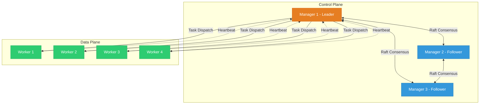
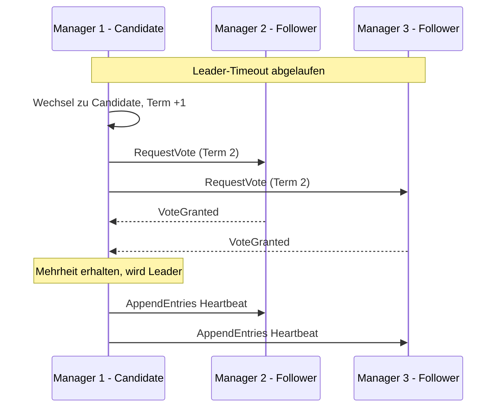
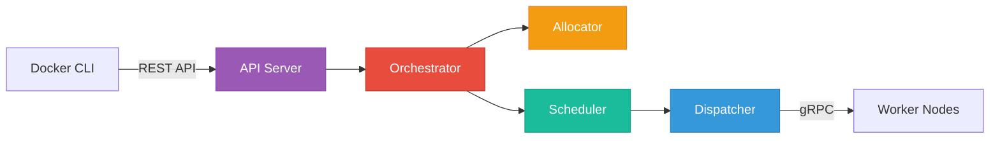
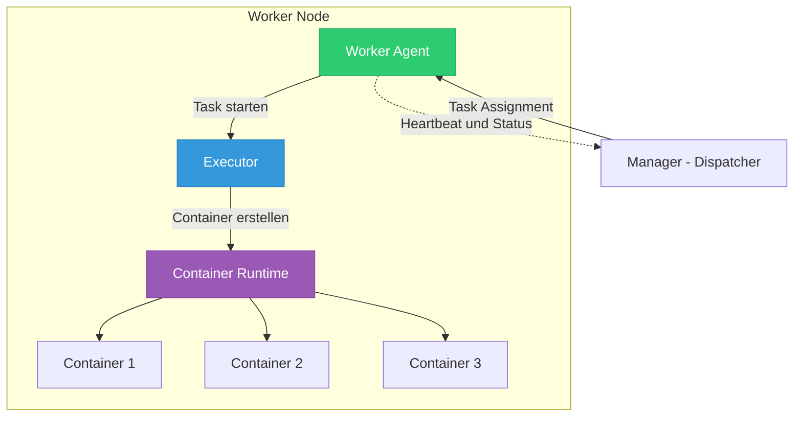
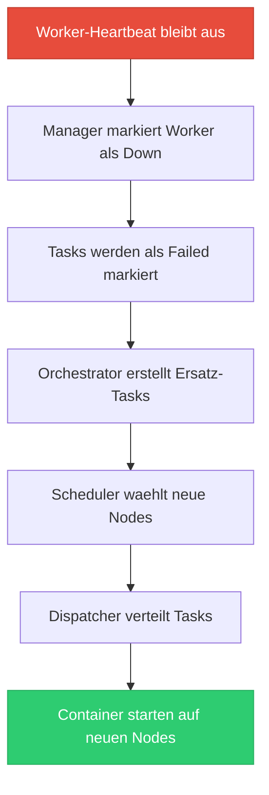
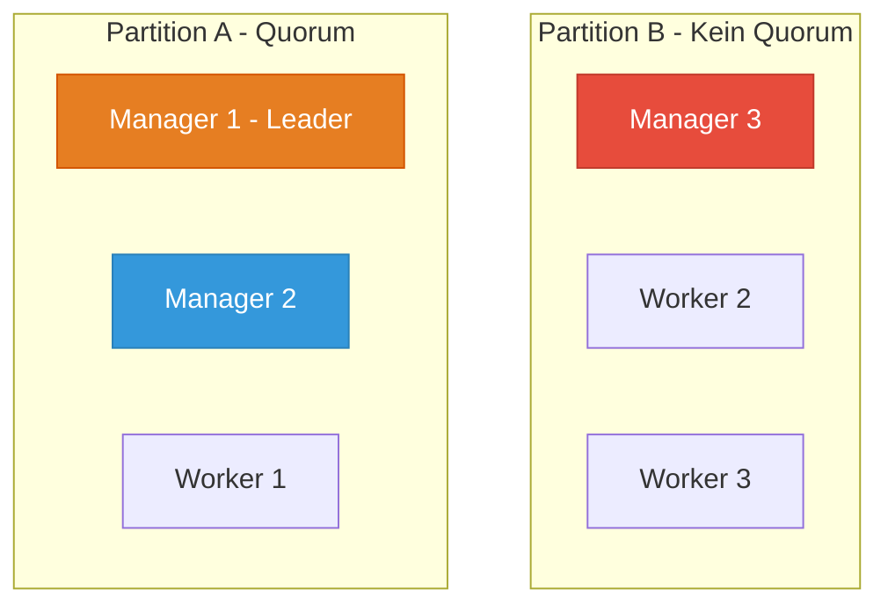

---
tags:
  - docker-swarm
  - architektur
  - raft
  - clustering
aliases:
  - Swarm Architektur
  - Docker Swarm Cluster Architektur
---

# Docker Swarm Architektur

> [!ABSTRACT] TL;DR
> Docker Swarm organisiert Container über mehrere Hosts in einem Cluster mit **Manager-** und **Worker-Nodes**. Manager nutzen den **Raft Consensus Algorithmus** für konsistente State-Verwaltung, während Worker die eigentlichen Container ausführen. Die Kommunikation läuft über verschlüsselte TLS-Verbindungen auf dedizierten Ports. Bei Ausfällen sorgt das System automatisch für Rescheduling und Failover — vorausgesetzt, das Quorum der Manager bleibt erhalten.

---

## Architektur-Überblick

Docker Swarm implementiert eine **dezentrale, aber hierarchische Cluster-Architektur**. Das Design folgt dem Prinzip der klaren Rollentrennung: Manager-Nodes übernehmen die Orchestrierung und Zustandsverwaltung, Worker-Nodes führen die eigentlichen Container-Workloads aus.

Die Architektur basiert auf drei fundamentalen Säulen:

- **Consensus Layer** — Raft-basierte Zustandssynchronisation zwischen Managern
- **Orchestration Layer** — Service-Definitionen werden in ausführbare Tasks übersetzt
- **Execution Layer** — Container werden auf den Worker-Nodes gestartet und überwacht

Ein Manager-Node kann gleichzeitig auch als Worker agieren. In Produktionsumgebungen wird dies jedoch nicht empfohlen, um die Stabilität des Consensus-Layers nicht zu gefährden.



> [!NOTE] Rollen im Überblick
> - **Leader Manager** (orange): Einziger Node, der Schreiboperationen auf den Raft-Log durchführt
> - **Follower Manager** (blau): Replizieren den State und übernehmen bei Leader-Ausfall
> - **Worker** (grün): Führen Container aus und melden ihren Status per Heartbeat

---

## Manager Nodes

Manager-Nodes sind das Gehirn des Swarm-Clusters. Sie verwalten den gesamten Cluster-State, nehmen API-Anfragen entgegen, treffen Scheduling-Entscheidungen und sorgen für die Aufrechterhaltung des gewünschten Zustands (Desired State Reconciliation).

Jeder Manager-Node enthält eine vollständige Kopie des Cluster-States. Änderungen werden über den Raft Consensus Algorithmus synchronisiert, sodass selbst bei Ausfall einzelner Manager der Cluster-State erhalten bleibt.

### Raft Consensus Algorithmus

Der **Raft Consensus Algorithmus** ist das Herzstück der Manager-Kommunikation. Er stellt sicher, dass alle Manager-Nodes denselben konsistenten State besitzen — auch bei Netzwerkpartitionen oder Node-Ausfällen.

#### Leader Election

Raft basiert auf dem Konzept eines gewählten Leaders:

1. Beim Start des Clusters oder bei Leader-Ausfall beginnt eine **Election**
2. Ein Manager-Node wechselt in den Status **Candidate** und fordert Stimmen an
3. Andere Manager stimmen ab — jeder Node kann pro Term nur einmal abstimmen
4. Der Candidate mit der **Mehrheit der Stimmen** wird zum neuen Leader
5. Der Leader sendet regelmäßig **Heartbeats**, um seine Rolle zu bestätigen



#### Log Replication

Sobald ein Leader gewählt ist, läuft die State-Synchronisation über **Log Replication**:

1. Der Client sendet eine Änderung an den Leader (z. B. `docker service create`)
2. Der Leader schreibt den Eintrag in seinen **lokalen Log**
3. Der Leader repliziert den Eintrag an alle Follower
4. Sobald die **Mehrheit** den Eintrag bestätigt, wird er **committed**
5. Der Leader wendet den Eintrag auf seinen State an und informiert den Client

> [!IMPORTANT] Committed vs. Applied
> Ein Log-Eintrag gilt als **committed**, sobald die Mehrheit der Manager ihn bestätigt hat. Erst dann wird er auf den tatsächlichen Cluster-State angewendet. Das garantiert, dass keine Daten verloren gehen — selbst wenn der Leader unmittelbar nach dem Commit ausfällt.

#### Quorum-Anforderungen

Das **Quorum** ist die Mindestanzahl an Manager-Nodes, die erreichbar sein müssen, damit der Cluster operativ bleibt. Die Formel lautet:

$$
Quorum = \lfloor \frac{N}{2} \rfloor + 1
$$

Dabei ist **N** die Gesamtzahl der Manager-Nodes.

| Manager-Nodes | Quorum | Tolerierte Ausfälle | Empfehlung |
|:-------------:|:------:|:-------------------:|:----------:|
| 1 | 1 | 0 | Nur für Dev/Test |
| 2 | 2 | 0 | Nicht empfohlen |
| 3 | 2 | 1 | Minimum für Produktion |
| 5 | 3 | 2 | Empfohlen für Produktion |
| 7 | 4 | 3 | Große Cluster |
| 9 | 5 | 4 | Selten nötig |

> [!WARNING] Gerade Anzahl vermeiden
> Eine **gerade Anzahl** an Managern (2, 4, 6) bietet keinen Vorteil gegenüber der nächstkleineren ungeraden Zahl. Zwei Manager tolerieren genauso viele Ausfälle wie ein einzelner (nämlich null). Vier Manager tolerieren genau so viele wie drei (nämlich einen). Daher sollte die Anzahl immer **ungerade** sein.

> [!TIP] Faustregel für die Praxis
> - **3 Manager** — Standard für die meisten Produktionsumgebungen
> - **5 Manager** — Wenn höhere Ausfalltoleranz nötig ist (z. B. Multi-Datacenter)
> - **7 Manager** — Nur bei sehr großen Clustern mit strikten Verfügbarkeitsanforderungen
> - **Mehr als 7** — Wird von Docker nicht empfohlen, da die Raft-Performance leidet

### Interne Manager-Komponenten

Innerhalb jedes Manager-Nodes arbeiten fünf spezialisierte Subsysteme zusammen:



#### API Server

Der **API Server** ist der Eintrittspunkt für alle externen Anfragen:

- Empfängt Befehle von `docker` CLI, Docker Compose und der Remote API
- Validiert Anfragen und prüft Berechtigungen
- Leitet Schreiboperationen an den aktuellen Leader weiter
- Lesezugriffe können von jedem Manager bedient werden

```bash
# Alle Anfragen an den Swarm laufen über den API Server
docker service create --name web --replicas 3 nginx:latest

# Status-Abfragen
docker node ls
docker service ls
```

#### Orchestrator

Der **Orchestrator** ist für die **Desired State Reconciliation** verantwortlich:

- Vergleicht den gewünschten Zustand (z. B. 3 Replicas) mit dem aktuellen Zustand
- Erstellt neue Tasks, wenn Replicas fehlen
- Entfernt überzählige Tasks
- Reagiert auf Node-Ausfälle durch Rescheduling

```bash
# Der Orchestrator erstellt 5 Tasks für diesen Service
docker service create --name api --replicas 5 my-api:v2

# Skalierung — Orchestrator erstellt oder entfernt Tasks
docker service scale api=10
```

#### Allocator

Der **Allocator** verwaltet die Zuweisung von Cluster-weiten Ressourcen:

- Weist jedem Task eine **eindeutige IP-Adresse** im Overlay-Netzwerk zu
- Verwaltet den **IP Address Management (IPAM)** Pool
- Stellt sicher, dass es keine IP-Konflikte gibt
- Arbeitet eng mit dem Netzwerk-Subsystem zusammen

#### Dispatcher

Der **Dispatcher** ist die Kommunikationsschnittstelle zu den Worker-Nodes:

- Verteilt zugewiesene Tasks an die entsprechenden Worker
- Empfängt Status-Updates und Heartbeats von den Workern
- Erkennt ausgefallene Worker anhand ausbleibender Heartbeats
- Kommuniziert über **gRPC** mit den Worker-Agents

#### Scheduler

Der **Scheduler** trifft die Entscheidung, auf welchem Node ein Task ausgeführt wird:

- Berücksichtigt **Ressourcenverfügbarkeit** (CPU, Memory)
- Wendet **Constraints** und **Placement Preferences** an
- Nutzt die **Spread-Strategie** als Standard (gleichmäßige Verteilung)
- Filtert Nodes nach Labels, Rollen und Verfügbarkeit

```bash
# Scheduler berücksichtigt Constraints
docker service create \
  --name db \
  --constraint 'node.labels.storage == ssd' \
  --constraint 'node.role == worker' \
  --replicas 3 \
  postgres:16
```

---

## Worker Nodes

Worker-Nodes sind die Arbeitspferde des Clusters. Sie führen die vom Manager zugewiesenen Tasks als Container aus und melden deren Status zurück.

Ein Worker-Node hat eine deutlich einfachere interne Architektur als ein Manager:



### Worker Agent

Der **Worker Agent** ist der zentrale Prozess auf jedem Worker-Node:

- Stellt eine **gRPC-Verbindung** zum Manager-Dispatcher her
- Empfängt Task-Zuweisungen und leitet sie an den Executor weiter
- Sendet regelmäßig **Heartbeats** an den Manager (Standard: alle 5 Sekunden)
- Meldet den aktuellen Status aller lokalen Tasks

### Executor

Der **Executor** übersetzt abstrakte Task-Definitionen in konkrete Container-Operationen:

- Zieht benötigte Images aus der Registry
- Erstellt und startet Container über die Container Runtime
- Überwacht den Lifecycle jedes Containers
- Meldet Zustandsänderungen (running, failed, completed) an den Agent

### Container Runtime

Docker Swarm nutzt die Standard-Docker Container Runtime:

- **containerd** als High-Level Runtime
- **runc** als Low-Level Runtime (OCI-kompatibel)
- Unterstützung für alle Docker-Features (Volumes, Networks, etc.)

> [!NOTE] Worker als Manager promoten
> Ein Worker-Node kann jederzeit zu einem Manager promoted werden — und umgekehrt. Dies ist nützlich, wenn Manager-Nodes ausfallen und ersetzt werden müssen.
>
> ```bash
> # Worker zum Manager promoten
> docker node promote worker-03
>
> # Manager zum Worker degradieren
> docker node demote manager-03
> ```

---

## Kommunikation im Cluster

Die Kommunikation im Swarm-Cluster ist in zwei logische Ebenen aufgeteilt: den **Control Plane** für Cluster-Management und den **Data Plane** für Anwendungsdaten.

### Control Plane

Der Control Plane steuert den Cluster-Betrieb und hält alle Nodes synchron:

| Port | Protokoll | Zweck | Teilnehmer |
|:----:|:---------:|:------|:----------:|
| 2377 | TCP | Cluster-Management und Raft | Manager untereinander |
| 2377 | TCP | Node Join und API | Manager ↔ Worker |

#### Cluster-Management (Port 2377/tcp)

Port **2377** ist der primäre Management-Port des Swarm-Clusters:

- **Raft-Protokoll** zwischen Manager-Nodes (Leader Election, Log Replication)
- **Join-Requests** von neuen Nodes, die dem Cluster beitreten
- **API-Kommunikation** zwischen Docker CLI und dem Cluster
- Verschlüsselt mit **mutual TLS** (mTLS)

```bash
# Neuen Worker zum Cluster hinzufügen (verbindet sich auf Port 2377)
docker swarm join \
  --token SWMTKN-1-xxxxxxxxxxxxx \
  manager-01:2377

# Neuen Manager zum Cluster hinzufügen
docker swarm join \
  --token SWMTKN-1-yyyyyyyyyyyyy \
  manager-01:2377
```

> [!IMPORTANT] Mutual TLS (mTLS)
> Docker Swarm verschlüsselt **alle** Control-Plane-Kommunikation automatisch mit mTLS. Dabei wird jeder Node mit einem eigenen Zertifikat ausgestattet, das vom internen Swarm-CA signiert wird. Die Zertifikate werden standardmäßig alle **90 Tage** automatisch rotiert.
>
> ```bash
> # Zertifikats-Rotationsintervall anpassen
> docker swarm update --cert-expiry 720h
>
> # Root-CA-Zertifikat manuell rotieren
> docker swarm ca --rotate
> ```

### Data Plane

Der Data Plane transportiert Daten zwischen den Containern über Host-Grenzen hinweg:

| Port | Protokoll | Zweck | Teilnehmer |
|:----:|:---------:|:------|:----------:|
| 7946 | TCP + UDP | Node Discovery und Gossip | Alle Nodes |
| 4789 | UDP | VXLAN Overlay Network | Alle Nodes |

#### Node Discovery und Gossip Protocol (Port 7946)

Port **7946** wird für die dezentrale Netzwerk-Synchronisation genutzt:

- **Gossip Protocol** (SWIM-basiert) verbreitet Netzwerk-State-Informationen
- Jeder Node tauscht regelmäßig Informationen mit zufällig gewählten Nachbarn aus
- Erkennung von Node-Ausfällen auf Netzwerkebene
- Verbreitung von Service-Discovery-Informationen

> [!NOTE] Gossip vs. Raft
> **Raft** synchronisiert den Cluster-**Management**-State (Services, Tasks, Secrets) nur zwischen Managern. **Gossip** synchronisiert den **Netzwerk**-State (welcher Container hat welche IP, welche Overlay-Netze existieren) zwischen **allen** Nodes. Beide Protokolle ergänzen sich.

#### VXLAN Overlay Network (Port 4789)

Port **4789** transportiert den eigentlichen Netzwerk-Traffic zwischen Containern auf verschiedenen Hosts:

- **VXLAN** (Virtual Extensible LAN) kapselt Layer-2-Frames in UDP-Pakete
- Ermöglicht transparente Kommunikation zwischen Containern über Host-Grenzen
- Jedes Overlay-Netzwerk erhält eine eigene **VXLAN Network Identifier (VNI)**
- Optional verschlüsselbar mit IPSec

```bash
# Verschlüsseltes Overlay-Netzwerk erstellen
docker network create \
  --driver overlay \
  --opt encrypted \
  --subnet 10.10.0.0/16 \
  secure-overlay

# Overlay-Netzwerk ohne Verschlüsselung (Standard, performanter)
docker network create \
  --driver overlay \
  --subnet 10.20.0.0/16 \
  app-network
```

> [!WARNING] Performance-Impact der Verschlüsselung
> Die Option `--opt encrypted` aktiviert **IPSec-Verschlüsselung** für den gesamten VXLAN-Traffic. Das erhöht die Sicherheit, verursacht aber einen messbaren **Performance-Overhead** (10-20% je nach Workload). Für interne Netzwerke in einem vertrauenswürdigen Rechenzentrum ist die Verschlüsselung oft nicht nötig.

### Firewall-Regeln Zusammenfassung

Folgende Ports müssen zwischen allen Swarm-Nodes freigeschaltet sein:

```bash
# Firewall-Regeln für Docker Swarm (iptables)
# Cluster Management (nur zwischen Managern + Join-Requests)
iptables -A INPUT -p tcp --dport 2377 -j ACCEPT

# Node Discovery (alle Nodes)
iptables -A INPUT -p tcp --dport 7946 -j ACCEPT
iptables -A INPUT -p udp --dport 7946 -j ACCEPT

# Overlay Network (alle Nodes)
iptables -A INPUT -p udp --dport 4789 -j ACCEPT
```

```bash
# Firewall-Regeln für Docker Swarm (firewalld)
firewall-cmd --permanent --add-port=2377/tcp
firewall-cmd --permanent --add-port=7946/tcp
firewall-cmd --permanent --add-port=7946/udp
firewall-cmd --permanent --add-port=4789/udp
firewall-cmd --reload
```

---

## Cluster State und Raft Log

Der gesamte Zustand des Swarm-Clusters wird in einem **internen verteilten Key-Value Store** gespeichert, der auf jedem Manager-Node repliziert ist.

### Was wird gespeichert?

Der Cluster-State umfasst:

- **Node-Informationen** — Registrierte Nodes, Rollen, Verfügbarkeit
- **Service-Definitionen** — Desired State aller Services
- **Task-Zuweisungen** — Welcher Task auf welchem Node läuft
- **Netzwerk-Konfiguration** — Overlay-Netzwerke, IP-Zuweisungen
- **Secrets und Configs** — Verschlüsselt gespeicherte sensible Daten
- **TLS-Zertifikate** — CA-Zertifikate und Node-Zertifikate

### Speicherort

Der Raft-State wird auf jedem Manager-Node lokal gespeichert:

```text
/var/lib/docker/swarm/
├── certificates/          # TLS-Zertifikate (CA, Node-Cert, Key)
│   ├── swarm-node.crt
│   ├── swarm-node.key
│   └── swarm-root-ca.crt
├── raft/                  # Raft-Log und Snapshots
│   ├── snap-v3-encrypted/ # Verschlüsselte Snapshots
│   └── wal-v3-encrypted/  # Write-Ahead-Log (verschlüsselt)
├── state.json             # Lokaler Node-State
└── worker/                # Worker-spezifische Daten
```

> [!IMPORTANT] Verschlüsselung at Rest
> Seit Docker 1.13 werden die Raft-Logs und Snapshots **standardmäßig verschlüsselt** auf der Festplatte gespeichert. Der Encryption Key wird über den Raft-Consensus selbst verteilt. Um die Verschlüsselung zusätzlich zu verstärken, kann **Autolock** aktiviert werden.
>
> ```bash
> # Autolock aktivieren (erfordert manuelles Unlock nach Neustart)
> docker swarm update --autolock=true
>
> # Unlock-Key anzeigen (sicher aufbewahren!)
> docker swarm unlock-key
>
> # Node nach Neustart entsperren
> docker swarm unlock
> ```

### Backup und Restore

Regelmäßige Backups des Swarm-States sind essenziell für die Disaster Recovery:

```bash
# Backup: Swarm-Verzeichnis sichern (auf einem Manager-Node)
sudo systemctl stop docker
sudo cp -a /var/lib/docker/swarm /backup/swarm-$(date +%Y%m%d)
sudo systemctl start docker
```

```bash
# Restore: Swarm aus Backup wiederherstellen
sudo systemctl stop docker
sudo rm -rf /var/lib/docker/swarm
sudo cp -a /backup/swarm-20260305 /var/lib/docker/swarm
sudo systemctl start docker

# Cluster mit dem wiederhergestellten State neu initialisieren
docker swarm init --force-new-cluster
```

> [!WARNING] Backup-Strategie
> - Docker muss während des Backups **gestoppt** sein, um einen konsistenten Snapshot zu erhalten
> - Backups sollten regelmäßig erstellt werden (mindestens **täglich** in Produktion)
> - Den **Unlock-Key** separat und sicher aufbewahren (Passwort-Manager, Vault)
> - Backups auf einem **externen Speicher** ablegen (nicht auf dem gleichen Host)

---

## Scheduling Strategien

Der Scheduler entscheidet, auf welchem Node ein neuer Task platziert wird. Er berücksichtigt dabei mehrere Faktoren in einer definierten Reihenfolge.

### Spread-Strategie (Standard)

Die Standard-Strategie verteilt Tasks **gleichmäßig** über alle verfügbaren Nodes:

- Bevorzugt Nodes mit den **wenigsten aktiven Tasks** des gleichen Services
- Maximiert die Ausfalltoleranz (ein Node-Ausfall betrifft weniger Replicas)
- Nutzt die Cluster-Ressourcen gleichmäßig aus

```bash
# 6 Replicas werden gleichmäßig auf verfügbare Worker verteilt
docker service create \
  --name web \
  --replicas 6 \
  nginx:latest

# Ergebnis bei 3 Workern: je 2 Replicas pro Worker
```

### Constraints

Constraints **schränken ein**, auf welchen Nodes ein Service laufen darf:

```bash
# Nur auf Worker-Nodes
docker service create \
  --constraint 'node.role == worker' \
  --name api \
  my-api:latest

# Nur auf Nodes mit bestimmtem Label
docker node update --label-add zone=eu-west worker-01
docker node update --label-add zone=eu-west worker-02

docker service create \
  --constraint 'node.labels.zone == eu-west' \
  --name regional-api \
  my-api:latest

# Nicht auf einem bestimmten Node
docker service create \
  --constraint 'node.hostname != worker-03' \
  --name web \
  nginx:latest

# Mehrere Constraints (AND-Verknüpfung)
docker service create \
  --constraint 'node.role == worker' \
  --constraint 'node.labels.storage == ssd' \
  --name db \
  postgres:16
```

### Placement Preferences

Placement Preferences steuern die **Verteilung über Label-Gruppen**:

```bash
# Gleichmäßig über Availability Zones verteilen
docker service create \
  --placement-pref 'spread=node.labels.zone' \
  --replicas 6 \
  --name ha-web \
  nginx:latest

# Ergebnis: Je 2 Replicas in zone=eu-west, zone=eu-central, zone=eu-east
```

### Resource Reservations und Limits

Der Scheduler berücksichtigt Ressourcen-Anforderungen bei der Platzierung:

```bash
# CPU- und Memory-Limits setzen
docker service create \
  --name api \
  --replicas 4 \
  --reserve-cpu 0.5 \
  --reserve-memory 256M \
  --limit-cpu 1.0 \
  --limit-memory 512M \
  my-api:latest
```

| Parameter | Beschreibung |
|:----------|:-------------|
| `--reserve-cpu` | Garantierte CPU-Anteile (Scheduling-Grundlage) |
| `--reserve-memory` | Garantierter Arbeitsspeicher (Scheduling-Grundlage) |
| `--limit-cpu` | Maximale CPU-Nutzung (Hard-Limit) |
| `--limit-memory` | Maximaler Arbeitsspeicher (OOM-Kill bei Überschreitung) |

> [!TIP] Best Practice für Scheduling
> - **Immer Reservations setzen**, damit der Scheduler realistische Entscheidungen trifft
> - **Node-Labels** für physische Eigenschaften verwenden (SSD, GPU, Zone)
> - **Placement Preferences** für High Availability über Zonen hinweg nutzen
> - **Constraints** sparsam einsetzen — zu viele schränken die Flexibilität ein

---

## Failover und Recovery

Docker Swarm implementiert automatische Failover-Mechanismen auf mehreren Ebenen. Das Verständnis dieser Mechanismen ist entscheidend für den stabilen Betrieb.

### Manager-Ausfall

Was passiert, wenn ein Manager-Node ausfällt, hängt von seiner Rolle und dem verbleibenden Quorum ab:

#### Follower-Ausfall

- Der Cluster arbeitet **normal weiter**, solange das Quorum erhalten bleibt
- Der ausgefallene Node wird als **unreachable** markiert
- Kein automatisches Rescheduling nötig (Follower führen keine Tasks aus, sofern korrekt konfiguriert)
- Nach Wiederherstellung synchronisiert sich der Node automatisch

#### Leader-Ausfall

1. Die verbleibenden Manager erkennen den Ausfall (ausbleibende Heartbeats)
2. Eine neue **Leader Election** wird ausgelöst
3. Ein neuer Leader wird gewählt (typisch innerhalb von **1-5 Sekunden**)
4. Der neue Leader übernimmt alle Leader-Aufgaben
5. Während der Election sind **keine Schreiboperationen** möglich

```bash
# Cluster-Status nach Manager-Ausfall prüfen
docker node ls

# Beispiel-Ausgabe:
# ID            HOSTNAME     STATUS    AVAILABILITY   MANAGER STATUS
# abc123 *     manager-01   Ready     Active         Leader
# def456       manager-02   Ready     Active         Reachable
# ghi789       manager-03   Down      Active         Unreachable
```

#### Quorum-Verlust

> [!DANGER] Kritischer Zustand: Quorum verloren
> Wenn die **Mehrheit** der Manager-Nodes ausfällt, verliert der Cluster sein Quorum. In diesem Zustand:
>
> - **Keine neuen Tasks** können erstellt oder geändert werden
> - **Bestehende Container laufen weiter** auf den Worker-Nodes
> - **Kein Rescheduling** bei Worker-Ausfällen möglich
> - Der Cluster ist effektiv **read-only**
>
> Dieser Zustand muss so schnell wie möglich behoben werden.

### Worker-Ausfall

Der Umgang mit Worker-Ausfällen ist unkomplizierter:

1. Der Manager erkennt ausbleibende Heartbeats (Timeout: ca. **5 Sekunden**)
2. Der Worker wird als **Down** markiert
3. Alle Tasks des ausgefallenen Workers werden als **failed** markiert
4. Der Orchestrator erstellt **neue Tasks** als Ersatz
5. Der Scheduler platziert die neuen Tasks auf den **verbleibenden Workern**



> [!NOTE] Drain-Modus für geplante Wartung
> Bevor ein Worker-Node gewartet wird, sollte er in den **Drain**-Modus versetzt werden. Dadurch werden alle Tasks kontrolliert auf andere Nodes verschoben.
>
> ```bash
> # Node in den Drain-Modus versetzen
> docker node update --availability drain worker-02
>
> # Nach der Wartung wieder aktivieren
> docker node update --availability active worker-02
> ```

### Split-Brain-Szenarien

Ein **Split-Brain** tritt auf, wenn eine Netzwerkpartition den Cluster in zwei Gruppen teilt, die sich gegenseitig nicht mehr erreichen können:



**Verhalten bei Split-Brain (3 Manager):**

- **Partition A** (2 Manager): Behält das Quorum → Cluster arbeitet normal weiter
- **Partition B** (1 Manager): Kein Quorum → Kann keine Änderungen vornehmen
- Bestehende Container in Partition B **laufen weiter**, aber kein Rescheduling möglich
- Nach Wiederherstellung der Netzwerkverbindung synchronisieren sich die Partitionen automatisch

> [!WARNING] Schutz vor Split-Brain
> - Manager-Nodes **über verschiedene Availability Zones** verteilen
> - **Ungerade Anzahl** an Managern verwenden (3, 5 oder 7)
> - **Netzwerk-Redundanz** sicherstellen (mehrere NICs, verschiedene Switches)
> - Monitoring für Netzwerkpartitionen einrichten

### Force-New-Cluster Recovery

Wenn das Quorum unwiderruflich verloren ist (z. B. bei einem Totalausfall der Mehrheit der Manager), kann der Cluster mit einem einzelnen verbleibenden Manager neu gestartet werden:

```bash
# ACHTUNG: Nur als letzter Ausweg verwenden!
# Stoppt den Docker-Daemon
sudo systemctl stop docker

# Startet den Cluster auf diesem Node neu
# Der aktuelle Node wird zum einzigen Manager und Leader
docker swarm init --force-new-cluster --advertise-addr <IP>
```

> [!DANGER] Force-New-Cluster — Nur im Notfall
> Dieser Befehl erstellt einen **komplett neuen Raft-Cluster** mit dem aktuellen Node als einzigem Manager. Dabei gehen:
>
> - Alle **Raft-Logs** der anderen Manager verloren
> - Nicht-committete Änderungen gehen verloren
> - Der Cluster muss danach durch Hinzufügen neuer Manager **neu aufgebaut** werden
>
> ```bash
> # Nach Force-New-Cluster: Neue Manager hinzufügen
> docker swarm join-token manager
> # Token auf den neuen Manager-Nodes verwenden
> ```

---

## Zusammenfassung der Architektur-Komponenten

| Komponente | Ebene | Funktion |
|:-----------|:-----:|:---------|
| API Server | Manager | Empfängt und validiert CLI-Befehle |
| Orchestrator | Manager | Desired State Reconciliation |
| Allocator | Manager | IP-Adresszuweisung im Overlay-Netz |
| Scheduler | Manager | Node-Auswahl für Task-Platzierung |
| Dispatcher | Manager | Task-Verteilung an Worker |
| Raft Consensus | Manager | Konsistente State-Replikation |
| Worker Agent | Worker | Kommunikation mit Manager |
| Executor | Worker | Container-Lifecycle-Management |
| Container Runtime | Worker | containerd/runc Ausführung |
| Gossip Protocol | Alle | Netzwerk-State-Verteilung |
| VXLAN | Alle | Overlay-Netzwerk-Transport |

---

## Verwandte Notizen

- [[Docker Swarm Index]] — Übersicht aller Docker-Swarm-Dokumentationen
- [[Was ist Docker Swarm]] — Einführung und Kernkonzepte
- [[Swarm Networking]] — Overlay-Netzwerke und Routing Mesh
- [[Docker Swarm HA Installation]] — Hochverfügbare Cluster-Installation
- [[Docker Architektur]]