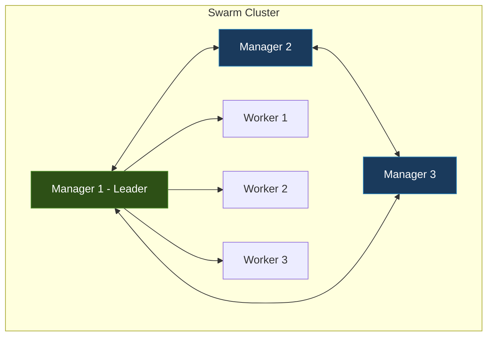
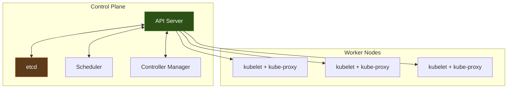
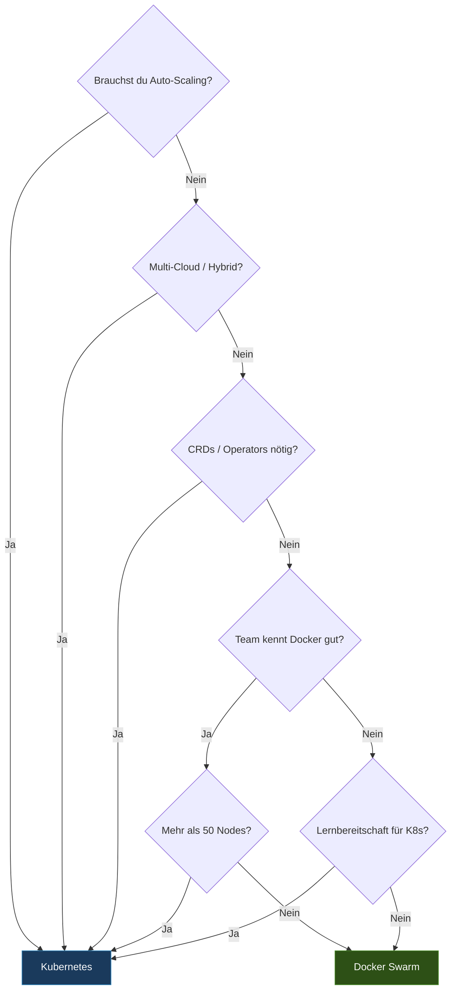

---
tags:
  - docker-swarm
  - kubernetes
  - vergleich
  - orchestrierung
aliases:
  - Swarm vs K8s
---

# Swarm vs Kubernetes

> [!ABSTRACT]
> Detaillierter Vergleich beider Container-Orchestrierungsplattformen — Architektur, Features, Stärken und Schwächen. Hilft bei der Entscheidung, wann welche Lösung die richtige Wahl ist.

---

## Architektur-Vergleich

### Docker Swarm Architektur



- **Manager Nodes**: Cluster-Verwaltung via Raft Consensus
- **Worker Nodes**: Führen Tasks (Container) aus
- **Integriert**: Kein zusätzliches Tool nötig — Teil der Docker Engine

### Kubernetes Architektur



- **Control Plane**: Mehrere spezialisierte Komponenten
- **Worker Nodes**: kubelet kommuniziert mit API Server
- **Modular**: Austauschbare Komponenten (CNI, CSI, CRI)

---

## Feature-Vergleich

| Feature | Docker Swarm | Kubernetes |
|---------|-------------|------------|
| **Setup-Komplexität** | ⭐ Einfach — `docker swarm init` | Komplex — kubeadm, k3s, oder Managed Service |
| **Lernkurve** | ⭐ Flach — Docker-Kenntnisse reichen | Steil — viele neue Konzepte (Pods, Deployments, etc.) |
| **Minimale Cluster-Größe** | 1 Node | 1 Node (k3s) bis 3+ Nodes |
| **Service Discovery** | Internes DNS, VIP | CoreDNS, Services (ClusterIP, NodePort, LoadBalancer) |
| **Load Balancing** | ⭐ Routing Mesh (Built-in) | Services + Ingress Controller (extra) |
| **Networking** | Overlay (VXLAN) | CNI-Plugins (Flannel, Calico, Cilium) |
| **Storage** | Volumes, NFS, Volume Plugins | PV, PVC, StorageClasses, CSI |
| **Secrets** | Docker Secrets (verschlüsselt im Raft Log) | Kubernetes Secrets (Base64, optional verschlüsselt) |
| **Configs** | Docker Configs | ConfigMaps |
| **Rolling Updates** | ✅ Nativ | ✅ Nativ + mehr Optionen |
| **Rollbacks** | ✅ `docker service rollback` | ✅ `kubectl rollout undo` |
| **Auto-Scaling** | ❌ Nur manuell | ✅ HPA, VPA, Cluster Autoscaler |
| **Health Checks** | HEALTHCHECK im Dockerfile | Liveness, Readiness, Startup Probes |
| **Ingress** | Routing Mesh (Layer 4) | Ingress Controller (Layer 7) |
| **TLS-Zertifikate** | ⭐ Automatisch (Mutual TLS) | Manuell oder Cert-Manager |
| **Monitoring** | Prometheus + cAdvisor (manuell) | Prometheus Operator, Metrics Server |
| **Logging** | Docker Log-Treiber | Loki, EFK/ELK Stack |
| **Package Manager** | ❌ Keiner | Helm |
| **Custom Resources** | ❌ Nicht möglich | ✅ CRDs und Operators |
| **Multi-Cloud** | ❌ Begrenzt | ✅ Federation, Multi-Cluster |
| **Service Mesh** | ❌ Nicht nativ | ✅ Istio, Linkerd, Cilium |
| **GitOps** | ❌ Begrenzt | ✅ ArgoCD, FluxCD |
| **Dashboard** | Visualizer (basic) | Kubernetes Dashboard, Lens, Portainer |
| **CLI-Tool** | `docker` (service, stack, node) | `kubectl` |
| **Community** | Klein, Docker Inc. | ⭐ Riesig, CNCF, alle Cloud-Provider |
| **CNCF-Zertifizierung** | ❌ | ✅ Certified Kubernetes |

---

## Stärken von Docker Swarm

### Einfachheit

```bash
# Cluster in 30 Sekunden
docker swarm init
docker swarm join --token <TOKEN> <MANAGER-IP>:2377

# Service deployen
docker service create --name web --replicas 5 -p 80:80 nginx:alpine
```

> [!TIP] Kein Extra-Tooling
> Docker Swarm ist in jeder Docker-Installation ab Version 1.12 enthalten. Kein `kubeadm`, kein `helm`, kein Ingress Controller — einfach `docker swarm init` und los.

### Docker-Compose-Kompatibilität

Bestehende `compose.yaml`-Dateien können (fast) direkt als Swarm Stacks deployed werden:

```bash
docker stack deploy -c compose.yaml myapp
```

### Geringer Resource-Overhead

| Metrik | Docker Swarm | Kubernetes (k3s) | Kubernetes (kubeadm) |
|--------|-------------|-------------------|---------------------|
| RAM Manager | ~50 MB zusätzlich zum Docker Daemon | ~512 MB | ~1.5 GB |
| CPU Manager | Minimal | Gering | Moderat |
| Disk Manager | ~100 MB | ~200 MB | ~500 MB |
| Zusätzliche Pods | 0 | ~15 | ~30+ |

### Automatische Sicherheit

- Mutual TLS zwischen allen Nodes — ohne Konfiguration
- Automatische Certificate Rotation
- Verschlüsselter Raft-Log für Secrets
- Autolock für zusätzlichen Schutz

---

## Stärken von Kubernetes

### Ecosystem und Community

| Bereich | Projekte |
|---------|----------|
| **Networking** | Calico, Cilium, Flannel, Weave |
| **Storage** | Longhorn, Rook/Ceph, OpenEBS |
| **Monitoring** | Prometheus, Grafana, Thanos |
| **Service Mesh** | Istio, Linkerd, Cilium |
| **GitOps** | ArgoCD, FluxCD |
| **Security** | Falco, OPA/Gatekeeper, Kyverno |
| **Package Manager** | Helm |

### Auto-Scaling

```yaml
apiVersion: autoscaling/v2
kind: HorizontalPodAutoscaler
metadata:
  name: web-hpa
spec:
  scaleTargetRef:
    apiVersion: apps/v1
    kind: Deployment
    name: web
  minReplicas: 2
  maxReplicas: 20
  metrics:
    - type: Resource
      resource:
        name: cpu
        target:
          type: Utilization
          averageUtilization: 70
```

> [!NOTE] Swarm-Äquivalent
> Docker Swarm bietet **kein Auto-Scaling**. Skalierung erfolgt nur manuell mit `docker service scale web=10`.

### Custom Resource Definitions (CRDs)

Kubernetes ist durch CRDs beliebig erweiterbar — Swarm hat keinen Erweiterungsmechanismus:

```yaml
apiVersion: cert-manager.io/v1
kind: Certificate
metadata:
  name: my-cert
spec:
  secretName: my-cert-tls
  issuerRef:
    name: letsencrypt-prod
    kind: ClusterIssuer
  dnsNames:
    - app.example.com
```

### Multi-Cloud & Hybrid

- Managed Kubernetes bei jedem Cloud-Provider (EKS, AKS, GKE)
- Cluster Federation für Multi-Cluster
- Konsistente API überall

---

## Wann Docker Swarm wählen?

| Kriterium | Empfehlung |
|-----------|------------|
| Team-Größe | Kleine Teams (1-5 Personen) |
| Cluster-Größe | Bis ~50 Nodes |
| Workload | Einfache Web-Apps, Microservices |
| Infrastruktur | On-Premises, Single-Datacenter |
| Docker-Erfahrung | Vorhanden |
| Kubernetes-Erfahrung | Nicht vorhanden |
| Budget | Begrenzt (kein Managed K8s) |
| Time-to-Production | Sofort |

> [!TIP] Ideales Szenario
> Ein kleines Team betreibt 10-20 Services auf eigener Hardware, hat Docker-Erfahrung und braucht kein Auto-Scaling oder Service Mesh.

---

## Wann Kubernetes wählen?

| Kriterium | Empfehlung |
|-----------|------------|
| Team-Größe | Mittel bis groß (5+ Personen) |
| Cluster-Größe | Unbegrenzt skalierbar |
| Workload | Komplexe Microservices, ML, Big Data |
| Infrastruktur | Multi-Cloud, Hybrid |
| Anforderungen | Auto-Scaling, Service Mesh, GitOps |
| Langfristigkeit | Strategische Plattform-Entscheidung |
| Ecosystem | CNCF-Tools gewünscht |

> [!TIP] K3s als Einstieg
> Wer Kubernetes-Features mit Swarm-ähnlicher Einfachheit möchte, sollte [[Kubernetes Distributionen|K3s]] evaluieren — ein leichtgewichtiger Kubernetes mit einfacher Installation.

---

## Entscheidungs-Flowchart



---

## Migration von Swarm zu Kubernetes

### Konzept-Mapping

| Docker Swarm | Kubernetes |
|-------------|------------|
| Swarm Cluster | Kubernetes Cluster |
| Manager Node | Control Plane Node |
| Worker Node | Worker Node |
| Service (replicated) | Deployment + Service |
| Service (global) | DaemonSet |
| Task | Pod |
| Stack | Helm Chart / Kustomize |
| Overlay Network | CNI Network + NetworkPolicy |
| Docker Secret | Kubernetes Secret |
| Docker Config | ConfigMap |
| Routing Mesh | Ingress Controller |
| `docker stack deploy` | `kubectl apply` / `helm install` |

### Kompose — Automatische Konvertierung

```bash
# Kompose installieren
curl -L https://github.com/kubernetes/kompose/releases/latest/download/kompose-linux-amd64 \
  -o /usr/local/bin/kompose && chmod +x /usr/local/bin/kompose

# Compose-File konvertieren
kompose convert -f compose.yaml

# Direkt deployen
kompose up
```

> [!WARNING] Kompose-Limitierungen
> Kompose konvertiert die Grundstruktur, aber Swarm-spezifische Features (`deploy.placement`, `deploy.update_config`) müssen manuell in K8s-Manifeste übersetzt werden.

### Migrationspfad


1. **Inventar**: Alle Stacks und Services dokumentieren
2. **Konvertieren**: Kompose als Ausgangspunkt
3. **Anpassen**: Health Checks, Resources, Ingress, Secrets
4. **Testen**: Parallel-Betrieb im Staging
5. **Migrieren**: Service für Service umziehen
6. **Abschalten**: Swarm Cluster nach vollständiger Migration entfernen

---

## Fazit

| Aspekt | Docker Swarm | Kubernetes |
|--------|-------------|------------|
| **Einfachheit** | ⭐⭐⭐⭐⭐ | ⭐⭐ |
| **Features** | ⭐⭐⭐ | ⭐⭐⭐⭐⭐ |
| **Ecosystem** | ⭐⭐ | ⭐⭐⭐⭐⭐ |
| **Skalierbarkeit** | ⭐⭐⭐ | ⭐⭐⭐⭐⭐ |
| **Zukunftssicherheit** | ⭐⭐ | ⭐⭐⭐⭐⭐ |

> [!IMPORTANT] Keine falsche Wahl
> Docker Swarm ist nicht „schlechter" als Kubernetes — es hat einen anderen Fokus. Für einfache Deployments mit wenig Overhead ist Swarm oft die pragmatischere Wahl. Kubernetes glänzt bei Skalierung, Erweiterbarkeit und Ecosystem.

---

## Verwandte Notizen

- [[Docker Swarm Index]]
- [[Was ist Docker Swarm]]
- [[Kubernetes Index]]
- [[Was ist Kubernetes]]
- [[Kubernetes vs Docker und Docker Swarm]]
- [[Kubernetes Distributionen]]
- [[Docker Compose]] — Lokale Orchestrierung als Vorstufe zu Swarm
