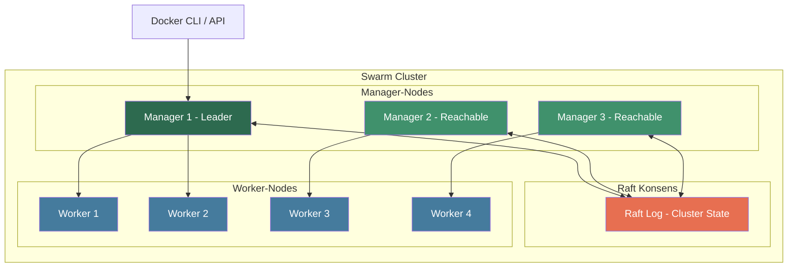
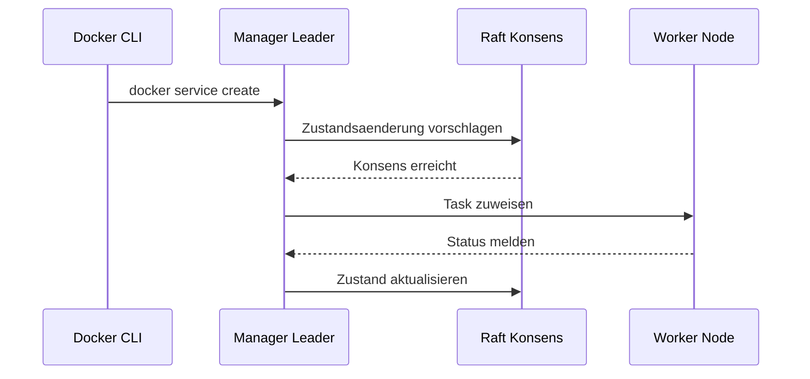

# Was ist Docker Swarm

> [!ABSTRACT]
> Docker Swarm (offiziell **Swarm Mode**) ist die native Container-Orchestrierungslösung, die seit Docker Engine v1.12 (Juli 2016) direkt integriert ist. Swarm verwandelt mehrere Docker-Hosts in einen einzigen virtuellen Host und ermöglicht deklaratives Service-Management, automatisches Load Balancing, Service Discovery und Self-Healing — ohne zusätzliche Software. Diese Dokumentation erklärt die Kernkonzepte, Vorteile, typische Einsatzszenarien und die Architektur von Docker Swarm.

---

## Was ist Docker Swarm?

Docker Swarm ist die **eingebaute Cluster- und Orchestrierungslösung** der Docker Engine. Mit einem einzigen Befehl lässt sich ein bestehender Docker-Host in einen Swarm-Manager verwandeln, dem weitere Nodes beitreten können.

### Swarm Mode vs. Standalone Swarm

> [!IMPORTANT]
> Es gibt zwei verschiedene Technologien mit dem Namen "Docker Swarm":
>
> - **Docker Swarm Mode** (ab v1.12, 2016) — direkt in die Docker Engine integriert, aktiv gewartet
> - **Docker Swarm Standalone** (Legacy) — separates Tool, seit 2017 **deprecated** und nicht mehr empfohlen
>
> In dieser Dokumentation bezieht sich "Docker Swarm" immer auf den **Swarm Mode**.

Der Swarm Mode wurde als Antwort auf die wachsende Komplexität von Container-Deployments entwickelt. Während standalone Docker nur einzelne Container auf einem Host verwaltet, ermöglicht Swarm Mode:

- **Cluster-Management** über mehrere Hosts
- **Deklarative Service-Definitionen** (gewünschter Zustand wird beschrieben)
- **Automatische Verteilung** von Containern auf verfügbare Nodes
- **Integrierte Verschlüsselung** der Cluster-Kommunikation

### Swarm initialisieren

Ein Swarm-Cluster wird mit einem einzigen Befehl erstellt:

```bash
# Swarm auf dem ersten Node initialisieren
docker swarm init --advertise-addr 192.168.1.10

# Ausgabe enthält den Join-Token für Worker-Nodes
# docker swarm join --token SWMTKN-1-xxx 192.168.1.10:2377
```

```bash
# Worker-Nodes dem Cluster hinzufügen
docker swarm join --token SWMTKN-1-xxx 192.168.1.10:2377

# Manager-Token anzeigen (für weitere Manager)
docker swarm join-token manager
```

> [!TIP]
> Der `docker swarm init` Befehl konfiguriert automatisch TLS-Zertifikate, generiert Join-Tokens und startet den Raft-Konsens-Algorithmus. Es ist keine zusätzliche Konfiguration nötig.

---

## Kernkonzepte

### Manager- und Worker-Nodes

Ein Swarm-Cluster besteht aus zwei Typen von Nodes:

**Manager-Nodes:**

- Verwalten den Cluster-Zustand über den **Raft-Konsens-Algorithmus**
- Planen und verteilen Tasks (Scheduling)
- Stellen die API-Endpunkte bereit
- Können auch Container ausführen (standardmäßig aktiv)

**Worker-Nodes:**

- Führen die ihnen zugewiesenen Container (Tasks) aus
- Melden ihren Status an die Manager zurück
- Haben keinen Zugriff auf die Cluster-Verwaltung

```bash
# Alle Nodes im Cluster anzeigen
docker node ls

# Node-Details inspizieren
docker node inspect worker-01 --pretty

# Node zum Manager befördern
docker node promote worker-02

# Manager zum Worker degradieren
docker node demote manager-03
```

### Raft-Konsens und Quorum

Die Manager-Nodes verwenden den **Raft-Konsens-Algorithmus**, um sich auf den aktuellen Cluster-Zustand zu einigen. Damit der Cluster funktionsfähig bleibt, muss eine **Mehrheit** (Quorum) der Manager erreichbar sein.

| Manager-Nodes | Quorum (Mehrheit) | Tolerierte Ausfälle |
|:-:|:-:|:-:|
| 1 | 1 | 0 |
| 3 | 2 | 1 |
| 5 | 3 | 2 |
| 7 | 4 | 3 |

> [!WARNING]
> Verwende immer eine **ungerade Anzahl** von Manager-Nodes (3, 5 oder 7). Eine gerade Anzahl bietet keine zusätzliche Ausfalltoleranz, erhöht aber den Kommunikations-Overhead. Docker empfiehlt **maximal 7 Manager-Nodes**.

### Services vs. Container

In Docker Swarm arbeitet man nicht direkt mit Containern, sondern mit **Services**:

| Konzept | Beschreibung |
|---|---|
| **Service** | Deklarative Definition des gewünschten Zustands (Image, Replicas, Netzwerk, Ports) |
| **Task** | Eine einzelne Instanz eines Services — entspricht einem laufenden Container |
| **Replica** | Die Anzahl der gewünschten Task-Instanzen eines Services |

```bash
# Service mit 3 Replicas erstellen
docker service create \
  --name web \
  --replicas 3 \
  --publish 80:80 \
  nginx:alpine

# Services auflisten
docker service ls

# Tasks eines Services anzeigen
docker service ps web

# Service skalieren
docker service scale web=5
```

Es gibt zwei Service-Modi:

- **Replicated Mode** (Standard): Eine definierte Anzahl von Replicas wird über den Cluster verteilt
- **Global Mode**: Genau ein Task wird auf **jedem** Node im Cluster ausgeführt (z.B. für Monitoring-Agents)

```bash
# Global Service erstellen (läuft auf jedem Node)
docker service create \
  --name monitoring-agent \
  --mode global \
  datadog/agent:latest
```

### Desired State Reconciliation

Docker Swarm arbeitet nach dem Prinzip der **Desired State Reconciliation** (Soll-Ist-Abgleich):

1. Der Administrator definiert den **gewünschten Zustand** (z.B. "3 Replicas von nginx")
2. Der Swarm-Manager überwacht kontinuierlich den **aktuellen Zustand**
3. Bei Abweichungen werden automatisch Korrekturmaßnahmen eingeleitet

> [!NOTE]
> Dieses deklarative Modell ermöglicht **Self-Healing**: Fällt ein Node aus, werden dessen Tasks automatisch auf andere verfügbare Nodes neu verteilt. Der Administrator muss nicht manuell eingreifen.

Beispiele für automatische Korrekturen:

- **Container stürzt ab** → Swarm startet einen neuen Task
- **Node fällt aus** → Tasks werden auf andere Nodes umverteilt
- **Netzwerk-Partition** → Manager gleichen den Zustand nach Wiederherstellung ab

```bash
# Gewünschten Zustand aktualisieren (Rolling Update)
docker service update \
  --image nginx:1.25-alpine \
  --update-parallelism 2 \
  --update-delay 10s \
  web
```

---

## Vorteile von Docker Swarm

### Einfachheit

Docker Swarm ist direkt in die Docker Engine integriert — es sind **keine zusätzlichen Tools oder Installationen** nötig. Wer Docker kennt, kann Swarm sofort nutzen:

```bash
# Vom einzelnen Docker-Host zum Cluster in 2 Befehlen
docker swarm init                          # Manager erstellen
docker swarm join --token <token> <ip>     # Worker hinzufügen
```

### Schnelles Setup

Ein produktionsfähiger Cluster lässt sich in **wenigen Minuten** aufsetzen:

- Keine separate Control-Plane-Installation
- Keine etcd-Konfiguration (Raft ist integriert)
- Keine zusätzlichen Netzwerk-Plugins nötig
- Join-Tokens werden automatisch generiert

### Docker-Compose-Kompatibilität

Swarm verwendet das gleiche Compose-File-Format (Version 3+) für Stack-Deployments:

```yaml
# docker-stack.yml
version: "3.8"

services:
  web:
    image: nginx:alpine
    deploy:
      replicas: 3
      update_config:
        parallelism: 2
        delay: 10s
      restart_policy:
        condition: on-failure
    ports:
      - "80:80"
    networks:
      - frontend

networks:
  frontend:
    driver: overlay
```

```bash
# Stack deployen (wie docker-compose, aber im Cluster)
docker stack deploy -c docker-stack.yml myapp

# Stacks auflisten
docker stack ls

# Stack-Services anzeigen
docker stack services myapp
```

> [!TIP]
> Bestehende `docker-compose.yml` Dateien können mit minimalen Anpassungen (Hinzufügen der `deploy`-Sektion) als Swarm-Stacks verwendet werden.

### Geringer Ressourcen-Overhead

Docker Swarm benötigt im Vergleich zu Kubernetes deutlich weniger Ressourcen:

| Ressource | Docker Swarm | Kubernetes |
|---|---|---|
| **RAM (Swarm-Overhead)** | ~50–100 MB zusätzlich | ~1,5–3 GB |
| **CPU (Control Plane)** | Minimal | 2+ Cores empfohlen |
| **Zusätzliche Komponenten** | Keine | etcd, kube-proxy, CoreDNS, ... |
| **Minimale Node-Anzahl** | 1 | 3 (für HA) |

### Integrierte Security

Swarm bietet von Anfang an umfassende Sicherheitsfunktionen:

- **Automatisches mTLS**: Alle Node-zu-Node-Kommunikation ist verschlüsselt
- **Zertifikats-Rotation**: TLS-Zertifikate werden automatisch erneuert (Standard: 90 Tage)
- **Join-Tokens**: Nodes können nur mit gültigem Token beitreten
- **Secrets Management**: Verschlüsselte Speicherung sensibler Daten im Raft-Log
- **Encrypted Overlay Networks**: Optionale Verschlüsselung des Datenverkehrs zwischen Containern

```bash
# Zertifikats-Rotation konfigurieren (z.B. alle 48 Stunden)
docker swarm update --cert-expiry 48h

# Join-Token erneuern (invalidiert alte Tokens)
docker swarm join-token --rotate worker
```

> [!NOTE]
> Im Gegensatz zu Kubernetes, wo mTLS oft über Service Meshes wie Istio nachgerüstet werden muss, ist die Verschlüsselung in Docker Swarm **standardmäßig aktiviert**.

---

## Typische Use Cases

### Kleine bis mittlere Deployments

Docker Swarm eignet sich besonders für Cluster mit **5 bis 50 Nodes**. In diesem Bereich bietet Swarm ein optimales Verhältnis von Funktionalität zu Komplexität.

### Docker-erfahrene Teams

Teams, die bereits Erfahrung mit Docker und Docker Compose haben, können **ohne zusätzliche Lernkurve** zu Swarm wechseln. Die CLI-Befehle und Konzepte sind vertraut.

### Staging- und Test-Umgebungen

Swarm eignet sich hervorragend für Staging-Umgebungen:

- Schnelles Aufsetzen und Abbauen von Clustern
- Gleiche Compose-Files wie in der Entwicklung
- Geringer Ressourcenverbrauch auf Testservern

### Edge Computing

Für Edge-Deployments mit begrenzten Ressourcen ist der geringe Overhead von Swarm ein entscheidender Vorteil:

- Läuft auf Geräten mit wenig RAM (z.B. Raspberry Pi)
- Minimale Netzwerk-Anforderungen
- Einfache Remote-Verwaltung

### Einfache Microservice-Architekturen

Für Anwendungen mit **5 bis 20 Services** bietet Swarm alle nötigen Funktionen:

- Service Discovery über DNS
- Internes Load Balancing
- Overlay-Netzwerke für Service-Isolation
- Rolling Updates und Rollbacks

> [!TIP]
> Wenn die Anforderungen über die Fähigkeiten von Swarm hinauswachsen (z.B. Custom Resource Definitions, komplexes Auto-Scaling, Namespace-Isolation), ist ein Wechsel zu [[Kubernetes vs Docker und Docker Swarm|Kubernetes]] sinnvoll.

---

## Docker Swarm vs. Standalone Docker

Die folgende Tabelle zeigt die wichtigsten Unterschiede zwischen einem einzelnen Docker-Host und einem Swarm-Cluster:

| Feature | Standalone Docker | Docker Swarm |
|---|---|---|
| **Skalierung** | Manuell pro Host | `docker service scale web=10` |
| **Overlay-Netzwerke** | Nicht verfügbar | Multi-Host-Netzwerke mit `overlay` Driver |
| **Service Discovery** | Manuell (z.B. Consul) | Integrierter DNS-basierter Discovery |
| **Load Balancing** | Manuell (z.B. Nginx/HAProxy) | Integriertes Ingress-Routing-Mesh |
| **Secrets Management** | Umgebungsvariablen oder Dateien | Verschlüsselte Secrets im Raft-Log |
| **Rolling Updates** | Manuelles Neuerstellen | `docker service update --image ...` |
| **Hochverfügbarkeit** | Kein HA | Multi-Manager mit Raft-Konsens |
| **Health Checks** | Nur lokale Restarts | Cluster-weite Neuverteilung |
| **Deklaratives Modell** | Nein (imperativ) | Ja (Desired State Reconciliation) |
| **Configs & Secrets** | Nicht verfügbar | Zentrale Verwaltung im Cluster |

> [!IMPORTANT]
> Docker Swarm ersetzt nicht Docker selbst — es **erweitert** Docker um Cluster-Fähigkeiten. Alle bekannten Docker-Befehle (`docker run`, `docker build`, `docker pull`) funktionieren weiterhin.

```bash
# Standalone Docker: Container manuell starten
docker run -d --name web -p 80:80 nginx:alpine

# Docker Swarm: Service deklarativ definieren
docker service create --name web --replicas 3 -p 80:80 nginx:alpine
```

---

## Architektur-Übersicht

Das folgende Diagramm zeigt die grundlegende Architektur eines Docker Swarm Clusters mit Manager- und Worker-Nodes:



### Kommunikationsfluss

Der Kommunikationsfluss in einem Swarm-Cluster folgt einem klaren Muster:



### Wichtige Ports

Für die Cluster-Kommunikation müssen folgende Ports geöffnet sein:

| Port | Protokoll | Verwendung |
|---|---|---|
| **2377** | TCP | Cluster-Management und Raft |
| **7946** | TCP/UDP | Node Discovery und Gossip |
| **4789** | UDP | Overlay-Netzwerk (VXLAN) |

```bash
# Firewall-Regeln (Beispiel mit ufw)
sudo ufw allow 2377/tcp    # Cluster Management
sudo ufw allow 7946/tcp    # Node Discovery
sudo ufw allow 7946/udp    # Node Discovery
sudo ufw allow 4789/udp    # Overlay Network
```

> [!WARNING]
> Port 2377 sollte nur innerhalb des Cluster-Netzwerks erreichbar sein. Exponiere diesen Port **niemals** öffentlich, da er vollen Zugriff auf die Cluster-Verwaltung ermöglicht.

---

## Erste Schritte

Ein minimales Beispiel für den Einstieg in Docker Swarm:

```bash
# 1. Swarm initialisieren
docker swarm init

# 2. Ersten Service erstellen
docker service create \
  --name hello \
  --replicas 3 \
  --publish 8080:80 \
  nginx:alpine

# 3. Service überprüfen
docker service ls
docker service ps hello

# 4. Service skalieren
docker service scale hello=5

# 5. Rolling Update durchführen
docker service update --image nginx:1.25-alpine hello

# 6. Service entfernen
docker service rm hello

# 7. Swarm verlassen (auf Worker-Nodes)
docker swarm leave

# 8. Swarm auflösen (auf dem letzten Manager)
docker swarm leave --force
```

> [!TIP]
> Für einen tieferen Einstieg in die Architektur und die einzelnen Komponenten siehe [[Docker Swarm Architektur]].

---

## Verwandte Notizen

- [[Docker Swarm Index]] — Übersicht aller Docker-Swarm-Dokumentationen
- [[Docker Swarm Architektur]] — Detaillierte Architektur und Komponenten
- [[Swarm vs Kubernetes]] — Vergleich der Orchestrierungslösungen
- [[Was ist Docker]] — Grundlagen der Docker-Technologie
- [[Kubernetes vs Docker und Docker Swarm]] — Umfassender Vergleich der Container-Plattformen
