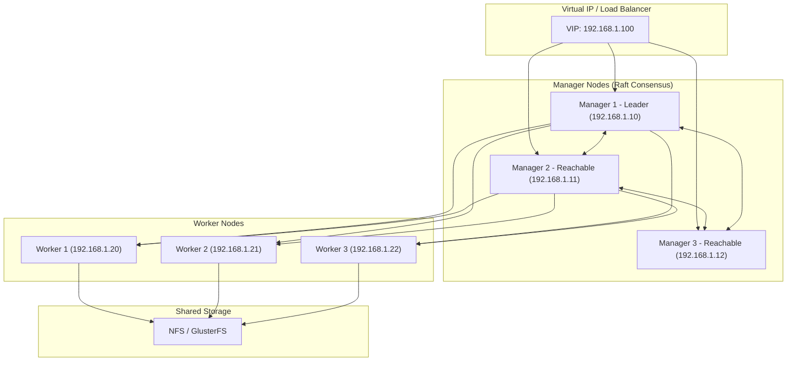
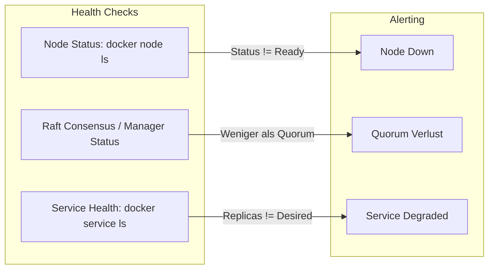

---
tags:
  - docker-swarm
  - installation
  - high-availability
  - clustering
---

# Docker Swarm HA Installation

> [!ABSTRACT] TL;DR
> Hochverfügbaren Docker Swarm Cluster einrichten — mit mehreren Manager Nodes, Quorum-Sicherheit, Shared Storage, Load Balancing und Disaster Recovery. Mindestens 3 Manager Nodes garantieren Ausfallsicherheit durch den Raft-Konsensalgorithmus.

---

## HA-Architektur Überblick

Ein hochverfügbarer Docker Swarm Cluster besteht aus einer **ungeraden Anzahl** von Manager Nodes und beliebig vielen Worker Nodes. Die Manager nutzen den **Raft-Konsensalgorithmus**, um sich über den Cluster-Zustand zu einigen. Solange die Mehrheit (Quorum) der Manager erreichbar ist, bleibt der Cluster funktionsfähig.

Das Minimum für Hochverfügbarkeit sind **3 Manager Nodes**. Damit kann ein Manager ausfallen, ohne dass der Cluster die Arbeitsfähigkeit verliert. Für größere Umgebungen sind 5 oder 7 Manager empfehlenswert.

> [!IMPORTANT] Ungerade Manager-Anzahl ist Pflicht
> Eine gerade Anzahl von Managern bietet **keinen Vorteil** gegenüber der nächstkleineren ungeraden Zahl — sie erhöht nur die Netzwerklast durch Raft-Kommunikation, ohne die Fehlertoleranz zu verbessern. 4 Manager tolerieren genau wie 3 Manager nur 1 Ausfall.

### Architektur-Diagramm



### Quorum-Tabelle

| Manager-Anzahl | Quorum (Mehrheit) | Tolerierte Ausfälle | Empfehlung |
|:--------------:|:-----------------:|:-------------------:|:-----------|
| 1              | 1                 | 0                   | Nur für Dev/Test |
| 3              | 2                 | 1                   | Minimum für HA |
| 5              | 3                 | 2                   | Empfohlen für Produktion |
| 7              | 4                 | 3                   | Große Umgebungen |

> [!WARNING] Mehr als 7 Manager sind kontraproduktiv
> Jeder zusätzliche Manager erhöht die Raft-Kommunikationslast exponentiell. Docker empfiehlt maximal **7 Manager Nodes**. Skalierung erfolgt über Worker Nodes.

---

## Voraussetzungen

Bevor der Cluster aufgebaut wird, müssen folgende Voraussetzungen auf **allen Nodes** erfüllt sein:

- **Ungerade Anzahl Manager Nodes** — 3, 5 oder 7
- **Docker Engine** installiert (gleiche Version auf allen Nodes)
- **Stabile Netzwerkverbindung** zwischen allen Managern (Latenz unter 10ms empfohlen)
- **NTP synchronisiert** — Zeitabweichungen führen zu Raft-Problemen
- **Eindeutige Hostnamen** — Jeder Node braucht einen einzigartigen Hostnamen
- **Offene Firewall-Ports** zwischen den Nodes

### Erforderliche Ports

| Port | Protokoll | Zweck |
|-----:|:---------:|:------|
| 2377 | TCP       | Cluster Management und Raft |
| 7946 | TCP/UDP   | Node Discovery und Gossip |
| 4789 | UDP       | VXLAN Overlay Netzwerk |

> [!NOTE] Port 2377 vs. 2376
> Port **2377** ist der Swarm Management Port. Port **2376** ist der Docker Daemon TLS Port. Diese nicht verwechseln — im `docker swarm join`-Befehl wird immer Port **2377** verwendet.

---

## Beispiel-Infrastruktur

Für dieses Tutorial verwenden wir folgende Infrastruktur mit 3 Managern und 3 Workern:

| Hostname      | IP-Adresse   | Rolle            | CPU | RAM  |
|:--------------|:-------------|:-----------------|:---:|:----:|
| `swarm-mgr1`  | 192.168.1.10 | Manager (Leader) | 2   | 4 GB |
| `swarm-mgr2`  | 192.168.1.11 | Manager          | 2   | 4 GB |
| `swarm-mgr3`  | 192.168.1.12 | Manager          | 2   | 4 GB |
| `swarm-wrk1`  | 192.168.1.20 | Worker           | 4   | 8 GB |
| `swarm-wrk2`  | 192.168.1.21 | Worker           | 4   | 8 GB |
| `swarm-wrk3`  | 192.168.1.22 | Worker           | 4   | 8 GB |

Zusätzlich wird eine **Virtual IP (VIP)** `192.168.1.100` als Floating IP für den Load Balancer eingerichtet.

---

## Schritt-für-Schritt Setup

### 1. Alle Nodes vorbereiten

Die folgenden Schritte werden auf **jedem Node** (Manager und Worker) ausgeführt.

#### Hostnamen setzen

```bash
# Auf jedem Node den Hostnamen setzen (Beispiel für Manager 1)
sudo hostnamectl set-hostname swarm-mgr1
```

#### /etc/hosts konfigurieren

```bash
# Auf ALLEN Nodes die gleiche hosts-Datei pflegen
sudo tee -a /etc/hosts << 'EOF'
# Swarm Manager Nodes
192.168.1.10  swarm-mgr1
192.168.1.11  swarm-mgr2
192.168.1.12  swarm-mgr3

# Swarm Worker Nodes
192.168.1.20  swarm-wrk1
192.168.1.21  swarm-wrk2
192.168.1.22  swarm-wrk3
EOF
```

#### Docker Engine installieren

```bash
# Docker-Repository hinzufügen (Debian/Ubuntu)
sudo apt-get update
sudo apt-get install -y ca-certificates curl gnupg

sudo install -m 0755 -d /etc/apt/keyrings
curl -fsSL https://download.docker.com/linux/ubuntu/gpg | \
  sudo gpg --dearmor -o /etc/apt/keyrings/docker.gpg
sudo chmod a+r /etc/apt/keyrings/docker.gpg

echo "deb [arch=$(dpkg --print-architecture) \
  signed-by=/etc/apt/keyrings/docker.gpg] \
  https://download.docker.com/linux/ubuntu \
  $(. /etc/os-release && echo "$VERSION_CODENAME") stable" | \
  sudo tee /etc/apt/sources.list.d/docker.list > /dev/null

# Docker installieren
sudo apt-get update
sudo apt-get install -y docker-ce docker-ce-cli containerd.io docker-compose-plugin

# Docker-Service aktivieren
sudo systemctl enable --now docker

# Aktuellen Benutzer zur docker-Gruppe hinzufügen
sudo usermod -aG docker $USER
```

#### NTP synchronisieren

```bash
# Chrony installieren und aktivieren
sudo apt-get install -y chrony
sudo systemctl enable --now chrony

# Synchronisation prüfen
chronyc tracking
chronyc sources -v
```

> [!TIP] Gleiche NTP-Quelle verwenden
> Alle Nodes sollten den **gleichen NTP-Server** verwenden, um Zeitdrift zwischen den Managern zu vermeiden. Im internen Netzwerk idealerweise einen eigenen NTP-Server betreiben.

#### Firewall konfigurieren

```bash
# UFW-Regeln für Docker Swarm
sudo ufw allow 2377/tcp comment "Swarm Cluster Management"
sudo ufw allow 7946/tcp comment "Swarm Node Discovery TCP"
sudo ufw allow 7946/udp comment "Swarm Node Discovery UDP"
sudo ufw allow 4789/udp comment "Swarm Overlay Network"

# Firewall aktivieren (falls noch nicht aktiv)
sudo ufw enable
sudo ufw status verbose
```

> [!WARNING] Firewall-Regeln vor dem Swarm-Join
> Die Firewall-Ports müssen **vor** dem Beitritt zum Cluster geöffnet sein. Fehlende Ports führen zu schwer diagnostizierbaren Verbindungsproblemen und Raft-Timeouts.

---

### 2. Ersten Manager initialisieren

Der erste Manager wird zum initialen **Leader** des Clusters. Auf `swarm-mgr1` ausführen:

```bash
# Swarm initialisieren mit expliziter Advertise-Adresse
docker swarm init --advertise-addr 192.168.1.10
```

Die Ausgabe enthält den **Worker-Join-Token**. Diesen notieren, aber zuerst werden die weiteren Manager hinzugefügt.

```text
Swarm initialized: current node (abc123def456) is now a manager.

To add a worker to this swarm, run the following command:
    docker swarm join --token SWMTKN-1-xxxxx 192.168.1.10:2377

To add a manager to this swarm, run:
    docker swarm join-token manager
```

> [!NOTE] Advertise-Adresse
> Der Parameter `--advertise-addr` ist wichtig, wenn der Node mehrere Netzwerkinterfaces hat. Er bestimmt, welche IP-Adresse für die Swarm-Kommunikation verwendet wird.

---

### 3. Weitere Manager hinzufügen

Zuerst den Manager-Join-Token auf `swarm-mgr1` abrufen:

```bash
# Manager-Join-Token anzeigen
docker swarm join-token manager
```

Dann auf `swarm-mgr2` und `swarm-mgr3` ausführen:

```bash
# Auf swarm-mgr2 ausführen
docker swarm join \
  --token SWMTKN-1-<MANAGER-TOKEN> \
  --advertise-addr 192.168.1.11 \
  192.168.1.10:2377
```

```bash
# Auf swarm-mgr3 ausführen
docker swarm join \
  --token SWMTKN-1-<MANAGER-TOKEN> \
  --advertise-addr 192.168.1.12 \
  192.168.1.10:2377
```

Erwartete Ausgabe auf jedem Node:

```text
This node joined a swarm as a manager.
```

> [!IMPORTANT] Manager nacheinander hinzufügen
> Manager Nodes sollten **nacheinander** und nicht parallel hinzugefügt werden. Der Raft-Konsensalgorithmus muss jeden neuen Manager einzeln in den Cluster aufnehmen, um die Konsistenz zu gewährleisten.

---

### 4. Worker Nodes hinzufügen

Worker-Join-Token auf einem Manager abrufen:

```bash
# Worker-Join-Token anzeigen
docker swarm join-token worker
```

Dann auf jedem Worker Node ausführen:

```bash
# Auf swarm-wrk1, swarm-wrk2 und swarm-wrk3 ausführen
docker swarm join \
  --token SWMTKN-1-<WORKER-TOKEN> \
  192.168.1.10:2377
```

Erwartete Ausgabe:

```text
This node joined a swarm as a worker.
```

> [!TIP] Worker können parallel beitreten
> Im Gegensatz zu Managern können Worker Nodes **gleichzeitig** dem Cluster beitreten. Sie nehmen nicht am Raft-Konsens teil.

---

### 5. Cluster verifizieren

Auf einem beliebigen Manager Node den Status prüfen:

```bash
# Alle Nodes anzeigen
docker node ls
```

Erwartete Ausgabe:

```text
ID                            HOSTNAME      STATUS    AVAILABILITY   MANAGER STATUS   ENGINE VERSION
abc123def456 *                swarm-mgr1    Ready     Active         Leader           27.x.x
ghi789jkl012                  swarm-mgr2    Ready     Active         Reachable        27.x.x
mno345pqr678                  swarm-mgr3    Ready     Active         Reachable        27.x.x
stu901vwx234                  swarm-wrk1    Ready     Active                          27.x.x
yza567bcd890                  swarm-wrk2    Ready     Active                          27.x.x
efg123hij456                  swarm-wrk3    Ready     Active                          27.x.x
```

```bash
# Detaillierte Node-Informationen
docker node inspect --pretty swarm-mgr1

# Swarm-Status anzeigen
docker info --format '{{json .Swarm}}' | jq .
```

> [!SUCCESS] Cluster-Verifikation erfolgreich
> Wenn alle 6 Nodes als `Ready` angezeigt werden und genau ein Manager den Status `Leader` hat, ist der HA-Cluster korrekt aufgesetzt.

---

## Shared Storage einrichten

Für zustandsbehaftete Services braucht ein HA-Cluster gemeinsamen Speicher. Wenn ein Container auf einen anderen Node verschoben wird, müssen die Daten weiterhin verfügbar sein.

### NFS (Network File System)

NFS ist die einfachste Lösung für Shared Storage in kleinen bis mittleren Umgebungen.

#### NFS-Server aufsetzen

Auf einem dedizierten Storage-Server (oder einem Manager):

```bash
# NFS-Server installieren
sudo apt-get install -y nfs-kernel-server

# Export-Verzeichnis erstellen
sudo mkdir -p /srv/swarm-data
sudo chown nobody:nogroup /srv/swarm-data
sudo chmod 0777 /srv/swarm-data
```

#### Exports konfigurieren

```bash
# NFS-Exports definieren
sudo tee -a /etc/exports << 'EOF'
/srv/swarm-data  192.168.1.0/24(rw,sync,no_subtree_check,no_root_squash)
EOF

# Exports neu laden
sudo exportfs -ra

# NFS-Server neustarten
sudo systemctl restart nfs-kernel-server
```

#### Auf allen Nodes mounten

```bash
# NFS-Client installieren (auf allen Swarm Nodes)
sudo apt-get install -y nfs-common

# Mount-Punkt erstellen
sudo mkdir -p /mnt/swarm-data

# NFS-Share mounten
sudo mount -t nfs 192.168.1.100:/srv/swarm-data /mnt/swarm-data

# Persistenten Mount in fstab eintragen
echo "192.168.1.100:/srv/swarm-data /mnt/swarm-data nfs defaults,_netdev 0 0" | \
  sudo tee -a /etc/fstab
```

#### NFS-Volume in Swarm Services verwenden

```bash
# Service mit NFS-Volume erstellen
docker service create \
  --name webapp \
  --replicas 3 \
  --mount type=bind,source=/mnt/swarm-data/webapp,target=/data \
  nginx:alpine
```

### GlusterFS (Alternative)

GlusterFS bietet replizierte Volumes ohne Single Point of Failure — ideal für Umgebungen, in denen der NFS-Server selbst ein Ausfallrisiko darstellt.

#### GlusterFS auf allen Storage-Nodes installieren

```bash
# GlusterFS installieren (auf allen Manager-Nodes als Storage-Nodes)
sudo apt-get install -y glusterfs-server
sudo systemctl enable --now glusterd
```

#### Peer Probing

```bash
# Von swarm-mgr1 aus die anderen Nodes verbinden
sudo gluster peer probe swarm-mgr2
sudo gluster peer probe swarm-mgr3

# Peer-Status prüfen
sudo gluster peer status
```

#### Repliziertes Volume erstellen

```bash
# Volume mit 3 Replikas erstellen (eine pro Manager)
sudo gluster volume create swarm-vol replica 3 \
  swarm-mgr1:/gluster/brick1 \
  swarm-mgr2:/gluster/brick1 \
  swarm-mgr3:/gluster/brick1

# Volume starten
sudo gluster volume start swarm-vol

# Volume-Info prüfen
sudo gluster volume info swarm-vol
```

#### GlusterFS in Swarm Services nutzen

```bash
# GlusterFS auf Worker-Nodes mounten
sudo mount -t glusterfs swarm-mgr1:/swarm-vol /mnt/swarm-data

# Oder als Docker Volume Plugin
docker volume create \
  --driver glusterfs \
  --opt servers=swarm-mgr1,swarm-mgr2,swarm-mgr3 \
  --opt volname=swarm-vol \
  shared-data
```

> [!TIP] NFS vs. GlusterFS
> **NFS** eignet sich für einfache Setups mit einem dedizierten Storage-Server. **GlusterFS** ist besser für verteilte Umgebungen, da die Daten über mehrere Nodes repliziert werden und kein Single Point of Failure existiert.

---

## Load Balancer vor Managern

Ein Load Balancer verteilt API-Anfragen über alle Manager Nodes. Fällt der aktuelle Leader aus, wird automatisch auf einen anderen Manager umgeleitet.

### Keepalived + Virtual IP

Keepalived stellt eine **Floating Virtual IP (VIP)** bereit, die immer auf einen aktiven Manager zeigt.

#### Keepalived installieren

```bash
# Auf allen 3 Manager-Nodes installieren
sudo apt-get install -y keepalived
```

#### Konfiguration auf dem Master (swarm-mgr1)

```bash
sudo tee /etc/keepalived/keepalived.conf << 'EOF'
vrrp_script chk_docker {
    script "/usr/bin/docker info > /dev/null 2>&1"
    interval 2
    weight -20
    fall 3
    rise 2
}

vrrp_instance SWARM_VIP {
    state MASTER
    interface eth0
    virtual_router_id 51
    priority 100
    advert_int 1

    authentication {
        auth_type PASS
        auth_pass SwarmHA2026
    }

    virtual_ipaddress {
        192.168.1.100/24
    }

    track_script {
        chk_docker
    }
}
EOF
```

#### Konfiguration auf Backup-Nodes (swarm-mgr2, swarm-mgr3)

```bash
sudo tee /etc/keepalived/keepalived.conf << 'EOF'
vrrp_script chk_docker {
    script "/usr/bin/docker info > /dev/null 2>&1"
    interval 2
    weight -20
    fall 3
    rise 2
}

vrrp_instance SWARM_VIP {
    state BACKUP
    interface eth0
    virtual_router_id 51
    priority 90
    advert_int 1

    authentication {
        auth_type PASS
        auth_pass SwarmHA2026
    }

    virtual_ipaddress {
        192.168.1.100/24
    }

    track_script {
        chk_docker
    }
}
EOF
```

> [!NOTE] Priority anpassen
> `swarm-mgr2` bekommt `priority 90`, `swarm-mgr3` bekommt `priority 80`. Der Node mit der höchsten Priorität wird MASTER, wenn alle verfügbar sind.

```bash
# Keepalived starten und aktivieren (auf allen Managern)
sudo systemctl enable --now keepalived

# VIP testen
ping -c 3 192.168.1.100
ip addr show eth0 | grep 192.168.1.100
```

### HAProxy (Alternative)

HAProxy kann als TCP-Proxy vor den Manager Nodes stehen und Health Checks durchführen.

#### HAProxy-Konfiguration

```bash
sudo tee /etc/haproxy/haproxy.cfg << 'EOF'
global
    log /dev/log local0
    maxconn 4096
    daemon

defaults
    mode tcp
    timeout connect 5s
    timeout client  30s
    timeout server  30s
    retries 3

frontend swarm_api
    bind *:2377
    default_backend swarm_managers

backend swarm_managers
    balance roundrobin
    option tcp-check
    server mgr1 192.168.1.10:2377 check inter 5s fall 3 rise 2
    server mgr2 192.168.1.11:2377 check inter 5s fall 3 rise 2
    server mgr3 192.168.1.12:2377 check inter 5s fall 3 rise 2

listen stats
    bind *:8404
    mode http
    stats enable
    stats uri /stats
    stats refresh 10s
EOF
```

```bash
# HAProxy neustarten
sudo systemctl restart haproxy
sudo systemctl enable haproxy

# Stats-Seite aufrufen: http://192.168.1.100:8404/stats
```

> [!WARNING] HAProxy nicht alleine betreiben
> Wenn HAProxy auf einem einzelnen separaten Node läuft, wird er selbst zum Single Point of Failure. Idealerweise HAProxy in Kombination mit Keepalived auf den Manager Nodes betreiben, oder zwei HAProxy-Instanzen mit Keepalived absichern.

---

## Autolock aktivieren

Docker Swarm speichert TLS-Zertifikate und den Raft-Encryption-Key auf der Festplatte. Mit **Autolock** wird der Raft-Log verschlüsselt — nach jedem Neustart eines Managers muss der Unlock-Key eingegeben werden.

```bash
# Autolock aktivieren
docker swarm update --autolock=true
```

```text
To unlock a swarm manager after it restarts, run the
`docker swarm unlock` command and provide the following key:

    SWMKEY-1-WuYH/IX284+lRcXuoVf38viIDK3HJEKY13MIHX+tTt8

Please remember to store this key in a password manager.
```

> [!DANGER] Unlock-Key sicher aufbewahren
> Ohne den Unlock-Key kann ein neugestarteter Manager **nicht** wieder dem Cluster beitreten. Den Key an einem sicheren Ort aufbewahren (Passwort-Manager, Vault, verschlüsseltes Backup) — **nicht** auf dem Manager-Node selbst.

### Manager nach Neustart entsperren

```bash
# Nach einem Neustart des Docker-Dienstes
docker swarm unlock

# Key eingeben, wenn aufgefordert:
# Please enter unlock key: SWMKEY-1-WuYH/IX284+lRcXuoVf38viIDK3HJEKY13MIHX+tTt8
```

### Unlock-Key rotieren

```bash
# Neuen Unlock-Key generieren
docker swarm unlock-key --rotate

# Aktuellen Key anzeigen (nur wenn entsperrt)
docker swarm unlock-key
```

---

## Backup & Restore

### Swarm-State sichern

Der gesamte Cluster-State (Services, Secrets, Configs, Netzwerke) wird im Raft-Log gespeichert unter `/var/lib/docker/swarm/`. Ein Backup dieses Verzeichnisses reicht, um den Cluster wiederherzustellen.

> [!IMPORTANT] Backup nur auf einem Manager
> Das Backup muss auf einem **Manager Node** erstellt werden. Docker muss dafür gestoppt werden, um inkonsistente Snapshots zu vermeiden.

```bash
# Docker stoppen (auf EINEM Manager)
sudo systemctl stop docker

# Swarm-Verzeichnis sichern
sudo tar -czf /backup/swarm-backup-$(date +%Y%m%d-%H%M%S).tar.gz \
  -C /var/lib/docker swarm/

# Docker wieder starten
sudo systemctl start docker
```

#### Automatisiertes Backup-Skript

```bash
#!/bin/bash
# /usr/local/bin/swarm-backup.sh

BACKUP_DIR="/backup/swarm"
RETENTION_DAYS=30
DATE=$(date +%Y%m%d-%H%M%S)
BACKUP_FILE="${BACKUP_DIR}/swarm-backup-${DATE}.tar.gz"

mkdir -p "${BACKUP_DIR}"

# Prüfen ob dieser Node ein Manager ist
if ! docker node inspect self --format '{{ .Spec.Role }}' 2>/dev/null | grep -q manager; then
    echo "FEHLER: Dieser Node ist kein Manager."
    exit 1
fi

# Docker stoppen und Backup erstellen
sudo systemctl stop docker
sudo tar -czf "${BACKUP_FILE}" -C /var/lib/docker swarm/
sudo systemctl start docker

# Alte Backups aufräumen
find "${BACKUP_DIR}" -name "swarm-backup-*.tar.gz" -mtime +${RETENTION_DAYS} -delete

echo "Backup erstellt: ${BACKUP_FILE}"
echo "Größe: $(du -h "${BACKUP_FILE}" | cut -f1)"
```

```bash
# Skript ausführbar machen
sudo chmod +x /usr/local/bin/swarm-backup.sh

# Cronjob einrichten (täglich um 02:00)
echo "0 2 * * * root /usr/local/bin/swarm-backup.sh >> /var/log/swarm-backup.log 2>&1" | \
  sudo tee /etc/cron.d/swarm-backup
```

### Restore / Disaster Recovery

#### Szenario 1: Komplettausfall — Cluster aus Backup wiederherstellen

Wenn **alle** Manager verloren sind, kann der Cluster aus einem Backup auf einem neuen Node wiederhergestellt werden:

```bash
# Docker stoppen
sudo systemctl stop docker

# Alten Swarm-State entfernen (falls vorhanden)
sudo rm -rf /var/lib/docker/swarm

# Backup wiederherstellen
sudo tar -xzf /backup/swarm-backup-20260305-020000.tar.gz \
  -C /var/lib/docker

# Docker starten
sudo systemctl start docker

# Cluster mit Force-Flag neu initialisieren
docker swarm init --force-new-cluster --advertise-addr 192.168.1.10
```

> [!WARNING] --force-new-cluster
> Dieser Befehl erstellt einen **neuen Single-Manager-Cluster** aus dem bestehenden State. Danach müssen alle anderen Manager und Worker **neu beitreten**. Nur als letztes Mittel verwenden.

#### Szenario 2: Einzelnen Manager ersetzen

Wenn ein Manager ausfällt, aber das Quorum noch steht:

```bash
# Ausgefallenen Node entfernen (auf einem funktionierenden Manager)
docker node demote <NODE-ID>
docker node rm --force <NODE-ID>

# Neuen Manager-Token generieren (optional, aus Sicherheitsgründen)
docker swarm join-token --rotate manager

# Neuen Node als Manager hinzufügen
docker swarm join \
  --token SWMTKN-1-<NEUER-MANAGER-TOKEN> \
  192.168.1.11:2377
```

---

## Monitoring des HA-Status

### Manager Health prüfen

```bash
# Alle Manager und ihren Raft-Status anzeigen
docker node ls --filter role=manager

# Leader identifizieren
docker node inspect --format '{{ .ManagerStatus.Leader }}' self

# Detaillierten Manager-Status abrufen
docker node inspect --format '{{json .ManagerStatus}}' self | jq .
```

### Raft-Status überwachen

```bash
# Raft-Informationen anzeigen
docker info --format '{{json .Swarm.Cluster}}' | jq '{
  ID: .ID,
  CreatedAt: .CreatedAt,
  Spec: .Spec.Name,
  RaftConfig: .Spec.Raft
}'
```

### Monitoring-Diagramm



### Alerting bei Quorum-Verlust

```bash
#!/bin/bash
# /usr/local/bin/swarm-health-check.sh

EXPECTED_MANAGERS=3
ALERT_EMAIL="admin@example.com"

# Aktive Manager zählen
ACTIVE_MANAGERS=$(docker node ls --filter role=manager \
  --format '{{.Status}}' 2>/dev/null | grep -c "Ready")

if [ "$ACTIVE_MANAGERS" -lt 2 ]; then
    echo "KRITISCH: Nur ${ACTIVE_MANAGERS}/${EXPECTED_MANAGERS} Manager aktiv!" | \
      mail -s "[SWARM ALERT] Quorum-Verlust droht!" "$ALERT_EMAIL"
elif [ "$ACTIVE_MANAGERS" -lt "$EXPECTED_MANAGERS" ]; then
    echo "WARNUNG: ${ACTIVE_MANAGERS}/${EXPECTED_MANAGERS} Manager aktiv." | \
      mail -s "[SWARM WARN] Manager ausgefallen" "$ALERT_EMAIL"
fi
```

```bash
# Health-Check alle 5 Minuten ausführen
echo "*/5 * * * * root /usr/local/bin/swarm-health-check.sh" | \
  sudo tee /etc/cron.d/swarm-health
```

> [!TIP] Prometheus und Grafana
> Für produktive Umgebungen empfiehlt sich ein Monitoring-Stack mit **Prometheus** (Docker Daemon Metrics auf Port 9323) und **Grafana** für Dashboards und Alerting. Siehe [[Swarm Monitoring und Maintenance]] für Details.

---

## Best Practices

> [!TIP] Empfehlungen für einen stabilen HA-Cluster

### Manager Nodes

- **Immer ungerade Manager-Anzahl** — 3 für kleine, 5 für große Umgebungen
- **Manager auf dedizierten Nodes** — Keine Workloads auf Managern schedulen
- **Manager Availability auf Drain setzen** — Verhindert Workload-Scheduling

```bash
# Manager-Nodes nur für Cluster-Management verwenden
docker node update --availability drain swarm-mgr1
docker node update --availability drain swarm-mgr2
docker node update --availability drain swarm-mgr3
```

### Netzwerk und Sicherheit

- **NTP synchronisieren** — Zeitdrift verursacht Raft-Probleme
- **Firewall-Regeln eng halten** — Nur Swarm-Ports zwischen Nodes öffnen
- **TLS aktivieren** — Swarm verschlüsselt standardmäßig, Autolock schützt die Keys
- **Unlock-Key sicher aufbewahren** — Nie auf dem Manager selbst speichern
- **Join-Tokens regelmäßig rotieren** — Verhindert unautorisierte Node-Beitritte

```bash
# Tokens rotieren
docker swarm join-token --rotate worker
docker swarm join-token --rotate manager
```

### Backup und Wartung

- **Tägliche Backups** des Swarm-State auf einem Manager
- **Backups extern speichern** — Nicht auf demselben Node wie der Swarm
- **Regelmäßige Restore-Tests** — Ein Backup ist nur so gut wie sein Restore
- **Rolling Updates** für Docker Engine — Nie alle Manager gleichzeitig updaten

> [!DANGER] Niemals alle Manager gleichzeitig stoppen
> Wenn alle Manager gleichzeitig gestoppt werden, geht der Raft-State verloren. Updates und Wartungsarbeiten immer **rollierend** durchführen — ein Manager nach dem anderen.

### Labels und Constraints

```bash
# Worker-Nodes labeln für gezielte Platzierung
docker node update --label-add zone=a swarm-wrk1
docker node update --label-add zone=b swarm-wrk2
docker node update --label-add zone=c swarm-wrk3

# Service mit Placement-Constraint und Spread-Strategie
docker service create \
  --name webapp \
  --replicas 3 \
  --constraint 'node.labels.zone != ""' \
  --placement-pref 'spread=node.labels.zone' \
  nginx:alpine
```

---

## Verwandte Notizen

- [[Docker Swarm Installation]] — Grundlegende Single-Manager-Installation
- [[Docker Swarm Architektur]] — Detaillierte Architektur und Raft-Konsens
- [[Swarm Security]] — TLS-Zertifikate, Secrets, Netzwerkverschlüsselung
- [[Swarm Monitoring und Maintenance]] — Prometheus, Grafana, Log-Aggregation
- [[KubeVIP und High Availability]] — HA-Konzepte in Kubernetes zum Vergleich
````

</details>

---

### ⚠️ Problem: Datei konnte nicht automatisch erstellt werden

Das Edit-Tool kann nur **bestehende Dateien bearbeiten**, nicht neue anlegen. Zusätzlich existiert das Verzeichnis `Docker-Swarm\Installation\` auf dem Dateisystem nicht (Git erstellt leere Ordner nicht beim Clonen).

**Bitte manuell ausführen:**

```powershell
# 1. Verzeichnis anlegen
New-Item -ItemType Directory -Force -Path "C:\Development\notes-n-docs\Clustering\Docker-Swarm\Installation"

# 2. Leere Datei erstellen
New-Item -ItemType File -Path "C:\Development\notes-n-docs\Clustering\Docker-Swarm\Installation\Docker Swarm HA Installation.md"