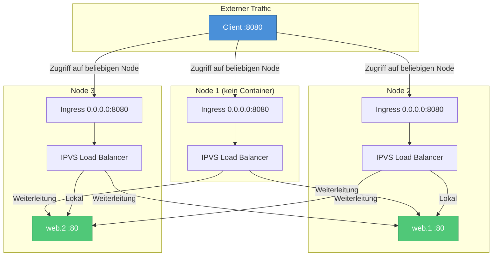
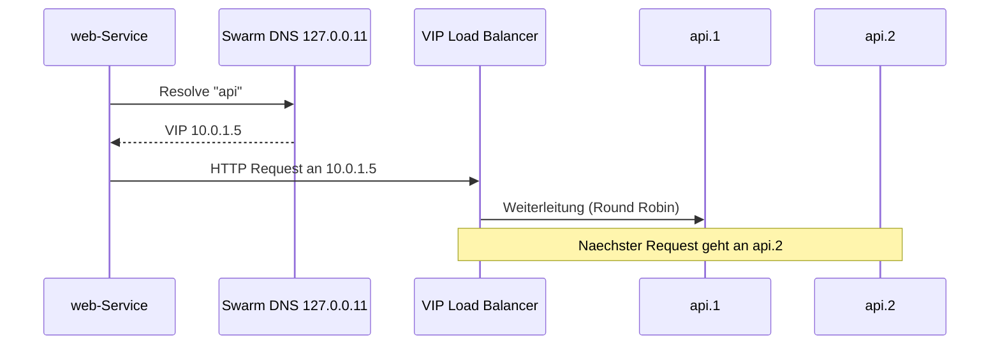
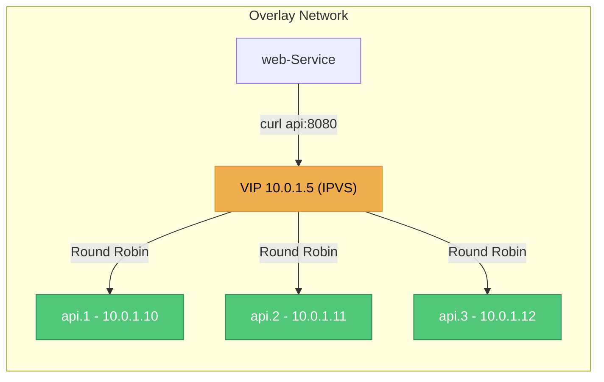
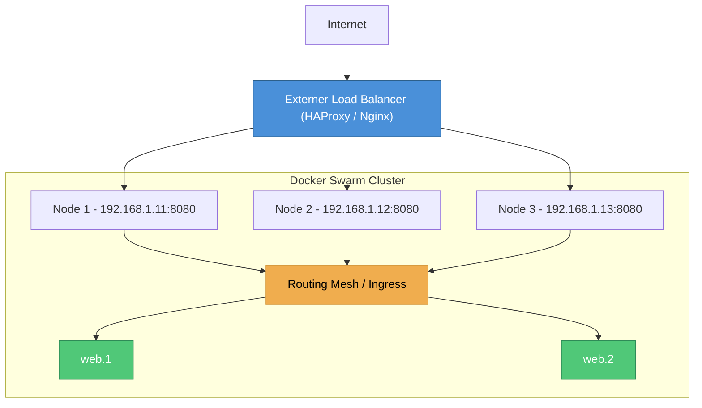
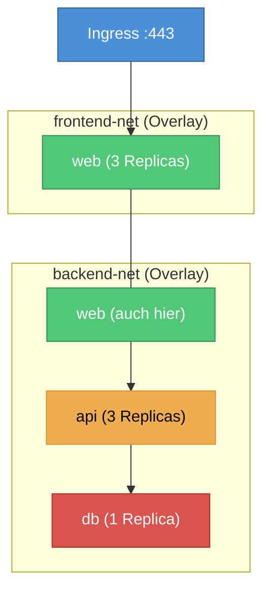

---
tags:
  - docker-swarm
  - networking
  - overlay
  - ingress
---

# Swarm Networking

> [!ABSTRACT] TL;DR
> Docker Swarm erweitert das Standard-Docker-Networking um **Overlay Networks**, ein automatisches **Ingress Routing Mesh** und **Cluster-weite Service Discovery**. Damit können Services über mehrere Nodes hinweg transparent miteinander kommunizieren, ohne dass manuelles Port-Mapping oder externe DNS-Server nötig sind.

---

## Netzwerk-Typen im Swarm

Docker Swarm bringt drei zentrale Netzwerk-Typen mit, die zusammen das Cluster-Networking ermöglichen. Jeder Typ hat eine spezifische Aufgabe und wird teilweise automatisch beim Initialisieren des Swarms erstellt.

| Netzwerk-Typ | Treiber | Erstellt durch | Zweck |
|:-------------|:--------|:---------------|:------|
| **Overlay** | `overlay` | Manuell / Service-Erstellung | Service-zu-Service-Kommunikation über Nodes |
| **Ingress** | `overlay` | Swarm Init (automatisch) | Routing Mesh für Published Ports |
| **docker_gwbridge** | `bridge` | Swarm Init (automatisch) | Verbindung zwischen Overlay und Host-Netzwerk |

---

### Overlay Network

Overlay Networks sind das Herzstück des Swarm-Networkings. Sie spannen ein **virtuelles Layer-2-Netzwerk** über alle Swarm-Nodes hinweg, sodass Container auf unterschiedlichen Hosts so kommunizieren können, als wären sie im selben lokalen Netzwerk.

#### Technische Grundlage — VXLAN

Overlay Networks basieren auf **VXLAN** (Virtual Extensible LAN). VXLAN kapselt Layer-2-Frames in UDP-Pakete (Port `4789`) und transportiert sie über das physische Netzwerk:

```
┌─────────────────────────────────────────────────┐
│  Äußerer Ethernet Frame                         │
│  ┌─────────────────────────────────────────────┐ │
│  │  Äußerer IP-Header (Host-to-Host)           │ │
│  │  ┌─────────────────────────────────────────┐ │ │
│  │  │  UDP-Header (Zielport 4789)             │ │ │
│  │  │  ┌─────────────────────────────────────┐ │ │ │
│  │  │  │  VXLAN-Header (VNI = Netzwerk-ID)   │ │ │ │
│  │  │  │  ┌─────────────────────────────────┐ │ │ │ │
│  │  │  │  │  Originaler Ethernet-Frame      │ │ │ │ │
│  │  │  │  │  (Container-zu-Container)       │ │ │ │ │
│  │  │  │  └─────────────────────────────────┘ │ │ │ │
│  │  │  └─────────────────────────────────────┘ │ │ │
│  │  └─────────────────────────────────────────┘ │ │
│  └─────────────────────────────────────────────┘ │
└─────────────────────────────────────────────────┘
```

#### Eigenschaften

- **Multi-Host:** Spanning über alle Nodes im Swarm
- **Isoliert:** Jedes Overlay hat einen eigenen Netzwerk-Namespace
- **Verschlüsselung optional:** Data-Plane-Verschlüsselung mit `--opt encrypted` (IPSec)
- **Automatisches IPAM:** Subnet-Verwaltung durch Docker oder manuell konfigurierbar
- **Scope:** Standardmäßig nur für Swarm-Services — mit `--attachable` auch für Standalone-Container

#### Overlay erstellen

```bash
# Einfaches Overlay Network
docker network create --driver overlay my-overlay

# Overlay mit benutzerdefiniertem Subnet
docker network create \
  --driver overlay \
  --subnet 10.0.9.0/24 \
  --gateway 10.0.9.1 \
  my-overlay

# Overlay mit Verschlüsselung
docker network create \
  --driver overlay \
  --opt encrypted \
  secure-overlay

# Attachable Overlay (auch für Standalone-Container)
docker network create \
  --driver overlay \
  --attachable \
  shared-overlay
```

> [!NOTE] Lazy-Erstellung auf Worker-Nodes
> Overlay Networks werden auf Worker-Nodes erst dann erstellt, wenn ein Task auf diesem Node gestartet wird, der das Netzwerk benötigt. Auf Manager-Nodes sind alle Overlays sofort sichtbar.

---

### Ingress Network

Das Ingress Network ist ein **spezielles Overlay**, das beim Initialisieren des Swarms automatisch erstellt wird. Es implementiert das **Routing Mesh** — den Mechanismus, der Published Ports auf **jedem Node** erreichbar macht, unabhängig davon, wo der Container tatsächlich läuft.

#### Wie das Routing Mesh funktioniert



#### Ablauf im Detail

1. Ein externer Client sendet eine Anfrage an **Port 8080** eines beliebigen Swarm-Nodes
2. Der **Ingress Listener** auf dem Node nimmt die Anfrage entgegen
3. Der **IPVS Load Balancer** leitet die Anfrage an einen der verfügbaren Tasks weiter
4. Falls der Task auf einem anderen Node läuft, wird die Anfrage über das Ingress Overlay dorthin geroutet
5. Die Antwort nimmt den gleichen Weg zurück

> [!IMPORTANT] Ingress Network nicht löschen
> Das Ingress Network ist essenziell für das Routing Mesh. Wird es gelöscht, funktionieren alle Published Ports nicht mehr. Es kann bei Bedarf neu erstellt werden, aber alle Services mit Published Ports müssen danach aktualisiert werden.

#### Ingress Network inspizieren

```bash
# Ingress Network anzeigen
docker network inspect ingress

# Zugehörige iptables-Regeln anzeigen
sudo iptables -t nat -L DOCKER-INGRESS -n -v

# IPVS-Regeln anzeigen (zeigt Load Balancing Targets)
sudo ipvsadm -Ln
```

---

### docker_gwbridge

Die `docker_gwbridge` ist eine **lokale Bridge** auf jedem Swarm-Node. Sie verbindet die Overlay-Netzwerke mit dem Host-Netzwerk und ermöglicht so den Zugang zur Außenwelt.

#### Aufgaben

- **NAT-Gateway** für ausgehenden Traffic aus Overlay Networks
- **Endpunkt** für das Ingress Routing Mesh auf dem Host
- **Kommunikationsbrücke** zwischen Swarm-internen und externen Netzwerken

```bash
# docker_gwbridge inspizieren
docker network inspect docker_gwbridge

# Typisches Subnet: 172.18.0.0/16
# Jeder Container bekommt ein Interface in dieser Bridge
```

> [!WARNING] docker_gwbridge anpassen
> Falls das Standard-Subnet `172.18.0.0/16` mit dem eigenen Netzwerk kollidiert, muss die Bridge **vor** dem Swarm-Join manuell erstellt werden:
>
> ```bash
> # Erst den Swarm verlassen (falls bereits beigetreten)
> docker swarm leave --force
>
> # Bestehende gwbridge löschen
> docker network rm docker_gwbridge
>
> # Neue gwbridge mit eigenem Subnet erstellen
> docker network create \
>   --subnet 172.20.0.0/16 \
>   --gateway 172.20.0.1 \
>   -o com.docker.network.bridge.enable_icc=false \
>   -o com.docker.network.bridge.enable_ip_masquerade=true \
>   -o com.docker.network.bridge.name=docker_gwbridge \
>   docker_gwbridge
>
> # Danach Swarm erneut initialisieren oder joinen
> ```

---

## Service Discovery und DNS

Docker Swarm enthält einen **eingebauten DNS-Server**, der automatisch DNS-Einträge für alle Services und Tasks pflegt. Dadurch können Services sich über ihren **Namen** ansprechen — keine IP-Adressen nötig.

### DNS-Auflösung im Swarm

Jeder Container im Swarm nutzt den internen DNS-Server (`127.0.0.11`). Wenn ein Service einen anderen Service per Name anspricht, wird dieser Name automatisch aufgelöst:



### Auflösungs-Modi

Docker Swarm bietet zwei Modi für die DNS-Auflösung von Services:

#### VIP-Modus (Standard)

Jeder Service bekommt eine **Virtual IP** (VIP). Alle Anfragen an diese VIP werden transparent per IPVS an die Tasks verteilt:

```bash
# Service mit VIP erstellen (Standard)
docker service create \
  --name api \
  --endpoint-mode vip \
  --replicas 3 \
  --network my-overlay \
  my-api:latest

# VIP des Services anzeigen
docker service inspect api --format '{{.Endpoint.VirtualIPs}}'
```

> [!TIP] VIP bevorzugen
> Der VIP-Modus ist in den meisten Fällen die bessere Wahl, da er Connection Pooling und lange TCP-Verbindungen korrekt handhabt. DNSRR kann bei langlebigen Verbindungen zu ungleichmäßiger Last führen.

#### DNSRR-Modus (DNS Round Robin)

Statt einer VIP liefert DNS direkt die **IP-Adressen aller Tasks** zurück. Der Client wählt selbst einen Ziel-Endpunkt:

```bash
# Service mit DNSRR erstellen
docker service create \
  --name api \
  --endpoint-mode dnsrr \
  --replicas 3 \
  --network my-overlay \
  my-api:latest

# DNS-Auflösung testen (zeigt mehrere IPs)
docker exec <container> nslookup api
```

> [!WARNING] DNSRR und Published Ports
> Services im DNSRR-Modus können **keine Published Ports** nutzen (kein Routing Mesh). Sie sind nur innerhalb des Overlay Networks erreichbar. Für externen Zugriff muss ein Reverse Proxy wie Traefik oder HAProxy eingesetzt werden.

### DNS-Namensschema

| DNS-Name | Auflösung | Beispiel |
|:---------|:----------|:---------|
| `<service>` | VIP oder Task-IPs (je nach Modus) | `api` → `10.0.1.5` |
| `tasks.<service>` | Alle Task-IPs (auch bei VIP-Modus) | `tasks.api` → `10.0.1.10, 10.0.1.11` |
| `<task>.<service>` | Einzelne Task-IP | `api.1` → `10.0.1.10` |
| `<service>.<network>` | VIP im spezifischen Netzwerk | `api.my-overlay` → `10.0.1.5` |

```bash
# DNS-Auflösung testen
# Service-VIP
docker exec <container> nslookup api

# Alle Task-IPs (bypassed VIP)
docker exec <container> nslookup tasks.api

# Spezifischen Task auflösen
docker exec <container> nslookup api.1.api
```

---

## Load Balancing

Docker Swarm implementiert Load Balancing auf zwei Ebenen: **intern** (zwischen Services) und **extern** (für eingehenden Traffic).

### Internes Load Balancing

Das interne Load Balancing nutzt **IPVS** (IP Virtual Server) im Linux-Kernel. Es verteilt Traffic an einen Service gleichmäßig auf alle zugehörigen Tasks.

#### Funktionsweise



#### Eigenschaften

- **Algorithmus:** Round Robin (Standard, nicht konfigurierbar)
- **Health-aware:** Tasks, die ihren Health Check nicht bestehen, werden aus der Rotation entfernt
- **Transparent:** Für den anfragenden Container sieht es aus wie eine einzelne Ziel-IP
- **Keine Session Affinity:** Swarm bietet nativ keine Sticky Sessions

> [!NOTE] Session Affinity
> Docker Swarm unterstützt keine native Session Affinity (Sticky Sessions). Falls eine Anwendung das benötigt, muss ein externer Load Balancer oder Reverse Proxy wie Traefik oder HAProxy eingesetzt werden, der Cookie-basierte Zuordnung unterstützt.

#### IPVS-Regeln prüfen

```bash
# IPVS-Modul laden (falls nötig)
sudo modprobe ip_vs

# Aktuelle IPVS-Regeln anzeigen
sudo ipvsadm -Ln

# Beispielausgabe:
# TCP  10.0.1.5:8080 rr
#   -> 10.0.1.10:8080     Masq  1  0  0
#   -> 10.0.1.11:8080     Masq  1  0  0
#   -> 10.0.1.12:8080     Masq  1  0  0
```

---

### Externes Load Balancing (Routing Mesh)

Für externen Traffic nutzt Swarm das **Routing Mesh** über das Ingress Network. Published Ports werden auf **allen Nodes** geöffnet, und eingehender Traffic wird per IPVS an die Service-Tasks verteilt.

#### Architektur mit externem Load Balancer

In Produktionsumgebungen wird ein externer Load Balancer vor den Swarm geschaltet:



```bash
# Service mit Published Port erstellen
docker service create \
  --name web \
  --replicas 2 \
  --publish published=8080,target=80 \
  nginx:latest

# Testen: Anfrage an beliebigen Node
curl http://node1:8080
curl http://node2:8080  # Gleicher Service, egal welcher Node
curl http://node3:8080
```

---

## Overlay Network erstellen und nutzen

### Praxisbeispiel: Multi-Service-Stack

Ein typisches Setup mit Frontend, Backend und Datenbank auf getrennten Overlays:

```bash
# Netzwerke erstellen
docker network create --driver overlay frontend-net
docker network create --driver overlay backend-net

# Frontend-Service (in beiden Netzwerken)
docker service create \
  --name web \
  --replicas 3 \
  --network frontend-net \
  --network backend-net \
  --publish published=443,target=443 \
  my-web:latest

# Backend-Service (nur Backend-Netzwerk)
docker service create \
  --name api \
  --replicas 3 \
  --network backend-net \
  my-api:latest

# Datenbank-Service (nur Backend-Netzwerk)
docker service create \
  --name db \
  --replicas 1 \
  --network backend-net \
  --mount type=volume,source=db-data,target=/var/lib/postgresql/data \
  postgres:16
```



> [!TIP] Netzwerk-Segmentierung
> Durch die Trennung in `frontend-net` und `backend-net` kann der `web`-Service sowohl von außen erreichbar sein als auch mit dem Backend kommunizieren. Der `db`-Service ist nur über das `backend-net` erreichbar und somit vom externen Zugriff isoliert.

---

## Multi-Service-Networking

### Attachable Overlays

Standardmäßig können nur Swarm-Services Overlay Networks nutzen. Mit `--attachable` können auch **Standalone-Container** (z.B. für Debugging) an ein Overlay angebunden werden:

```bash
# Attachable Overlay erstellen
docker network create --driver overlay --attachable debug-net

# Service im Netzwerk
docker service create --name api --network debug-net my-api:latest

# Standalone-Container für Debugging
docker run -it --rm --network debug-net nicolaka/netshoot bash

# Aus dem Debug-Container:
nslookup api
curl http://api:8080/health
ping api
```

### Mehrere Overlays pro Service

Ein Service kann an **mehrere Overlay Networks** gleichzeitig angebunden werden. Das ermöglicht feinkörnige Netzwerk-Segmentierung:

```bash
# Service an mehrere Netzwerke anbinden
docker service create \
  --name gateway \
  --network public-net \
  --network internal-net \
  --network monitoring-net \
  my-gateway:latest
```

> [!EXAMPLE] Typische Netzwerk-Topologie
> | Netzwerk | Zweck | Services |
> |:---------|:------|:---------|
> | `public-net` | Externer Zugriff | Reverse Proxy, Web |
> | `internal-net` | Service-zu-Service | API, Worker, DB |
> | `monitoring-net` | Metriken und Logs | Prometheus, Grafana, alle Services |
> | `management-net` | Cluster-Management | Portainer, Swarm-Visualizer |

---

## Verschlüsselung

### Control Plane — Immer verschlüsselt

Die Kommunikation zwischen Swarm-Managern (Raft-Konsensus, Service-Definitionen, Secrets) ist **immer mit TLS verschlüsselt**. Docker Swarm verwaltet die Zertifikate automatisch:

```bash
# TLS-Zertifikate und deren Rotation prüfen
docker info | grep -A 5 "Swarm"

# Zertifikat-Rotationsintervall anpassen (Standard: 90 Tage)
docker swarm update --cert-expiry 720h

# Sofortige Rotation erzwingen
docker swarm ca --rotate
```

### Data Plane — Optional verschlüsselt

Die eigentlichen Daten zwischen Containern (Data Plane) sind standardmäßig **nicht verschlüsselt**. Für sensible Kommunikation kann IPSec-Verschlüsselung aktiviert werden:

```bash
# Overlay mit Data-Plane-Verschlüsselung erstellen
docker network create \
  --driver overlay \
  --opt encrypted \
  secure-overlay
```

> [!WARNING] Performance-Impact bei Verschlüsselung
> Die Data-Plane-Verschlüsselung (`--opt encrypted`) nutzt **IPSec im ESP-Modus** und hat einen messbaren Performance-Impact:
>
> | Metrik | Ohne Verschlüsselung | Mit Verschlüsselung | Impact |
> |:-------|:---------------------|:---------------------|:-------|
> | **Durchsatz** | ~9.5 Gbit/s | ~3.5 Gbit/s | -63% |
> | **Latenz** | ~0.15 ms | ~0.35 ms | +133% |
> | **CPU-Last** | Niedrig | Mittel-Hoch | Deutlich höher |
>
> Die Verschlüsselung sollte nur für Netzwerke mit sensiblen Daten aktiviert werden, nicht pauschal für alle Overlays.

> [!IMPORTANT] Verschlüsselung nachträglich
> Die `--opt encrypted`-Option kann **nicht nachträglich** zu einem bestehenden Overlay hinzugefügt werden. Das Netzwerk muss neu erstellt werden, und alle Services müssen auf das neue Netzwerk umgezogen werden.

---

## Port-Konfiguration

### Published Ports — Ingress Mode (Standard)

Im Ingress Mode wird der Port auf **allen Swarm-Nodes** geöffnet und über das Routing Mesh an die richtigen Container weitergeleitet:

```bash
# Kurzform
docker service create \
  --name web \
  --publish 8080:80 \
  nginx:latest

# Langform (explizit Ingress Mode)
docker service create \
  --name web \
  --publish published=8080,target=80,protocol=tcp,mode=ingress \
  nginx:latest

# Mehrere Ports veröffentlichen
docker service create \
  --name web \
  --publish 80:80 \
  --publish 443:443 \
  nginx:latest
```

### Published Ports — Host Mode

Im Host Mode wird der Port **nur auf dem Node** geöffnet, auf dem der Container tatsächlich läuft. Kein Routing Mesh:

```bash
# Host Mode
docker service create \
  --name web \
  --publish published=8080,target=80,mode=host \
  --mode global \
  nginx:latest
```

> [!TIP] Wann Host Mode verwenden
> Host Mode ist sinnvoll, wenn:
> - **Maximale Performance** nötig ist (kein NAT/IPVS-Overhead)
> - **Client-IP erhalten** bleiben muss (im Ingress Mode geht die Quell-IP verloren)
> - Ein **externer Load Balancer** die Verteilung übernimmt
> - Der Service im `global` Mode läuft (genau ein Container pro Node)

### Vergleich: Ingress vs. Host Mode

| Eigenschaft | Ingress Mode | Host Mode |
|:------------|:-------------|:----------|
| **Port auf allen Nodes** | Ja | Nur wo Container laufen |
| **Routing Mesh** | Ja | Nein |
| **Client-IP sichtbar** | Nein (SNAT) | Ja |
| **Mehrere Replicas pro Node** | Ja | Nein (Port-Konflikt) |
| **Performance** | Gut | Besser (kein IPVS) |
| **Externer LB nötig** | Optional | Empfohlen |

---

## Troubleshooting Netzwerk

### Benötigte Firewall-Ports

Damit Docker Swarm korrekt funktioniert, müssen folgende Ports zwischen allen Nodes freigeschaltet sein:

| Port | Protokoll | Zweck |
|:-----|:----------|:------|
| `2377` | TCP | Cluster-Management und Raft-Konsensus |
| `7946` | TCP + UDP | Node-Discovery und Gossip-Protokoll |
| `4789` | UDP | VXLAN Overlay Traffic |

```bash
# Firewall-Regeln setzen (ufw)
sudo ufw allow 2377/tcp comment "Docker Swarm Management"
sudo ufw allow 7946/tcp comment "Docker Swarm Node Discovery TCP"
sudo ufw allow 7946/udp comment "Docker Swarm Node Discovery UDP"
sudo ufw allow 4789/udp comment "Docker Swarm VXLAN Overlay"

# Firewall-Regeln setzen (firewalld)
sudo firewall-cmd --permanent --add-port=2377/tcp
sudo firewall-cmd --permanent --add-port=7946/tcp
sudo firewall-cmd --permanent --add-port=7946/udp
sudo firewall-cmd --permanent --add-port=4789/udp
sudo firewall-cmd --reload
```

> [!DANGER] Firewall-Ports prüfen
> Fehlende Firewall-Regeln sind die **häufigste Ursache** für Swarm-Netzwerkprobleme. Symptome wie "Service nicht erreichbar", "Node unreachable" oder "Task pending" haben oft blockierte Ports als Ursache.

### Diagnose-Befehle

```bash
# Alle Swarm-Netzwerke auflisten
docker network ls --filter scope=swarm

# Netzwerk-Details inspizieren
docker network inspect my-overlay

# Peers im Overlay anzeigen
docker network inspect my-overlay --format '{{json .Peers}}' | jq

# Service-Endpunkte prüfen
docker service inspect api --format '{{json .Endpoint}}' | jq

# DNS-Auflösung aus einem Container testen
docker exec <container-id> nslookup api
docker exec <container-id> dig api

# Konnektivität testen
docker exec <container-id> ping api
docker exec <container-id> curl -v http://api:8080/health
```

### Debugging mit netshoot

Das `netshoot`-Image von Nicolaka ist ein unverzichtbares Werkzeug für Netzwerk-Debugging im Swarm:

```bash
# Netshoot als Service im Overlay starten
docker service create \
  --name netshoot \
  --network my-overlay \
  --mode replicated \
  --replicas 1 \
  nicolaka/netshoot sleep infinity

# In den Container einsteigen
docker exec -it $(docker ps -q -f name=netshoot) bash

# Nützliche Befehle im netshoot-Container:
nslookup api                      # DNS testen
dig api +short                    # DNS testen (detailliert)
curl http://api:8080/health       # HTTP Connectivity
tcpdump -i eth0 port 8080         # Traffic mitschneiden
iperf3 -c api -p 5201            # Bandbreite messen
traceroute api                    # Routing prüfen
ss -tlnp                         # Offene Ports anzeigen
ip addr show                     # Netzwerk-Interfaces
ip route show                    # Routing-Tabelle
```

### Häufige Probleme und Lösungen

> [!BUG] Service nicht über Overlay erreichbar
> **Symptom:** `curl http://api:8080` liefert "Connection refused" oder Timeout.
>
> **Mögliche Ursachen:**
> 1. Services sind nicht im selben Overlay Network
> 2. Der Ziel-Container ist nicht healthy
> 3. Die Anwendung bindet auf `127.0.0.1` statt `0.0.0.0`
>
> **Lösung:**
> ```bash
> # Prüfen ob Services im selben Netzwerk sind
> docker service inspect api --format '{{.Spec.TaskTemplate.Networks}}'
> docker service inspect web --format '{{.Spec.TaskTemplate.Networks}}'
>
> # Health-Status der Tasks prüfen
> docker service ps api --no-trunc
>
> # Port-Binding im Container prüfen
> docker exec <container> ss -tlnp
> ```

> [!BUG] Ingress Routing Mesh funktioniert nicht
> **Symptom:** Published Port nur auf manchen Nodes erreichbar.
>
> **Mögliche Ursachen:**
> 1. Firewall blockiert Port 4789/UDP (VXLAN)
> 2. Ingress Network ist beschädigt
> 3. iptables-Regeln fehlen
>
> **Lösung:**
> ```bash
> # Firewall-Port prüfen
> sudo ss -ulnp | grep 4789
>
> # Ingress Network neu erstellen
> docker network rm ingress
> docker network create \
>   --driver overlay \
>   --ingress \
>   --subnet 10.0.0.0/24 \
>   ingress
>
> # Services aktualisieren (force update)
> docker service update --force web
> ```

> [!BUG] DNS-Auflösung schlägt fehl
> **Symptom:** `nslookup <service>` gibt "NXDOMAIN" oder Timeout zurück.
>
> **Mögliche Ursachen:**
> 1. Interner DNS-Resolver (`127.0.0.11`) nicht konfiguriert
> 2. Container hat `/etc/resolv.conf` überschrieben
> 3. Service noch nicht vollständig deployed
>
> **Lösung:**
> ```bash
> # DNS-Konfiguration im Container prüfen
> docker exec <container> cat /etc/resolv.conf
> # Erwartete Ausgabe: nameserver 127.0.0.11
>
> # Alternativ: Tasks des Ziel-Services prüfen
> docker service ps api
> ```

> [!BUG] Subnet-Konflikte
> **Symptom:** Container können externe Ressourcen nicht erreichen oder Netzwerk-Overlap-Fehler.
>
> **Ursache:** Docker-Standard-Subnetze (`172.17.0.0/16`, `10.0.0.0/8`) überlappen mit dem Firmennetzwerk oder Heimnetzwerk.
>
> **Lösung:**
> ```bash
> # Overlays mit explizitem, nicht kollidierendem Subnet erstellen
> docker network create \
>   --driver overlay \
>   --subnet 192.168.100.0/24 \
>   my-safe-overlay
> ```
>
> Standard-Adresspool in `/etc/docker/daemon.json` anpassen:
> ```json
> {
>   "default-address-pools": [
>     {"base": "172.28.0.0/16", "size": 24},
>     {"base": "172.29.0.0/16", "size": 24}
>   ]
> }
> ```

---

## Best Practices

> [!TIP] Empfehlungen für Swarm Networking
> 1. **Netzwerk-Segmentierung:** Getrennte Overlays für Frontend, Backend und Management
> 2. **VIP statt DNSRR:** VIP-Modus als Standard verwenden, DNSRR nur wenn nötig
> 3. **Explizite Subnets:** Immer `--subnet` angeben, um Konflikte zu vermeiden
> 4. **Verschlüsselung gezielt:** `--opt encrypted` nur für sensible Netzwerke
> 5. **Health Checks definieren:** Unhealthy Container werden aus dem Load Balancing entfernt
> 6. **Host Mode für Performance:** Wenn Client-IP oder maximaler Durchsatz nötig ist
> 7. **Attachable sparsam:** Nur für Debugging oder spezielle Standalone-Container
> 8. **Firewall zuerst:** Ports `2377`, `7946`, `4789` vor dem Swarm-Setup freischalten

---

## Verwandte Notizen

- [[Docker Networking]] — Grundlegendes Docker-Networking (Bridge, Host, macvlan)
- [[Kubernetes Netzwerk]] — K8s-Networking im Vergleich (CNI, kube-proxy, Network Policies)
- [[Docker Swarm Index]] — Übersicht aller Docker Swarm Notizen
- [[Swarm Services und Tasks]] — Service-Typen, Scaling und Update-Strategien