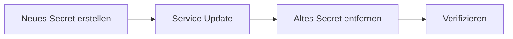
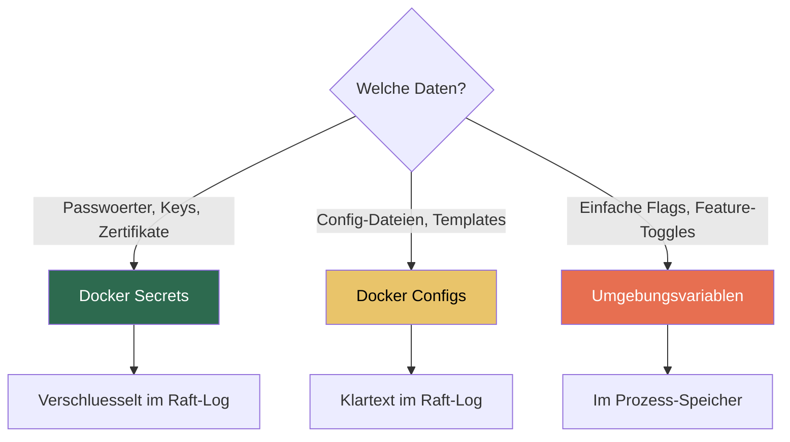
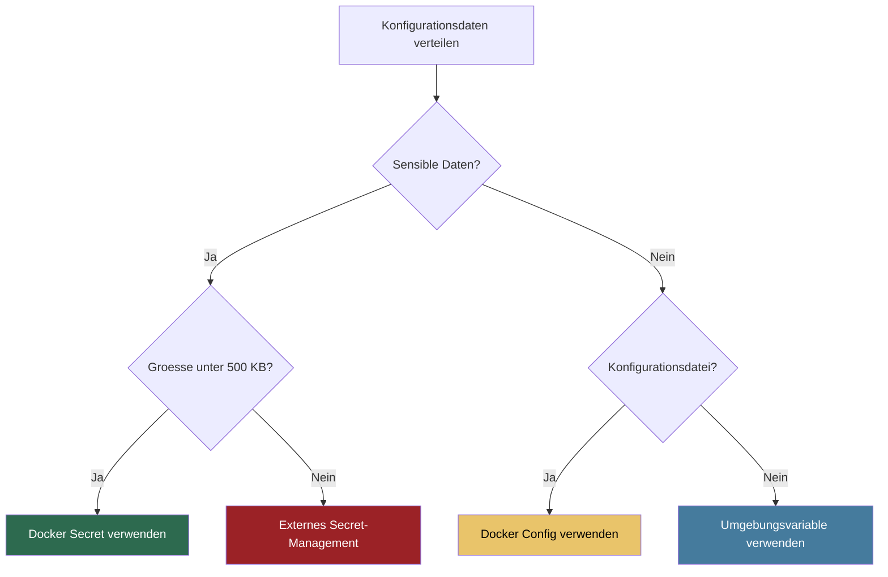

# Swarm Secrets und Configs

> [!ABSTRACT]
> Docker Swarm bietet mit **Secrets** und **Configs** zwei native Mechanismen zur sicheren Verwaltung sensibler Daten und Konfigurationsdateien im Cluster. Secrets werden verschlüsselt im Raft-Log gespeichert und nur den berechtigten Services als Dateien bereitgestellt. Configs ermöglichen die zentrale Verteilung von Konfigurationsdateien ohne Verschlüsselung. Diese Dokumentation erklärt die Unterschiede, die praktische Anwendung und Best Practices für beide Konzepte.

---

## Docker Secrets

### Konzept

Docker Secrets sind der empfohlene Weg, um **sensible Daten** wie Passwörter, API-Keys, TLS-Zertifikate und SSH-Schlüssel in einem Swarm-Cluster zu verwalten.

**Funktionsweise:**

1. Secrets werden **verschlüsselt im Raft-Log** der Manager-Nodes gespeichert
2. Secrets werden nur an Services übertragen, die explizit Zugriff haben
3. Im Container werden Secrets als **Dateien unter `/run/secrets/`** gemountet
4. Secrets existieren nur **im RAM** des Containers (tmpfs), nie auf der Festplatte
5. Beim Entfernen des Services wird das Secret aus dem Container gelöscht

> [!IMPORTANT]
> Secrets funktionieren **ausschließlich im Swarm Mode**. Für lokale Entwicklung mit `docker compose` (ohne Swarm) werden Secrets als Bind-Mounts aus lokalen Dateien simuliert.

### Secrets erstellen

Es gibt zwei Wege, ein Secret zu erstellen:

**Aus einer Datei:**

```bash
# Secret aus einer Datei erstellen
echo "mein-sicheres-passwort" > db_password.txt
docker secret create db_password db_password.txt

# Datei anschließend sicher löschen
rm db_password.txt
```

**Aus stdin (sicherer, keine temporäre Datei):**

```bash
# Secret aus stdin erstellen (empfohlen)
echo "mein-sicheres-passwort" | docker secret create db_password -
```

> [!TIP]
> Die stdin-Methode ist sicherer, weil kein temporäres File auf der Festplatte liegt und das Passwort nicht in der Shell-History erscheint.

```bash
# Alle Secrets auflisten
docker secret ls

# Secret-Metadaten anzeigen (Inhalt wird NICHT angezeigt)
docker secret inspect db_password
```

> [!WARNING]
> Der Inhalt eines Secrets kann nach der Erstellung **nicht mehr ausgelesen** werden — weder über die CLI noch über die API. Nur Container mit Zugriff können den Inhalt unter `/run/secrets/` lesen.

### Secrets in Services verwenden

```bash
# Service mit Secret erstellen
docker service create \
  --name postgres \
  --secret db_password \
  --env POSTGRES_PASSWORD_FILE=/run/secrets/db_password \
  postgres:16-alpine
```

Im Container ist das Secret als Datei unter `/run/secrets/db_password` verfügbar.

### Secrets in Compose-Dateien

In einer Stack-Definition (Compose v3.1+) werden Secrets im `secrets`-Abschnitt definiert:

```yaml
version: "3.8"

services:
  db:
    image: postgres:16-alpine
    environment:
      POSTGRES_PASSWORD_FILE: /run/secrets/db_password
      POSTGRES_USER: myapp
      POSTGRES_DB: myapp_production
    secrets:
      - db_password
    deploy:
      replicas: 1
      placement:
        constraints:
          - node.role == manager

secrets:
  db_password:
    external: true
```

### Die _FILE-Konvention

Viele offizielle Docker-Images unterstützen die **`_FILE`-Konvention**. Statt den Wert direkt als Umgebungsvariable zu übergeben, verweist man auf eine Datei:

| Umgebungsvariable | _FILE-Variante |
|---|---|
| `POSTGRES_PASSWORD` | `POSTGRES_PASSWORD_FILE` |
| `MYSQL_ROOT_PASSWORD` | `MYSQL_ROOT_PASSWORD_FILE` |
| `MONGO_INITDB_ROOT_PASSWORD` | `MONGO_INITDB_ROOT_PASSWORD_FILE` |
| `REDIS_PASSWORD` | `REDIS_PASSWORD_FILE` |

```yaml
services:
  db:
    image: postgres:16-alpine
    environment:
      POSTGRES_PASSWORD_FILE: /run/secrets/db_password
    secrets:
      - db_password
```

> [!WARNING]
> Nicht alle Images unterstützen die `_FILE`-Konvention. Bei eigenen Images muss die Logik selbst implementiert werden — z.B. mit einem Entrypoint-Script, das den Datei-Inhalt liest.

### Secret Rotation

Secrets sind **unveränderlich** (immutable). Um ein Secret zu aktualisieren, muss ein neues Secret erstellt und der Service aktualisiert werden:

```bash
# 1. Neues Secret erstellen
echo "neues-passwort" | docker secret create db_password_v2 -

# 2. Service aktualisieren (altes entfernen, neues hinzufügen)
docker service update \
  --secret-rm db_password \
  --secret-add source=db_password_v2,target=db_password \
  postgres

# 3. Altes Secret löschen
docker secret rm db_password
```

> [!TIP]
> Durch `target=db_password` bleibt der Pfad im Container (`/run/secrets/db_password`) gleich — die Anwendung bemerkt den Wechsel nicht.



---

## Docker Configs

### Konzept

Docker Configs sind für **nicht-sensible Konfigurationsdateien** gedacht, z.B. Nginx-Konfigurationen, Anwendungs-Settings oder Template-Dateien.

**Unterschied zu Secrets:**

- Configs werden **nicht verschlüsselt** im Raft-Log gespeichert
- Configs können an **beliebige Pfade** im Container gemountet werden
- Configs sind für Konfigurationsdateien gedacht, nicht für Passwörter

> [!NOTE]
> Configs wurden in Docker 17.06 (API v1.30) eingeführt und ergänzen das Secrets-System um die Möglichkeit, Konfigurationsdateien zentral zu verwalten.

### Configs erstellen und verwenden

```bash
# Config aus einer Datei erstellen
docker config create nginx_config ./nginx.conf

# Config aus stdin erstellen
cat <<'EOF' | docker config create nginx_config -
server {
    listen 80;
    server_name example.com;
    location / {
        proxy_pass http://app:3000;
    }
}
EOF

# Alle Configs auflisten
docker config ls

# Config-Inhalt anzeigen (im Gegensatz zu Secrets möglich)
docker config inspect --pretty nginx_config
```

### Configs in Services und Compose-Dateien

```bash
# Service mit Config erstellen
docker service create \
  --name web \
  --config source=nginx_config,target=/etc/nginx/conf.d/default.conf \
  nginx:alpine
```

In Compose-Dateien:

```yaml
version: "3.8"

services:
  web:
    image: nginx:alpine
    configs:
      - source: nginx_config
        target: /etc/nginx/conf.d/default.conf
        mode: 0444
    ports:
      - "80:80"

configs:
  nginx_config:
    file: ./config/nginx.conf
```

---

## Secrets vs. Configs vs. Umgebungsvariablen

Die folgende Tabelle vergleicht die drei Methoden zur Konfigurationsübergabe:

| Eigenschaft | Secrets | Configs | Umgebungsvariablen |
|---|---|---|---|
| **Verschlüsselung** | Ja (Raft-Log + Transit) | Nein | Nein |
| **Speicherort im Container** | `/run/secrets/` (tmpfs) | Beliebiger Pfad | Prozess-Umgebung |
| **Sichtbarkeit** | Nur im Container | `docker config inspect` | `docker inspect` |
| **Maximale Größe** | 500 KB | 500 KB | Systemabhängig |
| **Veränderbar (Mutable)** | Nein (immutable) | Nein (immutable) | Ja (bei Neustart) |
| **Swarm Mode nötig** | Ja | Ja | Nein |
| **Geeignet für** | Passwörter, Keys, Zertifikate | Config-Dateien, Templates | Einfache Einstellungen |
| **Sicherheitslevel** | Hoch | Mittel | Niedrig |

> [!DANGER]
> Verwende **niemals** Umgebungsvariablen für Passwörter oder API-Keys in Produktion. Sie sind über `docker inspect` sichtbar, erscheinen in Logs und können durch Child-Prozesse weitergegeben werden.



---

## Secrets in Stacks

### Inline vs. External Secrets

In Stack-Definitionen gibt es zwei Arten, Secrets zu referenzieren:

**Inline Secrets (aus Datei):**

```yaml
secrets:
  db_password:
    file: ./secrets/db_password.txt
```

Das Secret wird beim `docker stack deploy` automatisch aus der angegebenen Datei erstellt. Der Name wird mit dem Stack-Prefix versehen (z.B. `mystack_db_password`).

**External Secrets (vorab erstellt):**

```yaml
secrets:
  db_password:
    external: true
```

Das Secret muss vor dem Deployment mit `docker secret create` erstellt werden.

> [!TIP]
> Verwende **external Secrets** in Produktionsumgebungen — sie sind unabhängig vom Stack-Lifecycle.

### Versionierung mit Labels

Secrets können mit Labels versehen werden, um Versionierung und Metadaten zu ermöglichen:

```bash
# Secret mit Labels erstellen
echo "passwort123" | docker secret create db_password_v1 - \
  --label version=1 \
  --label environment=production
```

### Praxisbeispiel: Vollständiger Stack

Ein kompletter Stack mit Traefik, Webanwendung und PostgreSQL:

```bash
# Secrets vorab erstellen
echo "db-sicheres-passwort" | docker secret create postgres_password -
echo "jwt-geheimer-schluessel" | docker secret create jwt_secret -
```

```yaml
# stack.yml
version: "3.8"

services:
  # Reverse Proxy
  traefik:
    image: traefik:v3.0
    configs:
      - source: traefik_config
        target: /etc/traefik/traefik.yml
    ports:
      - "80:80"
      - "443:443"
    volumes:
      - /var/run/docker.sock:/var/run/docker.sock:ro
    deploy:
      replicas: 1
      placement:
        constraints:
          - node.role == manager
    networks:
      - proxy

  # Webanwendung
  app:
    image: myapp:latest
    environment:
      DATABASE_HOST: db
      DATABASE_USER: myapp
      DATABASE_NAME: myapp_production
      DATABASE_PASSWORD_FILE: /run/secrets/postgres_password
      JWT_SECRET_FILE: /run/secrets/jwt_secret
    secrets:
      - postgres_password
      - jwt_secret
    deploy:
      replicas: 3
      update_config:
        parallelism: 1
        delay: 30s
        failure_action: rollback
      labels:
        - "traefik.enable=true"
        - "traefik.http.routers.app.rule=Host(`app.example.com`)"
    networks:
      - proxy
      - backend

  # Datenbank
  db:
    image: postgres:16-alpine
    environment:
      POSTGRES_USER: myapp
      POSTGRES_DB: myapp_production
      POSTGRES_PASSWORD_FILE: /run/secrets/postgres_password
    secrets:
      - postgres_password
    volumes:
      - db_data:/var/lib/postgresql/data
    configs:
      - source: postgres_config
        target: /etc/postgresql/postgresql.conf
    deploy:
      replicas: 1
      placement:
        constraints:
          - node.labels.db == true
    networks:
      - backend

networks:
  proxy:
    driver: overlay
  backend:
    driver: overlay
    internal: true

volumes:
  db_data:
    driver: local

secrets:
  postgres_password:
    external: true
  jwt_secret:
    external: true

configs:
  traefik_config:
    file: ./config/traefik.yml
  postgres_config:
    file: ./config/postgresql.conf
```

```bash
# Stack deployen und überprüfen
docker stack deploy -c stack.yml myapp
docker stack services myapp
```

---

## Best Practices

### Secrets richtig verwenden

1. **Verwende Secrets für alle sensiblen Daten** — Passwörter, API-Keys, Zertifikate, SSH-Schlüssel
2. **Erstelle Secrets über stdin** — Vermeide temporäre Dateien auf der Festplatte
3. **Nutze die `_FILE`-Konvention** — Wenn das Image sie unterstützt, verwende `_FILE`-Variablen
4. **Benenne Secrets mit Versionen** — z.B. `db_password_v1`, `db_password_v2` für einfache Rotation

### Configs richtig verwenden

1. **Verwende Configs für Konfigurationsdateien** — Nginx, PostgreSQL, Application-Configs
2. **Keine sensiblen Daten in Configs** — Configs sind nicht verschlüsselt
3. **Versioniere Config-Namen** — z.B. `nginx_config_v3` für nachvollziehbare Änderungen

### Allgemeine Empfehlungen

> [!IMPORTANT]
> - **Regelmäßige Rotation**: Rotiere Secrets mindestens alle 90 Tage
> - **Least Privilege**: Weise Secrets nur den Services zu, die sie benötigen
> - **Keine Secrets im Image**: Bake niemals Secrets in Docker-Images ein
> - **Keine Secrets in Compose-Files**: Verwende `external: true` statt `file:` in Produktion

### Entscheidungshilfe



> [!TIP]
> Für komplexere Secret-Management-Anforderungen (z.B. dynamische Secrets, automatische Rotation, Audit-Trails) bieten sich externe Tools wie **HashiCorp Vault**, **AWS Secrets Manager** oder **Azure Key Vault** an. Diese können mit Swarm Secrets kombiniert werden.

---

## Fehlerbehebung

**Secret ist im Container nicht verfügbar:**

```bash
# Prüfen ob der Service das Secret zugewiesen hat
docker service inspect myapp --format '{{json .Spec.TaskTemplate.ContainerSpec.Secrets}}'

# In den Container schauen
docker exec -it <container-id> ls -la /run/secrets/
```

**Secret kann nicht gelöscht werden:**

```bash
# Fehler: "secret is in use by service"
# Zuerst vom Service entfernen, dann löschen
docker service update --secret-rm db_password myapp
docker secret rm db_password
```

---

## Verwandte Notizen

- [[Docker Swarm Index]] — Übersicht aller Docker-Swarm-Dokumentationen
- [[Swarm Stacks]] — Stack-Deployments mit Docker Compose
- [[Swarm Security]] — Sicherheitskonzepte in Docker Swarm
- [[ConfigMaps und Secrets]] — Vergleich mit Kubernetes ConfigMaps und Secrets
- [[Docker Compose]] — Docker Compose Grundlagen
