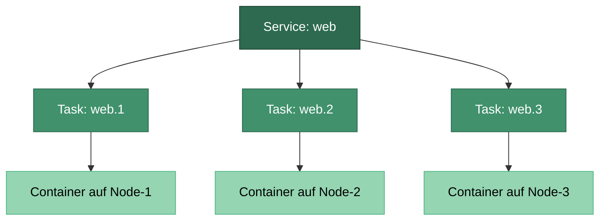
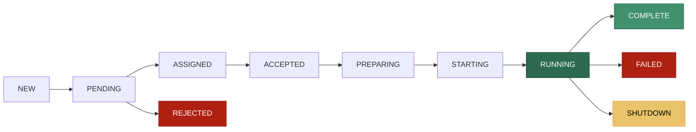
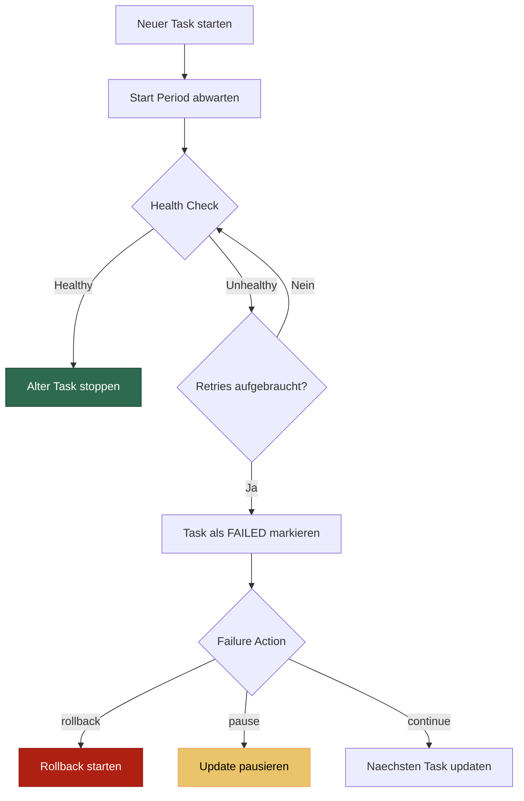
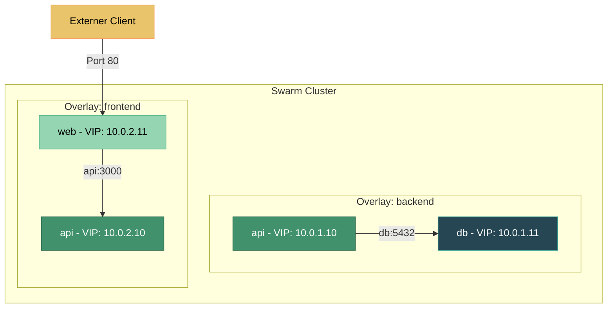

---
tags:
  - docker-swarm
  - services
  - tasks
  - orchestrierung
---

# Swarm Services und Tasks

> [!ABSTRACT] TL;DR
> Services sind das zentrale Konzept in Docker Swarm — sie definieren den **gewünschten Zustand** einer Anwendung. Ein Service beschreibt, welches Image laufen soll, wie viele Replicas gewünscht sind und wie Updates ablaufen. Tasks sind die einzelnen Ausführungseinheiten, die jeweils genau einen Container steuern.

---

## Was ist ein Service?

Ein Service in Docker Swarm ist die **deklarative Beschreibung** einer Anwendung. Man sagt dem Swarm nicht „starte diesen Container", sondern „ich möchte, dass 5 Instanzen von `nginx:latest` auf Port 80 laufen". Der Swarm-Manager kümmert sich dann selbstständig darum, diesen Zustand herzustellen und aufrechtzuerhalten.

Das Konzept ähnelt dem von [[Deployments und ReplicaSets]] in Kubernetes — beide folgen dem **Reconciliation-Loop-Prinzip**: Der aktuelle Zustand wird kontinuierlich mit dem gewünschten Zustand verglichen und bei Abweichung automatisch korrigiert.

> [!NOTE] Deklarativ vs. Imperativ
> Bei `docker run` sagt man: „Starte jetzt einen Container." Bei `docker service create` sagt man: „Ich möchte, dass dieser Dienst läuft." Der Unterschied: Stirbt der Container bei `docker run`, passiert nichts. Stirbt ein Task eines Services, erstellt der Swarm automatisch einen neuen.

---

## Service-Task-Container Hierarchie

Ein Service erzeugt Tasks, und jeder Task steuert genau einen Container. Diese dreistufige Hierarchie ist fundamental für das Verständnis von Swarm:



| Ebene | Beschreibung | Lebenszyklus |
|:------|:-------------|:-------------|
| **Service** | Gewünschter Zustand der Anwendung | Existiert bis explizit gelöscht |
| **Task** | Scheduling-Einheit, wird einem Node zugewiesen | Wird bei Bedarf neu erstellt |
| **Container** | Laufende Instanz des Images | Wird vom Task gesteuert |

> [!IMPORTANT] Tasks sind unveränderlich
> Ein Task kann nicht von einem Node auf einen anderen verschoben werden. Wenn ein Node ausfällt, wird der alte Task als `FAILED` markiert und ein **neuer** Task auf einem anderen Node erstellt. Tasks haben daher eine fortlaufende Slot-Nummer (`web.1`, `web.2`, etc.), aber die tatsächliche Task-ID ändert sich.

---

## Task-Lebenszyklus

Jeder Task durchläuft eine definierte Abfolge von Zuständen:



| Zustand | Bedeutung |
|:--------|:----------|
| `NEW` | Task wurde initialisiert |
| `PENDING` | Ressourcen werden zugewiesen |
| `ASSIGNED` | Task wurde einem Node zugewiesen |
| `ACCEPTED` | Node hat den Task akzeptiert |
| `PREPARING` | Image wird gepullt, Volumes gemountet |
| `STARTING` | Container wird gestartet |
| `RUNNING` | Container läuft |
| `COMPLETE` | Container wurde erfolgreich beendet (Exit 0) |
| `FAILED` | Container ist fehlgeschlagen |
| `SHUTDOWN` | Task wurde zum Herunterfahren aufgefordert |
| `REJECTED` | Node hat den Task abgelehnt |

---

## Service-Typen

Docker Swarm kennt zwei grundlegend verschiedene Service-Modi, die bestimmen, wie Tasks auf die Nodes verteilt werden.

### Replicated Services

Der Standardmodus. Man definiert eine **feste Anzahl an Replicas**, und der Swarm-Scheduler verteilt die Tasks nach Verfügbarkeit und Constraints auf die Nodes.

```bash
# Service mit 5 Replicas erstellen
docker service create \
  --name web \
  --replicas 5 \
  --publish published=80,target=80 \
  nginx:latest

# Replicas nachträglich ändern
docker service scale web=10
```

> [!TIP] Wann Replicated Services verwenden?
> Für **Applikations-Workloads** wie Webserver, APIs, Worker-Queues — überall, wo die Anzahl der Instanzen flexibel sein soll und nicht an die Anzahl der Nodes gebunden ist.

**Verteilungslogik:**

Der Scheduler versucht, Tasks **gleichmäßig** über die verfügbaren Nodes zu verteilen. Bei 5 Replicas auf 3 Nodes ergibt sich z.B.:

| Node | Tasks |
|:-----|:------|
| Node-1 (Manager) | `web.1`, `web.4` |
| Node-2 (Worker) | `web.2`, `web.5` |
| Node-3 (Worker) | `web.3` |

### Global Services

Im `global`-Modus läuft **genau ein Task auf jedem Node** im Swarm. Neue Nodes erhalten automatisch einen Task, wenn sie dem Cluster beitreten.

```bash
# Monitoring-Agent auf jedem Node
docker service create \
  --name node-exporter \
  --mode global \
  --publish published=9100,target=9100 \
  prom/node-exporter:latest

# Log-Collector auf jedem Node
docker service create \
  --name log-collector \
  --mode global \
  --mount type=bind,src=/var/log,dst=/var/log,readonly \
  fluent/fluent-bit:latest
```

> [!TIP] Wann Global Services verwenden?
> Für **infrastrukturelle Dienste**, die auf jedem Node präsent sein müssen:
> - Monitoring-Agents (Node Exporter, cAdvisor)
> - Log-Collector (Fluent Bit, Filebeat)
> - Storage-Plugins (CSI-Driver)
> - Netzwerk-Proxies (Traefik als Global Service)

> [!NOTE] Kein Scaling bei Global Services
> `docker service scale` funktioniert bei Global Services nicht — die Anzahl der Tasks ergibt sich automatisch aus der Anzahl der Nodes.

---

## Service erstellen und verwalten

### Service erstellen

```bash
# Einfacher Service
docker service create \
  --name web \
  --replicas 3 \
  --publish published=8080,target=80 \
  nginx:latest

# Umfangreiches Beispiel mit allen wichtigen Optionen
docker service create \
  --name api \
  --replicas 5 \
  --publish published=3000,target=3000 \
  --env NODE_ENV=production \
  --env DB_HOST=db.internal \
  --secret db_password \
  --config source=api-config,target=/app/config.json \
  --mount type=volume,src=api-data,dst=/app/data \
  --network backend \
  --network frontend \
  --limit-cpu 0.5 \
  --limit-memory 256M \
  --reserve-cpu 0.25 \
  --reserve-memory 128M \
  --restart-condition on-failure \
  --restart-max-attempts 3 \
  --restart-delay 5s \
  --health-cmd "curl -f http://localhost:3000/health || exit 1" \
  --health-interval 30s \
  --health-timeout 10s \
  --health-retries 3 \
  --update-parallelism 2 \
  --update-delay 10s \
  --update-order start-first \
  myregistry.local/api:2.1.0
```

### Service-Verwaltung

```bash
# Alle Services auflisten
docker service ls

# Tasks eines Services anzeigen (inkl. Node-Zuweisung)
docker service ps web

# Nur laufende Tasks anzeigen (ohne History)
docker service ps web --filter "desired-state=running"

# Detaillierte Informationen als JSON
docker service inspect web --pretty
docker service inspect web --format '{{.Spec.TaskTemplate.ContainerSpec.Image}}'

# Logs eines Services (aggregiert von allen Tasks)
docker service logs web
docker service logs web --follow --tail 100
docker service logs web --timestamps

# Logs eines einzelnen Tasks
docker service logs web.3

# Service aktualisieren
docker service update \
  --image nginx:1.28 \
  --env-add NEW_VAR=value \
  --env-rm OLD_VAR \
  web

# Service löschen
docker service rm web
```

> [!WARNING] `docker service rm` hat keine Bestätigung
> Der Befehl löscht den Service sofort inklusive aller laufenden Tasks und Container — ohne Rückfrage. Es gibt kein `--force`-Flag, weil es immer sofort wirkt. Vor dem Löschen sicherstellen, dass der richtige Service gewählt wurde.

---

## Scaling

### Manuelles Scaling

```bash
# Einen Service skalieren
docker service scale web=10

# Mehrere Services gleichzeitig skalieren
docker service scale web=10 api=5 worker=20

# Aktuellen Stand prüfen
docker service ls
```

### Scale auf 0 — Service pausieren

Ein nützlicher Trick: Einen Service auf 0 Replicas skalieren, ohne ihn zu löschen. Die gesamte Konfiguration (Netzwerke, Secrets, Mounts, Update-Policy) bleibt erhalten.

```bash
# Service pausieren
docker service scale web=0

# Service wieder aktivieren
docker service scale web=5
```

> [!TIP] Scale-auf-0 statt Löschen
> `docker service scale web=0` ist ideal für Wartungsfenster oder Debugging. Man kann den Service jederzeit wieder hochfahren, ohne ihn neu konfigurieren zu müssen. Die Alternative `docker service rm` würde die gesamte Konfiguration unwiderruflich löschen.

### Scaling-Verhalten

Beim Hoch- und Herunterskalieren gelten folgende Regeln:

| Richtung | Verhalten |
|:---------|:----------|
| **Scale Up** | Neue Tasks werden sofort erstellt und auf verfügbare Nodes verteilt |
| **Scale Down** | Überschüssige Tasks werden gestoppt (SIGTERM, Grace Period, dann SIGKILL) |
| **Node-Ausfall** | Tasks des ausgefallenen Nodes werden auf andere Nodes rescheduled |

> [!NOTE] Grace Period beim Herunterskalieren
> Container erhalten zuerst ein `SIGTERM`-Signal und haben standardmäßig 10 Sekunden Zeit für ein graceful Shutdown. Danach folgt `SIGKILL`. Die Grace Period kann mit `--stop-grace-period` konfiguriert werden.

---

## Update-Strategien

Updates sind eine der größten Stärken von Swarm Services. Statt alle Container gleichzeitig auszutauschen, können Rolling Updates schrittweise durchgeführt werden.

### Rolling Updates

```bash
# Image-Update mit Rolling-Update-Strategie
docker service update \
  --image myapp:2.0 \
  --update-parallelism 2 \
  --update-delay 10s \
  --update-order start-first \
  --update-failure-action rollback \
  --update-max-failure-ratio 0.2 \
  --update-monitor 30s \
  web
```

**Die wichtigsten Update-Parameter:**

| Parameter | Beschreibung | Default |
|:----------|:-------------|:--------|
| `--update-parallelism` | Wie viele Tasks gleichzeitig aktualisiert werden | `1` |
| `--update-delay` | Wartezeit zwischen den Batches | `0s` |
| `--update-order` | `start-first` oder `stop-first` | `stop-first` |
| `--update-failure-action` | `pause`, `continue` oder `rollback` | `pause` |
| `--update-max-failure-ratio` | Maximaler Anteil fehlgeschlagener Tasks (0.0-1.0) | `0` |
| `--update-monitor` | Beobachtungszeitraum nach Task-Start | `5s` |

```mermaid
graph LR
    subgraph Batch 1
        T1[Task 1: v1 zu v2]
        T2[Task 2: v1 zu v2]
    end
    subgraph Delay
        W1[Warte 10s]
    end
    subgraph Batch 2
        T3[Task 3: v1 zu v2]
        T4[Task 4: v1 zu v2]
    end
    subgraph Delay2[Delay]
        W2[Warte 10s]
    end
    subgraph Batch 3
        T5[Task 5: v1 zu v2]
    end

    Batch 1 --> Delay --> Batch 2 --> Delay2 --> Batch 3

    style T1 fill:#40916c,stroke:#2d6a4f,color:#fff
    style T2 fill:#40916c,stroke:#2d6a4f,color:#fff
    style T3 fill:#e9c46a,stroke:#f4a261,color:#000
    style T4 fill:#e9c46a,stroke:#f4a261,color:#000
    style T5 fill:#95d5b2,stroke:#52b788,color:#000
```

### Update-Order: start-first vs. stop-first

| Strategie | Ablauf | Vorteil | Nachteil |
|:----------|:-------|:--------|:---------|
| `stop-first` | Alter Task wird gestoppt, dann neuer gestartet | Weniger Ressourcenverbrauch | Kurze Downtime pro Task |
| `start-first` | Neuer Task wird gestartet, dann alter gestoppt | Zero-Downtime | Kurzzeitig doppelter Ressourcenverbrauch |

> [!TIP] Start-First für Produktionsumgebungen
> In Produktionsumgebungen ist `--update-order start-first` fast immer die bessere Wahl. Der neue Task wird gestartet und erst wenn er `RUNNING` ist (oder den Health Check besteht), wird der alte gestoppt. So gibt es keine Downtime.

### Rollbacks

Wenn ein Update fehlschlägt oder unerwünschte Ergebnisse liefert, kann auf die vorherige Version zurückgerollt werden.

```bash
# Manueller Rollback auf die vorherige Version
docker service rollback web

# Rollback mit eigener Strategie
docker service update \
  --rollback-parallelism 2 \
  --rollback-delay 5s \
  --rollback-order start-first \
  --rollback-failure-action pause \
  --rollback-max-failure-ratio 0.1 \
  --rollback-monitor 30s \
  web
```

> [!WARNING] Rollback geht nur einen Schritt zurück
> `docker service rollback` kehrt immer nur zur **unmittelbar vorherigen** Konfiguration zurück. Es gibt keine mehrstufige Rollback-Historie. Für komplexere Rollback-Szenarien empfiehlt sich der Einsatz von [[Swarm Stacks]] mit versionierten Compose-Dateien.

**Automatischer Rollback bei Fehlern:**

```bash
# Service mit automatischem Rollback bei Update-Fehler
docker service create \
  --name web \
  --replicas 5 \
  --update-failure-action rollback \
  --update-max-failure-ratio 0.2 \
  --update-monitor 30s \
  --rollback-parallelism 2 \
  --rollback-delay 5s \
  --rollback-order start-first \
  nginx:latest
```

In diesem Beispiel: Wenn mehr als 20% der Tasks beim Update fehlschlagen (`--update-max-failure-ratio 0.2`), wird automatisch ein Rollback ausgelöst.

---

## Placement und Constraints

Nicht jeder Task soll auf jedem Node laufen. Mit Placement Constraints und Preferences lässt sich steuern, **wo** Tasks platziert werden.

### Node Labels setzen

```bash
# Labels an Nodes vergeben
docker node update --label-add env=production node-1
docker node update --label-add env=production node-2
docker node update --label-add env=staging node-3
docker node update --label-add storage=ssd node-1
docker node update --label-add region=eu-west node-1
docker node update --label-add region=eu-east node-2

# Labels anzeigen
docker node inspect node-1 --format '{{.Spec.Labels}}'
```

### Constraints

Constraints schränken ein, auf **welchen Nodes** ein Service laufen darf. Sie sind harte Regeln — wird kein passender Node gefunden, bleibt der Task im Zustand `PENDING`.

```bash
# Nur auf Production-Nodes laufen
docker service create \
  --name web \
  --replicas 5 \
  --constraint 'node.labels.env == production' \
  nginx:latest

# Nur auf Worker-Nodes (nicht auf Managern)
docker service create \
  --name worker \
  --constraint 'node.role == worker' \
  myapp:latest

# Mehrere Constraints (AND-Verknüpfung)
docker service create \
  --name db \
  --constraint 'node.labels.env == production' \
  --constraint 'node.labels.storage == ssd' \
  postgres:16

# Nicht auf einem bestimmten Node
docker service create \
  --name web \
  --constraint 'node.hostname != node-3' \
  nginx:latest
```

> [!IMPORTANT] Pending Tasks bei unerfüllbaren Constraints
> Wenn kein Node die Constraints erfüllt, bleiben Tasks dauerhaft im Zustand `PENDING`. Der Swarm zeigt keine Fehlermeldung — man muss mit `docker service ps <service>` prüfen, ob Tasks tatsächlich laufen. Regelmäßiges Monitoring der Task-Zustände ist daher essenziell.

### Placement Preferences

Placement Preferences sind **weiche Regeln** — sie beeinflussen die Verteilung, verhindern aber nicht die Platzierung, wenn die Präferenz nicht erfüllt werden kann.

```bash
# Tasks gleichmäßig über Regionen verteilen (Spread)
docker service create \
  --name web \
  --replicas 6 \
  --placement-pref 'spread=node.labels.region' \
  nginx:latest
```

Bei 6 Replicas und 2 Regionen (`eu-west`, `eu-east`) verteilt der Scheduler je 3 Tasks pro Region:

| Region | Tasks |
|:-------|:------|
| `eu-west` | `web.1`, `web.3`, `web.5` |
| `eu-east` | `web.2`, `web.4`, `web.6` |

### Resource Reservations und Limits

```bash
# CPU- und Speicher-Limits setzen
docker service create \
  --name api \
  --replicas 5 \
  --limit-cpu 1.0 \
  --limit-memory 512M \
  --reserve-cpu 0.5 \
  --reserve-memory 256M \
  myapp:latest
```

| Parameter | Beschreibung |
|:----------|:-------------|
| `--limit-cpu` | Maximale CPU-Nutzung (Hard Limit) |
| `--limit-memory` | Maximaler Speicher (Container wird bei Überschreitung gekillt — OOM) |
| `--reserve-cpu` | Garantierte CPU (wird beim Scheduling berücksichtigt) |
| `--reserve-memory` | Garantierter Speicher (wird beim Scheduling berücksichtigt) |

> [!WARNING] OOM-Kill bei Speicher-Limit
> Wenn ein Container sein Memory-Limit überschreitet, wird er sofort vom Kernel per OOM-Kill beendet. Der Task wird als `FAILED` markiert und ein neuer Task gestartet. Wenn der Container grundsätzlich mehr Speicher braucht, führt das zu einer **Restart-Schleife**. Daher Limits immer mit ausreichend Puffer setzen.

---

## Health Checks

Health Checks ermöglichen dem Swarm, die Gesundheit einzelner Tasks zu überwachen und bei Problemen automatisch zu reagieren.

### Health Check im Dockerfile

```dockerfile
FROM node:20-slim
WORKDIR /app
COPY . .
RUN npm ci --production

HEALTHCHECK --interval=30s --timeout=10s --start-period=15s --retries=3 \
  CMD curl -f http://localhost:3000/health || exit 1

CMD ["node", "server.js"]
```

### Health Check beim Service erstellen

```bash
# Health Check per CLI definieren (überschreibt Dockerfile)
docker service create \
  --name api \
  --replicas 3 \
  --health-cmd "curl -f http://localhost:3000/health || exit 1" \
  --health-interval 30s \
  --health-timeout 10s \
  --health-start-period 15s \
  --health-retries 3 \
  myapp:latest

# Health Check deaktivieren
docker service create \
  --name worker \
  --no-healthcheck \
  myapp:latest
```

| Parameter | Beschreibung | Empfehlung |
|:----------|:-------------|:-----------|
| `--health-cmd` | Befehl, der den Zustand prüft (Exit 0 = healthy) | Leichtgewichtigen Endpoint prüfen |
| `--health-interval` | Intervall zwischen den Checks | 15-30s |
| `--health-timeout` | Maximale Dauer eines Checks | 5-10s |
| `--health-start-period` | Grace Period nach Container-Start | An Startup-Zeit anpassen |
| `--health-retries` | Fehlschläge bevor `unhealthy` | 3-5 |

### Einfluss auf Rolling Updates

Health Checks spielen bei Rolling Updates eine zentrale Rolle. Der Swarm wartet nach dem Start eines neuen Tasks, bis dieser als `healthy` gilt, bevor der nächste Batch aktualisiert wird.



> [!TIP] Start Period großzügig setzen
> Die `--health-start-period` sollte mindestens so lang sein, wie die Anwendung zum Starten braucht. Während der Start Period werden fehlgeschlagene Health Checks nicht als Fehler gezählt. Ist die Period zu kurz, werden langsam startende Anwendungen fälschlicherweise als `unhealthy` markiert.

---

## Service Discovery

Docker Swarm bringt eine eingebaute Service Discovery mit, die es Services ermöglicht, sich gegenseitig über ihren Namen zu finden — ohne externe Tools wie Consul oder etcd.

### Internes DNS

Jeder Service erhält automatisch einen DNS-Eintrag im Overlay-Netzwerk. Andere Services im gleichen Netzwerk können ihn über seinen Namen auflösen.

```bash
# Zwei Services im gleichen Netzwerk
docker network create --driver overlay backend

docker service create \
  --name api \
  --network backend \
  --replicas 3 \
  myapp:latest

docker service create \
  --name db \
  --network backend \
  --replicas 1 \
  postgres:16
```

Der `api`-Service kann die Datenbank jetzt einfach über den Hostnamen `db` erreichen:

```bash
# Innerhalb eines api-Containers
psql -h db -U postgres
curl http://api:3000/health
```

> [!NOTE] DNS-Auflösung nur im gleichen Netzwerk
> Services können sich nur gegenseitig finden, wenn sie im **gleichen Overlay-Netzwerk** sind. Services in verschiedenen Netzwerken sind voneinander isoliert. Ein Service kann Mitglied mehrerer Netzwerke sein, um gezielt Verbindungen zu ermöglichen.

### VIP vs. DNSRR

Docker Swarm bietet zwei Endpoint-Modi für die Service Discovery:

```bash
# VIP-Modus (Standard)
docker service create \
  --name web \
  --endpoint-mode vip \
  --replicas 3 \
  nginx:latest

# DNS Round Robin Modus
docker service create \
  --name web \
  --endpoint-mode dnsrr \
  --replicas 3 \
  nginx:latest
```

| Modus | Funktionsweise | Vorteile | Nachteile |
|:------|:---------------|:---------|:----------|
| **VIP** (Default) | Service bekommt eine virtuelle IP. IPVS-Load-Balancing verteilt Traffic auf die Tasks | Connection-basiertes LB, stabil | Etwas mehr Overhead |
| **DNSRR** | DNS gibt alle Task-IPs zurück. Client wählt zufällig | Kein LB-Overhead, kompatibel mit externen LBs | Kein echtes LB, DNS-Caching problematisch |

> [!TIP] VIP für die meisten Anwendungsfälle
> Der VIP-Modus ist fast immer die bessere Wahl. Er bietet echtes Load Balancing auf Verbindungsebene und ist transparent für die Anwendung. DNSRR ist nur sinnvoll, wenn ein externer Load Balancer die Verteilung übernimmt oder die Anwendung Client-seitiges Load Balancing implementiert.

### Netzwerk-Architektur

Für eine detaillierte Beschreibung der Netzwerk-Konzepte in Docker Swarm — Overlay-Netzwerke, Ingress-Netzwerk und Routing Mesh — siehe [[Swarm Networking]].



---

## Restart-Policies

Die Restart-Policy bestimmt, was passiert, wenn ein Task-Container beendet wird.

```bash
docker service create \
  --name worker \
  --restart-condition on-failure \
  --restart-delay 5s \
  --restart-max-attempts 3 \
  --restart-window 120s \
  myapp:latest
```

| Parameter | Optionen | Beschreibung |
|:----------|:---------|:-------------|
| `--restart-condition` | `any`, `on-failure`, `none` | Wann neu starten |
| `--restart-delay` | z.B. `5s`, `30s` | Wartezeit vor Neustart |
| `--restart-max-attempts` | z.B. `3`, `5` | Maximale Neustartversuche |
| `--restart-window` | z.B. `120s`, `5m` | Zeitfenster für Neustartzähler |

> [!NOTE] Restart-Condition: any vs. on-failure
> - `any` (Default): Container wird immer neu gestartet, auch bei Exit 0
> - `on-failure`: Container wird nur bei Fehler (Exit != 0) neu gestartet
> - `none`: Container wird nie automatisch neu gestartet
>
> Für **Langläufer** (Webserver, APIs) ist `any` sinnvoll. Für **Batch-Jobs**, die sich nach Abschluss beenden sollen, ist `on-failure` die richtige Wahl.

---

## Praxisbeispiel: Vollständiger Service-Stack

Ein realistisches Beispiel, das die meisten Konzepte dieser Seite kombiniert:

```bash
# Netzwerke erstellen
docker network create --driver overlay frontend
docker network create --driver overlay backend

# Node-Labels setzen
docker node update --label-add env=production node-1
docker node update --label-add env=production node-2
docker node update --label-add env=production node-3
docker node update --label-add storage=ssd node-1

# Datenbank (1 Replica, SSD-Node, reservierter Speicher)
docker service create \
  --name db \
  --replicas 1 \
  --network backend \
  --constraint 'node.labels.storage == ssd' \
  --mount type=volume,src=pgdata,dst=/var/lib/postgresql/data \
  --reserve-memory 512M \
  --limit-memory 1G \
  --env POSTGRES_DB=app \
  --secret postgres_password \
  --health-cmd "pg_isready -U postgres" \
  --health-interval 15s \
  --restart-condition on-failure \
  postgres:16

# API (5 Replicas, Rolling Update, Health Checks)
docker service create \
  --name api \
  --replicas 5 \
  --network backend \
  --network frontend \
  --constraint 'node.labels.env == production' \
  --reserve-cpu 0.25 \
  --reserve-memory 128M \
  --limit-cpu 1.0 \
  --limit-memory 512M \
  --env DATABASE_URL=postgresql://postgres@db:5432/app \
  --secret postgres_password \
  --health-cmd "curl -f http://localhost:3000/health || exit 1" \
  --health-interval 30s \
  --health-start-period 20s \
  --update-parallelism 2 \
  --update-delay 15s \
  --update-order start-first \
  --update-failure-action rollback \
  --rollback-parallelism 2 \
  --rollback-order start-first \
  myapp/api:1.5.0

# Webserver (3 Replicas, Published Port)
docker service create \
  --name web \
  --replicas 3 \
  --network frontend \
  --publish published=443,target=80 \
  --constraint 'node.labels.env == production' \
  --update-parallelism 1 \
  --update-order start-first \
  nginx:latest

# Monitoring (Global Service auf jedem Node)
docker service create \
  --name node-exporter \
  --mode global \
  --network backend \
  --publish published=9100,target=9100,mode=host \
  prom/node-exporter:latest
```

> [!TIP] Von einzelnen Services zu Stacks
> In der Praxis definiert man solche Multi-Service-Deployments nicht als einzelne CLI-Befehle, sondern als **Docker Compose-Datei** und deployt sie als Stack. Details dazu in [[Swarm Stacks]].

---

## Troubleshooting

### Häufige Probleme und Lösungen

> [!WARNING] Tasks bleiben im Zustand PENDING
> **Ursachen:**
> - Kein Node erfüllt die Constraints
> - Nicht genügend Ressourcen (CPU/RAM Reservations)
> - Alle Nodes sind `drain`
>
> **Diagnose:**
> ```bash
> # Task-Details mit Fehlermeldung anzeigen
> docker service ps web --no-trunc
>
> # Node-Ressourcen prüfen
> docker node ls
> docker node inspect <node> --format '{{.Status.State}}'
> ```

> [!WARNING] Container starten, fallen aber sofort wieder aus
> **Ursachen:**
> - Image nicht vorhanden oder fehlerhaft
> - Fehlende Umgebungsvariablen oder Secrets
> - Falsche CMD/Entrypoint-Konfiguration
>
> **Diagnose:**
> ```bash
> # Logs des fehlgeschlagenen Tasks ansehen
> docker service logs web --tail 50
>
> # Task-History mit Exit-Codes anzeigen
> docker service ps web --format "table {{.Name}}\t{{.CurrentState}}\t{{.Error}}"
> ```

> [!WARNING] Rolling Update bleibt hängen
> **Ursachen:**
> - Health Check schlägt fehl und `--update-failure-action pause` ist gesetzt
> - Neuer Container braucht länger zum Starten als `--health-start-period`
>
> **Lösung:**
> ```bash
> # Update-Status prüfen
> docker service inspect web --format '{{.UpdateStatus}}'
>
> # Update fortsetzen nach Pause
> docker service update --force web
>
> # Oder Rollback
> docker service rollback web
> ```

### Nützliche Diagnose-Befehle

```bash
# Gesamtübersicht aller Services und deren Tasks
docker service ls
docker service ps $(docker service ls -q) --filter "desired-state=running"

# Detaillierte Task-Informationen
docker service ps web --no-trunc --format \
  "table {{.ID}}\t{{.Name}}\t{{.Node}}\t{{.CurrentState}}\t{{.Error}}"

# Node-Auslastung prüfen
docker node ps <node-name>

# Alle Tasks auf einem bestimmten Node
docker node ps node-1 --filter "desired-state=running"

# Service-Events im Swarm
docker events --filter type=service --filter service=web
```

---

## Verwandte Notizen

- [[Docker Swarm Index]] — Übersicht aller Docker Swarm Dokumentationen
- [[Swarm Stacks]] — Multi-Service-Deployments mit Docker Compose
- [[Swarm Networking]] — Overlay-Netzwerke, Ingress und Routing Mesh
- [[Swarm CLI Cheatsheet]] — Kompakte Befehlsreferenz
- [[Deployments und ReplicaSets]] — Kubernetes-Pendant zu Swarm Services