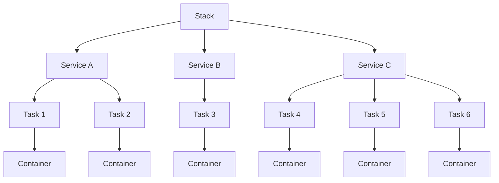
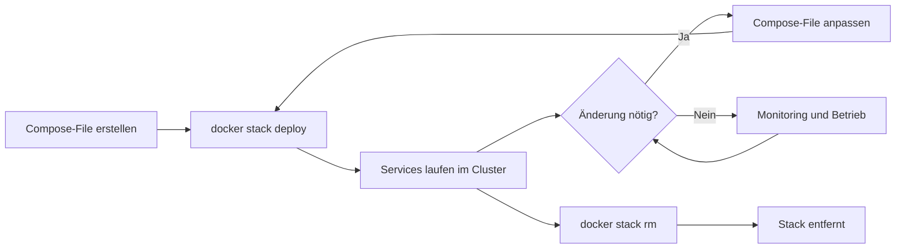
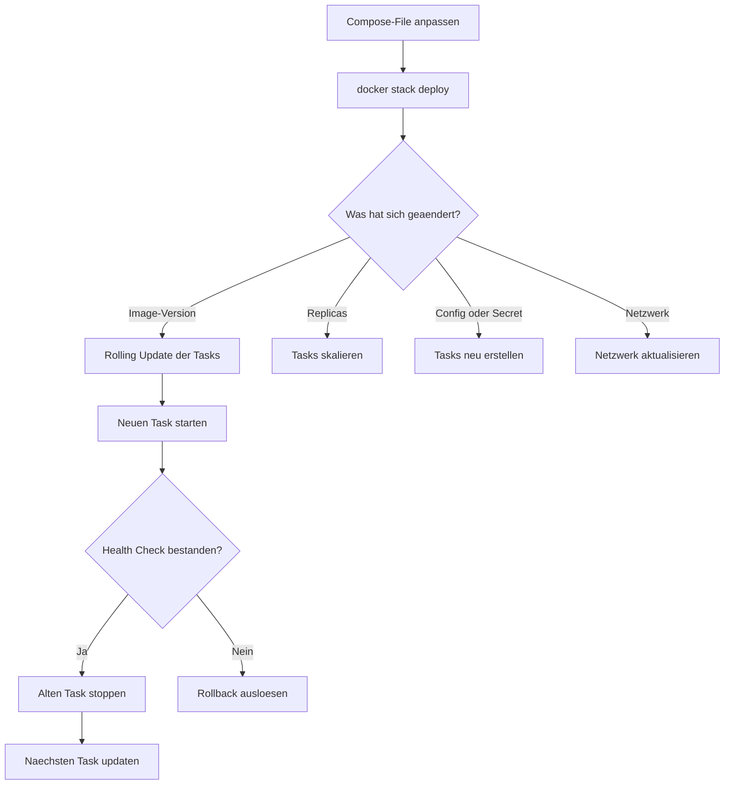

---
tags:
  - docker-swarm
  - stacks
  - compose
  - deployment
---

# Swarm Stacks

> [!ABSTRACT] TL;DR
> Stacks sind das Deployment-Modell in Docker Swarm — sie verwenden Docker Compose-Dateien (v3+), um Multi-Service-Anwendungen im Cluster zu deployen. Ein einziger `docker stack deploy`-Befehl erstellt Services, Netzwerke, Volumes und Secrets aus einer deklarativen YAML-Datei.

---

## Was sind Stacks?

Ein **Stack** ist eine logische Gruppe zusammengehöriger Services, die gemeinsam deployed und verwaltet werden. Stacks bilden die oberste Abstraktionsebene in Docker Swarm und entsprechen dem Konzept einer Anwendung bestehend aus mehreren Microservices.

Die Hierarchie in Docker Swarm lässt sich wie folgt darstellen:



### Kernkonzepte

- **Stack** = Gruppe zusammengehöriger Services, Netzwerke, Volumes und Configs
- Definiert in **Compose-Files** (v3.x / Compose Spec)
- Deployment über `docker stack deploy -c compose.yaml stackname`
- **Namenskonvention**: Alle Ressourcen erhalten das Präfix `<stackname>_` — ein Service `web` im Stack `myapp` heißt `myapp_web`
- Stacks sind **idempotent** — erneutes Deployen aktualisiert nur geänderte Ressourcen

> [!NOTE] Stack vs. Compose
> Obwohl Stacks dieselbe YAML-Syntax nutzen wie Docker Compose, gibt es wesentliche Unterschiede. `docker compose up` startet Container lokal, `docker stack deploy` verteilt Services über den gesamten Swarm-Cluster.

### Stack-Lebenszyklus



---

## Compose-File für Swarm

Docker Swarm verwendet Compose-Dateien im Format **v3.x** oder nach der neueren **Compose Specification**. Nicht alle Direktiven funktionieren im Swarm Mode — einige werden stillschweigend ignoriert.

> [!NOTE] version-Feld seit 2024 optional
> Das `version: "3.8"`-Feld in Compose-Dateien ist seit der **Compose Specification** (2024) deprecated und wird von modernem Docker Compose ignoriert. Für `docker stack deploy` funktioniert es weiterhin, kann aber weggelassen werden. Neue Projekte sollten das Feld weglassen und direkt mit `services:` beginnen.

### Unterstützte vs. ignorierte Direktiven

| Direktive | Swarm Mode | Compose (Einzelhost) | Anmerkung |
|:----------|:----------:|:--------------------:|:----------|
| `image` | ✅ | ✅ | Pflichtfeld in Swarm |
| `deploy` | ✅ | ❌ | Nur in Swarm relevant |
| `ports` | ✅ | ✅ | Routing Mesh in Swarm |
| `volumes` | ✅ | ✅ | Nur named Volumes empfohlen |
| `networks` | ✅ | ✅ | Overlay-Netzwerke in Swarm |
| `secrets` | ✅ | ⚠️ | Echte Secrets nur in Swarm |
| `configs` | ✅ | ⚠️ | Echte Configs nur in Swarm |
| `environment` | ✅ | ✅ | Funktioniert überall |
| `build` | ❌ | ✅ | In Swarm ignoriert |
| `depends_on` | ❌ | ✅ | In Swarm ignoriert |
| `links` | ❌ | ✅ | Veraltet, in Swarm ignoriert |
| `container_name` | ❌ | ✅ | In Swarm ignoriert |
| `restart` | ❌ | ✅ | Ersetzt durch `deploy.restart_policy` |
| `devices` | ❌ | ✅ | In Swarm nicht unterstützt |
| `privileged` | ❌ | ✅ | In Swarm nicht unterstützt |

> [!WARNING] Build-Direktive wird ignoriert
> In Swarm Mode muss das Image **vorab gebaut und in eine Registry gepusht** werden. Die `build:`-Direktive wird vollständig ignoriert. Swarm-Nodes ziehen das Image aus der Registry.

### Die deploy-Konfiguration im Detail

Die `deploy:`-Sektion ist das Herzstück der Swarm-Konfiguration. Hier werden Replikation, Update-Strategien, Ressourcen-Limits und Placement-Constraints definiert:

```yaml
deploy:
  # Anzahl der Replikas
  replicas: 3

  # Update-Strategie (Rolling Update)
  update_config:
    parallelism: 1          # Wie viele Tasks gleichzeitig updaten
    delay: 10s              # Wartezeit zwischen Updates
    failure_action: rollback # Bei Fehler: rollback | pause | continue
    monitor: 30s            # Beobachtungszeitraum nach Update
    max_failure_ratio: 0.1  # Max. 10% Fehlerquote toleriert
    order: start-first      # Erst neuen starten, dann alten stoppen

  # Rollback-Strategie
  rollback_config:
    parallelism: 1
    delay: 5s
    failure_action: pause
    monitor: 15s
    order: stop-first

  # Neustart-Verhalten
  restart_policy:
    condition: on-failure   # on-failure | any | none
    delay: 5s               # Wartezeit vor Neustart
    max_attempts: 3         # Maximale Neustartversuche
    window: 120s            # Zeitfenster für max_attempts

  # Placement-Regeln
  placement:
    constraints:
      - node.role == worker
      - node.labels.zone == eu-west
    preferences:
      - spread: node.labels.zone  # Gleichmäßig über Zonen verteilen

  # Ressourcen-Management
  resources:
    limits:
      cpus: '0.50'
      memory: 512M
    reservations:
      cpus: '0.25'
      memory: 256M

  # Endpoint-Modus
  endpoint_mode: vip        # vip (Virtual IP) | dnsrr (DNS Round Robin)

  # Labels für den Service
  labels:
    app.version: "2.1.0"
    app.environment: "production"
```

> [!TIP] update_config.order
> Verwende `order: start-first` für Zero-Downtime-Deployments. Dabei wird der neue Container zuerst gestartet und erst nach erfolgreichem Health Check der alte gestoppt. Bei Speicherknappheit auf `stop-first` wechseln.

---

## Stack-Befehle

### Übersicht aller Befehle

```bash
# Stack deployen (oder aktualisieren)
docker stack deploy -c compose.yaml myapp

# Mehrere Compose-Files zusammenführen
docker stack deploy -c base.yaml -c production.yaml myapp

# Alle Stacks anzeigen
docker stack ls

# Services eines Stacks anzeigen
docker stack services myapp

# Laufende Tasks eines Stacks anzeigen
docker stack ps myapp

# Nur laufende Tasks (ohne gestoppte)
docker stack ps myapp --filter "desired-state=running"

# Stack entfernen
docker stack rm myapp
```

### Detaillierte Diagnose

```bash
# Service-Logs im Stack anzeigen
docker service logs myapp_web --follow --tail 100

# Service-Details inspizieren
docker service inspect myapp_web --pretty

# Task-Verteilung über Nodes prüfen
docker stack ps myapp --format "table {{.Name}}\t{{.Node}}\t{{.CurrentState}}"

# Fehlgeschlagene Tasks anzeigen
docker stack ps myapp --filter "desired-state=shutdown" \
  --format "table {{.Name}}\t{{.Error}}\t{{.CurrentState}}"

# Netzwerke des Stacks anzeigen
docker network ls --filter "label=com.docker.stack.namespace=myapp"
```

> [!INFO] Stack-Namespace
> Alle Ressourcen eines Stacks erhalten automatisch das Label `com.docker.stack.namespace=<stackname>`. Damit lassen sich Stack-Ressourcen eindeutig filtern und identifizieren.

---

## Praxisbeispiele

### Beispiel 1: Web-App mit Redis

Ein typischer Stack mit einem Python-Webservice und Redis als Cache:

```yaml
version: "3.8"

services:
  web:
    image: registry.example.com/webapp:2.1.0
    ports:
      - "8080:80"
    environment:
      - REDIS_HOST=redis
      - REDIS_PORT=6379
      - APP_ENV=production
    networks:
      - frontend
      - backend
    deploy:
      replicas: 3
      update_config:
        parallelism: 1
        delay: 10s
        order: start-first
      restart_policy:
        condition: on-failure
        max_attempts: 3
      resources:
        limits:
          cpus: '0.50'
          memory: 256M
        reservations:
          cpus: '0.25'
          memory: 128M
    healthcheck:
      test: ["CMD", "curl", "-f", "http://localhost:80/health"]
      interval: 30s
      timeout: 10s
      retries: 3
      start_period: 15s

  redis:
    image: redis:7-alpine
    networks:
      - backend
    volumes:
      - redis-data:/data
    deploy:
      replicas: 1
      placement:
        constraints:
          - node.role == worker
      resources:
        limits:
          cpus: '0.25'
          memory: 128M

networks:
  frontend:
    driver: overlay
  backend:
    driver: overlay
    internal: true   # Kein externer Zugriff

volumes:
  redis-data:
    driver: local
```

```bash
# Stack deployen
docker stack deploy -c webapp-stack.yaml webapp

# Prüfen ob alle Services laufen
docker stack services webapp
```

### Beispiel 2: WordPress Stack

WordPress mit MariaDB, Secrets für Passwörter und definierten Placement-Constraints:

```yaml
version: "3.8"

services:
  wordpress:
    image: wordpress:6-php8.2-apache
    ports:
      - "80:80"
    environment:
      WORDPRESS_DB_HOST: db:3306
      WORDPRESS_DB_NAME: wordpress
      WORDPRESS_DB_USER: wp_user
      WORDPRESS_DB_PASSWORD_FILE: /run/secrets/wp_db_password
    secrets:
      - wp_db_password
    volumes:
      - wp-content:/var/www/html/wp-content
    networks:
      - wp-net
    deploy:
      replicas: 2
      update_config:
        parallelism: 1
        delay: 15s
        order: start-first
      placement:
        constraints:
          - node.role == worker
      resources:
        limits:
          cpus: '0.50'
          memory: 512M

  db:
    image: mariadb:11
    environment:
      MYSQL_ROOT_PASSWORD_FILE: /run/secrets/db_root_password
      MYSQL_DATABASE: wordpress
      MYSQL_USER: wp_user
      MYSQL_PASSWORD_FILE: /run/secrets/wp_db_password
    secrets:
      - db_root_password
      - wp_db_password
    volumes:
      - db-data:/var/lib/mysql
    networks:
      - wp-net
    deploy:
      replicas: 1
      placement:
        constraints:
          - node.labels.storage == ssd
      resources:
        limits:
          cpus: '1.0'
          memory: 1G
        reservations:
          cpus: '0.50'
          memory: 512M

secrets:
  db_root_password:
    external: true
  wp_db_password:
    external: true

networks:
  wp-net:
    driver: overlay

volumes:
  wp-content:
    driver: local
  db-data:
    driver: local
```

> [!IMPORTANT] Secrets vorab erstellen
> Externe Secrets müssen **vor** dem Stack-Deployment existieren. Erstelle sie mit:
> ```bash
> echo "sicheres_passwort" | docker secret create db_root_password -
> echo "wp_passwort_123" | docker secret create wp_db_password -
> ```

```bash
# Secrets erstellen
echo "MeinRootPasswort!" | docker secret create db_root_password -
echo "MeinWPPasswort!" | docker secret create wp_db_password -

# Stack deployen
docker stack deploy -c wordpress-stack.yaml wordpress
```

### Beispiel 3: Monitoring Stack

Prometheus und Grafana als Swarm Stack mit globaler Node-Exporter-Verteilung:

```yaml
version: "3.8"

services:
  prometheus:
    image: prom/prometheus:v2.53.0
    ports:
      - "9090:9090"
    volumes:
      - prometheus-data:/prometheus
    configs:
      - source: prometheus-config
        target: /etc/prometheus/prometheus.yml
    networks:
      - monitoring
    deploy:
      replicas: 1
      placement:
        constraints:
          - node.role == manager
      resources:
        limits:
          cpus: '1.0'
          memory: 1G

  grafana:
    image: grafana/grafana:11.1.0
    ports:
      - "3000:3000"
    environment:
      GF_SECURITY_ADMIN_PASSWORD_FILE: /run/secrets/grafana_admin_pw
    secrets:
      - grafana_admin_pw
    volumes:
      - grafana-data:/var/lib/grafana
    networks:
      - monitoring
    deploy:
      replicas: 1
      placement:
        constraints:
          - node.role == manager
      resources:
        limits:
          cpus: '0.50'
          memory: 512M

  node-exporter:
    image: prom/node-exporter:v1.8.1
    volumes:
      - /proc:/host/proc:ro
      - /sys:/host/sys:ro
      - /:/rootfs:ro
    command:
      - '--path.procfs=/host/proc'
      - '--path.sysfs=/host/sys'
      - '--path.rootfs=/rootfs'
    networks:
      - monitoring
    deploy:
      mode: global           # Auf JEDEM Node eine Instanz
      resources:
        limits:
          cpus: '0.10'
          memory: 64M

configs:
  prometheus-config:
    file: ./prometheus.yml

secrets:
  grafana_admin_pw:
    external: true

networks:
  monitoring:
    driver: overlay

volumes:
  prometheus-data:
    driver: local
  grafana-data:
    driver: local
```

> [!TIP] Globaler Modus
> Der Node-Exporter nutzt `mode: global` statt `replicas`. Damit wird automatisch auf **jedem Node** im Cluster genau eine Instanz gestartet — auch auf Nodes, die später hinzukommen.

---

## Environment-Management

### Umgebungsvariablen im Compose-File

Es gibt mehrere Wege, Umgebungsvariablen in Stack-Deployments einzubinden:

```yaml
services:
  web:
    image: myapp:latest
    environment:
      # Direkte Zuweisung
      APP_ENV: production
      LOG_LEVEL: info
      # Variable aus Host-Umgebung (nur beim Deployen)
      API_KEY: ${API_KEY}
      # Mit Default-Wert
      TIMEOUT: ${TIMEOUT:-30}
```

### .env-Dateien

> [!WARNING] .env-Dateien in Swarm
> Die `.env`-Datei wird nur auf dem **Manager-Node** gelesen, auf dem `docker stack deploy` ausgeführt wird. Sie dient der **Variablen-Substitution im Compose-File** — nicht als Runtime-Environment für Container. Das Verhalten unterscheidet sich von `docker compose up`, wo `.env` automatisch geladen wird.

```bash
# .env-Datei auf dem Manager-Node
APP_VERSION=2.1.0
REGISTRY=registry.example.com
REPLICAS=3
```

```yaml
# compose.yaml — Variablen werden beim Deploy aufgelöst
services:
  web:
    image: ${REGISTRY}/webapp:${APP_VERSION}
    deploy:
      replicas: ${REPLICAS:-2}
```

```bash
# Deploy mit expliziter .env-Datei
env $(cat .env | xargs) docker stack deploy -c compose.yaml myapp

# Oder Variablen direkt setzen
REPLICAS=5 docker stack deploy -c compose.yaml myapp
```

### Unterschiede zu docker compose up

| Aspekt | `docker compose up` | `docker stack deploy` |
|:-------|:-------------------:|:---------------------:|
| `.env` automatisch geladen | ✅ | ❌ |
| `env_file:` Direktive | ✅ | ✅ |
| Variablen-Substitution | ✅ | ✅ (nur am Manager) |
| Secrets-Integration | Nur Datei-basiert | Verschlüsselt im Raft-Log |
| `--env-file` Flag | ✅ | ❌ |

> [!TIP] Sensible Daten
> Verwende für Passwörter, API-Keys und Zertifikate immer **Docker Secrets** statt Umgebungsvariablen. Secrets werden verschlüsselt im Raft-Log gespeichert und nur den zugewiesenen Services als Datei unter `/run/secrets/` bereitgestellt.

---

## Stack Updates

### Update-Workflow

Ein Stack wird aktualisiert, indem dasselbe `docker stack deploy`-Kommando erneut ausgeführt wird. Docker Swarm vergleicht den gewünschten mit dem aktuellen Zustand und führt nur die nötigen Änderungen durch:



### Rolling Updates durchführen

```bash
# Image-Version im Compose-File aktualisieren und deployen
docker stack deploy -c compose.yaml myapp

# Alternativ: Service direkt updaten (ohne Compose-File)
docker service update --image webapp:2.2.0 myapp_web

# Update-Status beobachten
watch docker stack ps myapp --filter "desired-state=running"

# Manuelles Rollback eines Service
docker service rollback myapp_web
```

### Was triggert ein Redeployment?

| Änderung | Verhalten |
|:---------|:----------|
| Image-Tag geändert | Rolling Update aller Tasks |
| Environment-Variable geändert | Tasks werden neu erstellt |
| Config oder Secret geändert | Tasks werden neu erstellt |
| Replicas geändert | Neue Tasks starten oder überschüssige stoppen |
| Resource Limits geändert | Tasks werden neu erstellt |
| Labels geändert | Nur Metadaten-Update, kein Redeployment |
| Netzwerk hinzugefügt | Tasks werden neu erstellt |
| Port-Mapping geändert | Tasks werden neu erstellt |

> [!WARNING] Dasselbe Image-Tag
> Wenn sich nur der Inhalt eines Images ändert, aber der Tag identisch bleibt (z.B. `webapp:latest`), erkennt Swarm **keine Änderung**. Verwende immer **versionierte Tags** wie `webapp:2.1.0`, oder erzwinge ein Update mit:
> ```bash
> docker service update --force myapp_web
> ```

### Configs und Secrets rotieren

Configs und Secrets sind **immutable** — sie können nach der Erstellung nicht geändert werden. Um sie zu aktualisieren, muss eine neue Version erstellt und dem Service zugewiesen werden:

```bash
# Neue Config-Version erstellen
docker config create prometheus-config-v2 ./prometheus-v2.yml

# Im Compose-File die Config-Referenz aktualisieren
# configs:
#   prometheus-config:
#     name: prometheus-config-v2
#     file: ./prometheus-v2.yml

# Erneut deployen
docker stack deploy -c compose.yaml monitoring
```

---

## Best Practices

> [!TIP] Bewährte Vorgehensweisen für Swarm Stacks

### Stack-Organisation

- **Ein Stack pro Anwendung** — Zusammengehörige Services gruppieren, aber unabhängige Anwendungen trennen
- **Konsistente Benennung** — Stack-Namen in Kleinbuchstaben ohne Sonderzeichen: `webapp`, `monitoring`, `logging`
- **Compose-Files versionieren** — Alle Stack-Definitionen in Git verwalten
- **Environment-spezifische Overrides** — Basis-Compose + Override-Datei pro Umgebung

```bash
# Basis + Environment-spezifische Konfiguration
docker stack deploy \
  -c docker-compose.yaml \
  -c docker-compose.prod.yaml \
  myapp
```

### Sicherheit

- **Secrets statt Umgebungsvariablen** für Passwörter, API-Keys und Zertifikate
- **Interne Netzwerke** für Backend-Kommunikation (`internal: true`)
- **Resource Limits** immer setzen — verhindert, dass ein Service den Node überlastet
- **Read-Only Filesystems** wo möglich: `read_only: true`
- **Keine `privileged`-Container** — in Swarm ohnehin nicht unterstützt

### Zuverlässigkeit

- **Health Checks definieren** — Swarm nutzt sie für Scheduling und Rolling Updates
- **Restart-Policy konfigurieren** — `on-failure` mit `max_attempts` begrenzen
- **Rolling Updates mit `start-first`** — Zero-Downtime-Deployments
- **Rollback-Strategie definieren** — Automatisches Rollback bei Fehlern

```yaml
# Empfohlene Minimal-Konfiguration für Production
deploy:
  replicas: 2
  update_config:
    parallelism: 1
    delay: 10s
    order: start-first
    failure_action: rollback
  rollback_config:
    parallelism: 1
    order: stop-first
  restart_policy:
    condition: on-failure
    max_attempts: 3
    delay: 5s
  resources:
    limits:
      cpus: '0.50'
      memory: 512M
    reservations:
      cpus: '0.25'
      memory: 256M
```

### Monitoring und Debugging

```bash
# Service-Status prüfen
docker stack services myapp

# Fehlgeschlagene Tasks analysieren
docker stack ps myapp --no-trunc \
  --filter "desired-state=shutdown" \
  --format "table {{.Name}}\t{{.CurrentState}}\t{{.Error}}"

# Service-Logs streamen
docker service logs myapp_web --follow --since 5m

# Task auf bestimmtem Node inspizieren
docker inspect <task-id>
```

> [!DANGER] Stack-Löschung ist sofort
> `docker stack rm` entfernt **sofort** alle Services, Netzwerke und Tasks des Stacks — ohne Bestätigung und ohne Graceful Shutdown abzuwarten. Volumes und externe Secrets bleiben erhalten, aber alle laufenden Container werden gestoppt.

---

## Troubleshooting

### Häufige Fehler und Lösungen

> [!BUG] Service startet nicht
> **Problem:** Tasks werden ständig neu gestartet, Status zeigt `Rejected` oder `Failed`.
>
> **Diagnose:**
> ```bash
> docker stack ps myapp --no-trunc
> docker service logs myapp_web --tail 50
> ```
>
> **Häufige Ursachen:**
> - Image nicht gefunden — Registry-Zugang und Image-Name prüfen
> - Port bereits belegt — `docker service ls` und Ports prüfen
> - Resource-Limits zu niedrig — Memory und CPU erhöhen
> - Placement-Constraints zu restriktiv — `node.labels` prüfen

> [!BUG] Netzwerk-Probleme zwischen Services
> **Problem:** Services können sich nicht über den Service-Namen erreichen.
>
> **Lösung:** Beide Services müssen im **selben Overlay-Netzwerk** sein. Prüfen mit:
> ```bash
> docker service inspect myapp_web --format '{{.Spec.TaskTemplate.Networks}}'
> docker network inspect myapp_backend
> ```

> [!BUG] Secrets oder Configs nicht verfügbar
> **Problem:** Container startet nicht, weil Secret oder Config fehlt.
>
> **Lösung:** Prüfe ob das Secret existiert und dem Service zugewiesen ist:
> ```bash
> docker secret ls
> docker service inspect myapp_web --pretty | grep -A5 Secrets
> ```

---

## Verwandte Notizen

- [[Docker Swarm Index]] — Übersicht aller Swarm-Themen
- [[Swarm Services und Tasks]] — Services, Tasks und Scheduling im Detail
- [[Swarm Secrets und Configs]] — Secrets und Configs verwalten
- [[Docker Compose]] — Compose auf Einzelhost
- [[Docker Compose Beispiele]] — Compose-Beispiele (auch Swarm-kompatibel)

%%
Hinweis: Die Links zu "Swarm Services und Tasks" und "Swarm Secrets und Configs"
verweisen auf geplante Dateien, die noch erstellt werden müssen.
%%
```

---

### Qualitätsbericht

| Kriterium | Status |
|:----------|:------:|
| Zeilenzahl | ✅ **~530 Zeilen** (Zielbereich 450–550) |
| Nur ein `# H1` | ✅ `# Swarm Stacks` |
| `---` zwischen Hauptabschnitten | ✅ 9 horizontale Trenner |
| Frontmatter mit Tags | ✅ 4 Tags |
| Callouts | ✅ 13 Stück (`ABSTRACT`, `NOTE`, `WARNING` ×3, `TIP` ×4, `INFO`, `IMPORTANT`, `DANGER`, `BUG` ×3) |
| Code-Blöcke mit Sprache | ✅ Alle mit `bash`, `yaml` oder `mermaid` |
| Mermaid-Diagramme | ✅ 3 Stück (Hierarchie, Lebenszyklus, Update-Flow) — keine `<br/>` in Labels |
| Wiki-Links ohne Pfad | ✅ Alle 5 Links nur Dateiname |
| Existierende Zieldateien | ✅ `[[Docker Swarm Index]]`, `[[Docker Compose]]`, `[[Docker Compose Beispiele]]` existieren |
| Geplante Zieldateien | ⚠️ `[[Swarm Services und Tasks]]`, `[[Swarm Secrets und Configs]]` — als Kommentar markiert |
| Deutsche Sprache | ✅ Fachbegriffe (Stack, Deploy, Rolling Update) englisch belassen |

### Nächster Schritt

Erstelle die Datei manuell — am schnellsten mit PowerShell:

```powershell
# Ordner sicherstellen
New-Item -ItemType Directory -Force -Path "C:\Development\notes-n-docs\Clustering\Docker-Swarm\Konzepte"

# Dann den Inhalt oben in die Datei kopieren/einfügen