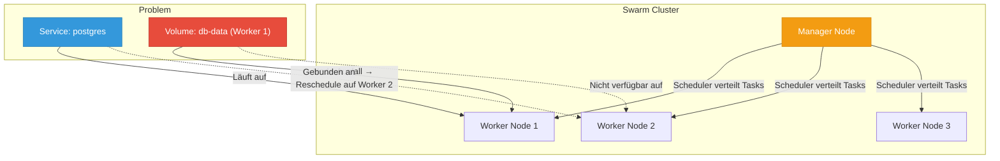
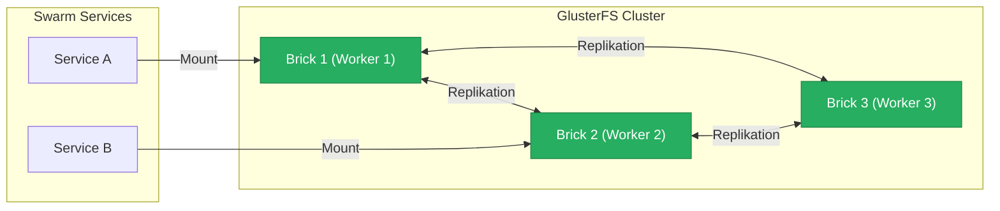
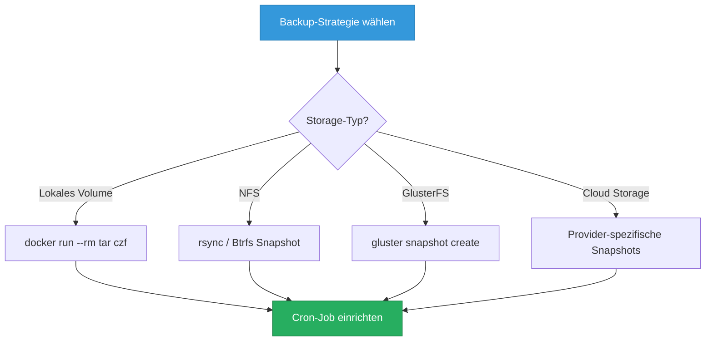

---
tags:
  - docker-swarm
  - volumes
  - storage
  - persistenz
---

# Swarm Volumes und Storage

> [!ABSTRACT] TL;DR
> Persistenter Storage in Docker Swarm — von lokalen Volumes über NFS-Mounts bis hin zu Volume-Plugins für verteilten Storage. Container in einem Swarm können auf beliebigen Nodes laufen, deshalb muss Storage **node-übergreifend** verfügbar sein. Diese Dokumentation erklärt alle Optionen, von einfachen lokalen Volumes mit Placement Constraints bis zu verteiltem GlusterFS.

---

## Storage-Herausforderung in Swarm

Docker Swarm verteilt Container (Tasks) automatisch auf verfügbare Nodes. Das erzeugt ein fundamentales Problem für persistente Daten:

- Container können bei jedem Neustart auf einem **anderen Node** landen
- Lokale Volumes existieren nur auf dem Node, auf dem sie erstellt wurden
- Bei einem **Node-Ausfall** werden Tasks auf andere Nodes verschoben — ohne Zugriff auf die lokalen Daten
- Swarm hat **kein eingebautes** verteiltes Storage-System (im Gegensatz zu Kubernetes mit PVs)



> [!WARNING] Datenverlust bei Reschedule
> Wenn ein Service mit lokalem Volume auf einen anderen Node verschoben wird, startet der Container mit einem **leeren Volume**. Die Daten auf dem ursprünglichen Node bleiben dort liegen, sind aber für den neuen Container nicht erreichbar.

### Lösungsansätze im Überblick

| Ansatz | Komplexität | Portabilität | Performance | Empfehlung |
|:-------|:-----------:|:------------:|:-----------:|:-----------|
| Lokale Volumes + Constraints | Niedrig | ❌ | Hoch | Entwicklung, Single-Node |
| NFS Volumes | Mittel | ✅ | Mittel | Kleiner Swarm, Homelab |
| CIFS/SMB Volumes | Mittel | ✅ | Mittel | Windows-Integration |
| GlusterFS | Hoch | ✅ | Hoch | Produktiver Swarm |
| Volume Plugins | Mittel–Hoch | ✅ | Variabel | Cloud, Enterprise |

---

## Volume-Typen

### Lokale Volumes

Lokale Volumes sind der Standard in Docker. Sie werden unter `/var/lib/docker/volumes/` auf dem jeweiligen Host gespeichert und sind **nicht portabel** zwischen Nodes.

```bash
# Volume auf einem bestimmten Node erstellen
docker volume create app-data

# Volume-Details anzeigen
docker volume inspect app-data
```

```json
[
    {
        "CreatedAt": "2026-03-05T10:00:00+01:00",
        "Driver": "local",
        "Labels": {},
        "Mountpoint": "/var/lib/docker/volumes/app-data/_data",
        "Name": "app-data",
        "Options": {},
        "Scope": "local"
    }
]
```

> [!IMPORTANT] Lokale Volumes in Swarm
> Lokale Volumes werden **pro Node** erstellt. Wenn ein Service auf Worker 1 ein Volume `db-data` erzeugt und später auf Worker 2 rescheduled wird, erzeugt Docker dort ein **neues, leeres** Volume mit demselben Namen. Die Daten von Worker 1 sind nicht automatisch verfügbar.

#### Lösung: Placement Constraints

Um lokale Volumes zu nutzen, kann man den Service auf einen **bestimmten Node festpinnen**:

```yaml
services:
  postgres:
    image: postgres:17
    volumes:
      - db-data:/var/lib/postgresql/data
    deploy:
      placement:
        constraints:
          - node.hostname == worker-01
          - node.labels.storage == ssd

volumes:
  db-data:
    driver: local
```

```bash
# Node mit Label versehen
docker node update --label-add storage=ssd worker-01

# Service mit Constraint erstellen
docker service create \
  --name postgres \
  --constraint 'node.labels.storage == ssd' \
  --mount type=volume,source=db-data,target=/var/lib/postgresql/data \
  -e POSTGRES_PASSWORD=geheim \
  postgres:17
```

> [!TIP] Wann Placement Constraints verwenden?
> - **Einzelner Datenbank-Node** — Wenn nur eine DB-Instanz läuft
> - **Spezielle Hardware** — SSDs, GPUs oder viel RAM auf bestimmten Nodes
> - **Entwicklungsumgebungen** — Wo Hochverfügbarkeit nicht kritisch ist
> - **Fallback** — Wenn kein verteilter Storage verfügbar ist

---

### NFS Volumes

NFS (Network File System) ist die einfachste Methode für **node-übergreifenden Storage** in Docker Swarm. Ein zentraler NFS-Server stellt Verzeichnisse bereit, die von allen Nodes gemountet werden können.

#### NFS-Server einrichten

```bash
# NFS-Server installieren (Debian/Ubuntu)
sudo apt update && sudo apt install -y nfs-kernel-server

# Export-Verzeichnis erstellen
sudo mkdir -p /exports/swarm-data
sudo chown nobody:nogroup /exports/swarm-data
sudo chmod 775 /exports/swarm-data

# Export konfigurieren
echo '/exports/swarm-data 192.168.1.0/24(rw,sync,no_subtree_check,no_root_squash)' \
  | sudo tee -a /etc/exports

# NFS-Server neu laden
sudo exportfs -ra
sudo systemctl restart nfs-kernel-server
```

#### NFS auf allen Swarm-Nodes installieren

```bash
# NFS-Client auf allen Worker-Nodes installieren
sudo apt install -y nfs-common

# Verbindung testen
showmount -e 192.168.1.100
```

#### NFS-Volume in Docker erstellen

```bash
# NFS-Volume manuell erstellen
docker volume create \
  --driver local \
  --opt type=nfs \
  --opt o=addr=192.168.1.100,nolock,soft,rw,nfsvers=4 \
  --opt device=:/exports/swarm-data \
  nfs-shared-data

# Volume testen
docker run --rm -v nfs-shared-data:/data alpine sh -c "echo 'NFS funktioniert' > /data/test.txt"
```

#### NFS-Volume in einem Swarm Stack

```yaml
version: "3.8"

services:
  webapp:
    image: nginx:alpine
    volumes:
      - web-content:/usr/share/nginx/html
    deploy:
      replicas: 3
    ports:
      - "8080:80"

  uploader:
    image: alpine
    volumes:
      - web-content:/data
    command: sh -c "while true; do date > /data/index.html; sleep 10; done"
    deploy:
      replicas: 1

volumes:
  web-content:
    driver: local
    driver_opts:
      type: nfs
      o: addr=192.168.1.100,nolock,soft,rw,nfsvers=4
      device: ":/exports/swarm-data"
```

> [!NOTE] NFS-Optionen erklärt
> | Option | Beschreibung |
> |:-------|:-------------|
> | `addr` | IP-Adresse des NFS-Servers |
> | `nolock` | Kein NFS-Locking (empfohlen für Container) |
> | `soft` | Timeout bei NFS-Ausfällen statt endlosem Warten |
> | `rw` | Lese- und Schreibzugriff |
> | `nfsvers=4` | NFS-Protokollversion (v4 empfohlen) |
> | `timeo=30` | Timeout in Zehntelsekunden |

> [!WARNING] NFS-Performance
> NFS ist ein **netzwerkbasiertes** Dateisystem. Für I/O-intensive Anwendungen wie Datenbanken kann die Performance deutlich schlechter sein als lokaler Storage. Für Datenbanken sollte man lokale Volumes mit Placement Constraints oder verteilten Storage wie GlusterFS bevorzugen.

---

### Volume Plugins

Volume Plugins erweitern Docker um Storage-Backends von Drittanbietern. Sie ermöglichen die transparente Nutzung von Cloud-Storage, SAN-Systemen oder Software-Defined-Storage.

```bash
# Plugin installieren
docker plugin install --grant-all-permissions rexray/s3fs

# Installierte Plugins anzeigen
docker plugin ls

# Plugin deaktivieren
docker plugin disable rexray/s3fs

# Plugin entfernen
docker plugin rm rexray/s3fs
```

#### Verfügbare Volume Plugins

| Plugin | Storage-Backend | Use Case |
|:-------|:----------------|:---------|
| **REX-Ray** | AWS EBS, S3, Azure, GCE | Multi-Cloud-Storage |
| **Portworx** | Software-Defined Storage | Enterprise Kubernetes/Swarm |
| **NetApp Trident** | NetApp ONTAP, SolidFire | Enterprise NAS/SAN |
| **Convoy** | NFS, EBS, DigitalOcean | Snapshot & Backup |
| **local-persist** | Lokales Dateisystem | Persistenter lokaler Pfad |
| **GlusterFS Plugin** | GlusterFS | Verteilter Open-Source-Storage |

#### CSI (Container Storage Interface)

CSI ist der moderne Standard für Storage-Integration. In Docker Swarm ist die CSI-Unterstützung allerdings **eingeschränkt** — CSI wurde primär für Kubernetes entwickelt.

> [!INFO] CSI in Swarm vs. Kubernetes
> Docker Swarm unterstützt CSI-Treiber nur über **Cluster Volumes** (ab Docker Engine 26+). In der Praxis ist die CSI-Integration in Kubernetes deutlich ausgereifter. Für Swarm sind klassische Volume Plugins meist die bessere Wahl.

---

## GlusterFS für Swarm

GlusterFS ist ein **verteiltes Dateisystem**, das Speicher über mehrere Nodes hinweg repliziert. Es eignet sich hervorragend für Docker Swarm, da es hohe Verfügbarkeit und Performance bietet.



### Installation auf allen Swarm-Nodes

```bash
# GlusterFS installieren (Debian/Ubuntu)
sudo apt update && sudo apt install -y glusterfs-server

# GlusterFS-Dienst starten und aktivieren
sudo systemctl start glusterd
sudo systemctl enable glusterd

# Status prüfen
sudo systemctl status glusterd
```

### GlusterFS-Cluster aufbauen

```bash
# Vom ersten Node aus: Peers hinzufügen
sudo gluster peer probe worker-02
sudo gluster peer probe worker-03

# Peer-Status prüfen
sudo gluster peer status
```

### GlusterFS-Volume erstellen

```bash
# Verzeichnisse auf allen Nodes erstellen
sudo mkdir -p /gluster/data/swarm-vol

# Repliziertes Volume erstellen (3-fache Replikation)
sudo gluster volume create swarm-vol replica 3 \
  worker-01:/gluster/data/swarm-vol \
  worker-02:/gluster/data/swarm-vol \
  worker-03:/gluster/data/swarm-vol

# Volume starten
sudo gluster volume start swarm-vol

# Volume-Info anzeigen
sudo gluster volume info swarm-vol
```

### GlusterFS-Volume in Swarm nutzen

```bash
# GlusterFS-Volume auf allen Nodes mounten
sudo mkdir -p /mnt/swarm-vol
sudo mount -t glusterfs worker-01:/swarm-vol /mnt/swarm-vol

# Permanenten Mount in /etc/fstab eintragen
echo 'worker-01:/swarm-vol /mnt/swarm-vol glusterfs defaults,_netdev 0 0' \
  | sudo tee -a /etc/fstab
```

```yaml
version: "3.8"

services:
  app:
    image: myapp:latest
    volumes:
      - gluster-data:/app/data
    deploy:
      replicas: 3

volumes:
  gluster-data:
    driver: local
    driver_opts:
      type: none
      o: bind
      device: /mnt/swarm-vol/app-data
```

> [!TIP] GlusterFS-Tuning
> - **Replica 3** für Hochverfügbarkeit (toleriert 1 Node-Ausfall)
> - **Dispersed Volumes** für mehr Speicherplatz bei geringerer Redundanz
> - `performance.cache-size` erhöhen für leseintensive Workloads
> - `network.ping-timeout` anpassen für instabile Netzwerke

---

## CIFS/SMB Volumes

CIFS/SMB-Volumes ermöglichen die Einbindung von **Windows-Freigaben** oder **Samba-Shares** in Docker Swarm Services.

### CIFS-Volume erstellen

```bash
# CIFS-Utilities installieren (auf allen Nodes)
sudo apt install -y cifs-utils

# CIFS-Volume erstellen
docker volume create \
  --driver local \
  --opt type=cifs \
  --opt o=addr=192.168.1.100,username=smbuser,password=smbpass,file_mode=0777,dir_mode=0777 \
  --opt device=//192.168.1.100/share \
  smb-volume
```

### CIFS-Volume in einem Swarm Stack

```yaml
version: "3.8"

services:
  fileserver:
    image: nginx:alpine
    volumes:
      - smb-share:/usr/share/nginx/html:ro
    deploy:
      replicas: 2
    ports:
      - "8080:80"

volumes:
  smb-share:
    driver: local
    driver_opts:
      type: cifs
      o: addr=192.168.1.100,username=smbuser,password=smbpass,vers=3.0,uid=1000,gid=1000
      device: "//192.168.1.100/share"
```

> [!WARNING] Credentials in Compose-Dateien
> Passwörter sollten **nicht** direkt in der `docker-compose.yml` stehen. Alternativen:
> - **Docker Secrets** für sensible Daten
> - **Credentials-Datei**: `o: addr=192.168.1.100,credentials=/etc/samba/creds`
> - **Umgebungsvariablen**: Nur als Notlösung

```bash
# Credentials-Datei erstellen (sicherer Ansatz)
sudo tee /etc/samba/creds << 'EOF'
username=smbuser
password=smbpass
domain=WORKGROUP
EOF

sudo chmod 600 /etc/samba/creds
```

---

## Named Volumes in Stacks

Docker Swarm Stacks verwenden Named Volumes, die beim `docker stack deploy` automatisch erstellt werden.

### Volume-Benennung in Stacks

Swarm versieht Volumes automatisch mit einem **Stack-Prefix**:

```bash
# Stack deployen
docker stack deploy -c docker-compose.yml myapp

# Volume-Name wird zu: myapp_db-data
docker volume ls
# DRIVER    VOLUME NAME
# local     myapp_db-data
# local     myapp_redis-data
```

### Stack mit mehreren Volumes

```yaml
version: "3.8"

services:
  db:
    image: postgres:17
    environment:
      POSTGRES_PASSWORD: geheim
      POSTGRES_DB: myapp
    volumes:
      - db-data:/var/lib/postgresql/data
    deploy:
      replicas: 1
      placement:
        constraints:
          - node.labels.db == true

  redis:
    image: redis:7-alpine
    volumes:
      - redis-data:/data
    command: redis-server --appendonly yes
    deploy:
      replicas: 1

  app:
    image: myapp:latest
    volumes:
      - app-uploads:/app/uploads
    deploy:
      replicas: 3

volumes:
  db-data:
    driver: local
  redis-data:
    driver: local
  app-uploads:
    driver: local
    driver_opts:
      type: nfs
      o: addr=192.168.1.100,nolock,soft,rw
      device: ":/exports/app-uploads"
```

### Externe Volumes in Stacks

Externe Volumes werden **nicht** vom Stack verwaltet — sie müssen vorher existieren und überleben `docker stack rm`:

```yaml
services:
  db:
    image: postgres:17
    volumes:
      - production-db:/var/lib/postgresql/data

volumes:
  production-db:
    external: true
```

```bash
# Externes Volume VOR dem Stack-Deploy erstellen
docker volume create production-db

# Stack deployen
docker stack deploy -c docker-compose.yml myapp

# Stack entfernen — externes Volume bleibt erhalten
docker stack rm myapp

# Volume existiert weiterhin
docker volume ls | grep production-db
```

> [!IMPORTANT] `external: true` für Produktionsdaten
> Produktive Datenbank-Volumes sollten **immer** als `external: true` deklariert werden. So können sie nicht versehentlich durch `docker stack rm` oder `docker volume prune` gelöscht werden.

---

## Backup-Strategien

### Volume-Backup mit temporärem Container

```bash
# Einzelnes Volume sichern
docker run --rm \
  -v myapp_db-data:/source:ro \
  -v /opt/backups:/backup \
  alpine tar czf /backup/db-data-$(date +%Y%m%d_%H%M%S).tar.gz -C /source .

# Volume wiederherstellen
docker run --rm \
  -v myapp_db-data:/target \
  -v /opt/backups:/backup:ro \
  alpine tar xzf /backup/db-data-20260305_100000.tar.gz -C /target
```

### NFS-basierte Backups

Wenn Volumes auf NFS liegen, kann der NFS-Server direkt gesichert werden:

```bash
# Auf dem NFS-Server: rsync-Backup
rsync -avz --delete /exports/swarm-data/ /backup/swarm-data/

# Snapshot mit Btrfs (wenn NFS auf Btrfs läuft)
sudo btrfs subvolume snapshot -r \
  /exports/swarm-data \
  /exports/.snapshots/swarm-data-$(date +%Y%m%d)
```

### Datenbank-spezifische Backups

> [!TIP] Logische Dumps bevorzugen
> Für Datenbanken sind **logische Dumps** zuverlässiger als Dateisystem-Backups, da sie Konsistenz garantieren.

```bash
# PostgreSQL-Dump im Swarm
docker exec $(docker ps -qf "name=myapp_db") \
  pg_dump -U postgres myapp > backup-$(date +%Y%m%d).sql

# MySQL-Dump im Swarm
docker exec $(docker ps -qf "name=myapp_mysql") \
  mysqldump -u root -pgeheim --all-databases > backup-$(date +%Y%m%d).sql
```

### Automatisiertes Backup-Skript für Swarm

```bash
#!/bin/bash
# swarm-backup.sh — Sichert alle Swarm-Volumes
set -euo pipefail

BACKUP_DIR="/opt/backups/swarm-volumes"
TIMESTAMP=$(date +%Y%m%d_%H%M%S)
RETENTION_DAYS=30

mkdir -p "$BACKUP_DIR"

echo "=== Swarm Volume Backup: $TIMESTAMP ==="

# Alle Volumes des Stacks sichern
for VOLUME in $(docker volume ls -q --filter "label=com.docker.stack.namespace"); do
    echo "Sichere Volume: $VOLUME"
    docker run --rm \
        -v "$VOLUME":/source:ro \
        -v "$BACKUP_DIR":/backup \
        alpine tar czf "/backup/${VOLUME}_${TIMESTAMP}.tar.gz" -C /source . \
        2>/dev/null || echo "  WARNUNG: Backup von $VOLUME fehlgeschlagen"
done

# Alte Backups aufräumen
find "$BACKUP_DIR" -name "*.tar.gz" -mtime +$RETENTION_DAYS -delete

BACKUP_COUNT=$(find "$BACKUP_DIR" -name "*_${TIMESTAMP}.tar.gz" | wc -l)
BACKUP_SIZE=$(du -sh "$BACKUP_DIR" | cut -f1)

echo "=== Fertig: $BACKUP_COUNT Volumes gesichert ($BACKUP_SIZE gesamt) ==="
```

### Snapshot-fähige Storage-Backends



```bash
# GlusterFS-Snapshot erstellen
sudo gluster snapshot create swarm-vol-snap swarm-vol no-timestamp

# Snapshot auflisten
sudo gluster snapshot list

# Snapshot wiederherstellen
sudo gluster snapshot restore swarm-vol-snap
```

---

## Best Practices

> [!TIP] Empfehlungen für Storage in Docker Swarm

### 1. NFS oder verteilten Storage für zustandsbehaftete Services

```yaml
# Empfohlen: NFS für shared Storage
volumes:
  app-data:
    driver: local
    driver_opts:
      type: nfs
      o: addr=192.168.1.100,nolock,soft,rw,nfsvers=4
      device: ":/exports/app-data"
```

Zustandsbehaftete Services (Datenbanken, File-Storage) benötigen node-übergreifenden Zugriff. Lokale Volumes nur mit Placement Constraints als Fallback verwenden.

### 2. Placement Constraints als Fallback

```bash
# Node labeln
docker node update --label-add storage=ssd worker-01
docker node update --label-add role=database worker-01

# Service mit Constraint
docker service create \
  --name postgres \
  --constraint 'node.labels.role == database' \
  --mount type=volume,source=db-data,target=/var/lib/postgresql/data \
  postgres:17
```

### 3. Resource Labels für Storage-Nodes

```bash
# Nodes nach Storage-Eigenschaften labeln
docker node update --label-add storage.type=ssd worker-01
docker node update --label-add storage.type=hdd worker-02
docker node update --label-add storage.capacity=high worker-01
docker node update --label-add storage.capacity=low worker-03
```

### 4. Regelmäßige Backups

```bash
# Cron-Job für tägliche Backups (auf dem Manager-Node)
echo '0 2 * * * /opt/scripts/swarm-backup.sh >> /var/log/swarm-backup.log 2>&1' \
  | sudo crontab -
```

### 5. Separate Nodes für Storage-intensive Workloads

```yaml
deploy:
  placement:
    constraints:
      - node.labels.storage.type == ssd
    preferences:
      - spread: node.labels.datacenter
```

### 6. Externe Volumes für Produktionsdaten

```yaml
# Produktionsdaten IMMER als external markieren
volumes:
  production-db:
    external: true
  production-uploads:
    external: true
```

### 7. Volume-Benennung standardisieren

```bash
# Konvention: <projekt>-<service>-<typ>
docker volume create myapp-postgres-data
docker volume create myapp-redis-data
docker volume create myapp-nginx-logs
docker volume create myapp-uploads-shared
```

> [!DANGER] Häufige Fehler vermeiden
> - **Kein** `docker volume prune` auf Produktions-Nodes ohne vorherige Prüfung
> - **Keine** Datenbank-Volumes zwischen mehreren Instanzen teilen
> - **Keine** Passwörter direkt in Compose-Dateien bei CIFS-Mounts
> - **Keine** lokalen Volumes ohne Placement Constraints für kritische Daten
> - **Immer** `external: true` für Produktionsdaten verwenden

---

## Verwandte Notizen

- [[Docker Swarm Index]] — Übersicht aller Docker-Swarm-Dokumentationen
- [[Swarm Stacks]] — Stack-Management und Compose-Dateien für Swarm
- [[Docker Volumes und Storage]] — Docker Volume Grundlagen (Volumes, Bind Mounts, tmpfs)
- [[Persistent Volumes und Storage Classes]] — Kubernetes Storage-Konzepte (PV, PVC, StorageClasses)