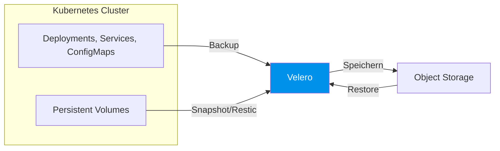
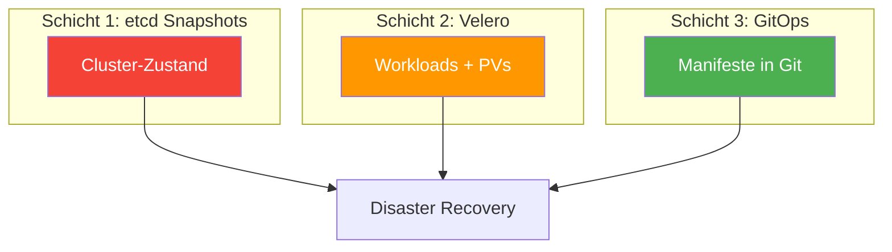

# Cluster Upgrades und Backups

> [!ABSTRACT]
> Kubernetes-Cluster müssen regelmäßig aktualisiert und gesichert werden. Diese Dokumentation beschreibt den Upgrade-Prozess für K3s und kubeadm, etcd-Backups, Velero für Workload-Backups und Disaster-Recovery-Strategien.

---

## Warum Upgrades und Backups?

| Thema | Warum wichtig |
|-------|---------------|
| **Upgrades** | Sicherheitspatches, Bug-Fixes, neue Features, API-Deprecations |
| **Backups** | Hardware-Ausfall, versehentliches Löschen, Ransomware, Migrations |
| **Disaster Recovery** | Cluster-Totalausfall, Datacenter-Ausfall, Datenkorruption |

> [!DANGER]
> Ein Kubernetes-Cluster ohne Backup-Strategie ist ein Cluster, den man jederzeit verlieren kann. Backups, die nie getestet werden, sind keine Backups.

---

## K3s Cluster Upgrade

### Vorbereitung

Vor jedem Upgrade müssen folgende Schritte durchgeführt werden:

| Schritt | Aktion |
|:-------:|--------|
| **1** | Backup erstellen (etcd Snapshot) |
| **2** | Release Notes lesen (Breaking Changes?) |
| **3** | Drain planen (Maintenance Window) |
| **4** | Server upgraden (einer nach dem anderen) |
| **5** | Agents upgraden |
| **6** | Cluster prüfen |

### Manuelles Upgrade

#### Server-Nodes upgraden (einer nach dem anderen)

```bash
# 1. Aktuelle Version prüfen
k3s --version

# 2. etcd-Snapshot erstellen
k3s etcd-snapshot save --name pre-upgrade-$(date +%Y%m%d)

# 3. Node drainieren (Workloads evakuieren)
kubectl drain node-1 --ignore-daemonsets --delete-emptydir-data

# 4. K3s-Service stoppen
sudo systemctl stop k3s

# 5. Neue Version installieren
curl -sfL https://get.k3s.io | INSTALL_K3S_VERSION="v1.30.4+k3s1" sh -s - server \
  --cluster-init

# 6. Warten bis der Node Ready ist
kubectl get nodes -w

# 7. Node wieder freigeben
kubectl uncordon node-1

# 8. Nächsten Server-Node upgraden (erst wenn dieser Ready ist!)
```

#### Agent-Nodes upgraden

```bash
# Auf jedem Agent-Node:
# 1. Node drainieren
kubectl drain agent-1 --ignore-daemonsets --delete-emptydir-data

# 2. K3s-Agent stoppen
sudo systemctl stop k3s-agent

# 3. Neue Version installieren
curl -sfL https://get.k3s.io | INSTALL_K3S_VERSION="v1.30.4+k3s1" sh -s - agent

# 4. Node freigeben
kubectl uncordon agent-1
```

> [!WARNING]
> **Immer einen Server-Node nach dem anderen upgraden!** Bei einem Multi-Server-Cluster (HA) muss etcd zwischen den Upgrades konsistent sein. Upgrade erst den nächsten, wenn der vorherige `Ready` ist.

### Automatisches Upgrade mit System Upgrade Controller

K3s bietet einen eingebauten **System Upgrade Controller** für automatisierte Upgrades:

```bash
# System Upgrade Controller installieren
kubectl apply -f https://github.com/rancher/system-upgrade-controller/releases/latest/download/system-upgrade-controller.yaml
```

```yaml
# Upgrade-Plan für Server-Nodes
apiVersion: upgrade.cattle.io/v1
kind: Plan
metadata:
  name: server-plan
  namespace: system-upgrade
spec:
  concurrency: 1
  cordon: true
  nodeSelector:
    matchExpressions:
      - key: node-role.kubernetes.io/master
        operator: Exists
  serviceAccountName: system-upgrade
  upgrade:
    image: rancher/k3s-upgrade
  version: v1.30.4+k3s1
---
# Upgrade-Plan für Agent-Nodes
apiVersion: upgrade.cattle.io/v1
kind: Plan
metadata:
  name: agent-plan
  namespace: system-upgrade
spec:
  concurrency: 2
  cordon: true
  nodeSelector:
    matchExpressions:
      - key: node-role.kubernetes.io/master
        operator: DoesNotExist
  prepare:
    args:
      - prepare
      - server-plan
    image: rancher/k3s-upgrade
  serviceAccountName: system-upgrade
  upgrade:
    image: rancher/k3s-upgrade
  version: v1.30.4+k3s1
```

| Feld | Bedeutung |
|------|-----------|
| `concurrency` | Wie viele Nodes gleichzeitig upgraden (1 für Server!) |
| `cordon` | Node automatisch drainieren |
| `nodeSelector` | Welche Nodes betroffen sind (Master vs. Worker) |
| `prepare` | Agent-Plan wartet auf Server-Plan |
| `version` | Zielversion |

---

## kubeadm Cluster Upgrade

### Upgrade-Reihenfolge

| Schritt | Node-Typ | Befehl |
|:-------:|----------|--------|
| **1** | Control Plane Node 1 | `kubeadm upgrade apply` |
| **2** | Weitere Control Plane Nodes | `kubeadm upgrade node` |
| **3** | Worker Nodes | `kubeadm upgrade node` |

### Erster Control Plane Node

```bash
# 1. Verfügbare Versionen prüfen
sudo apt update
apt list -a kubeadm

# 2. kubeadm upgraden
sudo apt-mark unhold kubeadm
sudo apt install -y kubeadm=1.30.4-1.1
sudo apt-mark hold kubeadm

# 3. Upgrade-Plan anzeigen
sudo kubeadm upgrade plan

# 4. Upgrade durchführen
sudo kubeadm upgrade apply v1.30.4

# 5. Node drainieren
kubectl drain control-plane-1 --ignore-daemonsets

# 6. kubelet und kubectl upgraden
sudo apt-mark unhold kubelet kubectl
sudo apt install -y kubelet=1.30.4-1.1 kubectl=1.30.4-1.1
sudo apt-mark hold kubelet kubectl

# 7. kubelet neustarten
sudo systemctl daemon-reload
sudo systemctl restart kubelet

# 8. Node freigeben
kubectl uncordon control-plane-1
```

### Weitere Control Plane und Worker Nodes

```bash
# kubeadm upgraden (gleiche Version)
sudo apt install -y kubeadm=1.30.4-1.1

# Auf weiteren Control Plane Nodes:
sudo kubeadm upgrade node

# Node drainieren, kubelet+kubectl upgraden, uncordon
# (gleiche Schritte wie oben)
```

> [!IMPORTANT]
> Kubernetes unterstützt Upgrades nur **eine Minor-Version** nach der anderen. Von 1.28 auf 1.30 geht nicht — erst 1.28 → 1.29, dann 1.29 → 1.30.

---

## etcd Backup und Restore

etcd ist die Datenbank von Kubernetes — hier liegen **alle Cluster-Daten**: Deployments, Services, Secrets, ConfigMaps, RBAC-Regeln. Ohne etcd existiert der Cluster nicht.

### etcd-Backup bei K3s

K3s nutzt **embedded etcd** (bei Multi-Server-Setup) oder **SQLite** (Single-Server):

#### Automatische Snapshots

K3s erstellt standardmäßig alle 12 Stunden einen etcd-Snapshot:

```bash
# Snapshots anzeigen
k3s etcd-snapshot list

# Standard-Speicherort
ls /var/lib/rancher/k3s/server/db/snapshots/
```

Die Snapshot-Frequenz und den Speicherort kann man konfigurieren:

```bash
# In der K3s Server-Konfiguration (/etc/rancher/k3s/config.yaml):
etcd-snapshot-schedule-cron: "0 */6 * * *"    # Alle 6 Stunden
etcd-snapshot-retention: 10                    # 10 Snapshots behalten
etcd-snapshot-dir: /backup/etcd                # Eigenes Verzeichnis
```

#### S3-Backup (Offsite)

```bash
# Snapshot direkt nach S3 sichern
k3s etcd-snapshot save \
  --name daily-backup \
  --s3 \
  --s3-bucket k3s-backups \
  --s3-region eu-central-1 \
  --s3-endpoint s3.amazonaws.com \
  --s3-access-key AKIAXXXXXXXX \
  --s3-secret-key xxxxxxxx
```

#### Manueller Snapshot

```bash
# Snapshot erstellen
k3s etcd-snapshot save --name manual-$(date +%Y%m%d-%H%M)

# Snapshot prüfen
k3s etcd-snapshot list
```

### etcd-Restore bei K3s

```bash
# 1. K3s auf ALLEN Server-Nodes stoppen
sudo systemctl stop k3s

# 2. Restore auf dem ERSTEN Server-Node
k3s server \
  --cluster-reset \
  --cluster-reset-restore-path=/var/lib/rancher/k3s/server/db/snapshots/SNAPSHOT-NAME

# 3. K3s startet automatisch mit den wiederhergestellten Daten

# 4. Auf den ANDEREN Server-Nodes:
# /var/lib/rancher/k3s/server/db löschen und K3s normal starten
# Sie joinen dem wiederhergestellten Cluster
sudo rm -rf /var/lib/rancher/k3s/server/db
sudo systemctl start k3s
```

> [!DANGER]
> Sichere den **Token** (`/var/lib/rancher/k3s/server/token`). Ohne diesen Token kann der Cluster nach einem Restore nicht die verschlüsselten Secrets entschlüsseln!

### etcd-Backup bei kubeadm

```bash
# Snapshot erstellen (etcdctl muss installiert sein)
ETCDCTL_API=3 etcdctl snapshot save /backup/etcd-$(date +%Y%m%d).db \
  --endpoints=https://127.0.0.1:2379 \
  --cacert=/etc/kubernetes/pki/etcd/ca.crt \
  --cert=/etc/kubernetes/pki/etcd/server.crt \
  --key=/etc/kubernetes/pki/etcd/server.key

# Snapshot verifizieren
ETCDCTL_API=3 etcdctl snapshot status /backup/etcd-$(date +%Y%m%d).db --write-table
```

---

## Velero — Workload-Backup

Während etcd-Snapshots den **Cluster-Zustand** sichern (alle API-Objekte), sichert **Velero** die **Workloads inklusive Persistent Volumes** — ideal für Disaster Recovery und Cluster-Migration.

### Was Velero kann



| Feature | Beschreibung |
|---------|-------------|
| **Cluster-Backup** | Alle Kubernetes-Ressourcen als YAML sichern |
| **Volume-Backup** | Persistent Volumes mit Restic/Kopia oder CSI-Snapshots |
| **Scheduled Backups** | Automatische Backups nach Cron-Schedule |
| **Selective Restore** | Nur bestimmte Namespaces oder Ressourcen wiederherstellen |
| **Cluster-Migration** | Workloads von einem Cluster auf einen anderen verschieben |

### Installation

```bash
# 1. Velero CLI installieren
wget https://github.com/vmware-tanzu/velero/releases/download/v1.14.0/velero-v1.14.0-linux-amd64.tar.gz
tar -xvf velero-v1.14.0-linux-amd64.tar.gz
sudo mv velero-v1.14.0-linux-amd64/velero /usr/local/bin/

# 2. Credentials-Datei erstellen (für S3/MinIO)
cat > credentials-velero <<EOF
[default]
aws_access_key_id=MINIO_ACCESS_KEY
aws_secret_access_key=MINIO_SECRET_KEY
EOF

# 3. Velero im Cluster installieren
velero install \
  --provider aws \
  --plugins velero/velero-plugin-for-aws:v1.10.0 \
  --bucket velero-backups \
  --backup-location-config region=default,s3ForcePathStyle=true,s3Url=http://minio.storage:9000 \
  --secret-file ./credentials-velero \
  --use-node-agent \
  --default-volumes-to-fs-backup
```

| Flag | Bedeutung |
|------|-----------|
| `--provider aws` | Auch für MinIO kompatibel (S3-API) |
| `--use-node-agent` | Aktiviert Restic/Kopia für Volume-Backups |
| `--default-volumes-to-fs-backup` | Sichert PVs standardmäßig mit File-System-Backup |
| `--backup-location-config` | S3-Endpoint-Konfiguration |

### Backups erstellen

```bash
# Vollständiges Cluster-Backup
velero backup create full-backup

# Nur bestimmte Namespaces
velero backup create app-backup --include-namespaces my-app,staging

# Nur bestimmte Ressourcentypen
velero backup create config-backup --include-resources configmaps,secrets

# Mit Label-Selektor
velero backup create labeled-backup --selector app=critical

# Backup-Status prüfen
velero backup describe full-backup
velero backup logs full-backup
```

### Automatische Backups (Schedule)

```bash
# Tägliches Backup um 2:00 Uhr
velero schedule create daily-backup \
  --schedule="0 2 * * *" \
  --ttl 720h

# Wöchentliches Vollbackup
velero schedule create weekly-full \
  --schedule="0 3 * * 0" \
  --ttl 2160h

# Schedules anzeigen
velero schedule get
```

| Parameter | Bedeutung |
|-----------|-----------|
| `--schedule` | Cron-Expression für die Backup-Frequenz |
| `--ttl` | Time-to-Live — wie lange das Backup aufbewahrt wird (720h = 30 Tage) |

### Restore

```bash
# Vollständiger Restore
velero restore create --from-backup full-backup

# Nur bestimmte Namespaces wiederherstellen
velero restore create --from-backup full-backup \
  --include-namespaces my-app

# In einen anderen Namespace wiederherstellen
velero restore create --from-backup full-backup \
  --namespace-mappings old-namespace:new-namespace

# Restore-Status prüfen
velero restore describe <restore-name>
velero restore logs <restore-name>
```

> [!TIP]
> Velero stellt nur Ressourcen wieder her, die **nicht bereits existieren**. Um einen "frischen" Restore zu machen, lösche den Namespace vorher: `kubectl delete namespace my-app && velero restore create --from-backup full-backup --include-namespaces my-app`

---

## Disaster Recovery Strategie

Eine vollständige DR-Strategie kombiniert mehrere Backup-Schichten:

### Die drei Schichten



| Schicht | Was gesichert wird | RPO | RTO |
|---------|-------------------|-----|-----|
| **etcd Snapshots** | Cluster-State (Deployments, Services, RBAC, Secrets) | 6-12 Stunden | 15-30 Minuten |
| **Velero** | Workloads + Persistent Volumes (Anwendungsdaten) | 24 Stunden | 30-60 Minuten |
| **GitOps** | Alle Manifeste als Code im Git-Repository | 0 (immer aktuell) | Abhängig von CI/CD |

> [!IMPORTANT]
> **RPO** = Recovery Point Objective (wie viel Datenverlust ist akzeptabel)
> **RTO** = Recovery Time Objective (wie schnell muss der Cluster wieder laufen)

### Was zusätzlich gesichert werden muss

| Artefakt | Speicherort | Warum wichtig |
|----------|------------|---------------|
| **K3s Token** | `/var/lib/rancher/k3s/server/token` | Für Secret-Entschlüsselung |
| **TLS-Zertifikate** | `/var/lib/rancher/k3s/server/tls/` | Cluster-Kommunikation |
| **Helm Values** | Git-Repository | Reproduzierbare Installation |
| **Custom CRDs** | Git-Repository | API-Erweiterungen |
| **DNS-Einträge** | DNS-Provider | Externes Routing |
| **LoadBalancer-IPs** | Dokumentation | KubeVIP, MetalLB Konfiguration |

### Recovery-Playbook

| Schritt | Aktion |
|:-------:|--------|
| **1** | Neue Nodes aufsetzen (Ansible/Terraform) |
| **2** | K3s installieren (gleiche Version) |
| **3** | etcd-Snapshot wiederherstellen |
| **4** | Cluster-Gesundheit prüfen |
| **5** | Velero installieren und Volumes restoren |
| **6** | DNS + Ingress konfigurieren |
| **7** | Anwendungen verifizieren |

---

## Backup-Checkliste

| Aufgabe | Frequenz | Tool |
|---------|----------|------|
| etcd-Snapshot erstellen | Alle 6 Stunden (automatisch) | K3s built-in / etcdctl |
| etcd-Snapshot offsite kopieren | Täglich | S3, NFS, rsync |
| Velero-Backup | Täglich | Velero Schedule |
| Restore-Test durchführen | Monatlich | Velero + etcd |
| K3s Token sichern | Bei Änderung | Manuell + Passwort-Manager |
| Manifeste in Git pflegen | Bei jeder Änderung | GitOps-Workflow |
| Upgrade-Plan prüfen | Vierteljährlich | Release Notes lesen |

> [!TIP]
> **Der wichtigste Punkt**: Teste deine Restores regelmäßig! Ein Backup, das noch nie restored wurde, ist nur eine Hoffnung — kein Plan.

---

## Verwandte Notizen

- [[K3s Cluster Installation]] — Initiale Cluster-Installation
- [[Kubeadm Multi-Master Cluster]] — kubeadm-spezifische Upgrades
- [[Kubernetes Architektur]] — etcd als zentrale Datenbank
- [[Longhorn]] — Longhorn hat eigene Backup-Mechanismen
- [[Helm Package Manager]] — Helm Values als reproduzierbare Konfiguration
- [[GitOps]] — Infrastructure as Code für Recovery
