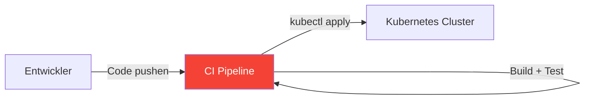
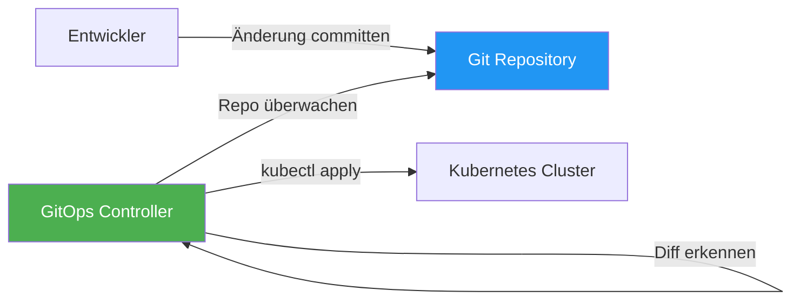
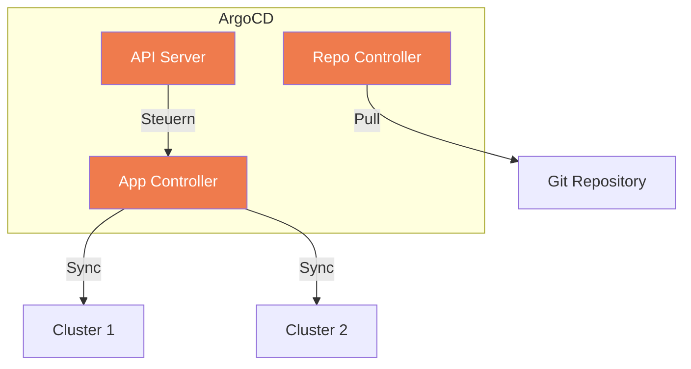
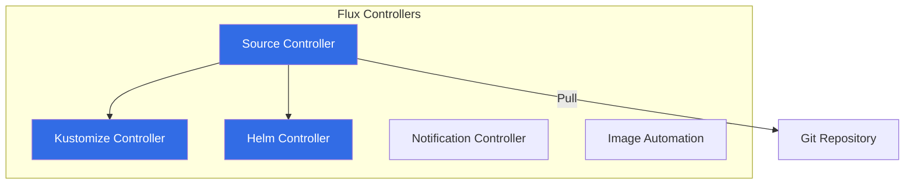

# GitOps

> [!ABSTRACT]
> GitOps ist ein Deployment-Paradigma, bei dem Git als einzige Wahrheitsquelle für den gewünschten Cluster-Zustand dient. Änderungen am Cluster werden ausschließlich über Git-Commits gesteuert — nicht über manuelle `kubectl apply`-Befehle.

---

## Was ist GitOps?

Stell dir vor, du machst **jede Änderung** an deinem Kubernetes-Cluster über einen Git-Commit:

- Neues Deployment? → Pull Request → Merge → Automatisches Deployment
- ConfigMap ändern? → Pull Request → Review → Merge → Automatisch synchronisiert
- Rollback nötig? → `git revert` → Cluster kehrt zum vorherigen Zustand zurück

Das ist GitOps in einem Satz: **Git ist die einzige Wahrheitsquelle — der Cluster folgt automatisch.**

### Die vier Prinzipien

| Prinzip | Bedeutung |
|---------|-----------|
| **Deklarativ** | Der gesamte gewünschte Zustand wird als Code beschrieben (YAML/Helm/Kustomize) |
| **Versioniert und unveränderlich** | Git-History = Audit-Log. Jede Änderung ist nachvollziehbar |
| **Automatisch abgeglichen** | Ein Controller im Cluster gleicht den Ist-Zustand ständig mit dem Soll-Zustand ab |
| **Automatisch korrigiert** | Abweichungen werden erkannt und behoben (Self-Healing) |

---

## Push vs. Pull Deployment

### Traditionell: Push-basiert (CI/CD)



**Probleme mit Push:**

| Problem | Warum |
|---------|-------|
| CI braucht Cluster-Credentials | Sicherheitsrisiko — Token in CI-Secrets |
| Kein Drift-Detection | Manuelle `kubectl`-Änderungen werden nicht bemerkt |
| Kein Self-Healing | Wenn jemand etwas löscht, wird es nicht automatisch neu erstellt |
| Schwer auditierbar | Wer hat wann was deployed? Log-Parsing nötig |

### GitOps: Pull-basiert



**Vorteile von Pull:**

| Vorteil | Warum |
|---------|-------|
| Keine externen Credentials | Der Controller läuft **im** Cluster — kein API-Token nach außen |
| Drift-Detection | Controller erkennt manuelle Änderungen und korrigiert sie |
| Self-Healing | Gelöschte Ressourcen werden automatisch wiederhergestellt |
| Vollständiger Audit-Trail | Jede Änderung ist ein Git-Commit mit Autor, Zeitstempel, Review |
| Einfaches Rollback | `git revert` statt panisches `kubectl`-Debugging |

---

## ArgoCD

ArgoCD ist das populärste GitOps-Tool für Kubernetes (~54% Adoption). Es bietet eine leistungsstarke Web-UI und zentrale Multi-Cluster-Verwaltung.

### Architektur



### Installation

```bash
# Namespace erstellen
kubectl create namespace argocd

# ArgoCD installieren
kubectl apply -n argocd -f https://raw.githubusercontent.com/argoproj/argo-cd/stable/manifests/install.yaml

# Admin-Passwort auslesen
kubectl -n argocd get secret argocd-initial-admin-secret \
  -o jsonpath="{.data.password}" | base64 --decode

# CLI installieren
curl -sSL -o argocd https://github.com/argoproj/argo-cd/releases/latest/download/argocd-linux-amd64
chmod +x argocd && sudo mv argocd /usr/local/bin/

# Login
argocd login argocd.example.com
```

### Application — Die zentrale Ressource

Eine ArgoCD `Application` verbindet ein Git-Repository mit einem Kubernetes-Cluster:

```yaml
apiVersion: argoproj.io/v1alpha1
kind: Application
metadata:
  name: my-app
  namespace: argocd
spec:
  project: default
  source:
    repoURL: https://github.com/org/k8s-manifests.git
    targetRevision: main
    path: apps/my-app
  destination:
    server: https://kubernetes.default.svc
    namespace: my-app
  syncPolicy:
    automated:
      prune: true
      selfHeal: true
    syncOptions:
      - CreateNamespace=true
    retry:
      limit: 5
      backoff:
        duration: 5s
        factor: 2
        maxDuration: 3m
```

| Feld | Bedeutung |
|------|-----------|
| `source.repoURL` | Git-Repository mit den Manifesten |
| `source.path` | Pfad im Repository zum Manifest-Ordner |
| `source.targetRevision` | Branch, Tag oder Commit-SHA |
| `destination.server` | Ziel-Cluster (oder `https://kubernetes.default.svc` für den lokalen) |
| `destination.namespace` | Ziel-Namespace |
| `syncPolicy.automated.prune` | Entfernt Ressourcen aus dem Cluster, die nicht mehr in Git sind |
| `syncPolicy.automated.selfHeal` | Korrigiert manuelle Änderungen am Cluster |

### Sync-Strategien

| Strategie | Verhalten |
|-----------|-----------|
| **Manual Sync** | Änderungen werden erkannt, aber erst bei Klick auf "Sync" angewendet |
| **Auto Sync** | Änderungen werden automatisch angewendet (nach Polling-Intervall, Standard 3 Min) |
| **Auto Sync + Prune** | Zusätzlich werden gelöschte Manifeste auch aus dem Cluster entfernt |
| **Auto Sync + Self-Heal** | Manuelle `kubectl`-Änderungen werden überschrieben |

> [!WARNING]
> **Self-Heal** bedeutet: Wenn jemand per `kubectl` eine Änderung macht, wird sie innerhalb von Sekunden rückgängig gemacht. Informiere dein Team, bevor du Self-Heal aktivierst!

### App of Apps Pattern

Für große Umgebungen kann eine "Root-Application" andere Applications verwalten:

```yaml
# root-app.yaml — verwaltet alle anderen Apps
apiVersion: argoproj.io/v1alpha1
kind: Application
metadata:
  name: root
  namespace: argocd
spec:
  source:
    repoURL: https://github.com/org/k8s-manifests.git
    path: apps  # Enthält Application-Manifeste für alle Apps
    targetRevision: main
  destination:
    server: https://kubernetes.default.svc
    namespace: argocd
  syncPolicy:
    automated:
      prune: true
      selfHeal: true
```

```
# Repo-Struktur
k8s-manifests/
├── apps/                    # Root-App liest diesen Ordner
│   ├── my-app.yaml          # Application-Manifest
│   ├── monitoring.yaml      # Application-Manifest
│   └── cert-manager.yaml    # Application-Manifest
├── apps/my-app/             # Manifeste für my-app
│   ├── deployment.yaml
│   ├── service.yaml
│   └── ingress.yaml
└── apps/monitoring/         # Manifeste für Monitoring
    ├── prometheus-values.yaml
    └── grafana-values.yaml
```

---

## Flux

Flux ist das zweite große GitOps-Tool (~32% Adoption). Es verfolgt einen **modularen, dezentralen** Ansatz — kein zentraler Server, keine Web-UI (standardmäßig).

### Architektur



### Installation

```bash
# Flux CLI installieren
curl -s https://fluxcd.io/install.sh | sudo bash

# Pre-Check
flux check --pre

# Flux im Cluster bootstrappen (GitHub)
flux bootstrap github \
  --owner=my-org \
  --repository=k8s-fleet \
  --branch=main \
  --path=clusters/production \
  --personal
```

### Flux-Konfiguration

#### GitRepository — Quelle definieren

```yaml
apiVersion: source.toolkit.fluxcd.io/v1
kind: GitRepository
metadata:
  name: my-app
  namespace: flux-system
spec:
  interval: 1m
  url: https://github.com/org/k8s-manifests.git
  ref:
    branch: main
```

#### Kustomization — Manifeste anwenden

```yaml
apiVersion: kustomize.toolkit.fluxcd.io/v1
kind: Kustomization
metadata:
  name: my-app
  namespace: flux-system
spec:
  interval: 5m
  path: ./apps/my-app
  prune: true
  sourceRef:
    kind: GitRepository
    name: my-app
  targetNamespace: my-app
  healthChecks:
    - apiVersion: apps/v1
      kind: Deployment
      name: my-app
      namespace: my-app
```

#### HelmRelease — Helm Charts verwalten

```yaml
apiVersion: helm.toolkit.fluxcd.io/v2
kind: HelmRelease
metadata:
  name: prometheus
  namespace: monitoring
spec:
  interval: 10m
  chart:
    spec:
      chart: kube-prometheus-stack
      version: "60.x"
      sourceRef:
        kind: HelmRepository
        name: prometheus-community
  values:
    prometheus:
      prometheusSpec:
        retention: 30d
```

### Image Automation

Eine einzigartige Flux-Funktion: **Automatisches Update von Container-Tags** in Git:

```yaml
apiVersion: image.toolkit.fluxcd.io/v1beta2
kind: ImageRepository
metadata:
  name: my-app
spec:
  image: registry.example.com/my-app
  interval: 1m
---
apiVersion: image.toolkit.fluxcd.io/v1beta2
kind: ImagePolicy
metadata:
  name: my-app
spec:
  imageRepositoryRef:
    name: my-app
  policy:
    semver:
      range: ">=1.0.0"
---
apiVersion: image.toolkit.fluxcd.io/v1beta2
kind: ImageUpdateAutomation
metadata:
  name: my-app
spec:
  interval: 1m
  sourceRef:
    kind: GitRepository
    name: my-app
  git:
    commit:
      author:
        name: flux
        email: flux@example.com
      messageTemplate: "Update {{ .AutomationObject }} images"
    push:
      branch: main
  update:
    path: ./apps/my-app
    strategy: Setters
```

Flux scannt das Container-Registry, findet neue Tags und committet automatisch die aktualisierte Image-Version in Git.

---

## ArgoCD vs. Flux

| Aspekt | ArgoCD | Flux |
|--------|--------|------|
| **Architektur** | Zentralisiert (Hub & Spoke) | Dezentral (pro Cluster) |
| **Web UI** | Ja (eingebaut, umfangreich) | Nein (CLI-first, optional Weave GitOps UI) |
| **App-Modell** | `Application` CRD | `GitRepository` + `Kustomization` CRDs |
| **Helm-Support** | Ja (nativ) | Ja (`HelmRelease` CRD) |
| **Multi-Cluster** | Zentral verwaltet | Jeder Cluster unabhängig |
| **Image Automation** | Via Plugins | Nativ (Image Automation Controller) |
| **Single Point of Failure** | Ja (ArgoCD Server) | Nein (verteilte Controller) |
| **Lernkurve** | Mittel (UI hilft) | Steiler (CLI-only) |
| **Ressourcenverbrauch** | Höher (~500 MB RAM) | Niedriger (~200 MB RAM) |
| **CNCF Status** | Graduated | Graduated |

### Wann welches Tool?

| Szenario | Empfehlung | Begründung |
|----------|------------|------------|
| Team will visuelle Übersicht | **ArgoCD** | Web-UI zeigt Sync-Status, Ressourcen, Diff |
| Viele Cluster zentral verwalten | **ArgoCD** | Hub-and-Spoke ideal für Platform-Teams |
| Maximale Sicherheit / Isolation | **Flux** | Kein zentraler Server, der kompromittiert werden kann |
| Automatische Image-Updates | **Flux** | Native Image Automation |
| Kubernetes-Einsteiger | **ArgoCD** | UI macht GitOps greifbar |
| GitOps für alles (inkl. Infrastruktur) | **Flux** | Modulare Controller für verschiedene Quellen |

---

## Repository-Struktur

Eine bewährte Struktur für GitOps-Repositories:

### Mono-Repo (alle Umgebungen in einem Repo)

```
k8s-manifests/
├── base/                    # Gemeinsame Basis-Manifeste
│   ├── deployment.yaml
│   ├── service.yaml
│   └── kustomization.yaml
├── overlays/
│   ├── staging/             # Staging-Anpassungen
│   │   ├── kustomization.yaml
│   │   └── replicas-patch.yaml
│   └── production/          # Produktions-Anpassungen
│       ├── kustomization.yaml
│       ├── replicas-patch.yaml
│       └── resources-patch.yaml
└── infrastructure/          # Cluster-Infrastruktur
    ├── cert-manager/
    ├── traefik/
    └── monitoring/
```

### Multi-Repo (getrennte Repos)

```
# Repo 1: k8s-infrastructure
infrastructure/
├── cert-manager/
├── traefik/
├── monitoring/
└── longhorn/

# Repo 2: k8s-apps
apps/
├── my-app/
├── api-gateway/
└── auth-service/
```

> [!TIP]
> **Mono-Repo** ist einfacher für kleine Teams. **Multi-Repo** bietet bessere Zugriffskontrolle (Infrastruktur-Repo nur für Ops, App-Repos für Entwickler).

---

## Best Practices

| Praxis | Warum |
|--------|-------|
| **Alles in Git** | Keine manuellen `kubectl`-Änderungen — was nicht in Git ist, existiert nicht |
| **PRs statt direkte Commits** | Code Review für Infrastruktur-Änderungen |
| **Environments in Branches oder Overlays** | Staging → main Branch, Production → production Branch (oder Kustomize Overlays) |
| **Sealed Secrets / External Secrets** | Secrets niemals unverschlüsselt in Git |
| **Health Checks definieren** | GitOps-Controller soll prüfen ob das Deployment tatsächlich funktioniert |
| **Notifications einrichten** | Slack/Email bei Sync-Fehlern |
| **Self-Heal mit Bedacht** | Team muss wissen, dass manuelle Änderungen überschrieben werden |

---

## Verwandte Notizen

- [[Helm Package Manager]] — Helm Charts als GitOps-Quelle
- [[CRDs und Operators]] — ArgoCD und Flux nutzen CRDs
- [[Cluster Upgrades und Backups]] — GitOps als Recovery-Schicht
- [[ConfigMaps und Secrets]] — Secret-Management in GitOps
- [[Monitoring und Logging]] — Monitoring des GitOps-Sync-Status
- [[Multi-Stage Builds]] — Optimierte Docker Images für CI/CD-Pipelines
