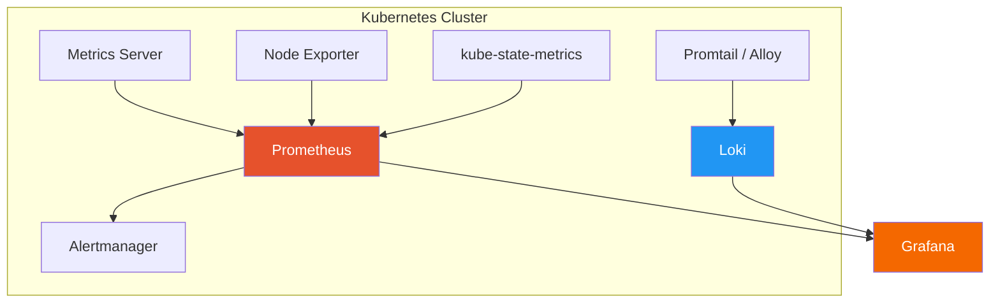
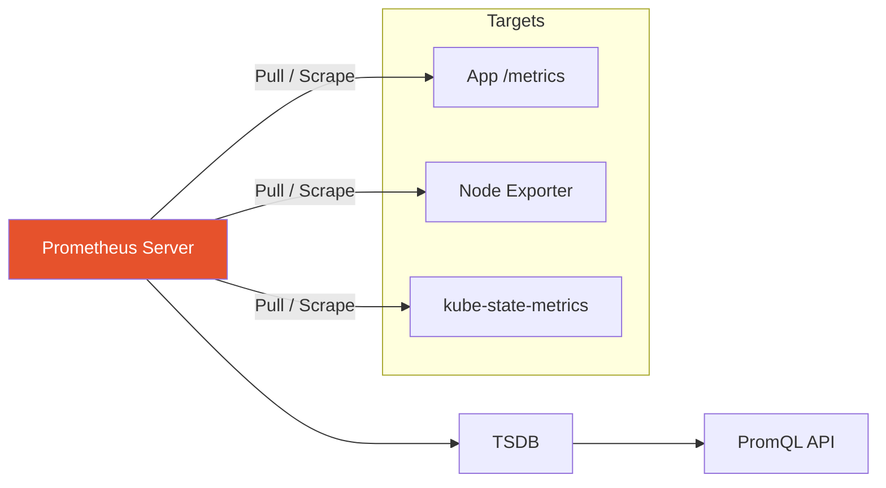
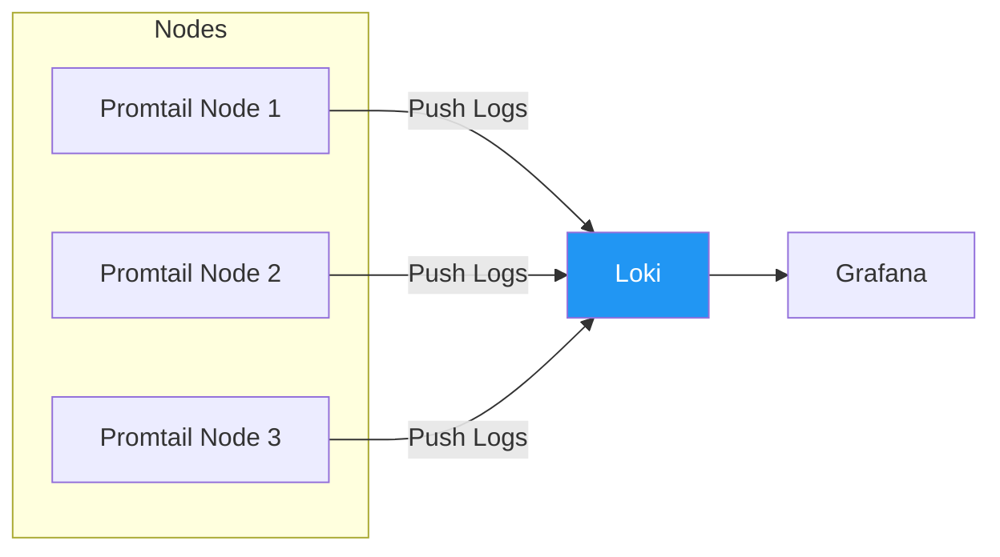
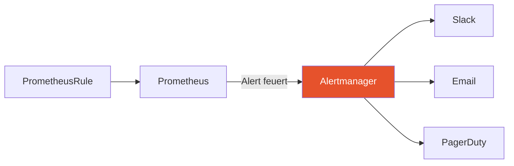

# Monitoring und Logging

> [!ABSTRACT]
> Ohne Monitoring ist ein Kubernetes-Cluster blind. Diese Dokumentation beschreibt den vollständigen Observability-Stack: Metrics Server für Basismetriken, Prometheus + Grafana für tiefgehende Überwachung, Loki für Log-Aggregation und Alerting für proaktive Benachrichtigungen.

---

## Warum Monitoring in Kubernetes?

Ein Kubernetes-Cluster besteht aus Dutzenden beweglicher Teile — Nodes, Pods, Container, Netzwerk, Storage. Ohne Monitoring weißt du nicht:

- Ob ein Node unter Speicherdruck steht
- Ob ein Pod ständig OOMKilled wird
- Wie viel CPU deine Anwendung tatsächlich verbraucht
- Ob die Antwortzeiten deiner API steigen
- Wann eine Disk vollläuft

> [!IMPORTANT]
> **Monitoring ist keine optionale Ergänzung** — es ist eine Grundvoraussetzung für den produktiven Betrieb. Die Kubernetes-Dokumentation selbst listet Monitoring als Day-2-Pflicht.

---

## Der Observability-Stack im Überblick



| Komponente | Funktion | Datentyp |
|-----------|----------|----------|
| **Metrics Server** | Leichtgewichtige CPU/Memory-Metriken für kubectl top und HPA | Metriken |
| **Prometheus** | Sammelt, speichert und queried Metriken (Pull-basiert) | Metriken |
| **Grafana** | Dashboards und Visualisierung für Metriken und Logs | Visualisierung |
| **Loki** | Log-Aggregation (wie Prometheus, aber für Logs) | Logs |
| **Alertmanager** | Routing und Zustellung von Alerts (Email, Slack, PagerDuty) | Alerts |
| **Node Exporter** | Exportiert Node-Level-Metriken (CPU, Disk, Netzwerk) | Metriken |
| **kube-state-metrics** | Exportiert Kubernetes-Objekt-Status (Deployments, Pods, etc.) | Metriken |

---

## Metrics Server

Der **Metrics Server** ist die leichtgewichtigste Monitoring-Komponente. Er sammelt CPU- und Memory-Verbrauch von Kubelets und stellt sie über die Kubernetes Metrics API bereit.

### Wozu braucht man den Metrics Server?

| Funktion | Ohne Metrics Server | Mit Metrics Server |
|----------|--------------------|--------------------|
| `kubectl top nodes` | Funktioniert nicht | Zeigt CPU/Memory pro Node |
| `kubectl top pods` | Funktioniert nicht | Zeigt CPU/Memory pro Pod |
| **HPA** (Horizontal Pod Autoscaler) | Kann nicht skalieren | Skaliert basierend auf CPU/Memory |
| **VPA** (Vertical Pod Autoscaler) | Kann nicht empfehlen | Empfiehlt Ressourcen-Limits |

### Installation

```bash
# Offizielle Installation
kubectl apply -f https://github.com/kubernetes-sigs/metrics-server/releases/latest/download/components.yaml

# Bei K3s: Metrics Server ist standardmäßig integriert!

# Für selbstsignierte Zertifikate (z.B. kubeadm)
# --kubelet-insecure-tls Flag hinzufügen:
kubectl patch deployment metrics-server -n kube-system \
  --type='json' \
  -p='[{"op": "add", "path": "/spec/template/spec/containers/0/args/-", "value": "--kubelet-insecure-tls"}]'
```

### Nutzung

```bash
# Node-Ressourcen anzeigen
kubectl top nodes

# Pod-Ressourcen anzeigen
kubectl top pods -n my-app

# Sortiert nach Memory-Verbrauch
kubectl top pods -n my-app --sort-by=memory

# Container-Level-Metriken
kubectl top pods -n my-app --containers
```

Beispiel-Ausgabe:

```
NAME           CPU(cores)   MEMORY(bytes)
node-1         350m         2145Mi
node-2         280m         1893Mi
node-3         190m         1654Mi
```

> [!NOTE]
> Der Metrics Server speichert **keine historischen Daten** — er zeigt nur den aktuellen Zustand. Für Trends und Alerting braucht man Prometheus.

---

## Prometheus

Prometheus ist das De-facto-Standard-Monitoring-System für Kubernetes. Es wurde von SoundCloud entwickelt, ist ein CNCF-Graduated-Projekt und speziell für Container-Umgebungen konzipiert.

### Wie Prometheus funktioniert



#### Das Pull-Modell

Prometheus **holt** sich die Metriken aktiv von den Targets (Pull/Scrape) — im Gegensatz zu Push-Systemen wie StatsD. Jedes Target stellt einen HTTP-Endpoint bereit (typischerweise `/metrics`), den Prometheus regelmäßig abfragt.

| Aspekt | Pull (Prometheus) | Push (StatsD, etc.) |
|--------|------------------|---------------------|
| **Erreichbarkeit** | Target muss von Prometheus erreichbar sein | Target muss Collector-Adresse kennen |
| **Service Discovery** | Prometheus entdeckt Targets automatisch | Targets müssen sich registrieren |
| **Debugging** | Target direkt im Browser aufrufbar | Schwerer zu debuggen |
| **Skalierung** | Gut für Kubernetes (SD integriert) | Besser für kurzlebige Jobs |

### Installation mit kube-prometheus-stack

Der einfachste Weg ist der **kube-prometheus-stack** Helm Chart — er installiert Prometheus, Grafana, Alertmanager und vorkonfigurierte Dashboards:

```bash
# Helm Repo hinzufügen
helm repo add prometheus-community https://prometheus-community.github.io/helm-charts
helm repo update

# Namespace erstellen
kubectl create namespace monitoring

# Installation mit Standardwerten
helm install prometheus prometheus-community/kube-prometheus-stack \
  --namespace monitoring

# Oder mit Custom Values
helm install prometheus prometheus-community/kube-prometheus-stack \
  --namespace monitoring \
  --values prometheus-values.yaml
```

### Wichtige Custom Values

```yaml
# prometheus-values.yaml
prometheus:
  prometheusSpec:
    retention: 30d
    storageSpec:
      volumeClaimTemplate:
        spec:
          storageClassName: longhorn
          accessModes: ["ReadWriteOnce"]
          resources:
            requests:
              storage: 50Gi

grafana:
  adminPassword: "sicheres-passwort"
  persistence:
    enabled: true
    storageClassName: longhorn
    size: 10Gi

alertmanager:
  alertmanagerSpec:
    storage:
      volumeClaimTemplate:
        spec:
          storageClassName: longhorn
          accessModes: ["ReadWriteOnce"]
          resources:
            requests:
              storage: 5Gi
```

> [!WARNING]
> Ohne persistenten Storage gehen bei einem Prometheus-Neustart **alle gesammelten Metriken verloren**. Konfiguriere immer ein PVC — idealerweise auf [[Longhorn]] oder einem anderen zuverlässigen StorageProvider.

### Was der Stack mitbringt

| Komponente | Was enthalten ist |
|-----------|------------------|
| **Prometheus Operator** | Verwaltet Prometheus-Instanzen über CRDs |
| **Prometheus Server** | Sammelt und speichert Metriken |
| **Alertmanager** | Alert-Routing und Benachrichtigungen |
| **Grafana** | Dashboards (40+ vorkonfigurierte) |
| **Node Exporter** | System-Metriken pro Node |
| **kube-state-metrics** | Kubernetes-Objekt-Metriken |
| **ServiceMonitor CRDs** | Definiert was Prometheus scrapen soll |

---

## ServiceMonitor und PodMonitor

Der Prometheus Operator nutzt [[CRDs und Operators|CRDs]] um zu definieren, welche Targets gescraped werden:

### ServiceMonitor

Überwacht Endpoints hinter einem Kubernetes Service:

```yaml
apiVersion: monitoring.coreos.com/v1
kind: ServiceMonitor
metadata:
  name: my-app-monitor
  namespace: monitoring
  labels:
    release: prometheus
spec:
  namespaceSelector:
    matchNames:
      - my-app
  selector:
    matchLabels:
      app: my-app
  endpoints:
    - port: metrics
      interval: 30s
      path: /metrics
```

### PodMonitor

Überwacht Pods direkt (ohne Service):

```yaml
apiVersion: monitoring.coreos.com/v1
kind: PodMonitor
metadata:
  name: envoy-stats
  namespace: monitoring
spec:
  namespaceSelector:
    matchNames:
      - istio-system
  selector:
    matchLabels:
      app: envoy
  podMetricsEndpoints:
    - port: stats
      interval: 15s
```

| CRD | Wann nutzen |
|-----|-------------|
| **ServiceMonitor** | App hat einen Service mit `/metrics`-Endpoint — der Standardfall |
| **PodMonitor** | Kein Service vorhanden oder Metriken-Port ist nicht im Service exponiert |

> [!TIP]
> Damit Prometheus die Monitore findet, müssen sie das Label `release: prometheus` tragen (oder das Label, das in der Prometheus-Konfiguration als `serviceMonitorSelector` definiert ist).

---

## PromQL — Metriken abfragen

PromQL ist die Abfragesprache von Prometheus. Einige wichtige Queries:

### Grundlegende Queries

```promql
# CPU-Auslastung pro Pod (in Prozent)
sum(rate(container_cpu_usage_seconds_total{namespace="my-app"}[5m])) by (pod) * 100

# Memory-Verbrauch pro Pod (in MB)
sum(container_memory_working_set_bytes{namespace="my-app"}) by (pod) / 1024 / 1024

# Request Rate pro Service
sum(rate(http_requests_total{namespace="my-app"}[5m])) by (service)

# 95. Perzentil der Antwortzeiten
histogram_quantile(0.95, rate(http_request_duration_seconds_bucket{namespace="my-app"}[5m]))

# Fehlerrate (5xx pro Gesamtanfragen)
sum(rate(http_requests_total{status=~"5.."}[5m])) / sum(rate(http_requests_total[5m])) * 100
```

### Nützliche Cluster-Queries

```promql
# Node CPU-Auslastung
100 - (avg by(instance) (rate(node_cpu_seconds_total{mode="idle"}[5m])) * 100)

# Verfügbarer Speicher pro Node (in GB)
node_memory_MemAvailable_bytes / 1024 / 1024 / 1024

# Pod-Neustarts (CrashLoopBackOff erkennen)
increase(kube_pod_container_status_restarts_total[1h]) > 3

# Pods die nicht Ready sind
kube_pod_status_ready{condition="false"} == 1

# PVC-Nutzung (Prozent)
kubelet_volume_stats_used_bytes / kubelet_volume_stats_capacity_bytes * 100
```

---

## Grafana

Grafana ist die Visualisierungs-Plattform, die Daten aus Prometheus (Metriken) und Loki (Logs) in Dashboards darstellt.

### Zugriff auf Grafana

```bash
# Port-Forward (Entwicklung)
kubectl port-forward svc/prometheus-grafana -n monitoring 3000:80

# Admin-Passwort auslesen
kubectl get secret prometheus-grafana -n monitoring \
  -o jsonpath="{.data.admin-password}" | base64 --decode
```

Für produktiven Zugriff empfiehlt sich ein [[Ingress und IngressRoutes|IngressRoute]]:

```yaml
apiVersion: traefik.io/v1alpha1
kind: IngressRoute
metadata:
  name: grafana
  namespace: monitoring
spec:
  entryPoints:
    - websecure
  routes:
    - match: Host(`grafana.example.com`)
      kind: Rule
      services:
        - name: prometheus-grafana
          port: 80
  tls:
    certResolver: letsencrypt
```

### Vorkonfigurierte Dashboards

Der kube-prometheus-stack bringt über **40 Dashboards** mit:

| Dashboard | Was es zeigt |
|-----------|-------------|
| **Kubernetes / Compute Resources / Cluster** | CPU, Memory, Netzwerk auf Cluster-Ebene |
| **Kubernetes / Compute Resources / Namespace (Pods)** | Ressourcenverbrauch pro Namespace und Pod |
| **Kubernetes / Networking / Cluster** | Netzwerk-Bandbreite, Fehler, Drops |
| **Node Exporter / Nodes** | Detaillierte Node-Metriken (CPU, Disk, RAM, Netzwerk) |
| **CoreDNS** | DNS-Query-Rate, Latenz, Fehler |
| **etcd** | Cluster-Gesundheit, Leader-Wechsel, Disk-Latenz |

> [!TIP]
> Auf [grafana.com/grafana/dashboards](https://grafana.com/grafana/dashboards) findest du Tausende Community-Dashboards. Importiere sie über die Dashboard-ID.

---

## Loki — Log-Aggregation

**Loki** ist ein Log-Aggregationssystem von Grafana Labs. Es speichert Logs effizient, indem es nur Labels indiziert (nicht den Log-Inhalt selbst) — wie "Prometheus, aber für Logs".

### Architektur



| Komponente | Rolle |
|-----------|-------|
| **Promtail** / **Grafana Alloy** | DaemonSet auf jedem Node, liest Container-Logs und pusht sie an Loki |
| **Loki** | Speichert und indiziert Logs (ähnlich wie Prometheus für Metriken) |
| **Grafana** | Visualisiert Logs im Explore-View und kombiniert sie mit Metriken |

### Installation

```bash
# Loki-Stack installieren (Loki + Promtail)
helm install loki grafana/loki-stack \
  --namespace monitoring \
  --set grafana.enabled=false \
  --set prometheus.enabled=false

# Oder einzeln:
helm install loki grafana/loki --namespace monitoring
helm install promtail grafana/promtail --namespace monitoring
```

### Loki als Datasource in Grafana

Wenn der kube-prometheus-stack bereits installiert ist, Loki als zusätzliche Datasource hinzufügen:

```yaml
# In den Grafana Helm Values:
grafana:
  additionalDataSources:
    - name: Loki
      type: loki
      url: http://loki:3100
      access: proxy
```

### LogQL — Logs abfragen

```logql
# Alle Logs eines bestimmten Pods
{namespace="my-app", pod="web-abc123"}

# Fehler filtern
{namespace="my-app"} |= "error"

# Regex-Filter
{namespace="my-app"} |~ "status=(4|5)\\d{2}"

# JSON-Parsing und Filtern
{namespace="my-app"} | json | response_code >= 500

# Log-Rate (Fehler pro Sekunde)
rate({namespace="my-app"} |= "error" [5m])

# Top Fehlermeldungen
topk(10, sum by(message) (count_over_time({namespace="my-app"} |= "error" [1h])))
```

### Loki vs. EFK (Elasticsearch, Fluentd, Kibana)

| Aspekt | Loki | EFK |
|--------|------|-----|
| **Indexierung** | Nur Labels (effizient) | Volltext-Index (ressourcenintensiv) |
| **Ressourcenverbrauch** | Gering (~1-2 GB RAM) | Hoch (~4-16 GB RAM für Elasticsearch) |
| **Query-Sprache** | LogQL (Prometheus-ähnlich) | KQL / Lucene |
| **Integration** | Nativ in Grafana | Eigene UI (Kibana) |
| **Kosten** | Niedrig | Hoch (Elasticsearch braucht viel Storage/RAM) |
| **Volltext-Suche** | Langsamer (filtert zur Abfragezeit) | Schneller (pre-indexed) |

> [!TIP]
> Für die meisten Kubernetes-Cluster ist **Loki die bessere Wahl** — geringerer Ressourcenverbrauch, nahtlose Grafana-Integration und ausreichende Query-Performance.

---

## Alerting

### Alertmanager

Der Alertmanager empfängt Alerts von Prometheus und leitet sie an konfigurierte Empfänger weiter:



### PrometheusRule — Alert-Regeln definieren

```yaml
apiVersion: monitoring.coreos.com/v1
kind: PrometheusRule
metadata:
  name: app-alerts
  namespace: monitoring
  labels:
    release: prometheus
spec:
  groups:
    - name: app.rules
      rules:
        - alert: HighErrorRate
          expr: |
            sum(rate(http_requests_total{status=~"5.."}[5m]))
            / sum(rate(http_requests_total[5m])) > 0.05
          for: 5m
          labels:
            severity: critical
          annotations:
            summary: "Hohe Fehlerrate: {{ $value | humanizePercentage }}"
            description: "Mehr als 5% der Requests liefern 5xx-Fehler."
            
        - alert: PodCrashLooping
          expr: increase(kube_pod_container_status_restarts_total[1h]) > 5
          for: 10m
          labels:
            severity: warning
          annotations:
            summary: "Pod {{ $labels.pod }} crashed häufig"
            description: "Pod {{ $labels.pod }} in {{ $labels.namespace }} hat mehr als 5 Neustarts in der letzten Stunde."

        - alert: NodeMemoryPressure
          expr: node_memory_MemAvailable_bytes / node_memory_MemTotal_bytes < 0.1
          for: 5m
          labels:
            severity: critical
          annotations:
            summary: "Node {{ $labels.instance }} hat weniger als 10% freien RAM"
```

### Alertmanager-Konfiguration

```yaml
# In den Helm Values:
alertmanager:
  config:
    global:
      resolve_timeout: 5m
    route:
      receiver: 'slack-notifications'
      group_by: ['alertname', 'namespace']
      group_wait: 30s
      group_interval: 5m
      repeat_interval: 4h
      routes:
        - match:
            severity: critical
          receiver: 'pagerduty'
        - match:
            severity: warning
          receiver: 'slack-notifications'
    receivers:
      - name: 'slack-notifications'
        slack_configs:
          - api_url: 'https://hooks.slack.com/services/XXX'
            channel: '#k8s-alerts'
            title: '{{ .CommonAnnotations.summary }}'
            text: '{{ .CommonAnnotations.description }}'
      - name: 'pagerduty'
        pagerduty_configs:
          - service_key: 'xxx-xxx-xxx'
```

### Wichtige Standard-Alerts

Der kube-prometheus-stack bringt zahlreiche vorkonfigurierte Alerts mit:

| Alert | Schwere | Auslöser |
|-------|---------|----------|
| `KubePodCrashLooping` | Warning | Pod startet wiederholt neu |
| `KubePodNotReady` | Warning | Pod ist länger als 15 min nicht Ready |
| `KubeDeploymentReplicasMismatch` | Warning | Deployment hat weniger Replicas als gewünscht |
| `NodeNotReady` | Critical | Node ist nicht erreichbar |
| `NodeMemoryHighUtilization` | Warning | Node-Speicher > 90% belegt |
| `NodeFilesystemSpaceFillingUp` | Warning | Dateisystem füllt sich |
| `etcdHighNumberOfLeaderChanges` | Warning | etcd-Cluster instabil |
| `PrometheusTargetDown` | Warning | Ein Scrape-Target antwortet nicht |

---

## Best Practices

| Praxis | Warum |
|--------|-------|
| **Persistenten Storage für Prometheus** | Metriken überleben Neustarts |
| **Retention konfigurieren** | 15-30 Tage sind für die meisten Fälle ausreichend |
| **Resource Limits setzen** | Prometheus kann viel RAM verbrauchen — Limits verhindern OOMKill anderer Pods |
| **ServiceMonitor statt scrape-Annotations** | Sauberer, versionierbar, validiert |
| **Dashboards als Code** | Grafana-Dashboards als ConfigMaps oder JSON im Git |
| **Alerting schrittweise einführen** | Zu viele Alerts = Alert Fatigue = Alerts werden ignoriert |
| **Loki für Logs statt stdout-Debugging** | Zentrale Logs statt `kubectl logs` auf einzelnen Pods |

---

## Verwandte Notizen

- [[Helm Package Manager]] — Installation des Monitoring-Stacks
- [[CRDs und Operators]] — ServiceMonitor, PrometheusRule als CRDs
- [[Deployments und ReplicaSets]] — HPA braucht Metrics Server
- [[Troubleshooting]] — Metriken und Logs als Debugging-Tool
- [[Longhorn]] — Persistenter Storage für Prometheus/Loki
- [[Ingress und IngressRoutes]] — Grafana über IngressRoute erreichbar machen
