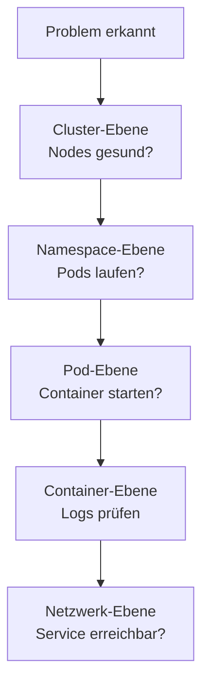

# Troubleshooting

> [!ABSTRACT]
> Systematische Fehlersuche in Kubernetes-Clustern — von Pod-Problemen über Netzwerk-Fehler bis hin zu Cluster-weiten Störungen. Mit Debugging-Strategien und Lösungen für häufige Probleme.

---

## Debugging-Strategie

Bei Problemen immer von **oben nach unten** debuggen:



---

## Pod-Probleme

### Pod startet nicht (Pending)

```bash
# Pod-Status prüfen
kubectl get pods
kubectl describe pod <pod-name>
```

| Ursache | Lösung |
|---------|--------|
| Nicht genug Ressourcen | Nodes prüfen: `kubectl describe node` — Ressourcen anpassen |
| Kein passender Node (Taints) | Tolerations im Pod hinzufügen |
| PVC nicht gebunden | PVC und StorageClass prüfen |
| Image Pull fehlgeschlagen | Image-Name und Registry-Credentials prüfen |

### Pod in CrashLoopBackOff

Der Container startet, stürzt ab und wird immer wieder neugestartet:

```bash
# Logs des aktuellen Containers
kubectl logs <pod-name>

# Logs des vorherigen (abgestürzten) Containers
kubectl logs <pod-name> --previous

# Events prüfen
kubectl describe pod <pod-name>
```

| Ursache | Lösung |
|---------|--------|
| Anwendungsfehler | Logs prüfen, Fehler in der App beheben |
| Fehlende Konfiguration | ConfigMaps/Secrets prüfen |
| Liveness Probe schlägt fehl | Probe-Konfiguration anpassen |
| OOMKilled (Out of Memory) | Memory-Limits erhöhen |

### Pod in ImagePullBackOff

```bash
kubectl describe pod <pod-name> | grep -A5 "Events"
```

| Ursache | Lösung |
|---------|--------|
| Image existiert nicht | Image-Name und Tag prüfen |
| Private Registry | `imagePullSecrets` konfigurieren |
| Registry nicht erreichbar | Netzwerk und DNS prüfen |

### Pod ist OOMKilled

```bash
# OOMKill erkennen
kubectl describe pod <pod-name> | grep -i "oomkilled"

# Aktuellen Memory-Verbrauch
kubectl top pods
```

```yaml
# Memory-Limits erhöhen
resources:
  limits:
    memory: "512Mi"    # War: 256Mi
```

---

## Service und Netzwerk

### Service ist nicht erreichbar

```bash
# Service und Endpoints prüfen
kubectl get service <name>
kubectl get endpoints <name>

# DNS-Auflösung testen
kubectl run dns-test --image=busybox -it --rm -- nslookup <service-name>

# Connectivity testen
kubectl run curl-test --image=curlimages/curl -it --rm -- \
  curl -v http://<service-name>:<port>
```

| Ursache | Lösung |
|---------|--------|
| Keine Endpoints | Label-Selector stimmt nicht mit Pod-Labels überein |
| DNS-Fehler | CoreDNS Pods prüfen: `kubectl get pods -n kube-system -l k8s-app=kube-dns` |
| Port falsch | `targetPort` im Service muss dem `containerPort` entsprechen |

### Ingress funktioniert nicht

```bash
# Ingress prüfen
kubectl get ingress -A
kubectl describe ingress <name>

# Ingress Controller Logs
kubectl logs -n traefik -l app.kubernetes.io/name=traefik

# IngressRoutes prüfen (Traefik)
kubectl get ingressroutes -A
```

| Ursache | Lösung |
|---------|--------|
| Kein Ingress Controller | Traefik/NGINX installiert? Pods prüfen |
| Falscher Host | DNS-Eintrag korrekt? Host im Ingress korrekt? |
| TLS-Fehler | Zertifikat und Secret prüfen |
| 404 Error | Path und Service prüfen |

---

## Storage-Probleme

### PVC bleibt Pending

```bash
kubectl get pvc
kubectl describe pvc <name>
```

| Ursache | Lösung |
|---------|--------|
| Kein Provisioner | StorageClass und Provisioner prüfen |
| Nicht genug Speicher | Nodes auf verfügbaren Speicher prüfen |
| Falsche StorageClass | `storageClassName` im PVC korrigieren |
| Longhorn nicht bereit | Longhorn Pods prüfen: `kubectl get pods -n longhorn-system` |

### Longhorn Volume degraded

```bash
# Longhorn Volume-Status
kubectl get volumes.longhorn.io -n longhorn-system

# Longhorn Manager Logs
kubectl logs -n longhorn-system -l app=longhorn-manager
```

| Ursache | Lösung |
|---------|--------|
| Node offline | Node wieder online bringen |
| Disk voll | Speicher freigeben oder Disk erweitern |
| iSCSI-Probleme | `iscsid` Service prüfen: `systemctl status iscsid` |

---

## Cluster-weite Probleme

### Node NotReady

```bash
kubectl get nodes
kubectl describe node <node-name>

# Auf dem Node selbst
sudo systemctl status kubelet
sudo journalctl -u kubelet -f
```

| Ursache | Lösung |
|---------|--------|
| kubelet gestoppt | `sudo systemctl restart kubelet` |
| Disk-Pressure | Speicher freigeben |
| Memory-Pressure | RAM freigeben oder Workloads verschieben |
| Netzwerk-Problem | Netzwerkverbindung zum API-Server prüfen |

### etcd-Probleme

```bash
# etcd-Status (K3s)
kubectl get pods -n kube-system | grep etcd

# etcd Logs
kubectl logs -n kube-system etcd-<node-name>

# K3s: etcd-Gesundheit
sudo k3s etcd-snapshot list
```

### Cert-Manager Zertifikate nicht bereit

```bash
# Zertifikat-Status
kubectl get certificates -A
kubectl describe certificate <name>

# Challenges prüfen
kubectl get challenges -A
kubectl describe challenge <name>

# Cert-Manager Logs
kubectl logs -n cert-manager -l app.kubernetes.io/name=cert-manager
```

---

## Nützliche Debug-Tools

| Tool | Beschreibung | Befehl |
|------|-------------|--------|
| **k9s** | Terminal-Dashboard | `k9s` |
| **stern** | Multi-Pod Logs | `stern -n default webapp` |
| **kubectl debug** | Ephemeral Debug Container | `kubectl debug -it pod -- /bin/sh` |
| **kubectl top** | Resource-Verbrauch | `kubectl top pods -A` |
| **kubectl events** | Sortierte Events | `kubectl get events --sort-by='.lastTimestamp'` |

---

## Checkliste bei Problemen

```text
□ kubectl get pods -A              → Alle Pods gesund?
□ kubectl get nodes                → Alle Nodes Ready?
□ kubectl get events               → Ungewöhnliche Events?
□ kubectl describe <resource>      → Details zur Ressource
□ kubectl logs <pod>               → Anwendungslogs prüfen
□ kubectl top nodes                → Resource-Auslastung
□ systemctl status kubelet         → kubelet auf dem Node
□ journalctl -u kubelet            → kubelet-Logs
```

---

## Verwandte Notizen

- [[kubectl Befehle und Cheatsheet]]
- [[Kubernetes Index]]
- [[Longhorn]]
- [[Cert-Manager]]
- [[Traefik Ingress Controller]]
