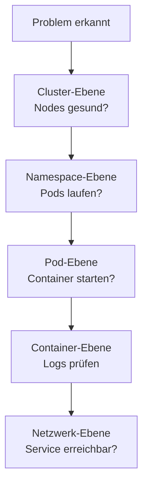

# Troubleshooting

> [!ABSTRACT]
> Systematische Fehlersuche in Kubernetes-Clustern — von Pod-Problemen über Netzwerk-Fehler bis hin zu Cluster-weiten Störungen. Mit Debugging-Strategien und Lösungen für häufige Probleme.

---

## Debugging-Strategie

Bei Problemen immer von **oben nach unten** debuggen:



---

## Pod-Probleme

### Pod startet nicht (Pending)

```bash
# Pod-Status prüfen
kubectl get pods
kubectl describe pod <pod-name>
```

| Ursache | Lösung |
|---------|--------|
| Nicht genug Ressourcen | Nodes prüfen: `kubectl describe node` — Ressourcen anpassen |
| Kein passender Node (Taints) | Tolerations im Pod hinzufügen |
| PVC nicht gebunden | PVC und StorageClass prüfen |
| Image Pull fehlgeschlagen | Image-Name und Registry-Credentials prüfen |

### Pod in CrashLoopBackOff

Der Container startet, stürzt ab und wird immer wieder neugestartet:

```bash
# Logs des aktuellen Containers
kubectl logs <pod-name>

# Logs des vorherigen (abgestürzten) Containers
kubectl logs <pod-name> --previous

# Events prüfen
kubectl describe pod <pod-name>
```

| Ursache | Lösung |
|---------|--------|
| Anwendungsfehler | Logs prüfen, Fehler in der App beheben |
| Fehlende Konfiguration | ConfigMaps/Secrets prüfen |
| Liveness Probe schlägt fehl | Probe-Konfiguration anpassen |
| OOMKilled (Out of Memory) | Memory-Limits erhöhen |

### Pod in ImagePullBackOff

```bash
kubectl describe pod <pod-name> | grep -A5 "Events"
```

| Ursache | Lösung |
|---------|--------|
| Image existiert nicht | Image-Name und Tag prüfen |
| Private Registry | `imagePullSecrets` konfigurieren |
| Registry nicht erreichbar | Netzwerk und DNS prüfen |

### Pod ist OOMKilled

```bash
# OOMKill erkennen
kubectl describe pod <pod-name> | grep -i "oomkilled"

# Aktuellen Memory-Verbrauch
kubectl top pods
```

```yaml
# Memory-Limits erhöhen
resources:
  limits:
    memory: "512Mi"    # War: 256Mi
```

---

## Service und Netzwerk

### Service ist nicht erreichbar

```bash
# Service und Endpoints prüfen
kubectl get service <name>
kubectl get endpoints <name>

# DNS-Auflösung testen
kubectl run dns-test --image=busybox -it --rm -- nslookup <service-name>

# Connectivity testen
kubectl run curl-test --image=curlimages/curl -it --rm -- \
  curl -v http://<service-name>:<port>
```

| Ursache | Lösung |
|---------|--------|
| Keine Endpoints | Label-Selector stimmt nicht mit Pod-Labels überein |
| DNS-Fehler | CoreDNS Pods prüfen: `kubectl get pods -n kube-system -l k8s-app=kube-dns` |
| Port falsch | `targetPort` im Service muss dem `containerPort` entsprechen |

### Ingress funktioniert nicht

```bash
# Ingress prüfen
kubectl get ingress -A
kubectl describe ingress <name>

# Ingress Controller Logs
kubectl logs -n traefik -l app.kubernetes.io/name=traefik

# IngressRoutes prüfen (Traefik)
kubectl get ingressroutes -A
```

| Ursache | Lösung |
|---------|--------|
| Kein Ingress Controller | Traefik/NGINX installiert? Pods prüfen |
| Falscher Host | DNS-Eintrag korrekt? Host im Ingress korrekt? |
| TLS-Fehler | Zertifikat und Secret prüfen |
| 404 Error | Path und Service prüfen |

---

## Storage-Probleme

### PVC bleibt Pending

```bash
kubectl get pvc
kubectl describe pvc <name>
```

| Ursache | Lösung |
|---------|--------|
| Kein Provisioner | StorageClass und Provisioner prüfen |
| Nicht genug Speicher | Nodes auf verfügbaren Speicher prüfen |
| Falsche StorageClass | `storageClassName` im PVC korrigieren |
| Longhorn nicht bereit | Longhorn Pods prüfen: `kubectl get pods -n longhorn-system` |

### Longhorn Volume degraded

```bash
# Longhorn Volume-Status
kubectl get volumes.longhorn.io -n longhorn-system

# Longhorn Manager Logs
kubectl logs -n longhorn-system -l app=longhorn-manager
```

| Ursache | Lösung |
|---------|--------|
| Node offline | Node wieder online bringen |
| Disk voll | Speicher freigeben oder Disk erweitern |
| iSCSI-Probleme | `iscsid` Service prüfen: `systemctl status iscsid` |

---

## Cluster-weite Probleme

### Node NotReady

```bash
kubectl get nodes
kubectl describe node <node-name>

# Auf dem Node selbst
sudo systemctl status kubelet
sudo journalctl -u kubelet -f
```

| Ursache | Lösung |
|---------|--------|
| kubelet gestoppt | `sudo systemctl restart kubelet` |
| Disk-Pressure | Speicher freigeben |
| Memory-Pressure | RAM freigeben oder Workloads verschieben |
| Netzwerk-Problem | Netzwerkverbindung zum API-Server prüfen |

### etcd-Probleme

```bash
# etcd-Status (K3s)
kubectl get pods -n kube-system | grep etcd

# etcd Logs
kubectl logs -n kube-system etcd-<node-name>

# K3s: etcd-Gesundheit
sudo k3s etcd-snapshot list
```

### Cert-Manager Zertifikate nicht bereit

```bash
# Zertifikat-Status
kubectl get certificates -A
kubectl describe certificate <name>

# Challenges prüfen
kubectl get challenges -A
kubectl describe challenge <name>

# Cert-Manager Logs
kubectl logs -n cert-manager -l app.kubernetes.io/name=cert-manager
```

---

## Init Container und Sidecar-Probleme

### Init Container schlägt fehl

```bash
# Init Container Status prüfen
kubectl describe pod <pod-name> | grep -A10 "Init Containers"

# Init Container Logs
kubectl logs <pod-name> -c <init-container-name>
```

| Symptom | Ursache | Lösung |
|---------|---------|--------|
| Pod in `Init:0/2` | Erster Init Container wartet | Dependencies (DB, API) prüfen |
| Pod in `Init:CrashLoopBackOff` | Init Container crasht | Logs prüfen, Config/Secrets verifizieren |
| Pod in `Init:Error` | Init Container mit Fehlercode beendet | Exit-Code und Logs analysieren |

```yaml
# Typischer Init Container — wartet auf Datenbank
initContainers:
  - name: wait-for-db
    image: busybox:1.36
    command: ['sh', '-c', 'until nc -z postgres-svc 5432; do echo waiting; sleep 2; done']
```

> [!TIP] Init Container Reihenfolge
> Init Container werden **sequentiell** ausgeführt. Wenn einer fehlschlägt, wird der nächste **nicht** gestartet. Das `kubectl describe pod` zeigt genau welcher Init Container blockiert.

---

## CronJob und Job-Probleme

### CronJob startet nicht

```bash
# CronJob-Status prüfen
kubectl get cronjobs
kubectl describe cronjob <name>

# Letzte Jobs eines CronJobs
kubectl get jobs --selector=job-name=<cronjob-name>

# Jobs manuell auslösen (zum Testen)
kubectl create job test-run --from=cronjob/<name>
```

| Ursache | Diagnose | Lösung |
|---------|----------|--------|
| Zeitzone falsch | Schedule prüfen (UTC!) | `.spec.timeZone` setzen (K8s 1.27+) |
| `suspend: true` | `kubectl get cronjob -o yaml` | `suspend: false` setzen |
| ConcurrencyPolicy blockiert | Vorheriger Job läuft noch | `concurrencyPolicy: Replace` erwägen |
| Startingdeadline verpasst | CronJob konnte nicht rechtzeitig starten | `startingDeadlineSeconds` erhöhen |

### Job schlägt wiederholt fehl

```bash
# Job-Status und Pods prüfen
kubectl describe job <name>
kubectl get pods --selector=job-name=<name>
kubectl logs job/<name>

# Fehlgeschlagene Pods anzeigen
kubectl get pods --field-selector=status.phase=Failed
```

```yaml
# Job-Retry-Konfiguration
spec:
  backoffLimit: 4           # Max Wiederholungen (Standard: 6)
  activeDeadlineSeconds: 600 # Timeout nach 10 Minuten
  ttlSecondsAfterFinished: 3600 # Aufräumen nach 1 Stunde
```

---

## Resource Quota und LimitRange

### Deployment wird abgelehnt

```bash
# ResourceQuota im Namespace prüfen
kubectl get resourcequota -n <namespace>
kubectl describe resourcequota -n <namespace>

# LimitRange prüfen
kubectl get limitrange -n <namespace>
kubectl describe limitrange -n <namespace>
```

| Fehler | Ursache | Lösung |
|--------|---------|--------|
| `exceeded quota` | ResourceQuota ausgeschöpft | Quota erhöhen oder Ressourcen freigeben |
| `must specify limits` | LimitRange erzwingt Limits | `resources.limits` im Pod definieren |
| `minimum cpu usage per container` | LimitRange Minimum nicht erfüllt | `resources.requests` auf Minimum setzen |

```bash
# Aktuellen Verbrauch vs. Quota anzeigen
kubectl describe resourcequota -n production
# Ausgabe zeigt: Used / Hard für jede Ressource

# Verwaiste ReplicaSets aufräumen (belegen Quota)
kubectl get rs -n production | awk '$2==0 {print $1}' | xargs kubectl delete rs -n production
```

---

## StatefulSet-Probleme

### Pod-Reihenfolge und Skalierung

```bash
# StatefulSet Status prüfen
kubectl get statefulset <name>
kubectl describe statefulset <name>

# Pods eines StatefulSets (geordnet 0, 1, 2...)
kubectl get pods -l app=<name> --sort-by=.metadata.name
```

| Symptom | Ursache | Lösung |
|---------|---------|--------|
| Pod-1 startet nicht | Pod-0 ist nicht Ready | Pod-0 debuggen — sequentielle Startordnung |
| PVC bleibt nach Scale-Down | PVCs werden **nicht** automatisch gelöscht | `kubectl delete pvc` manuell |
| Pods nach Neustart mit falschen Daten | PV an falschen Pod gebunden | PV-Bindung und `volumeName` prüfen |

> [!WARNING] StatefulSet PVCs
> Beim Scale-Down eines StatefulSets werden die PVCs **beibehalten**. Das ist gewollt (Datenverlust-Schutz), bedeutet aber, dass verwaiste PVCs manuell aufgeräumt werden müssen. Prüfe mit `kubectl get pvc` regelmäßig auf unbelegte PVCs.

---

## Webhook und Admission Controller

### Webhook blockiert Deployment

```bash
# Validating/Mutating Webhooks auflisten
kubectl get validatingwebhookconfigurations
kubectl get mutatingwebhookconfigurations

# Webhook-Details prüfen
kubectl describe validatingwebhookconfiguration <name>
```

| Fehler | Ursache | Lösung |
|--------|---------|--------|
| `Internal error occurred: failed calling webhook` | Webhook-Service nicht erreichbar | Service/Pod des Webhooks prüfen |
| `connection refused` | Webhook-Pod ist down | Pod neustarten |
| `context deadline exceeded` | Webhook antwortet zu langsam | `timeoutSeconds` im Webhook erhöhen |

```bash
# Webhook temporär deaktivieren (Notfall!)
kubectl delete validatingwebhookconfiguration <name>

# Webhook für bestimmte Namespaces ausschließen
# → namespaceSelector im Webhook konfigurieren
```

> [!DANGER] Webhook löschen
> Das Löschen eines ValidatingWebhook kann Sicherheitsrichtlinien deaktivieren. Nur als temporäre Notfallmaßnahme verwenden und sofort wieder aktivieren.

---

## Deployment-Probleme

### Rollout bleibt hängen

```bash
# Rollout-Status prüfen
kubectl rollout status deployment/<name> --timeout=300s

# Rollout-History anzeigen
kubectl rollout history deployment/<name>

# Aktuelle und vorherige ReplicaSets
kubectl get rs -l app=<name>
```

| Ursache | Diagnose | Lösung |
|---------|----------|--------|
| Neue Pods starten nicht | `kubectl describe pod` | Image, Resources, Config prüfen |
| Readiness Probe schlägt fehl | Pod bleibt nicht "Ready" | Probe-Config anpassen |
| PDB blockiert Rollout | `kubectl get pdb` | PDB-Werte lockern |
| Resource-Quota überschritten | `kubectl describe quota` | Quota erhöhen oder Replicas reduzieren |

```bash
# Rollback auf letzte funktionierende Version
kubectl rollout undo deployment/<name>

# Rollback auf bestimmte Revision
kubectl rollout undo deployment/<name> --to-revision=3
```

### HPA skaliert nicht

```bash
# HPA-Status prüfen
kubectl get hpa
kubectl describe hpa <name>

# Metrics-Server läuft?
kubectl get pods -n kube-system | grep metrics-server
kubectl top pods
```

| Ursache | Lösung |
|---------|--------|
| Metrics-Server nicht installiert | `kubectl apply -f components.yaml` |
| Keine Resource-Requests gesetzt | `requests.cpu` im Pod definieren |
| `<unknown>` bei Current-Wert | Metrics-Server Logs prüfen |
| Cooldown-Phase aktiv | Warten (Standard: 5 Min für Scale-Down) |

---

## RBAC und Berechtigungsfehler

### Zugriff verweigert (403 Forbidden)

```bash
# Eigene Berechtigungen prüfen
kubectl auth can-i get pods --namespace=production
kubectl auth can-i create deployments --namespace=production

# Alle Berechtigungen eines Users auflisten
kubectl auth can-i --list --namespace=production

# Als anderer User testen
kubectl auth can-i get pods --as=system:serviceaccount:default:my-sa
```

| Fehler | Ursache | Lösung |
|--------|---------|--------|
| `forbidden: User cannot get pods` | Fehlende Role/ClusterRole | RoleBinding erstellen |
| `forbidden: User cannot create` | Nur Lese-Rechte | ClusterRole anpassen |
| `no RBAC policy matched` | Keine Binding vorhanden | kubectl create rolebinding |
| ServiceAccount kann nichts | `automountServiceAccountToken: false` | Auf `true` setzen oder Token explizit mounten |

```bash
# Schnell-Fix: RoleBinding erstellen
kubectl create rolebinding dev-reader \
    --clusterrole=view \
    --user=developer@example.com \
    --namespace=production
```

---

## DNS-Debugging

```bash
# DNS-Debug-Pod starten
kubectl run dns-debug --image=busybox:1.36 -it --rm -- sh

# Innerhalb des Pods:
nslookup kubernetes.default
nslookup <service-name>.<namespace>.svc.cluster.local
cat /etc/resolv.conf

# CoreDNS Pods prüfen
kubectl get pods -n kube-system -l k8s-app=kube-dns
kubectl logs -n kube-system -l k8s-app=kube-dns

# CoreDNS ConfigMap prüfen
kubectl get configmap coredns -n kube-system -o yaml
```

| Symptom | Ursache | Lösung |
|---------|---------|--------|
| `nslookup` timeout | CoreDNS Pod down | CoreDNS Pods neustarten |
| Service auflösbar, aber nicht erreichbar | Endpoint fehlt | Labels zwischen Service und Pod prüfen |
| Externe Domains nicht auflösbar | Upstream-DNS-Problem | CoreDNS Forward-Config prüfen |
| `search domain` zu lang | Zu viele Namespace-Searches | `ndots` im Pod reduzieren |

```yaml
# ndots optimieren (reduziert DNS-Lookups)
spec:
  dnsConfig:
    options:
      - name: ndots
        value: "2"
```

---

## Node-Pressure Conditions

```bash
# Node Conditions prüfen
kubectl describe node <name> | grep -A5 "Conditions"
```

| Condition | Schwellwert | Auswirkung | Lösung |
|-----------|------------|------------|--------|
| `MemoryPressure` | <100Mi frei | Pods werden evicted | RAM freigeben, Pods verschieben |
| `DiskPressure` | <10% frei | Pods werden evicted | `docker system prune`, Logs löschen |
| `PIDPressure` | >max PIDs | Keine neuen Pods | PID-Limits erhöhen, Pods prüfen |
| `NetworkUnavailable` | CNI-Fehler | Pod-Scheduling gestoppt | CNI-Plugin neustarten |

```bash
# Disk-Pressure auf Node beheben
sudo docker system prune -af
sudo journalctl --vacuum-size=500M
sudo crictl rmi --prune

# kubelet Eviction-Thresholds prüfen
ps aux | grep kubelet | grep eviction
```

---

## Komponenten-Debugging

### API-Server Probleme

```bash
# API-Server Logs (kubeadm)
kubectl logs -n kube-system kube-apiserver-<node>

# API-Server Logs (K3s)
sudo journalctl -u k3s | grep apiserver

# API-Server Erreichbarkeit testen
kubectl cluster-info
curl -k https://<api-server>:6443/healthz
```

### Controller-Manager / Scheduler

```bash
# Controller-Manager Logs
kubectl logs -n kube-system kube-controller-manager-<node>

# Scheduler Logs
kubectl logs -n kube-system kube-scheduler-<node>

# Pending Pods = Scheduler-Problem?
kubectl get pods --field-selector=status.phase=Pending -A
```

### kubelet-Debugging

```bash
# kubelet Status und Logs
sudo systemctl status kubelet
sudo journalctl -u kubelet -f --no-pager

# kubelet Konfiguration
sudo cat /var/lib/kubelet/config.yaml

# Container Runtime prüfen
sudo crictl ps
sudo crictl pods
sudo crictl logs <container-id>
```

---

## Network Policy Debugging

```bash
# Aktive Network Policies prüfen
kubectl get networkpolicies -A
kubectl describe networkpolicy <name> -n <namespace>

# Test: Verbindung zwischen Pods
kubectl exec -n <ns> <pod-a> -- curl -s -o /dev/null -w "%{http_code}" http://<pod-b>:8080

# Wenn blockiert: temporär Default-Allow testen
kubectl delete networkpolicy default-deny -n <namespace>
# → Verbindung klappt? Dann Network Policy zu restriktiv
```

> [!TIP] Network Policies debuggen
> Network Policies sind **additiv** — es gibt kein "Deny"-Rule, nur "Allow"-Rules. Wenn eine Policy existiert, wird alles blockiert was **nicht** explizit erlaubt ist. Prüfe ob alle benötigten Ports, Namespaces und Labels in den Policies abgedeckt sind.

---

## Nützliche Debug-Tools

| Tool | Beschreibung | Befehl |
|------|-------------|--------|
| **k9s** | Terminal-Dashboard | `k9s` |
| **stern** | Multi-Pod Logs | `stern -n default webapp` |
| **kubectl debug** | Ephemeral Debug Container | `kubectl debug -it <pod> --image=busybox -- sh` |
| **kubectl top** | Resource-Verbrauch | `kubectl top pods -A` |
| **kubectl events** | Sortierte Events | `kubectl get events --sort-by='.lastTimestamp'` |
| **netshoot** | Netzwerk-Debugging | `kubectl run net --image=nicolaka/netshoot -it --rm -- bash` |
| **crictl** | Container-Runtime direkt | `sudo crictl ps`, `sudo crictl logs` |

### Erweiterte Debug-Techniken

```bash
# Ephemeral Debug Container (K8s 1.25+)
kubectl debug -it <pod> --image=busybox --target=<container> -- sh

# Pod mit Debug-Tools klonen
kubectl debug <pod> --copy-to=debug-pod --image=nicolaka/netshoot -it -- bash

# Node-Level Debugging
kubectl debug node/<node-name> -it --image=busybox -- chroot /host

# Events eines bestimmten Pods
kubectl get events --field-selector involvedObject.name=<pod-name> -n <namespace>

# Alle fehlgeschlagenen Pods finden
kubectl get pods -A --field-selector=status.phase=Failed

# Resource-Verbrauch vs. Limits
kubectl top pods -A --sort-by=memory
```

---

## Häufige Fehlermeldungen — Schnellreferenz

| Fehlermeldung | Bedeutung | Erste Schritte |
|---------------|-----------|----------------|
| `0/3 nodes are available` | Kein Node kann den Pod schedulen | `kubectl describe pod` → Taints, Resources, Affinity |
| `Back-off restarting failed container` | CrashLoopBackOff | `kubectl logs --previous` → App-Fehler |
| `FailedScheduling` | Scheduler findet keinen passenden Node | Node-Resources und Tolerations prüfen |
| `FailedMount` / `MountVolume.SetUp failed` | Volume kann nicht gemountet werden | PVC, PV, StorageClass prüfen |
| `Readiness probe failed` | Container ist nicht bereit | Probe-Config und Anwendungs-Health prüfen |
| `OOMKilled` | Container hat Memory-Limit überschritten | Limits erhöhen oder Memory-Leak fixen |
| `ImagePullBackOff` | Image kann nicht gepullt werden | Image-Name, Tag, Registry-Credentials |
| `CrashLoopBackOff` | Container crasht wiederholt | Logs analysieren, Startbefehl prüfen |
| `ErrImagePull` | Einmaliger Pull-Fehler | Netzwerk, DNS, Registry-Erreichbarkeit |
| `CreateContainerConfigError` | ConfigMap/Secret fehlt | Referenced ConfigMaps/Secrets existieren? |
| `NodeNotReady` | Node meldet sich nicht | kubelet-Status und -Logs auf dem Node |
| `EvictionThresholdMet` | Node unter Ressourcen-Druck | Disk/Memory freigeben |
| `Forbidden 403` | RBAC verweigert Zugriff | `kubectl auth can-i` testen |
| `webhook denied the request` | Admission Controller blockiert | Webhook-Config und -Logs prüfen |

---

## Checkliste bei Problemen

```text
□ kubectl get pods -A              → Alle Pods gesund?
□ kubectl get nodes                → Alle Nodes Ready?
□ kubectl get events --sort-by='.lastTimestamp' → Ungewöhnliche Events?
□ kubectl describe <resource>      → Details zur Ressource
□ kubectl logs <pod>               → Anwendungslogs prüfen
□ kubectl logs <pod> --previous    → Logs vor dem Crash
□ kubectl top nodes                → Resource-Auslastung
□ kubectl top pods -A              → Pod-Verbrauch
□ kubectl get pvc -A               → Storage-Status
□ kubectl get networkpolicy -A     → Network Policies aktiv?
□ kubectl auth can-i --list        → RBAC-Berechtigungen
□ systemctl status kubelet         → kubelet auf dem Node
□ journalctl -u kubelet            → kubelet-Logs
□ crictl ps                        → Container-Runtime-Status
```

---

## Verwandte Notizen

- [[kubectl Befehle und Cheatsheet]]
- [[Kubernetes Index]]
- [[Best Practices]] — Produktions-Checkliste
- [[Praktische Beispiele]] — YAML-Referenz-Manifeste
- [[Monitoring und Logging]] — Monitoring-Setup
- [[Longhorn]]
- [[Cert-Manager]]
- [[Traefik Ingress Controller]]
- [[Docker Troubleshooting]] — Container-Level Debugging mit Docker
