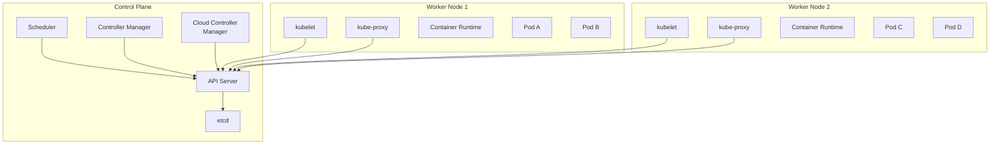
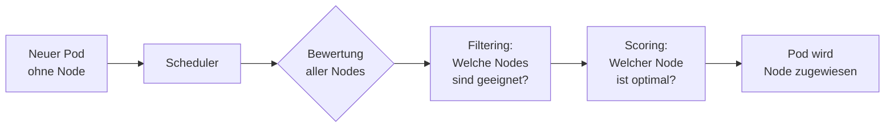

# Kubernetes Architektur

> [!ABSTRACT]
> Ein Kubernetes-Cluster besteht aus einer **Control Plane** (Steuerungsebene) und **Worker Nodes** (Arbeitsknoten). Die Control Plane verwaltet den Cluster-Zustand, während Worker Nodes die eigentlichen Workloads ausführen.

---

## Cluster-Übersicht

Ein Kubernetes-Cluster setzt sich aus zwei Hauptkomponenten zusammen:



---

## Control Plane Komponenten

Die Control Plane ist das „Gehirn" des Clusters. In einem Hochverfügbarkeits-Setup (HA) laufen mehrere Instanzen der Control Plane auf verschiedenen Nodes.

### kube-apiserver

Der **API Server** ist der zentrale Einstiegspunkt für alle Interaktionen mit dem Cluster. Jede Kommunikation — ob von `kubectl`, dem Dashboard oder internen Komponenten — läuft über die REST-API.

| Eigenschaft | Details |
|-------------|---------|
| Funktion | Zentrale API für alle Cluster-Operationen |
| Port | 6443 (HTTPS) |
| Authentifizierung | Zertifikate, Tokens, OIDC |
| Autorisierung | RBAC, ABAC, Webhook |

```bash
# API Server direkt ansprechen
kubectl get --raw /api/v1/namespaces

# API-Ressourcen auflisten
kubectl api-resources
```

### etcd

**etcd** ist ein verteilter Key-Value-Store, der den gesamten Cluster-Zustand speichert. Jede Konfiguration, jeder Pod-Status und jedes Secret wird in etcd persistiert.

> [!WARNING]
> etcd ist die kritischste Komponente im Cluster. Ein Datenverlust in etcd bedeutet den Verlust des gesamten Cluster-Zustands. Regelmäßige Backups sind essentiell.

| Eigenschaft | Details |
|-------------|---------|
| Typ | Verteilter Key-Value-Store |
| Konsistenz | Raft-Konsensus-Algorithmus |
| Port | 2379 (Client), 2380 (Peer) |
| HA | Mindestens 3 Instanzen empfohlen (ungerade Zahl) |

```bash
# etcd Backup erstellen (auf einem Control Plane Node)
ETCDCTL_API=3 etcdctl snapshot save /backup/etcd-snapshot.db \
  --endpoints=https://127.0.0.1:2379 \
  --cacert=/etc/kubernetes/pki/etcd/ca.crt \
  --cert=/etc/kubernetes/pki/etcd/server.crt \
  --key=/etc/kubernetes/pki/etcd/server.key
```

### kube-scheduler

Der **Scheduler** entscheidet, auf welchem Node ein neuer Pod gestartet wird. Dabei berücksichtigt er:

- Ressourcenanforderungen (CPU, RAM)
- Hardware-/Software-Constraints
- Affinität und Anti-Affinität
- Taints und Tolerations
- Datenlokalität



### kube-controller-manager

Der **Controller Manager** führt die Reconciliation Loops aus. Jeder Controller überwacht einen bestimmten Ressourcentyp und stellt sicher, dass der Ist-Zustand dem Soll-Zustand entspricht.

Wichtige Controller:

| Controller | Aufgabe |
|-----------|---------|
| Deployment Controller | Verwaltet ReplicaSets und Rolling Updates |
| ReplicaSet Controller | Stellt sicher, dass die gewünschte Anzahl Pods läuft |
| Node Controller | Überwacht Node-Gesundheit |
| Job Controller | Verwaltet einmalige Aufgaben |
| EndpointSlice Controller | Pflegt Service-Endpunkte |
| ServiceAccount Controller | Erstellt Standard-ServiceAccounts |

### cloud-controller-manager

Der **Cloud Controller Manager** ist optional und nur relevant, wenn Kubernetes bei einem Cloud-Provider (AWS, GCP, Azure) läuft. Er verwaltet cloud-spezifische Ressourcen wie LoadBalancer, Nodes und Storage.

> [!NOTE]
> Bei Self-Hosted-Clustern (Homelab, On-Premise) wird der Cloud Controller Manager in der Regel nicht verwendet. Stattdessen kommen Lösungen wie KubeVIP oder MetalLB zum Einsatz.

---

## Worker Node Komponenten

Worker Nodes führen die eigentlichen Anwendungen in Pods aus. Jeder Worker Node enthält drei essenzielle Komponenten.

### kubelet

Der **kubelet** ist der Agent auf jedem Node, der mit dem API Server kommuniziert. Er ist verantwortlich für:

- Empfang von Pod-Spezifikationen vom API Server
- Starten und Überwachen von Containern über die Container Runtime
- Melden des Node- und Pod-Status an den API Server
- Ausführen von Liveness- und Readiness-Probes

```bash
# kubelet Status prüfen
sudo systemctl status kubelet

# kubelet Logs anzeigen
sudo journalctl -u kubelet -f
```

### kube-proxy

Der **kube-proxy** verwaltet die Netzwerkregeln auf jedem Node. Er stellt sicher, dass Services korrekt auf die zugehörigen Pods weitergeleitet werden.

| Modus | Beschreibung |
|-------|-------------|
| iptables | Standard — setzt iptables-Regeln für Service-Routing |
| IPVS | Performanter — nutzt Linux IPVS für Load Balancing |
| nftables | Modern — nutzt nftables (ab K8s v1.31+) |

### Container Runtime

Die Container Runtime ist die Software, die Container tatsächlich ausführt. Kubernetes unterstützt jede Runtime, die das **Container Runtime Interface (CRI)** implementiert.

| Runtime | Beschreibung |
|---------|-------------|
| **containerd** | Standard-Runtime, leichtgewichtig und stabil |
| **CRI-O** | Speziell für Kubernetes entwickelt, oft in OpenShift |
| ~~Docker Engine~~ | Seit K8s v1.24 nicht mehr direkt unterstützt (dockershim entfernt) |

> [!IMPORTANT]
> K3s verwendet standardmäßig **containerd** als Container Runtime. Der Pfad zum Socket ist `/run/k3s/containerd/containerd.sock`.

---

## Netzwerk-Architektur

Kubernetes setzt ein flaches Netzwerkmodell voraus, bei dem:

1. **Jeder Pod eine eigene IP-Adresse** erhält
2. **Alle Pods sich gegenseitig erreichen** können (ohne NAT)
3. **Alle Nodes alle Pods erreichen** können (ohne NAT)

Diese Anforderungen werden durch ein **CNI-Plugin** (Container Network Interface) erfüllt:

| CNI Plugin | Besonderheiten |
|-----------|---------------|
| **Flannel** | Einfach, Standard bei K3s, VXLAN-basiert |
| **Calico** | Network Policies, BGP-Routing, performant |
| **Cilium** | eBPF-basiert, sehr performant, Service Mesh Fähigkeiten |
| **Weave** | Einfache Installation, verschlüsseltes Overlay |

### DNS im Cluster

**CoreDNS** ist der Standard-DNS-Server in Kubernetes-Clustern. Er ermöglicht Service Discovery über DNS-Namen:

```text
<service-name>.<namespace>.svc.cluster.local

Beispiel: meine-app.default.svc.cluster.local
```

---

## Hochverfügbarkeit (HA)

Für produktive Umgebungen sollte die Control Plane hochverfügbar betrieben werden.

### Stacked etcd (Standard)

etcd läuft auf denselben Nodes wie die Control Plane:

```text
┌─────────────────────────────────┐
│         Load Balancer / VIP     │
└──────────┬──────────┬───────────┘
           │          │
    ┌──────┴──┐ ┌─────┴───┐ ┌─────────┐
    │ CP + etcd│ │CP + etcd│ │CP + etcd│
    │ Node 1   │ │ Node 2  │ │ Node 3  │
    └──────────┘ └─────────┘ └─────────┘
```

### External etcd

etcd läuft auf separaten Nodes — bietet bessere Isolation, aber höheren Aufwand:

```text
┌─────────────────────────────────┐
│         Load Balancer / VIP     │
└──────────┬──────────┬───────────┘
           │          │
    ┌──────┴──┐ ┌─────┴───┐ ┌─────────┐
    │ CP Node 1│ │CP Node 2│ │CP Node 3│
    └──────────┘ └─────────┘ └─────────┘
           │          │          │
    ┌──────┴──┐ ┌─────┴───┐ ┌─────────┐
    │ etcd 1  │ │ etcd 2  │ │ etcd 3  │
    └─────────┘ └─────────┘ └─────────┘
```

> [!TIP]
> Für die meisten Homelab- und kleine Produktionsumgebungen reicht **Stacked etcd** mit 3 Control Plane Nodes. K3s unterstützt diesen Modus mit `--cluster-init`.

---

## Ports und Kommunikation

### Control Plane Ports

| Komponente | Port | Protokoll | Beschreibung |
|-----------|------|-----------|-------------|
| API Server | 6443 | TCP | Kubernetes API |
| etcd | 2379-2380 | TCP | Client und Peer-Kommunikation |
| Scheduler | 10259 | TCP | Health Check |
| Controller Manager | 10257 | TCP | Health Check |

### Worker Node Ports

| Komponente | Port | Protokoll | Beschreibung |
|-----------|------|-----------|-------------|
| kubelet | 10250 | TCP | kubelet API |
| NodePort Services | 30000-32767 | TCP | Externe Service-Ports |

---

## Verwandte Notizen

- [[Was ist Kubernetes]]
- [[Kubernetes vs Docker und Docker Swarm]]
- [[Kubernetes Distributionen]]
- [[K3s Cluster Installation]]
- [[KubeVIP und High Availability]]
