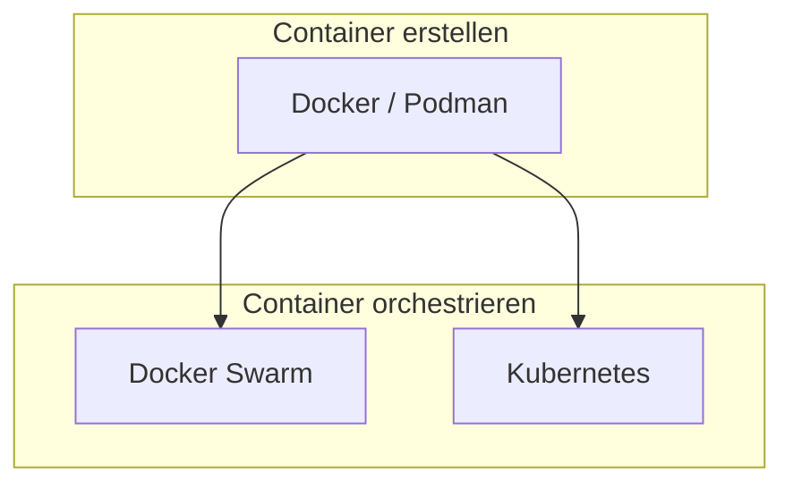

# Kubernetes vs Docker und Docker Swarm

> [!ABSTRACT]
> Docker, Docker Swarm und Kubernetes sind drei verschiedene Technologien im Container-Ökosystem. Docker ist eine Container-Runtime, Docker Swarm ein einfacher Orchestrator und Kubernetes die umfassendste Container-Orchestrierungsplattform.

---

## Überblick

Es ist wichtig zu verstehen, dass Docker und Kubernetes **keine Konkurrenten** sind, sondern sich ergänzen. Docker erstellt Container — Kubernetes orchestriert sie.



---

## Docker — Die Container-Engine

Docker ist eine Plattform zum **Erstellen, Verteilen und Ausführen** von Containern.

### Was Docker macht

| Funktion | Beschreibung |
|----------|-------------|
| **Build** | Container-Images aus Dockerfiles bauen |
| **Ship** | Images über Registries verteilen (Docker Hub, Harbor) |
| **Run** | Container auf einem einzelnen Host starten |

### Docker Compose

Für Multi-Container-Anwendungen auf **einem einzelnen Host** bietet Docker Compose eine einfache YAML-basierte Konfiguration:

```yaml
# docker-compose.yaml
services:
  webapp:
    image: nginx:latest
    ports:
      - "80:80"
  database:
    image: postgres:16
    environment:
      POSTGRES_PASSWORD: geheim
    volumes:
      - db-data:/var/lib/postgresql/data

volumes:
  db-data:
```

> [!NOTE]
> Docker Compose ist ideal für Entwicklungsumgebungen und einzelne Server. Für mehrere Server benötigt man einen Orchestrator wie Docker Swarm oder Kubernetes.

---

## Docker Swarm — Einfache Orchestrierung

Docker Swarm ist Docker's eingebauter Cluster-Modus. Er erweitert Docker um die Fähigkeit, Container über **mehrere Hosts** zu verteilen.

### Architektur

```text
┌──────────────┐  ┌──────────────┐  ┌──────────────┐
│  Manager 1   │  │  Manager 2   │  │  Manager 3   │
│  (Leader)    │  │  (Follower)  │  │  (Follower)  │
└──────┬───────┘  └──────┬───────┘  └──────┬───────┘
       │                 │                 │
┌──────┴───────┐  ┌──────┴───────┐  ┌──────┴───────┐
│  Worker 1    │  │  Worker 2    │  │  Worker 3    │
└──────────────┘  └──────────────┘  └──────────────┘
```

### Stärken von Docker Swarm

- **Einfachheit**: Ein Befehl genügt — `docker swarm init`
- **Docker-nativ**: Gleiche CLI, gleiche Compose-Dateien
- **Schneller Start**: Minimaler Konfigurationsaufwand
- **Geringer Overhead**: Leichtgewichtiger als Kubernetes

### Einschränkungen von Docker Swarm

- **Kein Auto-Scaling**: Manuelle Skalierung nötig
- **Begrenztes Ökosystem**: Wenige Add-ons und Erweiterungen
- **Kein Ingress-Konzept**: Nur einfaches Port-basiertes Routing
- **Eingeschränktes Storage-Management**: Keine PersistentVolumes oder StorageClasses
- **Reduzierte Entwicklung**: Docker fokussiert sich zunehmend auf Kubernetes

---

## Kubernetes — Enterprise-Orchestrierung

Kubernetes bietet die umfassendste Lösung für Container-Orchestrierung mit einem riesigen Ökosystem.

### Stärken von Kubernetes

- **Auto-Scaling**: Horizontal Pod Autoscaler (HPA), Vertical Pod Autoscaler (VPA)
- **Riesiges Ökosystem**: Helm, Ingress Controller, Service Meshes, GitOps
- **Deklaratives Management**: Gewünschter Zustand wird definiert und eingehalten
- **Rolling Updates**: Zero-Downtime Deployments
- **RBAC**: Feingranulare Zugriffskontrolle
- **Namespace-Isolation**: Logische Trennung von Umgebungen
- **Ingress**: HTTP(S)-Routing mit TLS-Termination
- **Persistent Storage**: PV, PVC, StorageClasses mit Dynamic Provisioning

### Einschränkungen von Kubernetes

- **Komplexität**: Steile Lernkurve
- **Ressourcenbedarf**: Mehr CPU und RAM für die Control Plane
- **Wartungsaufwand**: Erfordert Kubernetes-Expertise im Team

---

## Detaillierter Vergleich

### Architektur und Setup

| Aspekt | Docker Compose | Docker Swarm | Kubernetes |
|--------|---------------|-------------|-----------|
| Scope | Einzelner Host | Multi-Host Cluster | Multi-Host Cluster |
| Setup-Zeit | Sekunden | Minuten | Stunden |
| Komplexität | Sehr gering | Gering | Hoch |
| Min. Nodes | 1 | 1 (Manager) | 1 (K3s) / 3 (HA) |
| Control Plane | Docker Daemon | Swarm Manager | API Server + etcd + Scheduler |
| Config-Format | docker-compose.yaml | docker-compose.yaml (Stack) | YAML Manifeste |

### Netzwerk und Routing

| Aspekt | Docker Swarm | Kubernetes |
|--------|-------------|-----------|
| Service Discovery | DNS-basiert | DNS + Environment Variables |
| Load Balancing | Routing Mesh (L4) | Services + Ingress (L4/L7) |
| Ingress | Nicht vorhanden | Ingress Controller (Traefik, NGINX) |
| Network Policies | Nicht vorhanden | Calico, Cilium — feingranulare Regeln |
| TLS-Termination | Manuell (Traefik-Container) | Ingress Controller + Cert-Manager |

### Storage

| Aspekt | Docker Swarm | Kubernetes |
|--------|-------------|-----------|
| Volumes | Docker Volumes, NFS-Mounts | PersistentVolumes, StorageClasses |
| Dynamic Provisioning | Nein | Ja (Longhorn, Ceph, Cloud Provider) |
| Replikation | Manuell | Longhorn, Rook/Ceph |
| Backup | Manuell | Velero, Longhorn Snapshots |

### Skalierung und Updates

| Aspekt | Docker Swarm | Kubernetes |
|--------|-------------|-----------|
| Manuelle Skalierung | `docker service scale` | `kubectl scale` |
| Auto-Scaling | Nicht vorhanden | HPA, VPA, Cluster Autoscaler |
| Rolling Updates | Ja | Ja (konfigurierbar) |
| Rollbacks | Ja | Ja (Revision-basiert) |
| Canary Deployments | Nein | Ja (mit Ingress/Service Mesh) |

### Sicherheit

| Aspekt | Docker Swarm | Kubernetes |
|--------|-------------|-----------|
| Zugriffskontrolle | Docker TLS | RBAC, ABAC, Admission Controller |
| Secrets | Docker Secrets | Kubernetes Secrets (etcd-verschlüsselt) |
| Network Policies | Nein | Ja |
| Pod Security | Nein | Pod Security Standards |
| Audit Logging | Begrenzt | Umfassend |

---

## Wann was einsetzen?

### Docker Compose wählen, wenn

- Einzelner Server oder Entwicklungsumgebung
- Wenige Services (< 10)
- Einfachheit im Vordergrund steht
- Kein HA-Requirement

### Docker Swarm wählen, wenn

- Kleines Team ohne Kubernetes-Expertise
- Einfaches Multi-Host-Setup benötigt wird
- Docker-Tooling bereits im Einsatz
- Moderate Verfügbarkeitsanforderungen

### Kubernetes wählen, wenn

- Microservices-Architektur mit vielen Services
- Auto-Scaling und HA-Requirements
- Mehrere Umgebungen (Dev, Staging, Prod)
- Compliance- und Security-Anforderungen (RBAC, Audit)
- Team mit Kubernetes-Wissen vorhanden oder aufbaubar

> [!TIP]
> Für Homelab-Umgebungen ist **K3s** ein guter Mittelweg: Kubernetes-Funktionalität mit deutlich weniger Komplexität und Ressourcenbedarf als ein vollständiges K8s-Cluster.

---

## Migration von Docker Swarm zu Kubernetes

Wer von Docker Swarm auf Kubernetes migrieren möchte, sollte folgende Schritte beachten:

1. **Images beibehalten** — Container-Images funktionieren in beiden Systemen
2. **Compose → Manifeste** — Docker Compose Dateien in Kubernetes YAML-Manifeste umwandeln (Tools wie `kompose` helfen)
3. **Volumes → PV/PVC** — Docker Volumes durch PersistentVolumeClaims ersetzen
4. **Routing → Ingress** — Port-basiertes Routing durch Ingress-Regeln ersetzen
5. **Secrets migrieren** — Docker Secrets in Kubernetes Secrets überführen

```bash
# Kompose: Docker Compose zu Kubernetes konvertieren
kompose convert -f docker-compose.yaml
```

---

## Verwandte Notizen

- [[Was ist Kubernetes]]
- [[Kubernetes Architektur]]
- [[Kubernetes Distributionen]]
- [[Services]]
- [[Ingress und IngressRoutes]]
