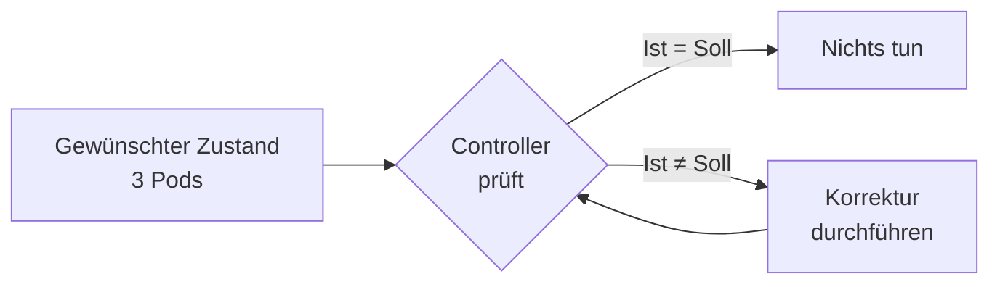

# Was ist Kubernetes

> [!ABSTRACT]
> Kubernetes (K8s) ist eine Open-Source-Plattform zur Automatisierung der Bereitstellung, Skalierung und Verwaltung von containerisierten Anwendungen. Ursprünglich von Google entwickelt und seit 2014 als Open-Source-Projekt unter der CNCF verwaltet.

---

## Herkunft und Geschichte

Kubernetes wurde von Google als Open-Source-Version ihres internen Systems **Borg** entwickelt, das seit über 15 Jahren Container-Workloads in Google's Rechenzentren orchestriert. Der Name „Kubernetes" stammt aus dem Griechischen und bedeutet **Steuermann** oder **Pilot** — passend für ein System, das Container-Flotten steuert.

| Meilenstein | Beschreibung |
|-------------|-------------|
| 2014 | Google veröffentlicht Kubernetes als Open Source |
| 2015 | Kubernetes v1.0 — Übergabe an die CNCF |
| 2018 | Kubernetes wird erstes CNCF „Graduated" Projekt |
| 2024 | 10 Jahre Kubernetes — De-facto-Standard für Container-Orchestrierung |
| 2026 | Aktuelle stabile Version: v1.35 |

Die **Cloud Native Computing Foundation (CNCF)** ist Teil der Linux Foundation und verwaltet Kubernetes zusammen mit einem riesigen Ökosystem an Projekten wie Prometheus, Envoy, Helm und vielen mehr.

---

## Was macht Kubernetes?

Kubernetes löst die Herausforderung, containerisierte Anwendungen **zuverlässig, skalierbar und automatisiert** in Produktion zu betreiben. Es bietet:

### Automatische Bereitstellung (Scheduling)

Kubernetes verteilt Container intelligent auf verfügbare Nodes im Cluster, basierend auf Ressourcenanforderungen (CPU, RAM) und Constraints (Affinität, Tolerations).

### Selbstheilung (Self-Healing)

Wenn ein Container abstürzt, startet Kubernetes ihn automatisch neu. Fällt ein Node aus, werden die Workloads auf gesunde Nodes umverteilt.

```text
Container stürzt ab → Kubernetes erkennt Fehler → Neustart des Containers
Node fällt aus       → Pods werden auf andere Nodes verschoben
```

### Skalierung

Anwendungen können horizontal skaliert werden — entweder manuell oder automatisch basierend auf Metriken wie CPU-Auslastung:

```bash
# Manuelles Skalieren eines Deployments auf 5 Replicas
kubectl scale deployment meine-app --replicas=5

# Autoscaling basierend auf CPU-Auslastung
kubectl autoscale deployment meine-app --min=2 --max=10 --cpu-percent=80
```

### Service Discovery und Load Balancing

Kubernetes weist Containern eigene IP-Adressen zu und stellt DNS-Namen für Services bereit. Der Traffic wird automatisch auf alle verfügbaren Pods verteilt.

### Rolling Updates und Rollbacks

Neue Versionen einer Anwendung können schrittweise ausgerollt werden, ohne Downtime. Bei Problemen kann sofort auf die vorherige Version zurückgerollt werden:

```bash
# Update auf neues Image
kubectl set image deployment/meine-app container=meine-app:v2

# Rollback zur vorherigen Version
kubectl rollout undo deployment/meine-app
```

### Secret- und Konfigurationsmanagement

Sensible Daten wie Passwörter, API-Keys und TLS-Zertifikate werden sicher als Secrets gespeichert und in Container eingebunden, ohne sie im Container-Image zu hinterlegen.

---

## Kernprinzipien

Kubernetes basiert auf mehreren fundamentalen Design-Prinzipien:

### Deklarativer Ansatz

Anstatt imperative Befehle zu geben („starte 3 Container"), beschreibt man den **gewünschten Zustand** (Desired State). Kubernetes sorgt dann kontinuierlich dafür, dass der aktuelle Zustand dem gewünschten entspricht:

```yaml
apiVersion: apps/v1
kind: Deployment
metadata:
  name: meine-app
spec:
  replicas: 3          # Gewünschter Zustand: 3 Pods
  selector:
    matchLabels:
      app: meine-app
  template:
    metadata:
      labels:
        app: meine-app
    spec:
      containers:
        - name: meine-app
          image: meine-app:latest
          ports:
            - containerPort: 8080
```

### Reconciliation Loop

Der **Controller Manager** vergleicht permanent den Ist-Zustand mit dem Soll-Zustand und nimmt bei Abweichungen Korrekturen vor:



### Immutable Infrastructure

Container werden nicht im laufenden Betrieb verändert. Stattdessen wird ein neues Container-Image gebaut und deployed. Das sorgt für Reproduzierbarkeit und Konsistenz.

### API-First

Alles in Kubernetes läuft über eine zentrale REST-API. Tools wie `kubectl`, Dashboards und Automatisierungen kommunizieren alle über dieselbe API.

---

## Wann Kubernetes einsetzen?

Kubernetes bietet enormen Mehrwert, ist aber nicht für jedes Szenario die richtige Wahl.

### Gute Anwendungsfälle

| Szenario | Warum Kubernetes? |
|----------|------------------|
| Microservices-Architektur | Service Discovery, Load Balancing, unabhängiges Deployment |
| Hohe Verfügbarkeit | Self-Healing, Multi-Node, automatisches Failover |
| Automatische Skalierung | HPA/VPA basierend auf Last |
| CI/CD Pipelines | Deklarative Deployments, GitOps-Workflows |
| Multi-Cloud / Hybrid Cloud | Plattformunabhängige Abstraktion |

### Weniger geeignet für

| Szenario | Warum nicht? |
|----------|-------------|
| Einzelne kleine Anwendung | Overhead zu groß — Docker Compose reicht |
| Monolithische Legacy-Apps | Schwer zu containerisieren, wenig Nutzen |
| Kein Ops-Team vorhanden | Kubernetes erfordert Wissen und Wartung |

> [!TIP]
> Für Homelab-Umgebungen und kleinere Setups bietet sich **K3s** als leichtgewichtige Kubernetes-Distribution an. Es benötigt deutlich weniger Ressourcen als ein vollständiges K8s-Cluster.

---

## Ökosystem und CNCF Landscape

Kubernetes steht im Zentrum eines riesigen Ökosystems. Wichtige Projekte aus der CNCF Landscape:

| Kategorie | Projekte |
|-----------|---------|
| Container Runtime | containerd, CRI-O |
| Networking (CNI) | Flannel, Calico, Cilium, Weave |
| Service Mesh | Istio, Linkerd, Consul Connect |
| Monitoring | Prometheus, Grafana, Datadog |
| Logging | Fluentd, Loki, Elasticsearch |
| Package Management | Helm, Kustomize |
| GitOps | ArgoCD, Flux |
| Storage | Longhorn, Rook/Ceph, OpenEBS |
| Ingress | Traefik, NGINX Ingress, HAProxy |
| Security | Falco, OPA/Gatekeeper, Trivy |

---

## Grundlegende Begriffe

| Begriff | Bedeutung |
|---------|-----------|
| **Cluster** | Gesamtheit aller Nodes, die zusammen Kubernetes bilden |
| **Node** | Eine Maschine (physisch oder virtuell) im Cluster |
| **Pod** | Kleinste deploybare Einheit — ein oder mehrere Container |
| **Deployment** | Beschreibt den gewünschten Zustand für Pods |
| **Service** | Stabile Netzwerk-Adresse für eine Gruppe von Pods |
| **Namespace** | Logische Trennung von Ressourcen im Cluster |
| **Ingress** | Regelt externen HTTP(S)-Zugriff auf Services |
| **ConfigMap** | Konfigurationsdaten als Key-Value-Paare |
| **Secret** | Sensible Daten (Passwörter, Tokens, Zertifikate) |
| **PersistentVolume** | Dauerhafter Speicher für Pods |
| **Helm Chart** | Paket-Format für Kubernetes-Anwendungen |

---

## Verwandte Notizen

- [[Kubernetes Index]]
- [[Kubernetes Architektur]]
- [[Kubernetes vs Docker und Docker Swarm]]
- [[Kubernetes Distributionen]]
- [[Was ist Docker]] — Docker als Container-Runtime-Grundlage für Kubernetes
