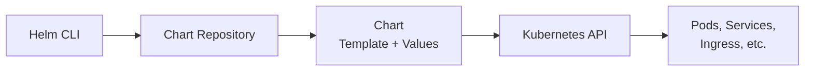

# Helm Package Manager

> [!ABSTRACT]
> Helm ist der Package Manager für Kubernetes. Mit Helm Charts können komplexe Anwendungen mit einem einzigen Befehl installiert, konfiguriert und aktualisiert werden. Statt Dutzende YAML-Manifeste manuell zu verwalten, bündelt ein Chart alles in einem Paket.

---

## Was ist Helm?

Helm löst das Problem, dass Kubernetes-Anwendungen aus vielen einzelnen YAML-Dateien bestehen (Deployment, Service, ConfigMap, Secret, Ingress, etc.). Ein Helm Chart bündelt all diese Manifeste in einem **parametrisierbaren Paket**.



---

## Helm installieren

```bash
# Linux / macOS
curl https://raw.githubusercontent.com/helm/helm/main/scripts/get-helm-3 | bash

# macOS mit Homebrew
brew install helm

# Windows mit Chocolatey
choco install kubernetes-helm

# Version prüfen
helm version
```

---

## Grundlegende Konzepte

| Konzept | Beschreibung |
|---------|-------------|
| **Chart** | Paket mit Templates und Standardwerten |
| **Repository** | Sammlung von Charts (wie ein App Store) |
| **Release** | Eine installierte Instanz eines Charts |
| **Values** | Konfigurationswerte, die Templates füllen |
| **Template** | YAML-Datei mit Go-Template-Platzhaltern |

---

## Chart Repositories

### Repositories verwalten

```bash
# Repository hinzufügen
helm repo add traefik https://helm.traefik.io/traefik
helm repo add jetstack https://charts.jetstack.io
helm repo add longhorn https://charts.longhorn.io
helm repo add portainer https://portainer.github.io/k8s/

# Repositories aktualisieren
helm repo update

# Repositories auflisten
helm repo list

# Repository entfernen
helm repo remove <name>
```

### Charts suchen

```bash
# Im Repository suchen
helm search repo traefik

# Im Artifact Hub suchen (öffentlicher Hub)
helm search hub prometheus
```

---

## Charts installieren

### Einfache Installation

```bash
# Chart installieren
helm install <release-name> <repo>/<chart>

# Beispiel: Traefik installieren
helm install traefik traefik/traefik \
  --namespace traefik \
  --create-namespace
```

### Installation mit Values-Datei

Die Values-Datei überschreibt die Standardwerte des Charts:

```bash
helm install traefik traefik/traefik \
  --namespace traefik \
  --create-namespace \
  --values traefik-values.yaml
```

```yaml
# traefik-values.yaml
globalArguments:
  - "--global.sendanonymoususage=false"
  - "--global.checknewversion=false"

deployment:
  enabled: true
  replicas: 2

ports:
  web:
    expose:
      default: true
    port: 8000
    exposedPort: 80
  websecure:
    expose:
      default: true
    port: 8443
    exposedPort: 443
    tls:
      enabled: true

service:
  type: LoadBalancer
  spec:
    loadBalancerIP: 192.168.178.20
```

### Installation mit --set

Für einzelne Werte kann `--set` statt einer Values-Datei verwendet werden:

```bash
helm install traefik traefik/traefik \
  --set deployment.replicas=2 \
  --set service.type=LoadBalancer
```

### Installation mit bestimmter Version

```bash
helm install cert-manager jetstack/cert-manager \
  --namespace cert-manager \
  --create-namespace \
  --values cert-manager-values.yaml \
  --version v1.16.2
```

---

## Releases verwalten

```bash
# Installierte Releases auflisten
helm list
helm list -A              # Alle Namespaces

# Release-Status anzeigen
helm status traefik -n traefik

# Release-Werte anzeigen
helm get values traefik -n traefik

# Alle generierten Manifeste anzeigen
helm get manifest traefik -n traefik
```

---

## Charts aktualisieren

```bash
# Repositories aktualisieren
helm repo update

# Release upgraden
helm upgrade traefik traefik/traefik \
  --namespace traefik \
  --values traefik-values.yaml

# Install oder Upgrade (idempotent)
helm upgrade --install traefik traefik/traefik \
  --namespace traefik \
  --create-namespace \
  --values traefik-values.yaml
```

> [!TIP]
> `helm upgrade --install` ist der empfohlene Befehl, da er sowohl für die Erstinstallation als auch für Updates funktioniert. Ideal für Automatisierung und CI/CD.

---

## Charts entfernen

```bash
# Release deinstallieren
helm uninstall traefik -n traefik

# Release deinstallieren, aber Historie behalten
helm uninstall traefik -n traefik --keep-history
```

---

## Rollback

```bash
# Revision-Historie anzeigen
helm history traefik -n traefik

# Zur vorherigen Revision zurückrollen
helm rollback traefik -n traefik

# Zu einer bestimmten Revision zurückrollen
helm rollback traefik 2 -n traefik
```

---

## Chart-Werte erkunden

```bash
# Standard-Values eines Charts anzeigen
helm show values traefik/traefik

# In eine Datei speichern und anpassen
helm show values traefik/traefik > traefik-values.yaml

# Alle Chart-Informationen
helm show all traefik/traefik

# Chart README anzeigen
helm show readme traefik/traefik
```

---

## Template-Preview

Vor der Installation das gerenderte YAML prüfen:

```bash
# Generierte Manifeste anzeigen (ohne Installation)
helm template traefik traefik/traefik \
  --namespace traefik \
  --values traefik-values.yaml

# Dry-Run mit dem Cluster (validiert gegen API)
helm install traefik traefik/traefik \
  --namespace traefik \
  --values traefik-values.yaml \
  --dry-run
```

---

## Praxisbeispiele aus dem Cluster

### Cert-Manager installieren

```bash
helm repo add jetstack https://charts.jetstack.io
helm repo update
helm install cert-manager jetstack/cert-manager \
  --namespace cert-manager \
  --create-namespace \
  --values cert-manager-values.yaml \
  --version v1.16.2
```

### Longhorn installieren

```bash
helm repo add longhorn https://charts.longhorn.io
helm repo update
helm install longhorn longhorn/longhorn \
  --namespace longhorn-system \
  --create-namespace \
  --version 1.7.2 \
  --values longhorn-values.yaml
```

### Portainer installieren

```bash
helm repo add portainer https://portainer.github.io/k8s/
helm repo update
helm upgrade --install portainer portainer/portainer \
  --namespace portainer \
  --create-namespace \
  --values portainer-values.yaml
```

---

## Verwandte Notizen

- [[Kubernetes Index]]
- [[Cert-Manager]]
- [[Longhorn]]
- [[Traefik Ingress Controller]]
- [[Portainer]]
