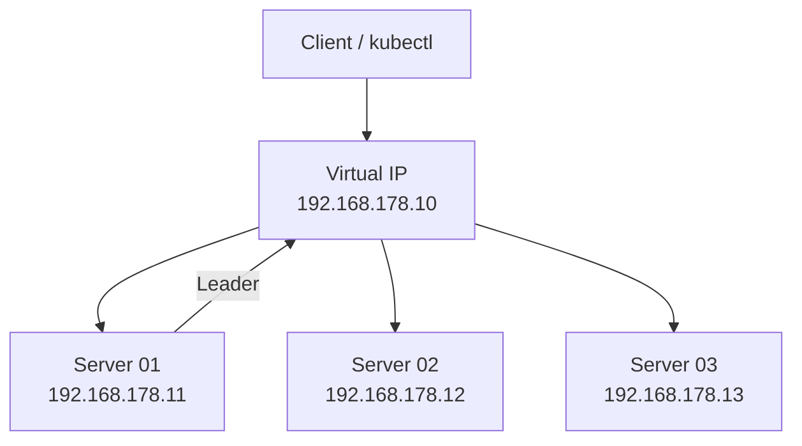

# KubeVIP und High Availability

> [!ABSTRACT]
> KubeVIP stellt eine virtuelle IP-Adresse (VIP) für den Kubernetes API-Server bereit und ermöglicht LoadBalancer-Services in Bare-Metal-Clustern. Zusammen mit einem Multi-Server-Setup sorgt es für echte Hochverfügbarkeit.

---

## Was ist KubeVIP?

KubeVIP ist ein leichtgewichtiger, Kubernetes-nativer Virtual IP Manager. Er löst zwei Probleme in Bare-Metal-Clustern:

1. **Control Plane HA** — Eine floating VIP für den API Server, die bei Server-Ausfall automatisch auf einen anderen Node wechselt
2. **LoadBalancer Services** — Ermöglicht `type: LoadBalancer` Services ohne Cloud-Provider



---

## KubeVIP für K3s installieren

### Schritt 1: RBAC installieren

```bash
kubectl apply -f https://kube-vip.io/manifests/rbac.yaml
```

### Schritt 2: DaemonSet Manifest generieren

```bash
# Variablen setzen
export VIP=192.168.178.10
export INTERFACE=eth0

# Aktuelle Version ermitteln
KVVERSION=$(curl -sL https://api.github.com/repos/kube-vip/kube-vip/releases | jq -r ".[0].name")

# Image herunterladen und Manifest generieren
ctr image pull ghcr.io/kube-vip/kube-vip:$KVVERSION

ctr run --rm --net-host ghcr.io/kube-vip/kube-vip:$KVVERSION vip /kube-vip \
  manifest daemonset \
  --interface $INTERFACE \
  --address $VIP \
  --inCluster \
  --taint \
  --controlplane \
  --services \
  --arp \
  --leaderElection > /var/lib/rancher/k3s/server/manifests/kube-vip.yaml
```

**Parameter erklärt:**

| Parameter | Beschreibung |
|-----------|-------------|
| `--interface` | Netzwerk-Interface für die VIP (z.B. `eth0`) |
| `--address` | Die virtuelle IP-Adresse |
| `--inCluster` | Authentifizierung über ServiceAccount |
| `--taint` | Läuft auch auf Nodes mit Control Plane Taint |
| `--controlplane` | VIP für den API Server bereitstellen |
| `--services` | LoadBalancer-Services unterstützen |
| `--arp` | ARP-basierte VIP (Layer 2) |
| `--leaderElection` | Nur ein Node hält die VIP (Leader Election) |

> [!NOTE]
> Das Manifest wird in `/var/lib/rancher/k3s/server/manifests/` abgelegt. K3s deployed automatisch alle YAML-Dateien aus diesem Verzeichnis.

---

## KubeVIP Cloud Controller

Der Cloud Controller ermöglicht `type: LoadBalancer` Services mit einem definierbaren IP-Bereich:

```bash
# Cloud Controller installieren
kubectl apply -f https://raw.githubusercontent.com/kube-vip/kube-vip-cloud-provider/main/manifest/kube-vip-cloud-controller.yaml

# IP-Bereich für LoadBalancer Services konfigurieren
kubectl create configmap -n kube-system kubevip \
  --from-literal range-global=192.168.178.30-192.168.178.39
```

Danach können Services mit `type: LoadBalancer` eine IP aus diesem Bereich erhalten:

```yaml
apiVersion: v1
kind: Service
metadata:
  name: traefik
  namespace: traefik
spec:
  type: LoadBalancer
  loadBalancerIP: 192.168.178.20    # Optionale feste IP
  ports:
    - name: http
      port: 80
    - name: https
      port: 443
```

---

## Alternative: Keepalived + HAProxy

Für kubeadm-Cluster wird statt KubeVIP oft die Kombination Keepalived + HAProxy eingesetzt.

### Keepalived

Keepalived verwaltet die virtuelle IP über das VRRP-Protokoll:

```text
┌─────────┐     ┌─────────┐     ┌─────────┐
│  LB 01  │     │  LB 02  │     │  LB 03  │
│  MASTER │     │ BACKUP  │     │ BACKUP  │
│ VIP: ✓  │     │ VIP: ✗  │     │ VIP: ✗  │
└─────────┘     └─────────┘     └─────────┘
     │
     ↓ (LB 01 fällt aus)

┌─────────┐     ┌─────────┐     ┌─────────┐
│  LB 01  │     │  LB 02  │     │  LB 03  │
│  DOWN   │     │  MASTER │     │ BACKUP  │
│ VIP: ✗  │     │ VIP: ✓  │     │ VIP: ✗  │
└─────────┘     └─────────┘     └─────────┘
```

### HAProxy

HAProxy verteilt den Traffic auf die Control Plane Nodes:

```text
frontend kubernetes-frontend
  bind *:6443
  mode tcp
  default_backend kubernetes-backend

backend kubernetes-backend
  balance roundrobin
  server cp01 192.168.178.11:6443 check fall 3 rise 2
  server cp02 192.168.178.12:6443 check fall 3 rise 2
  server cp03 192.168.178.13:6443 check fall 3 rise 2
```

---

## KubeVIP vs Keepalived+HAProxy

| Aspekt | KubeVIP | Keepalived + HAProxy |
|--------|---------|---------------------|
| Deployment | In-Cluster (DaemonSet) | Externe Services auf LB-Nodes |
| Zusätzliche Nodes | Nein | Ja (dedizierte LB-Nodes) |
| Setup-Aufwand | Gering | Hoch |
| LoadBalancer Services | Integriert | Nicht enthalten |
| Kubernetes-nativ | Ja | Nein |
| Empfohlen für | K3s, RKE2 | kubeadm |

---

## HA-Voraussetzungen

Für ein hochverfügbares Kubernetes-Cluster:

| Anforderung | Minimum | Empfohlen |
|-------------|---------|-----------|
| Control Plane Nodes | 3 | 3 oder 5 (immer ungerade) |
| etcd-Quorum | 2 von 3 | 3 von 5 |
| LoadBalancer | KubeVIP oder 2+ LB-Nodes | 3+ |
| Worker Nodes | 1 | 3+ |

> [!IMPORTANT]
> Die Anzahl der Control Plane Nodes muss **immer ungerade** sein (3, 5, 7), da etcd den Raft-Konsensus-Algorithmus verwendet und eine Mehrheit (Quorum) benötigt. Bei 3 Nodes kann 1 ausfallen, bei 5 können 2 ausfallen.

---

## Troubleshooting

### VIP reagiert nicht

```bash
# Prüfen ob KubeVIP Pod läuft
kubectl get pods -n kube-system | grep kube-vip

# KubeVIP Logs anzeigen
kubectl logs -n kube-system -l app.kubernetes.io/name=kube-vip-ds

# VIP auf Nodes prüfen
ip addr show eth0 | grep 192.168.178.10
```

### LoadBalancer Service bekommt keine IP

```bash
# ConfigMap prüfen
kubectl get configmap -n kube-system kubevip -o yaml

# Cloud Controller Logs
kubectl logs -n kube-system -l app=kube-vip-cloud-provider
```

---

## Verwandte Notizen

- [[K3s Cluster Installation]]
- [[Kubeadm Multi-Master Cluster]]
- [[Kubernetes Architektur]]
- [[Traefik Ingress Controller]]
